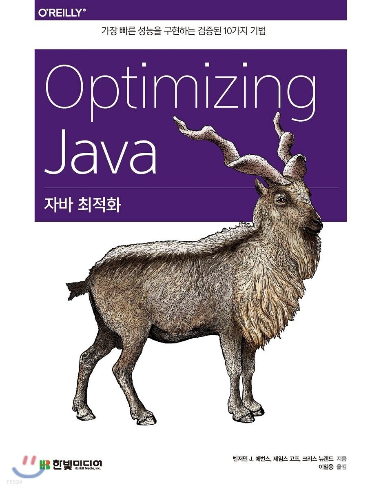

## 성능 테스트 패턴 및 안티패턴

---

성능 테스트는 여러 가지 이유로 수행합니다. 이 장에서는 다양한 종류의 테스트를 소개하고 유형별 베스트 프랙티스를 안내합니다.

뒷부분에서는 성능 테스트에 좋지 않은 영향을 끼치는 몇 가지 일반적인 안티패턴(anipattern)을 열거하고, 이러한 안티패턴이 문제가 되지 않도록 리팩토링하는 방법을 설명합니다.

### 성능 테스트 유형

---

성능 테스트를 나쁜 의도로, 부실하게 수행하는 경우가 많습니다. 원인은 제각각이겠지만 대개 성능 분석의 본질을 이해하지 못한 채 "그래도 뭐라도 하는게 아무것도 안 하는 것보다 낫지 않나"라고 믿기 때문입니다. 그릇된 믿음은 위험한 반쪽짜리 진실일 뿐입니다.

가장 흔히 저지르는 실수는 구체적인 내용을 정하지 않고 뭉뚱그려 "성능 테스트"를 운운하는 겁니다. 시스템에서 수행 가능한 대규모 성능 테스트의 종류는 꽤 많습니다.

> **NOTE\_**좋은 성능 테스트는 정량적(quantitative)입니다. 어떤 질문을 던져도 실험 결과를 토대로 수치화한 답변을 내놓을 수 있어야 합니다.

지금부터 이야기할 성능 테스트는 유형별로 그 목표가 거의 독립적(약간씩 중첩되는 부분도 있지만)입니다. 따라서 어떤 테스트를 하더라도 그 도메인을 심사숙고해야 합니다. 

가장 일반적인 성능 테스트와 종류별 질문 예시를 몇 가지 살펴보겠습니다.

**지연 테스트(Latency Test)**

종단 트랜잭션에 걸리는 시간은?

**처리율 테스트(Throughput Test)**

현재 시스템이 처리 가능한 동시 트랜잭션 개수는?

**부하 테스트(Load Test)**

특정 부하를 시스템이 감당할 수 있는가?

**스트레스 테스트(Stress Test)**

이 시스템의 한계점(breaking poing)은 어디까지인가?

**내구성 테스트(Endurance Test)**

시스템을 장시간 실행할 경우 성능 이상 증상이 나타나는가?

**용량 계획 테스트(Capacity planning Test)**

리소스를 추가한 만큼 시스템이 확장되는가?

**저하 테스트(Degradation)**

시스템이 부분적으로 실패할 경우 어떤 일이 벌어지나?

각각의 테스트 유형을 자세히 살펴보겠습니다.

#### 지연 테스트

지연 테스트(latency test)는 가장 일반적인 성능 테스트입니다. `고객이 트랜잭션(또는 페이지 로딩)을 얼마나 오래 참고 기다려야 하는지` 측정한 시스템 수치는 경영진들이 피부로 느끼는 관심사입니다. 그런데 지연 테스트는 사실 양날의 검입니다. 이 테스트를 통해 답변하려는 질문이 너무 정량적이고 명확한 나머지 다른 종류의 성능 테스트로 밝히려는 정량적 질문을 식별할 필요성마저 흐릿하게 만들 수 있습니다.

> **NOTE\_** 지연을 튜닝하는 목적은 유저 경험을 직접 개선하거나 서비스 수준 [**협약서(service-level-agreement, SLA)**](tistory-418.html#toc-SLA) 조항을 이행하는 것입니다.

그러나 아무리 단순한 케이스라도 지연 테스트에는 조심스럽게 취급해야 할 미묘한 부분이 있습니다. 단순 평균값은 애플리케이션의 요청 응답성을 측정하는 지표로 별로 소용이 없다는 사실도 주의해야 합니다.

#### 처리율 테스트

처리율 테스트(throughput test)도 일반적인 성능 테스트일 것입니다. 어떤 측면에서 처리율은 지연과 동등한 개념이라고 볼 수 있습니다.

지연 테스트를 수행할 때에는 계속 진행중인 동시 트랜잭션을 반드시 명시(그리고 제어)해야 합니다. 

> **NOTE\_** 시스템 지연을 측정할 때에는 반드시 처리율을 어느 정도 수준으로 유지했는지 함께 기술해야 합니다.

마찬가지로, 처리율 역시 지연을 모니터링하면서 테스트합니다. 지연 분포가 갑자기 변하는 시점, 즉 사실상 한계점(변곡점)이 바로 '최대 처리율'입니다. 스트레스 테스트의 목표는 이런 현상이 발생하는 지점과 그 시점의 부하 수준을 포착하는 것입니다.

반면, 처리율 테스트는 시스템 성능이 급락하기 직전, 최대 처리율 수치를 측정하는 것이 목표입니다.

#### 부하 테스트

부하 테스트(load test)는 처리율 테스트(또는 스트레스 테스트)와는 조금 다릅니다. '시스템이 이정도 부하는 견딜 수 있을까, 없을까'하는 예/아니오 질문에 답을 구하는 과정입니다. 가령, 신규 고객을 유치하거나 새로운 시장에 진출하기 전, 애플리케이션 트래픽이 상당할 것으로 예상되는 특정 비즈니스 이벤트(예: 광고 캠페인, 소셜 미디어 이벤트, [바이럴 콘텐츠](tistory-418.html#toc-Viral%20Content))에 대비하기 위해 부하 테스트를 수행합니다.

#### 스트레스 테스트

스트레스 테스트(Stress test)는 시스템 여력이 어느 정도인지 알아보는 수단입니다. 보통 일정한 수준의 트랜잭션, 즉 특정 처리율(현재로서 최대치)을 시스템에 계속 걸어놓습니다. 시간이 갈수록 서서히 동시 트랜잭션이 증가하고 시스템 성능은 저하됩니다.

측정값이 나빠지기 시작하기 직전의 값이 바로 최대 처리율 입니다.

#### 내구도 테스트

메모리 누수(Memory Leak), 캐시 오염(Cache Pollution), [메모리 단편화](tistory-418.html#toc-%EB%A9%94%EB%AA%A8%EB%A6%AC%20%EB%8B%A8%ED%8E%B8%ED%99%94)(Memory fragmentation, CMS 가비지 수집기를 쓰는 애플리케이션은 결국 언제가 CMF가 발생합니다) 등 한참 시간이 지나고 나서야 드러나는 문제점도 있습니다.

대기 이런 종류의 문제는 **내구도 테스트**(Endurance Test(= Soak Test, 흡수 테스트)) 로 감지합니다.

평균(또는 그보다 높은) 사용률로 시스템에 일정 부하를 계속 주며 모니터링하다가 갑자기 리소스가 고갈되거나 시스템이 깨지는 지점을 찾습니다.

내구 테스트는 빠른 응답을 요구하는(지연이 낮은) 시스템에서 많이 합니다. 풀 GC 사이클이 일으키는 STW 시간조차 허용되지 않습니다.

#### 용량 계획 테스트

용량 계획 테스트(Capacity planing test)는 스트레스 테스트와 여러모로 비슷하지만, 분명히 구분되는 차이점이 있습니다. 

스트레스 테스트는 현재 시스템이 어느 정도 부하를 버틸 수 있는지 알아보는 반면, 용량 계획 테스트는 업그레이드한 시스템이 어느 정도 부하를 감당할 수 있을지 미리 내다보는 것입니다.

따라서 어떤 이벤트나 위협 요소에 대응하는 것이 아니라, 예정된 계획의 일부분으로 실행하는 경우가 많습니다.

#### 저하 테스트

저하 테스트(Degradation test)는 부분 실패 테스트(partial failure test)라고도 합니다. 이 책에서 [복원성](tistory-418.html#toc-%EB%B3%B5%EC%9B%90%EC%84%B1)(resilence, 리질리언스)이나 장애 극복(failover) 같은 개념은 일일이 다루지 않습니다. 다만, (은행이나 재무법인처럼) 업무 체계가 잘 잡혀있고 정규화된 환경에서는 대부분 [페일오버](tistory-418.html#toc-%ED%8E%98%EC%9D%BC%EC%98%A4%EB%B2%84) 및 복원 테스트를 아주 꼼꼼하게 기획하며, 매우 엄격한 기준 하에 수행한다는 정도만 알아두면 됩니다.

이 책에서 저하 테스트는 복원 테스트(Resilience test) 하나만 생각하면 됩니다. 저하 테스트는 기본적으로 평상시 운영 환경과 동등한 수준의 부하를 시스템에 가하는 도중, 어떤 컴포넌트나 전체 서비스시스템이 갑자기 능력을 상실하는 시점에 벌어지는 일들을 확인합니다. 예를들어, 애플리케이션 서버 클러스터에서 순간적으로 멤버가 사라지거나, DB 서버에서 RAID 디스크가 빠져버리든지, 네트워크 대역폭이 갑자기 줄어드는 경우를 떠올려볼 수 있습니다.

저하 테스트 도중 눈여겨 봐야 할 측정값은 트랜잭션 지연 분포와 처리율입니다.

부분 실패 테스트 중에는 [카오스 몽키](tistory-418.html#toc-%EC%B9%B4%EC%98%A4%EC%8A%A4%20%EB%AA%BD%ED%82%A4)(Chaos Monkey, 혼돈의 원숭이)라는 하위 유형이 있습니다. 넷플릭스에서 자사 인프라의 견고함을 검증하려고 수행한 프로젝트명으로 유래되었습니다.

카오스 멍키의 요지는, 복원성 있는 아키텍처에는 어느 한 컴포넌트가 잘못돼도 다른 컴포넌트까지 연쇄적으로 무너뜨리면서 전체 시스템에 부정적 영향을 끼치는 일은 없어야 한다는 것입니다.

실제로 운영 환경에 떠 있는 라이브 프로세스를 하나씩 랜덤하게 죽이면서 검증합니다.

카오스 몽키형 시스템을 잘 구축하려면 조직 차원에서 시스템 위생(Hygine), 서비스 설계, [운영 탁월성](tistory-418.html#toc-%EC%9A%B4%EC%98%81%20%ED%83%81%EC%9B%94%EC%84%B1)(Operational Excellence)을 최고 수준으로 확보해야 합니다. 요즘엔 점점 더 많은 기업과 팀들이 열정적으로 관심을 갖는 분야이기도 합니다.

### 기본 베스트 프랙티스

---

성능 튜닝 시 주안점을 두어야 할 부분은 다음 세가지 기본 원칙에 따라 결정합니다.

* 나의 관심사가 무엇인지 식별하고 그 측정 방법을 고민한다.
* 최적화하기 용이한 부분이 아니라, 중요한 부분을 최적화한다.
* 중요한 관심사를 먼저 다룬다.

두 번째 원칙을 반대로 바꿔보면, 쉽게 측정 가능한 양에 큰 의미를 부여하는 실수는 저지르지 말라는 의미입니다. 모든 측정값이 다 비즈니스에 중요한 것은 아닙니다. 하지만 정확하게 측정하기보다 쉽게 측정 가능한 것 위주로 보고서를 작성하려는 유혹에 빠지기 쉽습니다.

#### 하향식 성능

자바 성능을 다루는 엔지니어가 흔히 간과하는 사실이 있습니다. 자바 애플리케이션을 대규모 벤치마킹하는 일이 작은 코드 섹션별로 정확하게 수치를 얻는 것보다 쉽다는 사실입니다. 

> **NOTE\_** 전체 애플리케이션의 성능 양상부터 먼저 알아보는 접근 방식을 **하향식 성능(Top-Down performance)**이라고 합니다.

하향식 성능 접근 방식으로 성과를 극대화하려면, 먼저 테스트팀이 테스트 환경을 구축한 다음, 무엇을 측정하고 무엇을 최적화해야 하는지, 또 성능 활동을 전체 소프트웨어 개발 주기에서 어떻게 병행해야 하는지, 전 팀원이 명확하게 이해해야 합니다.

#### 테스트 환경 구축

테스트 환경 구축은 성능 테스트 팀이 가장 먼저 할 일입니다. 테스트 환경은 가급적 모든 면에서 운영 환경과 똑같이 복제해야 합니다. 애플리케이션 서버뿐만 아니라(CPU 수, OS, 자바 런타임 버전도 동일해야 함) 웹 서버, DB, 로드 밸런서(Load Balancer, 부하 분산기), 네트워크 방화벽 등도 맞추어야 합니다. 운용 중인 각종 서비스(예. 복제하기 곤란하거나 운영 환경과 동등한 부하를 처리하기엔 QA 용량이 녹록치 않은 서드파티 네트워크 서비스)도 성능 테스트 환경에 목업(Mock-up) 형태로 반영돼야 합니다.

편의상 기존 QA 환경을 성능 테스트 환경으로 재활용하거나 시간을 나눠쓰려고 하는 경우도 있습니다. 소규모 환경이나 일회성 테스트라면 큰 문제가 안 되겠지만, 나중에 **관리 오버헤드,** **스케줄링**, **로지스틱스**(Logistics, 물류) 문제가 생길 가능성을 절대 과소평가해선 안됩니다.

> **NOTE\_** 운영 환경과 차이 많이나는 성능 테스트 환경에서는 실제 환경에서 어떤 일들이 일어날지 예측하기 어렵고 쓸모있는 결과를 얻지 못할 가능성이 있습니다.

종래(즉, 논클라우드) 환경에서는 운영 환경과 유사한 성능 테스트 환경을 구축하기가 비교적 수월했습니다. 운영 환경에서 가동 중인 기계 수만큼 구매해서 정확히 운영 환경과 똑같이 설정만 해주면 됬었습니다.

성능 테스트 인프라 구축 비용을 탐탁지 않게 바라보는 경영진도 있습니다. 이는 사실상 **허위 절약**(False Economy, 겉으로 절약하는 것 같지만 결과적으로 더 많이 소비하는 것)인 경우가 많지만, 아쉽게도 서비스 중단으로 치러야 할 대가를 올바르게 인식하지 못한 회사가 아직도 많습니다. 그러다 보니 운영 환경이 반영되지 않은 QA 환경에서 성능 테스트하는 리스크가 얼마나 큰지는 모른 채, 성능 테스트 환경을 대충 만들어서라도 비용을 아끼는 게 더 중요하다고 믿는 경향이 있습니다.

최근에는 클라우드 기술의 출현으로 기존 판도가 많이 바뀌었습니다. 주문형(On-Demand) 및 자동 확장 인프라 기술이 발전해서 이제는 '서버를 사고, 네트워크 다이어그램을 그리고, 소프트웨어를 하드웨어에 배포하는' 공식에 안 맞는 아키텍처가 증가하는 추세입니다. 서버 인프라를 '반려동물이 아닌 가축(LiveStock, not Pets)으로 바라보는 데브옵스 문화가 확산되면서 인프라를 보다 동적으로 관리하는 방식이 더 각광받기 시작했습니다.

그래서 운영 환경과 유사한 성능 테스트 환경 구축이 더 버겁게 느껴질 수 있지만, 사용하지 않는 때는 테스트 환경을 간편하게 꺼둘 수 있다는 장점도 있습니다. 그만큼 프로젝트 비요을 상당 부분 절약할 수 있겠지만, 예정대로 테스트 환경을 시작/종료하는 프로세스는 수립해야 합니다.

#### 성능 요건 식별

3.5절에서 전체 시스템 성능은 애플리케이션 코드뿐만 아니라 컨테이너, OS, 하드웨어 모두 나름대로 영향을 끼친다고 했습니다.

성능을 평가하는 지표는 코드 관점에서만 생각해서도 안 되고, 시스템을 전체적으로 바로보며 고객과 경영진에게 중요한 측정값을 고려해야 합니다. 이렇게 최적화하려는 핵심 지표를 **성능 비기능 요건(NonFunctional Requirement, NFR)**이라고 합니다.

어떤 목표는 아주 명확합니다.

* 95% 백분율(percentile) 트랜잭션 시간을 100밀리초 줄인다.
* 기존 하드웨어 처리율을 5배 높일 수 있게 개선한다.
* 평균 응답 시간을 30% 줄인다.

조금 모호한 목표가 있습니다.

* 일반 고객을 서비스하는 리소스 비용을 50% 줄인다.
* 애플리케이션 클러스터 성능이 50% 떨어져도 시스템이 응답 목표를 25% 이내로 유지한다.
* 고객 `이탈률(drop-off rate)`을 25밀리초 지연당 25% 낮춘다.

이해관계자들이 한 데 모여 측정 대상과 목표를 허심탄회하게 논의하는 자리가 필요합니다. 성능 활동 개시 미팅(kick-off meeting) 일부로 진행하는 편이 좋습니다.

#### 자바에 특정한 이슈

성능 분석이라는 과학은 최신 소프트웨어 시스템의 어디에도 적용할 수 있습니다. 하지만, JVM에는 성능 엔지니어가 잘 이해하고 주의 깊에 살펴야 할 복잡 미묘한 부분들이 존재합니다. 메모리 영역의 동적 튜닝 등 JVM 특유의 다이내믹한 자기 관리 기능이 추가되면서 복잡해진 까닭입니다.

특히, JIT 컴파일은 중요한 부분이라서 유심히 잘 살펴봐야 합니다. 최신 JVM은 어떤 메서드를 JIT 컴파일해서 최적화한 기계어로 변환할지 분석합니다. JIT 컴파일 안 하기로 결정된 메서드는 다음 둘 중 하나입니다.

* JIT 컴파일할 정도로 자주 실행되는 메서드가 아닌 경우
* 메서드가 너무 크고 복잡해서 도저히 컴파일 분석을 할 수 없는 경우

첫 번째 경우보다 두 번째 경우가 훨씬 드문 편이지만, 어쨌든 JVM 기반 어플리케이션에서 성능 활동을 시작하는 첫 단추는, 어떤 메서드가 컴파일 중인지 로그를 남겨 살피고 핵심 코드 경로상의 중요 메서드가 잘 컴파일되고 있는지 확인하는 것입니다.

#### SDLC 일부로 성능 테스트 수행하기

성능 테스트는 그냥 생각날 때 한번 실행하는 게 낫다고 말하는 사람들이 있습니다. 그러나 일류 회사, 수준 높은 팀일수록 성능 테스트를 전체 SDLC(Softwrare Development LifeCycle, 소프트웨어 개발 생명 주기)의 일부로서 수행하며, 특히 성능 회귀 테스트(Performance regression testing)를 상시 수행하는 편입니다.

그렇게 하려면 개발팀, 인프라팀이 서로 조율해서 어느 시점에 몇 버전 코드를 성능 테스트 환경에 배포할지 조정해야 합니다. 전용 테스트 환경이 없다면 사실상 불가능한 일입니다.

### 성능 안티패턴 개요

---

안티패턴(antipattern)은 사람들이 수많은 프로젝트를 수행하면서 밝혀낸, 소프트웨어 프로젝트 또는 팀의 좋지 않은 패턴입니다. 발생 빈도가 늘어나면서 이러저러한 근본 요인 때문에 안 좋은 방향으로 흘러가는구나 하고 결론을 내린(또는 의심하는) 것입니다. 처음엔 뭐가 좋지 않은지 명확하지 않지만 일단 뭔가 조치를 취하긴 해야할 것 같은 안티패턴도 있고, 시간이 지나면서 서서히 축적된 나쁜 프로젝트 관행의 결과물도 있습니다.

사회적 제약이나 팀 여건이 녹록지 않거나, 평소 그릇된 관리 기법을 적용해서, 또는 그냥 사람(개발자)이기 때문에 어쩔 수 없는 경우도 있습니다. 그래서 필자는 모두가 원치 않는 패턴을 분류하고 유형화함으로써, 팀원들이 서로 소통하며 가능하면 안티패턴을 제거할 수 있도록 '패턴 언어(Pattern Language)'를 개발했습니다.

성능 튜닝은 항상 초기 기획 단계부터 구체적으로 목표를 정해놓고 시작하는 목표 지향형 프로세스로 접근해야 합니다 .물론 말보다 행동이 어렵습니다. 팀이 심한 일정 압박을 받고 있거나 상식적으로 일 처리가 되지 않는 환경이라면 중도 실패할 가능성이 큽니다.

신규 서비스를 오픈하거나 새로운 기능을 오픈할 때 예기치 않은 사고가 발생했던 경험이 한두 번씩 있으실 것입니다. 그런 문제가 유저 **인수 테스트(User Aceeptance Testing, UAT)** 도중 발견되면 그나마 다행이지만, 대개 실제 운영 환경에서 사고가 터지기 일쑤입니다. 팀원들은 병목(Bottleneck)이 발생한 원인을 찾아 해결하고자 일제히 달려듭니다. 일이 이 지경에 이른 건, 성능 테스트를 한번도 안 했거나 팀에 닌자가 나타나 온갖 추정만 해놓고 말없이 사라져버렸기 때문입니다.

평소 우수한 성능 테스트 관례를 다르고 팀원 간에 활발하고 이성적인 대화를 나누는 팀보다 이런 식으로 일하는 팀이 안티패턴의 제물이 되기 쉽습니다. 개발 이슈가 대부분 그렇지만, 기술적인 측면보다 의외로 의사소통 문제 같은 인적 요소가 원인이 될 때가 많스니다.

캐리 플리첼(Carey Flichel)은 "왜 개발자는 잘못된 기술 선택은 밥 먹듯이 하나([Why Developers Keep Making Bad Technology Choice](https://dzone.com/articles/why-developers-keep-making-bad))"라는 제목의 블 로그 게시글에서 그 원인을 다섯 가지로 분류했습니다. 

#### 지루함

개발자는 대부분 자기 역할에 지루함을 느끼고 뭔가 새롭고 도전적인 일을 찾아 같은 회사 또는 아예 다른 곳으로 떠날 궁리를 하는 사람도 있습니다. 하지만 사내에 딱히 마땅한 기회가 없거나 다른 회사로 이직하는 게 여의치 않을 때도 있습니다.

물론 지루한 일상을 잘 참고 견딜 뿐만 아니라 외려 더 쉽고 편한 삶을 추구하는 개발자도 있습니다. 개발자의 지루함은 프로젝트에 여러 가지로 해악을 끼칠 수 있습니다. 일례로, Collections.sort() 한줄이면 될 것을 직접 정렬 알고리즘을 구현해 필요 이상으로 복잡하게 코딩하는 개발자가 있습니다. 지금껏 알려지지 않은 기술로 컴포넌트를 제작하거나, 맞지도 않은 유스케이스(Use case, 사용 사례)에 억지로 기술을 욱여넣는 등 여러 가지 방법으로 지루함을 표출하기도 합니다.

#### 이력서 부풀리기

지룸함 때문에 기술을 과용하는 개발자가 있는 반면, 본인의 이력서(Resume, Cover Letter)를 과대 포장할 구실을 찾는 개발자도 있습니다. 구직 시장에 다시 뛰어들 즈음, 어떻게 하면 자기 연봉과 몸값을 높일 수 있을까 골몰하는 것입니다. 잘 굴러가는 팀치고 이런 생각을 하는 팀원이 한 사람도 없는 경우는 드물겠지만, 어쨌든 프로젝트를 불필요한 방향으로 끌고 가는 선택의 발단이 될 수 있습니다.

개발자의 지루함, 이력서 부풀리기 탓에 불필요한 기술을 자꾸 덧댄 결과는, 기존에 개발자가 더 좋은 회사로 이직한 후 아주 오랫동안(심지어 수년 동안) 시스템에 지대한 영향을 미치게 될 것입니다.

#### 또래 압박

팀원들이 기술을 결정할 때 관심사를 분명히 밝히지 않고, 서로 충분한 논의 없이 진행하면 쓰디쓴 결과를 맛보기 쉽습니다. 가령, 선배 앞에서 가급적 실수 안 하려는(가면 증후군, imposter syndrome) 신입 개발자, 특정 주제를 자기가 잘 모른다는 사실을 두려워하는 개발자가 있습니다. 경쟁심이 불타오르는 팀 분위기 속에서 개발이 광속으로 진행되는 듯 보이고자 제대로 사정을 따져보지도 않고 섣불리 중요한 결정을 내리는 것도 또래 압박(Peer pressure)의 아주 고약한 형태입니다.

#### 이해 부족

지금 사용하는 툴의 기능도 온전히 알지 못하는데 무턱대고 새로운 툴로 문제를 해결하려는 개발자가 있습니다. 새로 나온 멋진 기술이 어떤 태스크를 수행할 때 아주 좋다는 소문이 퍼지면 사람 마음이란 게 기울어지게 되기 마련입니다. 하지만 기술 복잡도를 높이는 것과 현재 툴로도 할 수 있는 것 사이의 균형을 잘 맞추어야 합니다.

예를 들어, 하이버네이트(Hibernate)는 도메인 객체 ↔ DB 객체 변환을 단순화하는 절호의 방법처럼 보입니다. 하이버네이트를 수박 겉핥기 식으로 아는 개발자는 다른 프로젝트에서도 하이버네티으를 쓰더라, 하는 경험담을 들려주며 이 기술이 적합하다고 쉽게 단정합니다.

이처럼 이해가 부족한 상태에서는 하이버네이트를 너부 복잡하게 사용하게 되고 결국 운영 단계에서 회복 불가한 중단 사태를 맞이할 수도 있습니다. 데이터 계층을 전부 간단한 JDBC 호출로 바꾸면 개발자는 자신이 익숙한 분야라서 유연하게 대처할 수 있습니다.

#### 오해와 있지도 않은 문제

문제 자체가 무엇인지 제대로 이해하지 못한 채 오로지 기술을 이용해서 문제를 해결하려는 개발자도 있습니다. 설령 그렇게 해서 성공한들, 성능 수치를 측정도 안 해보고 어떻게 성공을 장담할 수 있을까요? 성능 지표를 수집/분석해야만 비로소 문제의 본질을 이해할 수 있습니다.

안티 패턴을 에방하려면 팀원 모두 참여해서 기술 이슈를 활발히 공유하는 분위기를 적극 장려해야 합니다 .아직도 뭔가 불분명하다 싶으면 먼저 사실에 근거한 증거를 수집하고 프로토타입을 만들어 조사합니다. 그래야 팀이 올바른 방향으로 나아갈 수 있게됩니다. 최신 기술이 아무리 좋아 보여도 프로토타입을 만들어 보니 기대에 미치지 못하면 보다 정확한 정보를 근거로 팀 결정을 내리는데 도움이 될 것입니다.

### 성능 안티패턴 카탈로그

---

성능 안티패턴을 유형별로 간략히 소개합니다. 여기 나열한 안티패턴이 많아보여도 사실 빙산의 일각일 것입니다.

#### 화려함에 사로잡히다.

**증상**

일단 최신의 멋진 기술을 튜닝 타깃으로 정합니다. 레거시 코드를 파헤치느니 신기술의 작동 원리를 연구하는 게 더 재미있고, 또 아무래도 최신 기술이 더 멋진 코드로 구현되었고 관라하기 쉽습니다. 그리하여 개발자는 새로 나온 애플리케이션 컴포넌트를 찾아 헤매는 강박에 사로잡히게 됩니다.

**흔히 하는 말**

처음이라 말썽이 많군. 뭐가 문제인지 원인을 밝혀야 해.

**현실**

* 애플리케이션을 측정하고 튜닝하려고 하지 않고 그냥 어떻게 해보면 되겠지하고 생각합니다.
* 개발자는 신기술을 제대로 알지 못한 상태에서 문서도 보지 않고 어설프게 지레짐작만 하는데 실제로 다른 문제가 불거지기 일쑤입니다.
* 신기술에 관한 온라인 예제는 보통 작은 규모의 전형적인 데이터셋을 다룹니다. 기업 규모로 확장하는 데 필요한 베스트 프랙티스는 일언반구 말도 없습니다.

**진단**

안티패턴은 신생팀이나 숙련도가 떨어지는 팀에서 흔합니다. 자신의 능력을 증명하려는 욕구, 레거시 시스템이라고 간주한 것에 매이지 않으려는 마음으로 오로지 최신의 `뜨고 있는` 기술을 숭배합니다. 그런데 마침 그들이 새 직장에서 고액의 연봉을 받기 딱 좋은 그런 종류의 기술인 경우가 많습니다.

따라서 어떤 성능 이슈가 발생하든 무작정 최신 기술을 찾아보겠노라 마음속 깊은 잠재의식에서 결론을 내립니다. 본인이 잘 모르면 다른 사람에게 자문을 구하는 게 낫지 않을까요??

**처방**

* 측정을 해보고 진짜 성능 병목점을 찾으세요.
* 새 컴포넌트는 전후로 충분한 로그를 남기세요.
* 베스트 프랙티스 및 단순화한 데모를 참조하세요.
* 팀원들이 새 기술을 이해하도록 독려하고 팀 차원의 베스트 프랙티스 수준을 정하세요.

#### **단순함에 사로잡히다**

**증상**

전체적으로 애플리케이션을 프로파일링해서 객관적으로 아픈 부위를 들추려 하지 않고 무작정 시스템에서 제일 간단한 부분만 파고듭니다. 원래 처음 개발한 마법사만 편집 가능한 아주 '전문적인' 부분도 있을 것입니다.

**흔히 하는 말**

우리가 알고 있는 부분부터 한번 파봅시다.

그건 OO가 개발했는데, 그 사람 휴가 갔습니다. OO이 돌오면 성능 봐달라고 하고 그때까지 기다리죠?

**현실**

* 원개발자는 그 시스템 파트를(혹은 해당 파트만?) 어떻게 튜닝해야 할지 압니다.
* 다양한 시스템 컴포넌트에 대해 지식 공유를 하지 않고 짝 프로그래밍(pair programing)을 안 한 결과, 독보적인 전문가만 양산됩니다.

**진단**

이전 절의 '화려함에 사로잡히다' 패턴과는 반대로 시스템을 정상 가동시키는 일이 주임무인, 체계가 잘 잡힌 유지보수 팀에서 흔히 나타나는 안티패턴입니다. 애플리케이션에 실기술을 적용하여 새로 병합할 경우, 팀원들은 자레 겁먹고 가급적 새 시스템을 안 맡으려고 합니다.

이런 분위기에서 개발자는 시스템에서 자기가 익숙한 부분만 프로파일링하는 게 더 속편합니다. 포근한 울타리를 벗어나지 않고도 원하는 결과를 운 좋게 얻게 되기를 간절히 바랄 것입니다.

'~에 사로잡히다' 두 안티패턴 모두 미지의 세계에 대한 인간의 반응이라는 점에서 비슷합니다. '화려함에 사로잡히다'는 더 배우고 더유리한 고지를 차지하려는 개발자(또는 팀)의 욕망이 공격적인 형태로 드러나며, '단순함에 사로잡히다'는 행여 긁어 부스럼 만들지 모를 신기술에 관여하느니 익숙한 것만 갖고 놀겠다는 방어 태세입니다.

**처방**

* 측정을 해보고 진짜 성능 병목점을 찾으세요.
* 본인이 익숙지 않은 컴포넌트에 문제가 생기면 잘 아는 전문가에게 도움을 청하세요.
* 개발자에게 전체 시스템 컴포넌트를 고루 이해하도록 독려하세요.

#### 성능 튜닝 도사

**증상**

서비스 중 발생한 성능 문제를 해결하려고 안간힘을 쓰던 중, 한 팀원이 웹사이트에서 '마법'의 설정 매개변수를 발견합니다. 인터넷에 글 쓴 사람이 성능이 향상된다고 장담했으니 테스트도 안 해보고 곧장 마법의 매개변수를 운영 서버에 적용하는데...

**흔히 하는말**

스택 오버플로(Stack Overflow)에 이런 멋진 팁이 있더라고. 이제 다 끝났어

**현실**

* 개발자는 성능 팁의 전후 맥락이나 기초를 모르고 그 팁이 진짜 어떤 영향을 미칠지 모릅니다.
* 어떤 시스템에선 통했을지 모르지만 다른 시스템에 적용해도 효혐이 있을지는 모를 일입니다. 실제로 더 나빠질 수도 있습니다.

**진단**

성능 팁은 잘 알려진 문제의 해결 방법을 찾는 과정으로, 유통 기한이 짧아 금세 낡은 유물이 되기 쉽습니다. 나중에 소프트웨어/플랫폼이 업데이트되고 누군가 새로운 해결책을 찾아내면 (잘해야) 무용지물이 될 것입니다.

생뚱맞고 추상적인 말들로 가득한 관리자 메뉴얼은 나쁜 성능 조언의 전형적인 근원입니다. 업체가 소송에 휘말리면 변화사들은 이 모호한 조언이 '권고 설정'일 뿐이라고 주장할 것입니다.

자바 성능은 오만 가지 잡다한 요인이 영향을 미치는 맥락에서 발생합니다. 자바는 실행 환경이 복잡하기 때문에 전후 매락을 벗겨낸 나머지만 갖고는 거의 추론할 수가 없습니다.

> **NOTE\_** 자바는 계속 진화하는 플랫폼이라서 어느 버전에서 성능 문제를 해결한 매개변수가 다른 버전에서는 안 통할 수 있습니다.

가령, 가비지 수집 알고리즘 제어 스위치는 버전마다 달라서, 구형 VM(6.7 버전)에서 잘 작동했던 스위치가 현재 버전(8 버전)에선 아무 쓸모 없는 경우도 있습니다. 7버전에서는 잘써왔지만 9 버전에 쓰면 VM이 시작조차 안 되는 스위치도 있습니다.

한 두 글자 바뀌는 설정값이라도 조심해서 관리하지 않으면 운영계에서 큰 사고가 터질 수 있습니다.

**처방**

* 시스템의 가장 중요한 부분에 직접 영향을 미치는 기술은 확실히 파악하고 충분히 검증된 것들만 적용하세요.
* 매개변수를 UAT에서 시험해보세요. 어떤 변화라도 철저히 검증하고 효용을 프로파일링하는 일이 중요합니다.
* 다른 개발자나 운영 요원, 데브옵스팀과 함께 설정 문제를 리뷰하고 토의합니다.

#### **안되면 조상 탓**

**증상**

정작 이슈와는 아무 상관도 없는 특정 컴포넌트를 문제 삼습니다.

글쓴이는 시스템 오픈 전날, UAT에서 대규모 중단 사태를 경험한 적이 있습니다. 코드가 어떤 경로를 거쳐 실행되다 중앙 DB 테이블 하나에 락이 걸려버렸습니다. 해당 코드는 에러를 내뿜고 락은 계속 걸린 상태로 애플리케이션은 사실상 멎었습니다. 결국 서버를 다시 부팅했습니다. 사람들은 약속이나 한 듯 데이터 액세스 계층에 사용한 하이버네이트가 원이라고 비난했지만, 자세히 확인해보니 타임아웃 예외를 붙잡은 catch 블록에 DB 커넥션을 정리하는 코드를 안 넣은 게 진짜 원이었습니다. 개발자가 하이버네이트 비난을 멈추고 정말 버그를 일으킨 자신들의 코드를 직시하기까지 꼬박 하루가 걸렸다고 합니다.

**흔히 하는 말**

JMS, 하이버네이트, 그 머시기 라이브러리가 항상 문제라니깐?

**현실**

* 충분히 분석도 안 해보고 성급한 결론을 내립니다.
* 평소 의심했던 범인을 수사 과정의 유일한 용의자로 지목합니다.
* 진짜 원인을 밝히려면 숲을 봐야 하는 데 팀원들은 그럴 마음이 없습니다.

**진단**

경영진, 영업팀에서 종종 나타나는 안티패턴입니다. 기술 스택을 잘 모르는 사람들은 대부분 인지편향(Cognitive bias)을 갖고 있어서 어떤 패턴에 대충 맞춰 진행합니다. 물론 엔지니어는 그들의 이런 습성에 전혀 면역력이 없습니다.

비난의 대사으로 낙인찍힌 것들 이외의 코드 베이스나 라이브러리를 잘 모르는 엔지니어는 이 안티패턴의 제물이 되기 쉽습니다. 아무래도 뭔가 새로 조사하는 것보다는 보통 문제를 많이 일으키는 곳을 지목하는 게 속 편합니다. 이런 현상을 팀 전체가 매너리즘에 빠졌다는 신호라서 머지않아 갖가지 운영 이슈가 불거질 것입니다.

하이버네티으가 아주 좋은 사레입니다. 정확히 설정해서 사용하지 않는 경우가 참 많습니다. 과거 하이버네이트로 골탕먹은 경험이 있는 팀은 일단 이 기술을 싸잡아 비난합니다. 하지만 하부 쿼리 문제, 부적정한 인덱스 사용, 물리적 DB 접속 문제, 객체 매핑 계층 등 문제는 다른 곳에 있을 가능성이 큽니다. 따라서 정확한 원인을 밝히려면 프로파일링이 필수입니다.

**처방**

* 성급한 결론을 내리고픈 욕망에 굴하지 마세요.
* 정상적으로 분석을 하세요.
* 분석 결과를 (문제를 일으킨 원인을 구체화하기 위해) 모든 이해관계자와 의논하세요.

#### **숲을 못 보고 나무만 본다.**

**증상**

전체적인 변경 영향도를 완전히 파악하지 않은 채 일단 그냥 변경을 해보거나 애플리케이션의 국소적인 부분만 프로파일링합니다. 엔지니어는 JVM 스위치를 바꿔보며 조금이라도 성능을 올리려고 하지만, 그마저도 사내 다른 애플리케이션의 선례나 에제 코드를 따라 합니다.

또 마이크로벤치마킹(microbenchmarking) 기법으로 일부 애플리케이션 파트를 프로파일링해보려고 합니다.

**흔히 하는 말**

이 설정만 바꾸면 성능이 좀 나아질 거야.

그냥 메서드 디스패치 시간을 줄일 수 있으면...

**현실**

* 변경 영향도를 완전히 이해한 사람이 아무도 없습니다.
* 새로 바꾼 JVM 설정값 하에서 애플리케이션을 완전히 프로파일링하지 않았습니다.
* 마이크로벤치마킹 때문에 빚어질 전체 시스템 영향도를 파악하지 않습니다

**진단**

JVM은 그 수이치만 수백 개에 달합니다. 그만큼 런타임을 자유자재로 설정할 수 있지만, 모든 설정값을 저눕 활용하고픈 욕구를 불러일으킬 수 있습니다. 하지만 JVM의 디폴트 설정값과 자기관리 능력만으로도 충분하기 때문에 괜히 긁어 부스럼 나들 때가 많습니다. 또 예기치 않게 스위치끼리 간섭을 일으키는 경우도 있는데, 겉으로 잘 드러나지 않는 변화가 사실 더 위험합니다. 같은 회사에서 만든 애플리케이션조차도 운영 및 프로파일링하는 방식은 완전히 다를 수 있으므로 보통 권장하는 설정값을 시도해보는게 중요합니다.

성능 튜닝을 통계를 내는 활동이라서 특정 실행 맥락에 크게 좌우됩니다. 따라서 일반적으로 큰 시스템이 작은 시스템보다 벤치마킹하기 더 쉽습니다. 큰 시스템은 엔지니어의 바람대로 큰 수의 법칙(The law of large numbers)이 개별 이벤트를 왜곡하는 플랫폼 효과를 바로잡는데 유리합니다.

이와 달리, 시스템의 한 단면에 집중하면 플랫폼(적어도 자바/C#는)을 구성하는 복잡한 환경의 서브시스템(예. 스레딩, GC, 스케줄링, JIT 컴파일)을 제각기 풀어내야 합니다. 이 작업은 정말 극도로 어려울뿐더러 통계치를 다루는 일도 민감하고 소프트웨어 엔지니어가 많이 해본다고 거저 얻어지는 기술 역량(Skillset)도 아닙니다. 그러다 보니 시스템 양상을 정확하게 반영하지 못한 숫자만 나오기 쉽고 어리석은 엔지니어는 자신이 벤치마크한 결과를 액면 그대로 받아들이는 것입니다.

인간의 선입과과 맞물려 실제 있지도 않은 패턴을 존재하는 것처럼 바라보는 안타까운 일이 반복됩니다. 결국, 성능 엔지니어는 그릇된 통계치와 부실하게 제어한 결과에 현혹된 나머지, 다른 동료들이 반박하지 못하게 사력을 다해 자신의 성능 벤치마크/효과를 방어하는 광격이 펼쳐집니다.

두 가지 사실을 간과해선 안됩니다.

1. 운영계를 그대로 모사한 UAT 환경 없이 최적화의 효용성을 판단하기는 어렵습니다.
2. 부하가 높을 때만 도움이 되고 평소에는 외려 성능을 떨어뜨리는 최적화는 아무 의미가 없습니다.

평상시 서비스 이용 실태를 나타내면서도 부하 집중 시 유의미한 테스트를 제공하는 데이터를 얻기란 결코 쉽지 않습니다.

**처방**

운영계에서 스위치를 변경하기 전 다음 절차를 따르세요.

1. 운영계 성능 지표를 측정합니다.
2. UAT에서 한번에 스위치 하나씩 변경합니다
3. 스트레스를 받는 지점이 UAT와 운영계가 도일한지 확인합니다.
4. 운영계에서 일반적인 부하를 나타내는 테스트 데이터를 확보합니다.
5. UAT에서 스위치를 변경하며 테스트합니다.
6. UAT에서 다시 테스트합니다.
7. 여러분이 추론한 내용을 다른 사람에게 재검토 요청합니다.
8. 여러분이 내린 결론을 다른 사람과 공유합니다.

#### **내 데스크톱이 UAT**

**증상**

UAT 환경이 운영계 환경과 전혀 다른 경우도 많습니다. 개발자는 그 차이점을 예상하거나 완전히 이해하지 못한 채 저성능(low-powered) 데스크톱에서 고성능(high-powered) 운영 서버로 서비스할 코드를 작성합니다. 그러나 개발자 개인 장비는 대부분 운영계에서 배포되는 작은 서버보다 성능이 더 좋습니다. 저성능 마이크로 환경은 보통 별문제가 안 되므로 개발자에게 하나씩 가상화해서 지급할 때가 맣지만, 개발자 장비보다 코어 수가 훨씬 많고 대용량 RAM에 비싼 I/O 장비가 탑재되는 고성능 운영계 장비에선 문제가 됩니다.

**흔히 하는 말**

UAT 환경을 완벽히 갖추려면 돈이 너무 많이 들어...

**현실**

* UAT 환경이 운영계와 달라서 서비스 중단되는 사태가 벌어지면 장비 몇 대 더 추가되는 비용보다 훨씬 더 값비싼 대가를 치르게 됩니다.

**진단**

'내 데스크톱이 UAT' 안티패턴은 앞서 살펴봤던 것들과는 다른 종류의 인지 편향에 기인합니다. 그래도 UAT서 뭐라도 해보는게 아무것도 안 하는 것보다 낫다고 보는 것입니다. 이렇게 근거없는 낙관주의는 복잡한 기업 환경을 오해하게 만듭니다. 어떤 식으로든 유의미한 추정을 하려면 UAT 환경을 운영계와 반드시 동기화해야 합니다.

요즘 환경은 적응성이 좋아 런타임 서브시스템은 리소스를 최대한 활용하겠지만, 실제로 배포될 환경의 리소스가 UAT와 많이 차이나면 그에 맞는 결정을 내릴 것입니다. 결국 장밋빛 희망에 가득 찬 추정은 잘해야 무용지물입니다.

**처방**

* 서비스 중단 비용과 고객 이탈로 인한 기회비용을 잘 따져보세요.
* 운영 환경과 동일한 UAT 환경을 조성하는 것은 중요합니다.
* 소 잃고 외양간 고치는 비용이 더 많이 소요될 것이므로, 이따금 관리자들에게 올바른 사례를 제시해야 합니다.

#### **운영 데이터처럼 만들기는 어려워**

**증상**

데이터라이트(DataLite)라고도 하는 이 안티패턴은, 사람들이 운영계와 유사한 데이터를 나타내고자 할 때 빠지는 함정입니다. 한 대형 은행의 무역 거래소에서 예약은 완료되었으나 미지급한 선물 및 옵션 거래를 처리한다고 합시다. 이런 시스템은 보통 하루에도 메시지를 수백만 건 처리합니다. 자, UAT 전략을 다음과 같이 수립했을 때 무슨 문제가 벌어질지 하나씩 살펴보겠습니다.

1. 테스트 편의상, 하루에 고가는 메시지 중 작은 한 부분만 포착해서 UAT에서 전부 돌려본다.  
   → 시스템에 나타나는 버스트(Burst, 간헐적 부하 폭증) 양상과 다른 시장에서 거래 옵션이 열리기 전 특정 시장에서 더 많은 선물 거래가 일어나서 발생하는 웜업(Warm up, 시스템 예열) 현상도 포찰할 수 없습니다.
2. 테스트 편의상 단언(Assertion) 시 단순한 값만 사용하도록 거래, 옵션 데이터를 업데이트한다.  
   → 데이터 '현실설'이 떨어집니다. 외부 라이브러리나 시스템을 이용해 옵션 단가를 책정하는 환경에서 UAT 데이터셋만 봐서는 운영계 디펜던시 때문에 성능 이슈가 발생한 건 아니라고 부인하기 어렵습니다. 운영계 데이터를 단순화해서, 그것도 극히 일부만 대상으로 계산을 해서 그렇습니다.
3. 작업 편의상 모든 값을 한꺼번에 시스템에 밀어 넣는다.  
   → UAT에서 이렇게 테스트하는 사람들이 많은데, 데이터 적재 비율이 달라질 때 나타나는 핵심적인 웜업과 최적화를 놓치게 됩니다.

**흔히 하는 말**

UAT - 운영계 동기화는 너무 어려워요

시스템에 맞게 데이터를 조작하는 건 정말 삽질이지..

보안 정책상 개발자는 운영 데이터에 접근할 수 없습니다.

**현실**

UAT에서 정확한 결과를 얻으려면 운영계 데이터와 최대한 맞추어야 합니다. 보안 정책 때문에 원본 데이터를 가져올 수 없다면 (마스킹(Masking) 이나 낙독화(obfuscation)) 데이터를 뒤죽박줄 섞어서 테스트하는 방법도 있습니다. 개발자가 데이터를 볼 수 없게 UAT를 분할하는 것도 방법입니다. 이렇게 해도 성능 테스트 결과를 보고 문제점을 찾는 데 별 지장은 없습니다.

**진단**

안티패턴 역시 '뭐라도 해보는 게 아무것도 안하는 것보다 낫지 않나' 싶은 덫에 빠지게 합니다. 낡은 데이터, 비전형적인(Unrepresentative) 데이터라도 테스트를 해보는 게 아예 안 하는 것보다 낫겠지 싶은 것입니다.

앞서 말했듯이 이런 사고방식은 아주 위험합니다. (운영 데이터와는 전혀 다른 모습이라도) 이 정도면 되겠다. 싶은 데이터로 테스트를 할 때 진짜 결함이나 누락된 부분이 드러나는 경우도 있지만, 그릇된 판단을 내릴 소지가 다분합니다.

막상 시스템을 오픈하고 UAT 데이터로 예상했던 것과는 전혀 다른 패턴을 보이면 개발/데스옵스팀은 그제야 자신들이 그동안 UAT에 안일하게 살았구나. 운영 환경에서 큰 문제가 생겼을 때 신속하게 대응할 준비를 전혀 안했구나 하는 사실을 뼈저리게 실감하게 됩니다.

**처방**

* 데이터 도메인 전문가에게 컨설팅을 받고 운영 데이터를 (필요시 뒤섞거나 난독화해서) UAT로 다시 이전하는 프로세스에 시간과 노력을 투자하셔야 합니다.
* 다수의 고객이 몰리고 엄청난 트랜잭션이 예상되는 서비스는 출시 전 철저히 준비하세요.

### 인지 편향과 성능테스트

인간은 원래 정확하고 신속하게 의견을 정리하는 일에 서투릅니다. 예전에 비슷한 상황에 처했거나 경험을 한 적이 있어도 마찬가지입니다.

> **NOTE\_** 인지 편향(Cognitive bias)은 인간의 두뇌가 부정확한 결론을 내리게 이끄는 심리 작용입니다. 편향을 보이는 사람이 대개 자신이 그런 줄도 모르고 스스로는 아주 이성적이라고 믿는 게 더 큰 문제입니다.

지금까지 이 장에서 살펴보았던 안티패턴도 배부분, 전체/부분적으로는 하나 이상의 인지 편향으로 비롯된 것들입니다. 즉, 무의식중에 어떤 가정을 내리는 것입니다.

예들 들어, `안되면 조상 탓` 안티패턴에서, 최근 특정 컴포넌트 때문에 몇 차례 시스템이 다운된 사례가 있을 경우, 사람들은 새로 불거진 성능 문제도 그 컴포넌트가 원인이라는 편견을 가집니다. 한번 그런 생각을 가지면 분석한 데이터를 보는 족족 사니의 믿음을 점점 굳히게 되어버립니다. 이 안티패턴은 확증 편향(Confirmation bias)과 최신 편향(Recency bias - 뭐든 최근에 일어난 일이 앞으로도 계속 일어날거라 믿는 것)이 조합된 것입니다.

> **NOTE\_** 자바는 런타임의 최적화 양상에 따라 모든 컴포넌트의 작동 방식이 애플리케이션마다 다를 수 있습니다. 선입견에 빠지지 않으려면 애플리케이션을 전체로 바라보아야 합니다.

각 편향은 이중적 또는 상보적입니다. 어떤 문제가 생기면 "이 현상은 소프트웨어와 전혀 상관없고, 소프트웨어가 실행되는 인프라가 문제에요"하고 편향된 결론을 내리는 개발자가 있습니다. 바로 '내가 하면 잘돼(Works for me)' 안티패턴 입니다. "UAT에서는 잘 돌아갔어. 그러니 운영계 어딘가가 문제겠지" 하는 사고방식입니다. 하지만 반대로 생각하면 모든 문제의 원인은 소프트웨어입니다. 개발자가 가장 잘 알고 있고 직접 영향력을 행사할 수 있는 시스템 파트는 바로 소프트웨어입니다.

#### 환원 주의

환원주의(Reductionist thinking)는 시스템을 아주 작은 조각으로 나누어 그 구성 파트를 이해하면 전체 시스템도 다 이해할 수 있다는 분석주의적 사고방식입니다. 각 파트를 이해하면 그릇된 가정을 내릴 가능성도 작을 거라는 편향된 논리입니다.

하지만 복잡한 시스템은 그렇지 않다는 게 문제입니다. 소프트웨어(또는 물리적) 시스템은 거의 항상 예기치 않은 순간에 돌변합니다. 단순히 구성 파트를 합한 것보다 시스템을 전체로 바라봐야 문제의 원인을 찾을 수 있습니다.

#### 확증 편향

확증 편향은 성능 면에서 중대한문제를 초래하거나, 애플리케이션을 주관적으로 바라보게 합니다. 일부러 그런 것은 아니지만 테스트 세트를 부실하게 선택하거나 테스트 결과를 통계적으로 건전하게 분석하지 않으면 확증 편향의 포로가 되기 쉽습니다. 또한 확증 편향은 보통 강력한 동기가 부여되거나 감정 요소가 개입되기 때문에 거스르기가 참 어렵습니다.(예. 팀원 한 사람이 어떤 사실을 입증하려고애씀)

'화려함에 사로잡히다' 안티패턴에 '사로잡힌' 한 팀원이 최신, 최고 사양인 NoSQL DB 도입을 검토 중인 상황을 생각해봅시다. 평가 목적으로 전체 스키마를 대상으로 삼는 것은 적절치 않으므로 운영 데이터가 아닌 데이터로 몇 가지 테스트를 합니다. 성격이 급한 담당자는 자기 로컬장비에서 테스트해보니, NoSQL DB가 액세스 시간 측면에서 월등히 나은 모습을 보였다고 떠벌렸고 결과 자료를 받아온 사람들은 전체 구현 단계로 전격 돌입합니다. 여기서도 여러 가지 안티패턴이 복합적인 영향을 미치고 있습니다. 새로운 라이브러리 스펙에 대한 검증되지 않은 가설을 믿게 만듭니다.

> 스위치 만지작 거리기  
>   
> '민간 튜닝'과 '숲을 못 보고 나무만 보다(마이크로벤치마킹 남용)'는 환원주의 + 확증 편향 결과로 나타난 안티패턴 사례입니다. '민간 튜닝'의 일종인 스위치 만지작거리기(fiddling with switches)는 특히 바람직하지 않은 하위 유형입니다.  
>   
> VM은 감지된 하드웨어에 알맞은 설정을 적용하지만, 환경에 따라 성능 엔지니어가 수동으로 플래그를 설정해서 코드 성능을 튜닝할 수도 있습니다. '스위치 만지작거리기' 자체는 무해하나 JVM은 명령줄 스위치로 다양한 설정을 조합할 수 있기 때문에 인지 함정의 깊은 늪에 빠지기 쉽습니다.  
>   
> VM 플래그 목록은 다음 스위치로 확인할 수 있습니다.  
>
> ```bash
> -XX:+PrintFlagsFinal​
> ```
>
>   
>   
> 자바 8u131 버전 기준으로 약 700개가 넘는 스위치가 화면에 나옵니다. 다음 스위치를 하나 더 추가하면 VM을 진단 모드에서 실행할 경우에만 사용 가능한 부가적인 튜닝 옵션도 볼수 있습니다.  
>   
>
> ```bash
> -XX:+UnlockDiagnosticWMOptions​
> ```
>
>   
> 대략 100개 정도목록에 나옵니다. 사람이 이 모든 스위치를 조합한 경우의 수를 따져가며 종합적인 효과를 정확히 추론하기란 애당초 불가능합니다. 더구나, 실험을 해보면 스위치값을 바꾼 효과가 개발자가 기대한 수준에 훨씬 못 미치게 나와서 감이 잘 안 옵니다.

#### 전운의 그림자(행동 편향)

시스템이 예상대로 작동하지 않는 상황, 또는 아예 중단된 시간 중에 발현되는 편향입니다. 가장 흔한 원인을 몇 가지 꼽아보면 다음과 같스니다.

* 영향도를 분석해보지도 않고, 또 다른 사람에게 연략도 안하고 시스템 인프라를 변경합니다.
* 시스템이 의존하는 라이브러리를 변경합니다.
* 연중 가장 업무가 빠듯한 날에 처음 보는 버그나 경합 조건이 발생합니다.

평소 로깅, 모니터링을 꾸준히 하면서 잘 가꾸어 온 애플리케이션은 오류가 발생해도 명확한 에러 메시지가 생성되므로 지원팀이 금세 원인을 찾아낼 수 있습니다.

하지만 실패 시나리오를 충분히 테스트 안 해본 상태로 오픈해서 로그도 제대로 남기지 않는 애플리케이션이 아직도 많습니다. 이런 상황이면 숙련된 엔지니어도 ('전운의 그림자' 편향에 휩싸여) 시스템 중단을 해결하려고 뭐라도 해야 한다는 막연한 느낌으로 서두르기만 하다가 절망에 빠질 수 있습니다.

업무 담당자 모두 체계적으로 접근하는 태도를 길들이지 않으면 지금까지 이 장에서 살펴본, 사람이기 때문에 벌어지는 문제들이 언제든 발생할 수 있습니다. 예를 들어, '안되면 조상 탓' 같은 안티패턴은 팀원들이 전명 조사를 건너뛰고 획일적인 방향으로만 사고하도록 몰아가고 결국 더 큰 그림을 놓치게 만듭니다. 정확히 어느 서브시스템에서 문제가 발생했는지 밝히지 않은 채 무작정 시스템을 구성 요소로 쪼개어 저수준 코드부터 뒤적이는 것도 마찬가지입니다.

과거에는 항상 비용을 들여 시스템 중단 시나리오를 체계적으로 접근했고 패치가 필요없는 부분은 사후 처리했습니다. 하지만 이것은 인간의 감정 영역에 속하는 문제라서, 가뜩이나 시스템이 가동을 멈춘 상황에서 긴장을 풀고 여유를 가지기란 대단히 어려울 수 있습니다.

#### 위험 편향

인간의 본성은 위험을 피하고 변화를 거부합니다. 누구나 예전에 뭔가 바꿨더니 잘못됐던 경험을 한두 가지 갖고 있어서 가급적 위험을 감수하지 않으려고 합니다. 미리 계산된 위험을 조금만 안고 가면 제품을 내놓을 수 있을 때도 사람들의 이런 성향 탓에 상황은 매우 절망적으로 흘러갑니다. 단위 테스트 세트와 운영계 회귀 테스트 체계만 확실히 갖추고 나면 리스크를 상당히 줄일 수 있습니다. 이 중 어느 것도 미덥지 못하다면 변화를 꾀하기가 극도로 어렵고 리스크 요인은 어쩔 도리가 없습니다.

위험 편향은 보통 애플리케이션 문제가 생겼을 때(심지어 서비스 자체가 중단됐을 때) 제대로 학습하고 적절한 조치를 하지 못한 까닭에 더 고착화됩니다.

#### 엘스버그 역설

엘스버그 역설은 인간이 확률을 이해하는 데 얼마나 서투른지 잘 보여주는 사례입니다. 대니얼 엘스버그(Daniel Ellsberg)는 미국의 저명한 보도 기자이자 내부고발자(whistleblower)로, 그는 '알려지지 않은 미지의 것(unknown unknowns)' 보다 '알려진 기지의 것(known unknowns)'을 추구하는 인간 본연의 욕구에 관한 역설을 주장했습니다.

엘스버그 역설은 실험을 통한 단순 확률로 설명할 수 있습니다. 통 안에 색깔 있는 90 개 공이 들어 있고, 그중 30개는 파란 공, 나머지는 빨간 공 아니면 녹색 공이라고 합시다. 빨간 공, 녹색 공 비율은 알 수 없지만, 통은 하나밖에 없고 전체 공의 개수는 정해져 있으니 확률은 일정합니다.

이 역설의 첫 단계는 어떤 내기를 할지 선택하는 것입니다. 참가자는 다음 내기 중 하나를 선택합니다.

1. 통에서 꺼낸 공이 파란 공이면 상금 $100를 받는다.
2. 통에서 꺼낸 공이 빨간 공이면 상금 $100를 받는다.

사람들은 대부분 A를 선택합니다. 이길 확률이 정확히 1/3이니까요. 그러나 (꺼낸 공을 다시 통에 넣고 섞는다면) 참가자가 다음과 같이 두 번째 내기를 할 경우 놀라운 일이 벌어집니다.

1. 통에서 꺼낸 공이 파란 공 또는 녹색 공이면 상금 $100를 받는다.
2. 통에서 꺼낸 공이 빨간 공 또는 녹색 공이면 상금 $100를 받는다.

이때 사람들은 대부분 이길 확률(2/3)이 뻔한 D를 고릅니다.

하지만 역설적으로 A와 D는 비이성적인 선택입니다. A를 선택한 건 빨간 공과 녹색 공이 어떤 분포일 거라는 의사(즉, 녹색 공이 빨간 공보다 많을 거라는)를 암묵적으로 나타낸 겁니다. 따라서 기왕 A를 선택했다면 논리적으로 D보다 이길 확률이 더 높은 C를 잇따라 선택하는 게 더 우세한 전략입니다.

### 정리

---

성능 결과를 평가할 때에는 데이터를 적절한 방법으로 처리하고 비과학적인, 주관적인 사고에 빠지지 않도록 조심해야 합니다. 몇 가지 테스트 유형 및 테스트에 관한 베스트 프랙티스, 그리고 성능 분석에 내재된 안티패턴들을 살펴보았습니다.

다음 장에서는 저수준 성능 측정 방법, 마이크로벤치마크의 잠재적 위험성과 JVM을 측정한 결과 데이터를 가공하는 통계 기법을 차례로 설명합니다.

### 용어 정리

---

#### SLA

* IT 서비스를 제공하는 공급자(업체)와 사용자(고객) 간에 서비스의 측정 지표와 품질 목표 등을 미리 약속한 문서

#### Viral Content

* 소비자들 사이의 입소문을 타고 상품 홍보가 끊임없이 전달되도록 하는 신종 마케팅 기법

#### 메모리 단편화

* RAM 공간이 작은 조각으로 나뉘어 전체적으로 용량이 충분하지만 메모리 할당이 불가능한 상태

#### 복원성

* 오류가 발생하거나 실패해도 다시 수용 가능한 서비스 수준으로 돌아가는(복원되는) 능력

#### 페일오버

* 컴퓨터 서버, 시스템, 네트워크 등에서 이상이 생겼을 때 예비 시스템으로 자동 전환되는 기능

#### 카오스 몽키

* <https://github.com/Netflix/SimianArmy>

#### 운영 탁월성

* 운영 효율성, 운영 우월성으로 옭기기도 합니다. 일상적인 비즈니스 전약을 경쟁사보다 일관된 방향으로 우수하게 실천하는 것을 말합니다. 그러려면 경쟁사보다 운영 리스크와 비용을 낮추고 수익은 높은 구조로 개선하면서 고객 및 주주에게 더 나은 가치를 창조해야 합니다.

#### 안티패턴

* 이 용어는 「AntiPatterns: Refactoring Software, Architectures, and Projects in Crisis(안티패턴: 위기에 처한 소프트웨어, 아키텍처, 프로젝트를 리팩토링」덕분에 유명해졌습니다.

#### Paire Programming

* 애자일 개발 방법론에 나오는 기법으로, 두 개발자가 한 컴퓨터에서 함께 코딩하며 리뷰하는 방식으로 결함을 줄이고 품질을 향상시킨다는 장점도 있지만, 현실적으로 많은 논란을 불러일으키며 호불호가 엇갈리기도 합니다.

#### 스택 오버플로

* 제프 애트우드(Jeff Atwood)와 조엘 스폴스키(Joel Spolsky)가 만든 개방형 웹사이트로, 방문자들끼리 컴퓨터 프로그래밍의 다양한 주제에 대해 질문과 답변을 합니다.

#### 큰수의 법칙(The law of large numbers)

* 큰 수의 법칙(또는 대수의 법칙, 라플라스의 정리)은 큰 모집단에서 무작위로 뽑은 표본의 평균이 전체 모집단의 평균과 가까울 가능성이 높다는 통계와 확률 분야의 기본 개념입니다(출처. 위키백과)

#### 확증 편향

* 원래 가지고 있는 생각이나 신념을 확인하려는 경향성. 쉬운 말로 '사람은 보고 싶은 것만 본다'가 확증편향입니다.(출처: 위키백과)
