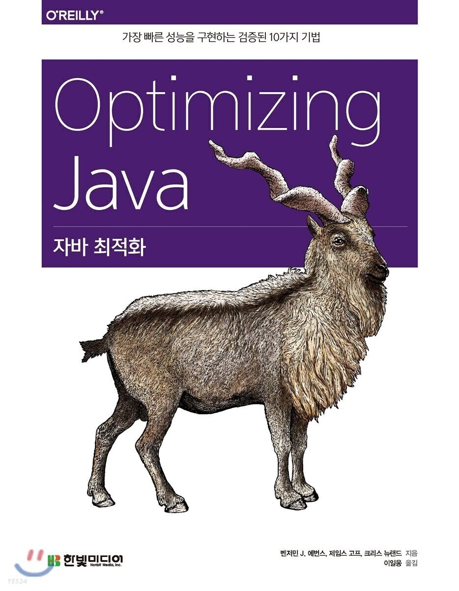


## **마이크로벤치마킹과 통계**

---

이 장에서는 자바 성능 수치(Performace numbers)를 직접 측정하는 내용을 자세히 살펴봅시다. JVM은 워낙 자유분방한 특성 탓에 성능 수치를 다루기가 의외로 만만치 않습니다. 정확하지 않은, 오해를 일으키는 이상한 성능 수치가 인터넷에 여기저기 떠돌게 된 것도 그 때문입니다.  

이 장의 목표는 이러한 잠재적 위험을 이해하고 기준으로 삼을 만한 성능 수치만 산출하도록 안내하는 것입니다. 특히, 작은 자바 코드 한 조각의 성능을 정확히 측정(마이크로밴치마킹)하기란 매우 미묘하고 어려운 일입니다. **마이크로 벤치마킹**이란 무엇인지, 그리고 올바른 사용법은 무엇인지 알아보겠습니다.  


> 첫 번째 원칙은  
> 절대로 스스로를 속이면 안 된다는 겁니다.   
> 여러분은 가장 속아 넘어가기 쉬운 사람이지요.  
>   
> - 리차드 파인만 -


뒷부분에서는 마이크로밴치마킹 툴의 업계 표준인 **JMH** 사용법을 설명합니다. 갖은 위험을 무릎쓰고라도 애플리케이션 및 유스케이스를 상대로 마이크로벤치마킹을 해야 한다면, 가장 미덥고 진보된 툴로 시작해서 잘 알려진 함정들과 `**베어 트랩(Bear traps)**`을 피해 가는 게 좋습니다.  

끝부분은 통계 이야기입니다. JVM은 조심해서 다루어야 할 성능 수치를 계속 냅니다. 마이크로벤치마킹 산출 수치는 대부분 매우 민감하므로 성능 엔지니어는 반드시 측정 결과를 통계적으로 정교하게 처리해야 합니다. 마지막 절은 JVM 성능 데이터를 다루는 몇가지 기법과 데이터 해석 문제를 다룹니다.


### **자바 성능 측정 기초**

---

1.2절에서 성능 분석이 기초 실험과학 분야로 귀결된 다양한 기술 측면을 종합한 것이라고 말했습니다. 즉, 벤치마크를 하나의 과학 실험처럼 바라보면 좋은 (마이크로)벤치마크를 작성하는 데에 큰 도움이 됩니다.  

이렇게 보면 결국 벤치마크란, 입출력을 지닌 일종의 `블랙 박스(Black Box)`와도 같습니다. 우리는 어떤 결과를 추측/추론하는데 필요한 데이터를 수집하려고 하지만, 단지 데이터를 모으는 것으론 충분하지 않고 그 데이터에 현혹되지 않도록 주의해야 합니다.  


> 벤치마크에서 수치는 별로 중요하지 않습니다.  
> 이 수치들로부터 어떤 모델을 이끌어 내느냐, 하는 점이 관건입니다.  
>   
> - 알렉세이 시필레프 -


우리의 목표는 벤치마크로 공정한 테스트를 하는 것입니다. 즉, 가급적 시스템의 어느 한 곳만 변경하고 다른 외부 요인은 벤치마크 안에 두고 통제하면 좋겠습니다. 이상적으로는, 시스템에서 가변적인 부분은 테스트 간에 불변성을 유지해야 하지만 실제로 그렇게 운 좋은 경우는 드문 편입니다.  


> 과학적으로 순수하게 공정한 테스트는 현실적으로 어려운 일이지만, 벤치마크는 경험 결과의 근간을 형성하므로 최소한 반복은 할 수 있어야 합니다.


자바 플랫폼을 벤치마크할 때에는 자바 런타임의 정교함이 가장 문제입니다. 이 책은 JVM이 개발자가 작성한 코드에 적용하는 자동 최적화에 가장 많은 시간을 할애했습니다. 이런 최적화의 맥락에서 벤치마크를 과학적인 테스트로 바라보면 우리가 가진 선택지는 제한적입니다.  

따라서 최적화가 미치는 영향을 구체적으로 완전히 이해하고 설명하기란 사실 불가능합니다. 애플리케이션 코드가 정말 정확히 투영된 성능 모델은 생성하기도 어렵고 적용 범위가 한정됩니다.  

다시 말해, 자바 코드 실행은 JIT 컴파일러, 메모리 관리, 그밖의 자바 런타임이 제공하는 서브 시스템과 완전히 떼어놓고 생각할 수 없습니다. 테스트 실행 당시 OS, 하드웨어, 런타임 조건(예. 부하)의 작용 또한 무시할 수 없습니다.  


> 그 누구도 온전한 전체일 뿐 섬이 아닙니다.  
>   
> - 존 던 -


이와 같은 여러 가지 작용은 보다 큰 단위(전체 시스템이나 서브시스템)로 처리하여 상쇄시킬 수 있습니다. 반대로, 작은 규모로 마이크로벤치마크를 할 때는 물밑에서 작동하는 런타임과 애플리케이션 코드를 확실히 떼어놓기가 참 어렵습니다. 이것이 마이크로벤치마킹이 정말 어려운 근본 이유입니다.  

100,000 개 숫자를 정렬하는 벤치마크 코드를 예로 들어봅시다. 진짜 공정한 테스트를 작성하겠다는 관점에서 코드를 한번 살펴볼까요?  


```java
public class ClassicSort {

    public static final int N = 1000;
    public static final int I = 150000;
    public static final List<Integer> testData = new ArrayList<>();

    public static void main(String[] args) {
        Random randomGenerator = new Random();

        IntStream.range(0, N).forEach(i -> {
            testData.add(randomGenerator.nextInt(Integer.MAX_VALUE));
        });

        System.out.println("== Sort Algorithm Test==");

        double startTime = System.nanoTime();

        IntStream.range(0, I).mapToObj(i -> new ArrayList<>(testData)).forEach(Collections::sort);

        double endTime = System.nanoTime();
        double timePerOperation = ((endTime - startTime) / (1_000_000_000L * I));
        System.out.println("Result : " + (1 / timePerOperation) + " op/s");
    }
}
```


먼저, 무작정 정수 배열 생성 후 벤치마크 시작 시간을 로깅합니다. 그리고 루프를 돌며 이 배열을 다른 배열로 복사한 다음 전체 원소를 정렬합니다. I번 루프 실행이 끝난 뒤 소요 시간을 초 단위로 바꾸고 반복 횟수로 나누면 작업당 소요 시간(timePerOperation)이 계산됩니다.  

이 벤치마크의 **첫 번째 문제점**은, **JVM 웜업을 전혀 고려하지 않은 채 그냥 코드를 테스트했다**는 사실입니다. 운영계 서버 애플리케이션에서 이렇게 정렬을 실행하면 몇 시간, 심지어 며칠씩 걸릴 수도 있지만, JIT 컴파일러가 JVM에 내장된 덕분에 인터프리티드 바이트코드는 최적화된 기계어로 변환됩니다. JIT 컴파일러는 메서드를 몇 번 실행해본 다음 곧바로 임무를 개시합니다.  

따라서 이 테스트만으로는 운영계에서 어떻게 작동할지 확실히 모릅니다. 벤치마크 도중에 JVM이 메서드 호출을 최적화하느라 시간을 보낼 테니까요. 정말 그런지 몇 가지 플래그를 붙여봅시다.  


```java
java -Xms2048m -Xmx2048m -XX:+PrintCompilation .\ClassicSort.java
```


-Xms, -Xmx는 힙 크기를 조정하는 옵션입니다. 여기서는 둘 다 2기가 바이트로 잡았습니다. PrintCompilation은 메서드를 컴파일할 때마다(또는 다른 컴파일 이벤트가 발생할 때마다) 로깅을 하라는 지령입니다. 실행 결과 다음과 같습니다.  


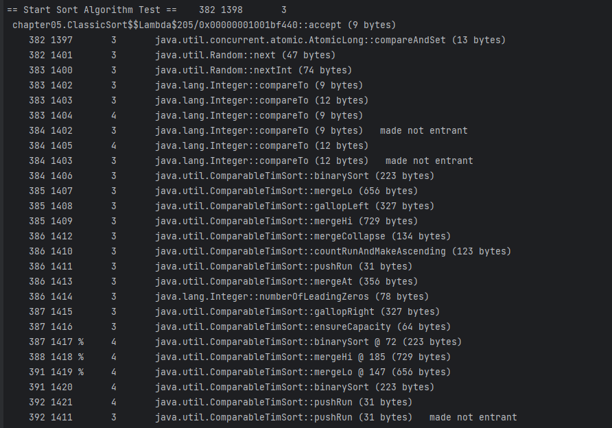


JIT 컴파일러는 코드를 조금이라도 효율적으로 작동시키려고 호출 계층(Call Hierarchy)을 최적화하므로 벤치마크 성능은 캡처 타이밍에 따라 달라집니다. 이 실험에서는 무심코 우리가 통제할 수 없는 변수 하나를 방치했습니다. 타이밍을 캡처하기 전에 JVM이 가동 준비를 마칠 수 있게 웜업 기간을 두는 게 좋습니다. 보통 타이밍 세부를 캡처하지 않는 상태로 벤치마크 대상 코드를 여러 번 반복 실행하는 식으로 JVM을 예열시킵니다.  

또 한 가지 고려할 외부 요인은 **가비지 수집**입니다. 타이밍 캡처 도중에 GC가 안일어나게 설정한 다음 가동시키면 참 좋겠지만, 가바지 수집은 원래 불확정적(nondeterministic)이어서 사람 마음대로 어찌할 도리가 없습니다.  

GC가 일어날 가능성이 큰 시기에는 타이밍을 캡처하지 않는 게 최선입니다. GC를 해달라고 시스템에 요청하고 잠시 대기하는 방법도 있지만, 시스템이 이 요청을 그냥 무시할 가능성이 있습니다. 또 이 상태로는 타이밍 범위가 너무 넓어지니까 발생이 임박한 가비지 수집 이벤트에 관한 자세한 정보가 필요합니다.  

타이밍 시점을 선택하는 것뿐만 아니라 이터레이션 횟수도 정해야 하는데, 시행착오를 반복해도 적절한 값을 찾기 어려울 때도 있습니다. 가비지 수집이 작동되는 모습은 다음 VM 플래그를 추가하여 볼 수 있습니다(자세한 로그 포맷은 7장 참고).  


```bash
java -Xms2048m -Xmx2048m -verbose:gc ClassicSort
```


실행 결과, 다음과 같은 GC 로그 엔트리가 보입니다.  


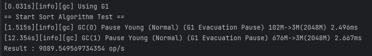


벤치마크에서 흔히 저지르는 또 다른 실수는 테스트하려는 코드에서 생성된 결과를 실제로 사용하지 않는 것입니다. 방금 벤치마크에 copy는 사실상 죽은 코드이므로 JIT 컴파일러가 이를 죽은 코드 경로로 식별하고 정작 우리가 벤치마크하려던 것을 최적화해버릴 가능성이 있습니다.  

또, 한번 측정한 결과로는 평균을 내도 벤치마크가 어떻게 수행됐는지 전체 사정을 속속들이 알 길이 없습니다. **허용 오차(Margin of Error)**를 구해 수집한 값의 신뢰도를 파악하는 게 좋습니다. 허용 오차가 큰 것은 통제불능 변수가 있다는 뜻이거나, 개발된 코드 자체가 성능 기준에 미치지 못함을 의미합니다. 어느 쪽이든 허용 오차를 구하지 않고선 문제의 존재조차 알 수 없습니다.  

정말 단순한 정렬 알고리즘을 벤치마크하는 경우도 자칫 벤치마킹 자체를 걷잡을 수 없는 방향으로 흘러가게 만들지만, 복잡도가 높아지면 상황은 더욱 나빠집니다. 가령, 멀티스레드 코드를 평가하는 벤치마크는 지독히 까다롭습니다. 정확한 결과를 얻으려면 처음부터 각 스레드가 완전히 시작될 때까지 전체 스레드를 출반선에 대기시켜야 합니다. 하지만 이렇게 안 하면 허용 오차가 높게 나올 것입니다.  

동시 코드를 벤치마크할 때에는 하드웨어 설정치를 가볍게 웃돌 가능성도 있어서 하드웨어 역시 잘 살펴야 합니다. 시스템 전원 관리 기능이 작동할 수도 있고, 머신상에서 별별 경합 조건이 발생할 수도 있습니다.  

벤치마크 코드를 바로잡는 일은 대단히 복잡하고 여러 요인을 고려해야 합니다. 물론, 개발자는 자신이 프로파일링하려는 코드만 관심있겠지만, 지금까지 설명한 모든 이슈를 진지하게 고민하지 않으면(여러분이 JVM 전문가가 아닌 이상) 뭔가를 놓치거나 엉뚱한 벤치마크 결과를 얻게 될 것입니다.  


해결 방안은 두 가지입니다.   

**첫째, 시스템 전체를 벤치마크**  
저순준 수치는 수집하지 않거나 그냥 무시합니다. 수많은 개별 작용의 전체 결과는 평균을 내어 더 큰 규모에서 유의미한 결과를 얻는 것입니다. 대부분 상황에서, 대부분의 개발자에게 필요한 접근 방식입니다.  

**둘째, 곻통 프레임워크 이용**

연관된 저수준의 결과를 의미있게 비교하기 위해 앞서 언급한 많은 문제를 공통 프레임워크를 이용해 처리하는 것입니다.  
이상적인 프레임워크라면 몇 가지 문제는 어느 정도 해결할 것입니다. 이런 툴은 새로운 최적화 및 다른 외부 제어 변수가 잘 관리되도록 OpenJDK의 개발 흐름을 잘 따라가야 합니다.  


### **JMH 소개**

---

순진하게 접근하면 마이크로벤치마킹이 얼마나 잘못되기 쉬운지, 또 그 이유는 무엇인지 한 실화를 통해 알아보겟습니다 .그리고 마이크로벤치마킹 대상으로 적합한 유스케이스를 분별하는 휴리스틱을 소개합니다. 대부분 애플리케이션에서 마이크로벤치마킹은 적합하지 않는 기술로 밝혀지는 경우가 많습니다.  


#### **될 수 있으면 마이크로벤치마크하지 말지어다(실화)**

긴 하루를 보낸 어느 날 퇴근하는데 책상에 앉아 자바 메서드 하나를 뚫어져라 바로보고 있는 동료 여직원이 눈에 띄었습니다. 대수롭지 않게 여기고 통근 열차를 타서 귀가했습니다. 그런데 이틀 뒤에도 똑같은 모습을 목격했습니다. 그녀는 이전과 거의 같은 메서드를 바라보며 잔뜩 찌푸린 얼굴을 하고 있어 `뭔가 조사를 해봐야겠군`하고 생각했습니다.  

그녀가 새로 단장하고 있던 애플리케이션은 성능 문제가 곧잘 터지곤 했습니다. 많이 쓰는 라이브러리의 최신 버전을 이용해 차기 버전을 개발했지만, 성능은 예전 버전보다 별 나을 게 없었습니다. 그녀는 문제의 원인을 밝히려고 코드 일부를 들어내고 소규모 벤치마크를 작성하느라 시간을 보내고 있었습니다.  

이렇게 '**건초 더미에서 바늘 찾는**' 방식은 좀 아닌 것 같았습니다. 그래서 그녀는 접근 방식을 달리했고 이내 곧 애플리케이션의 CPU 사용률이 정점을 찍고 있다는 사실을 파악했습니다. 실행 프로파일러에 딱 맞는 유스케이스라서(언제, 어떤 프로파일러를 쓰는지는 13장에서 다룹니다) 10여 분 동안 애플리케이션을 프로파일링한 결과 진짜 원인을 찾을 수 있었습니다. 애플리케이션 코드는 전혀 문제가 없었고 팀에서 새로 들어온 인프라 라이브러리가 화근이었습니다.  

자바 성능 문제를 어떻게 다루어야 하는지 잘 보여준 무용담인데, 안타깝게도 이와 비슷한 사례가 의외로 많습니다. 개발자는 큰 그림을 못보고 자기 코드가 성능을 떨어뜨렸을 거란 강박 관념에 사로잡힙니다.  


> 개발자는 작은 코드를 세세히 뜯어보며 원인을 찾으려고 하지만, 이 정도 수준으로 벤치마킹하는 것은 몹시 어려울 뿐만 아니라 '**베어 트랩**'에 빠질 위험도 있습니다.

#### **휴리스틱: 마이크로벤치마킹은 언제 하나?**

2장에서도 언급했지만, 자바 플랫폼은 원래 천성이 동적인 데다 가비지 수집 및 공격적인 JIT 최적화 같은 특성이 있으므로 성능을 직접 가늠하기가 어렵습니다. 설상가상으로, 실제 애플리케이션을 측정한 각 런타임 환경마다 성능 수치도 제각각입니다.   


> 작은 자바 코드 조각보다 자바 애플리케이션 전체를 대상으로 성능 분석을 하는 편이 거의 항상 더 수월합니다.


하지만 어쩔 수 없이 단위 메서드 또는 코드 조각 하나를 직접 성능 분석해야 할때가 있습니다. 그런데 결코 섣불리 덤벼들면 안됩니다. 일반적으로 저수준 분석이나 마이크로벤치마킹을 하는 주요 유스케이스는 다음 세 가지입니다.  


* **사용 범위가 넓은 범용 라이브러리 코드를 개발한다.**
* **OpenJDK 또는 다른 자바 플랫폼 구현체를 개발한다.**
* **지연에 극도로 민감한 코드를 개발한다(예. 저지연 거래)**


위 유스케이스를 뒷받침하는 세 가지는 근거는 각각 조금씩 다릅니다.  

범용 라이브러리는 (정의상) 이 라이브러리가 쓰이는 컨텍스트에 관한 정보가 제한적이며(예: 구글 구아바(Google Guava), (원래 골드만 삭스 사가 제작한) 이클립스 컬렉션즈(Eclipse Collections), 아주 폭넓은(할목 개수만 수십 ~ 수억개에 달하는 데이터셋을 다루는) 유스케이스에 걸쳐 쓸만한, 더 나은 성능을 보여야 합니다.  

범용 라이브러리는 원래 적용 범위가 넓기 때문에 전통적인 성능/용량 테스트 기법 대신 마이크로벤치마킹을 쓸 수밖에 없는 때가 있습니다.  

플랫폼 개발자는 마이크로벤치마크의 핵심 사용 커뮤니티를 형성하는 사람들입니다. JMH도 원래 OpenJDK 개발팀 본인들이 쓰려고 개발한 툴입니다. 입소문이 나면서 성능 전문가 세상에도 알려지게 된 것입니다.  

끝으로, 자바 성능의 최첨단을 추구하는 개발자입니다. 자신이 개발한 애플리케이션과 극단적 유스케이스에 가장 잘 맞는 알고리즘/기법을 선택하기 위해 마이크로벤치마크를 활용하는 사람들입니다. 주로 저지연 금융 거래 분야에서 쓰이며, 그 밖의 유스케이스는 상대적으로 적습니다.  

여러분이 **OpenJDK**나 **범용 라이브러리** 개발자라면 마땅히 마이크로벤치마킹이 필요하겠지만, 일반 개발자 입장에서는 시스템 성능 요건이 정말 마이크로벤치마크를 고려해야 할 정도인지 확실치 않을 것입니다.  


> 마이크로벤치마크에서 가장 조심해야 할 부분은  
> 아무 의미가 없더라도 항상 어떤 수치가 만들어진다는 사실입니다.  
> 뭔가 측정은 하는데 그 실체는 확실치 않습니다.  
>   
> - 브라이언 괴츠 -


일반적으로 마이크로벤치마크는 가장 극단적인 애플리케이션에 한하여 사용하는 게 좋습니다. 딱 정해진 기준은 없지만, 다음에 열거한 항목을 모두/대부분 충족하는 애플리케이션이 아니라면 마이크로벤치마킹을 수행해도 진정 가치 있는 결과를 도출하기 어렵습니다.  


* 총 코드 경로 실행 시간은 적어도 1밀리초, 실제로는 100마이크로초 보다 짧아야 한다.
* 메모리(객체) 할당률(자세한 내용은 6, 7장 참고)을 하는데, 그 값은 1MB/s 미만, 가급적 0에 가까운 값이어야 한다.
* 100%에 가깝게 CPU를 사용하며 시스템 이용률은 낮게(10% 밑으로) 유지해야 한다.
* 실행 프로파일러(13장 참고)로 CPU를 소비하는 메서드들의 분포를 이해해야 한다. 분포 그래프에서 지배적인 영향을 끼치는 메서드는 많아야 두 세개 정도다.


여기까지 종합하면, 마이크로벤치마킹은 분명히 거의 쓸 일이 없는 고급 기법이지만, 마이크로벤치마킹의 일부 기본 이론과 복잡성은 잘 알아두는게 좋습니다. 그래야 극단적이 않은 애플리케이션을 자바 플랫폼에 올려놓고 성능 작업을 하는 일이 얼마나 고된지 깨닫게 될 것입니다.

> 역어셈블리/코드생성 분석을 지원하지 않는  
> 나노벤치마크는 신뢰할 수 없습니다.  
>   
> - 알렉세이 시필레프 -


### JMH 프레임워크

---

JMH는 앞서 거론한 이슈들을 해소하고자 개발된 프레임워크입니다.  


> JMH는 자바를 비롯해 JVM을 타깃으로 하는 언어로  
> 작성된 나노/마이크로/밀리/매크로 벤치마크를  
> 제작, 실행, 분석하는 자바 도구입니다.  
>   
> - OpenJDK -


과거에도 단순 벤치마킹 라이브러리를 제작하려는 움직임은 있었습니다. **구글 캘리퍼(Google Calliper)**는 개발자 사이에서 평판이 가장 좋았습니다. 하지만, 이런 프레임워크도 나름대로 문제점이 있었습니다. 언뜻 보기엔 당연한 것 같은 코드 성능 설정/측정 방법도 종종 미묘한 베어 트립에 빠져 개발자를 곤라하게 만들었습니다. 특히 JVM이 계속 새로운 최적화 기법을 통해 진화하면서 그런 일이 늘었습니다.  

JMH는 JVM을 빌드한 사람들이 직접 만들 프레임워크라서, JMH 제작자는 JVM 버전별로 숨겨진 함정과 최적화 베어 트랩을 어떻게 피하는지 누구보다 잘 알고 있습니다. JMH는 각 JVM 릴리즈마다 꼭 맞는 벤치마킹 툴 세트로 함께 진화해왔고, 덕분에 개발자는 툴 사용법은 익히고 벤치마크 코드에만 전념할 수 있게 되었습니다.  

JMH는 앞서 설명한 문제 외에도 벤치마크 툴에 관한 몇 가지 핵심적인 설계 이슈를 고려했습니다.  

벤치마크 프레임워크는 컴파일 타임에 벤치마크 내용을 알 수 없으므로 동적이어야 합니다. 리플렉션을 써서 작성한 벤치마크를 실행하는 우회 방법도 있지만, 벤치마크 실행 경로에 복잡한 JVM 서브시스템이 하나 더 끼어들게 된 것입니다. 그래서 JMH는 벤치마크 코드에 애노테이션을 붙여 자바 소스를 추가 생성하는 식으로 작동합니다.  


> 애노테이션 기반의 유명 자바 프레임워크(예: JUnit)는 대부분 리플렉션을 사용하기 때문에 추가 소스 생성 작업에 프로세스를 사용면서 다소 예기치 못한 결과를 초래할 때가 있습니다.


벤치마크 프레임워크가 유저 코드를 엄청나게 반복 호출할 경우, 루프 최적화를 수행하는 것도 문제입니다. 벤치마크 코드를 실행하는 실제 프로세스가 실제 프로세스가 결과 신뢰도에 영향을 미칠 가능성이 있습니다.  

JMH는 벤치마크 코드가 루프 최적화에 걸리지 않을 정도로 조심스레 반복 횟수를 설정한 루프 안에 감싸 넣는 기지를 발휘합니다.  


#### 벤치마크 실행

JMH에서 복잡한 부분은 유저가 볼 수 없게 숨겨져 있고, 유저는 메이븐을 이용해서 단순 벤치마크를 쉽게 설정할 수 있습니다. 다음 명령어로 JMH 프로젝트를 새로 만듭시다.  


```java
$ mvn archetype:generate \
               -DinteractiveMode=false \
               -DarcheTypeGroupId=org.openjdk.jmh \
               -DarcheTypeArtifactId=jmh-java-benchmark-archetype \
               -DgroupId=org.sample \
               -DartifactId=test \
               -Dversion=1.0
```

필요한 아티팩트를 모두 내려받으면 코드를 짜 넣어 벤치마크 스텁이 생성됩니다.

직접 라이브러리를 추가할 경우 다음 코드를 추가해주세요.

```java
<dependency>
    <groupId>org.openjdk.jmh</groupId>
    <artifactId>jmh-core</artifactId>
    <version>1.19</version>
</dependency>
<dependency>
    <groupId>org.openjdk.jmh</groupId>
    <artifactId>jmh-generator-annprocess</artifactId>
    <version>1.19</version>
</dependency>
```


이 프레임워크가 여러 설정 태스크를 마친 후 실행시킬 벤치마크 메서드에는 @Benchmark를 붙입니다.  


```java
public class MyBenchMark {
    @Benchmark
    public void testMethod() {
       // 코드 스텁
    }
}
```


벤치마크 실행을 설정하는 매개변수는 명령줄에 넣거나, 다음과 같이 main() 메서드에 세팅합니다.  


```java
public class MyBenchMark {

    public static void main(String[] args) throws RunnerException {
        Options opt = new OptionsBuilder()
                .include(SortBenchmark.class.getName())
                .warmupIterations(100)
                .measurementIterations(5).forks(1)
                .jvmArgs("-server", "-Xms2048m", "-Xmx2048m").build();

        new Runner(opt).run();
    }
}
```


명령줄에 넣은 매개변수가 우선순위가 더 높기 때문에 main() 메서드에 세팅한 매개변수를 오버라이드합니다.  

벤치마킹를 할 때는 보통 데이터셋 생성 또는 성능 비교용 대조군에 필요한 조건 세팅 등 몇 가지 설정 작업이 필요합니다.  

JMH 프레임워큰 상태를 제어하는 기능까지 제공합니다. **@State**는 상태를 정의하는 애노테이션으로 **Benchmark, Group, Thread** 세 상태가 정의된 **Scope Enum**을 받습니다. **@State**를 붙인 객체는 벤치마크 도중에 액세스할 수 있으므로 어떤 설정을 하는 용도로 쓸 수 있습니다.  

멀티스레드 코드 역시 상태를 제대로 관리하는 기능까지 제공합니다. **@State**는 상태를 정의하는 애노테이션으로 **Benchmark, Group, Thread** 세 상태가 정의된 **Scope 이넘**을 받습니다. **@State**를 붙인 객체는 벤치마크 도중에 액세스할 수 있으므로 어떤 설정을 하는 용도로 쓸 수 있습니다.  

멀티스레드 코드 역시 상태를 제대로 관리되지 않아 벤치마크가 편향되지 않게 하려면 조심스럽게 다루어야 합니다.  

일반적으로 JVM은 메서드 내에서 실행된 코드가 부수 효과(side effect)를 전혀 일으키지 않고 그 결과를 사용하지 않을 경우 해당 메서드를 삭제 대상으로 삼습니다. JMH는 이런 일이 없도록 벤치마크가 반환한 단일 결과값을 암묵적으로 (무시해도 좋을 정도로 성능 오버헤드를 낮추려고 JMH 프레임워크 제작자가 개발한) 블랙홀(blackhole)에 할당합니다. 덕분에 벤치마크 작성자는 일처리가 너무 간단해집니다.  

계산량이 많은 벤치마크는 메서드에서 결과를 조합해 반환하는 비용이 많이 듭니다. 이럴 때 블랙홀을 매개변수로 받는 벤치마크를 작성해서 명시적으로 블랙홀을 벤치마크 안에 주입하면 됩니다.  

블랙홀은 네 가지 장치를 이용해 벤치마크에 영향을 줄 수 있는 최적화로부터 보호합니다. 스코프가 한정된 탓에 벤치마크가 과최적화(overoptimization)되지 않게 하거나 런타임에 데이터 패턴을 예측 실행하지 않게 만드는 장치들입니다. 평상시 시스템 실행 중에는 이런 일이 발생하지 않습니다.  


* 런타임에 죽은 코드를 제거하는 최적화를 못하게 한다.
* 반복되는 계산을 **상수 폴딩(constant folding)** 하지 않게 만든다.
* 값을 읽거나 쓰는 행위가 현재 캐시 라인에 영향을 끼치는 공유 현상을 방지한다.
* **쓰기 방벽(Write wall)**으로부터 보호한다.


성능 분야에서 장벽(Wall)이란, 일반적으로 리소스가 포화돼서 사실상 애플리케이션에 병목을 초래하는 지점을 가리킵니다. 쓰기 장벽에 이르면 캐시에 영향을 미치고 쓰기 전용 버퍼가 오염될 수 있습니다. 벤치마크 내부에서 이런 일이 벌어지면 큰일 날 것입니다.  

블랙홀 자바 문서에 기술되어 있듯이, 벤치마크가 최적화를 피해갈 수 있게 이런 보호 장치를 제공하려면 무엇보다 여러분 스스로 JIT 컴파일러 자세히 잘 알고 있어야 합니다.  

JMH가 어떤 트릭을 쓰는지 이해하기 위해 블랙홀을 사용한 다음 두 consume() 메서드를 재빨리 살펴봅시다.  


```java
public volatile int i1 = 1, i2 = 2;

/**
 * This call provides a side effect preventing JIT to eliminate
 * dependent computations.
 * 
 * @param i int to consume
 */
public final void consume(int i) {
    if (i == i1 && i == i2) {
        // SHOULD NEVER HAPPEN
        nullBait.i1 = 1;    // implicit null pointer exception
    }
}
```

다른 기본형을 소비하는 코드도 이런 형태로 오버로드(overload)돼 있습니다. i1, i2는 volatile로 선언된 변수라서 런타임은 반드시 이 두 변수를 재평가합니다. if 조건문이 true가 될 일은 없지만, 컴파일러는 어떻게든 이 코드를 실행시켜야 합니다. if문에 비트 연산자 AND(&)가 있기 때문에 추가 분기 로직이 문제 될 일도 없고 일정한 성능이 보장됩니다.

다음은 두 번째 메서드입니다.

```java
public int tlr = (int) System.nanoTime();

/**
 * Consume object. This call provides a side effect preventing JIT to eliminate
 * dependent computations.
 * 
 * @param obj
 */
public final void consume(Object obj) {
    int tlr = (this.tlr = (this.tlr * 1664525 + 1013904223));

    if((tlr && tlrMask) == 0) {
        // SHOULD ALMOST NEVER HAPPEN IN MEASUREMENT
        this.obj1 = obj;
        this.tlrMask = (this.tlrMask << 1) + 1;
    }
}
```

언뜻 보면 유저가 보유한 어떤 객체도 블랙홀에 빠진 객체와 동등할 가능성은 0이니 객체에도 똑같은 로직을 적용할 수 있을 것 같지만, 컴파일러는 이 부분에서도 영리하게 처리하려고 고심합니다. 컴파일러가 **탈출 분석(escape analysis)**을 해보고 이 객체가 그 어느 객체와도 동등할 수 없다고 결론 내리면 비교문 자체가 return false; 하나로 최적화될 수도 있습니다.

대신, 객체는 아주 드문 경우에만 실행된다는 조건하에 소비됩니다. tlr 값을 계산해서 tlrMask와 AND 비트 연산을 하면 그 결과가 0이 될 확률은 줄지만 그렇다고 완전히 없애지는 못합니다. 이렇게 해서 객체를 할당하지 않아도 소비될 수 있게 만드는 것입니다. 벤치마크 프레임워크 코드는 여러분이 많이 봤던 일반 자바 애플리케이션 코드와는 아주 달라서 보면 볼수록 재미가 있습니다. 물론, 그렇다고 이런 코드를 자바 애플리케이션 제품에 집어넣는 개발자는 아마 금세 해고될 것입니다.

JMH 개발팀은 고도로 정확한 마이크로벤치마킹 툴을 개발하면서 클래스 문서화도 정말 감명 깊게 잘해놨습니다.

이 정도만 알아도 간단히 벤치마킹하는 데엔 어려움이 없지만 JMH는 몇 가지 고급 기능도 제공합니다. [공식 사이트](http://openjdk.java.net/projects/code-tools/jmh)에 나와 있는 기능별 예제는 시간을 들여 살펴볼 가치가 충분합니다.

JVM과 밀접하게 맞닿아 작동하는 JMH는 아주 강력한 기능을 자랑합니다.

* 컴파일러를 제어한다.
* 벤치마크 도중 CPU 사용 수준을 시뮬레이션한다.

블랙홀을 이용하면 실제로 CPU 사이클을 소모해 다양한 CPU 부하 상황에서 벤치마크를 시뮬레이션해볼 수 있습니다.

JVM이 인라이닝 또는 컴파일을 하므로 성능 이슈가 발생한 걸로 의심될 경우 **@CompilerControl** 어노테이션을 활용하면 됩니다. 모드를 지정해 인라이닝을 못 하게 하거나(**CompilerControl.Mode.DONT\_INLINE**), 명시적으로 인라이닝하게 하거나(**CompilerControl.Mode.INLINE**), 메서드를 컴파일하지 않도록(**CompilerControl.Mode.EXCLUDE**) 컴파일러에게 지시할 수 있습니다.

```java
@State(Scope.Benchmark)
@BenchmarkMode(Mode.Throughput)
@Warmup(iterations = 5, time = 1, timeUnit = TimeUnit.SECONDS)
@Measurement(iterations = 5, time = 1, timeUnit = TimeUnit.SECONDS)
@OutputTimeUnit(TimeUnit.SECONDS)
@Fork(1)
public class SortBenchmark {

    private static final int N = 1000;
    private static final List<Integer> testData = new ArrayList<>();

    @Setup
    public static final void setUp() {
        Random randomGenerator = new Random();

        IntStream.range(0, N).forEach(i -> {
            testData.add(randomGenerator.nextInt(Integer.MAX_VALUE));
        });

        System.out.println("Setup Complete");
    }

    @Benchmark
    public List<Integer> classicSort() {
        List<Integer> copy = new ArrayList<>(testData);
        Collections.sort(copy);;
        return copy;
    }

    @Benchmark
    public List<Integer> standardSort() {
        return testData.stream().sorted().collect(Collectors.toList());
    }

    @Benchmark
    public List<Integer> parallelSort() {
        return testData.parallelStream().sorted().collect(Collectors.toList());
    }

    public static void main(String[] args) throws RunnerException {
        Options opt = new OptionsBuilder()
                .include(SortBenchmark.class.getName())
                .warmupIterations(100)
                .measurementIterations(5).forks(1)
                .jvmArgs("-server", "-Xms2048m", "-Xmx2048m")
                .addProfiler(GCProfiler.class)
                .addProfiler(SafepointsProfiler.class)
                .build();

        new Runner(opt).run();
    }

}
```

벤치마크 실행 결과는 다음과 같습니다.

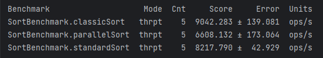

이 벤치마크만 보면 스트림을 쓰는 것보다 고전적인 방법으로 정렬하는 게 더 낫다는 결론을 섣불리 내리기 쉽습니다. 양쪽 모두 하나의 배열 사본을 가지고 한번 정렬을 했다면 응당 그럴 것입니다. 개발자들은 에러율이 낮고 처리율은 높게 나왔으니 벤치마크 결과가 틀림없다고 여길 것입니다.

그러나 이 벤치마크가 성능을 정확히 반영하지 못한 부분은 없을까요? '이 테스트는 제대로 통제됐는가?' 하는 질문을 자신에게 던져봅시다. 먼저, classicSort 메서드를 테스트할 때 가비지 수집의 영향도를 알아보겠습니다.

```java
Iterations     1:
[GC (Allocation Failure)   65496K->1480K(239104K), 0.0012473 secs]
[GC (Allocation Failure)   63944K->1496K(237056K), 0.0013170 secs]
10830.105 ops/s
Iteration      2:
[GC (Allocation Failure)   62936K->1680K(236032K), 0.0004776 secs]
10951.704 ops/s
```

스냅샷을 떠보니 (대략) 1회 반복할 때마다 GC 사이클이 발생한 패턴입니다. 병렬 정렬하는 경우와 비교해보니 흥미롭습니다.

```java
Iterations     1:
[GC (Allocation Failure)   52952K->1848K(225792K), 0.0005354 secs]
[GC (Allocation Failure)   52024K->1848K(226816K), 0.0005341 secs]
[GC (Allocation Failure)   51000K->1784K(223744K), 0.0005509 secs]
[GC (Allocation Failure)   49912K->1748K(225280K), 0.0003952 secs]
9526.212 ops/s
Iteration      2:
[GC (Allocation Failure)   49400K->1912K(222720K), 0.0005589 secs]
[GC (Allocation Failure)   49016K->1832K(223744K), 0.0004594 secs]
[GC (Allocation Failure)   48424K->1864K(221696K), 0.0005370 secs]
[GC (Allocation Failure)   47944K->1832K(222720K), 0.0004966 secs]
[GC (Allocation Failure)   47400K->1864K(220672K), 0.0005004 secs]
```

플래그를 추가해 예상치 못했던 차이를 발생시키는 원인을 찾아보니, 벤치마크에서 뭔가 노이즈(noise, 가비지 수집)가 일어나고 있음을 짐작할 수 있습니다.

벤치마크가 통제된 환경을 나타낸다고 쉽게 가정하지만 실은 전혀 그렇지 못한 경우도 많습니다. 통제되지 않은 변수는 대개 찾아내기가 어려워서 JMH 같은 툴을 쓰더라도 각별히 잘 살펴야 합니다. 또 스스로 인지 편향에 흔들리지 않도록 관심을 기울여야 하며, 시스템 양상을 있는 그대로 잘 나타낸 측정값을 얻고 있는지 확인해야 합니다.

9장에서 배울 **JITWatch**를 이용해서 JIT 컴파일러가 바이트코드를 갖고 무슨 일을 하는지 엿볼 수 있습니다. 특정 메서드를 컴파일해 얻은 바이트코드가 왜 기대한 만큼 벤치마크 성능을 나오지 않게 하는지 이해하는 데 도움이 됩니다.

### **JVM 성능 통계**

---

성능 분석은 진정한 실험과학이므로 결과 데이터 분포를 다루는 일은 필수입니다. 통계학자, 과학자들은 실세계에서 얻은 결과가 눈에 탁 틔는 신호로 깔끔하게 나타나지 않는다는 사실을 압니다. 우리는 우리가 보고 싶은 과장된 상태가 아닌, 있는 그대로의 세상을 바라보아야 합니다.

> 신이라면 믿겠습니다.   
> 신 아닌 사람들은 데이터를 가져오세요.  
>   
> - 마이클 블룸버그 -

모든 측정은 어느 정도의 오차를 수반합니다. 자바 개발자가 성능 분석 시 흔히 맞닥뜨리는 두 가지 주요 오차 유형을 설명하겠습니다.

#### **오차 유형**

엔지니어가 자주 접하는 오차의 주된 근원은 두 가지 입니다.

**랜덤 오차(Random Error)**

측정 오차 또는 무관계 오인(unconnected fator)이 어떤 상관관계 없이 결과에 영향을 미칩니다.

**계통 오차(Synstematic Error)**

원인을 알 수 없는 요인이 상관관계 있는 형태로 측정에 영향을 미칩니다.

정확도(Accuracy)는 계통 오차의 수준을 나타내는 용어로, 정확도가 높으면 계통 오차가 나은 것입니다. 마찬가지로, **정밀도(Percision)**는 랜덤 오차를 나타내는 용어로서, 정밀도가 높으면 랜덤 오차가 늦은 것입니다.

[그림 5-1] 그래프를 보면 두 종류의 오차가 측정에 어떤 영향을 끼치는지 알 수 있습니다.

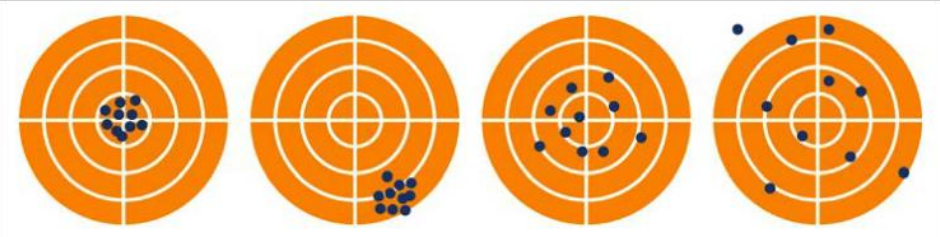

[그림 5-1] 여러 가지 오차 종류

첫 번째 그림은 진짜 결과(과녁 중앙) 주변에 측정값이 몰려 있습니다. 정확도와 정밀도, 모두 높은 것입니다.

두번째 그림은 계통 오차 때문에 탄착점이 모두 한곳에 쏠려 있습니다. 정밀도는 높으나 정확도는 낮은 경우입니다.

세 번째 그림은 과녁에는 다 들어갔지만 드문드문 흩어져 있습니다. 두 번째 그림과 정반대로 정밀도가 낮고 정확도는 높은 경우입니다.

네 번째 그림은 정확도, 정밀도 모두 낮아 뚜렷한 신호가 없습니다.

**계통 오차**

예를 들어, JSON을 주고받는 백엔드 자바 웹 서비스의 성능 테스트를 수행한다고 합시다. 부하 테스트를 하고자 애플리케이션 프론트엔드를 직접 끌어 쓰는 것이 부담스러울 때 이런 테스트를 합니다.

[그림 5-2]는 부하 생성 툴인 **아파치 제이미터(Apache JMeter)**용 **JP GC 확장팩**을 이용해 얻은 그래프입니다. 잘 보면 실제로 두 가지 계통 효과가 작용하고 있습니다. 첫째, 선형 패턴으로 증가하는 위쪽 그래프(특이점 서비스)를 보니 어떤 한정된  서버 리소스가 조금씩 소모되고 있습니다. 메모리 누수가 발생하거나, 어떤 스레드가 도중 다른 리소스를 점유하여 놔주질 않는 상황에서 주로 나타나는 패턴입니다. 진짜 원인일 수 있으니 추가 조사가 필요한 후보입니다.

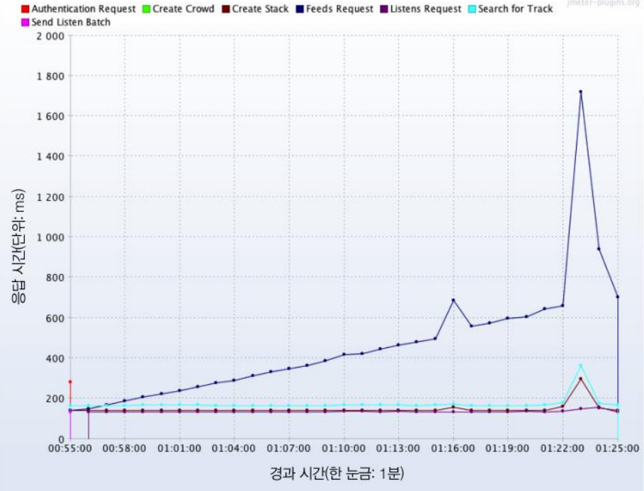

[그림 5-2] 계통 오차

> 어느 리소스가 영향받았는지 특정하려면 더 분석을 해봐야 합니다. 그냥 메모리 누수라고 단정지울 수는 없습니다.

둘째, 다른 서비스는 대부분 180밀리초 안팎의 일정한 응답 시간을 보이는데, 이 대목이 수상합니다. 요청을 접수해 처리하는 작업량은 서비스마다 제각각일 텐데, 어떻게 이리도 결과가 일정하게 나왔을까요?

확인 결과, 테스트 대상 서버는 영국 런던에 있는데, 부하 테스트는 인도 뭄바이에서 한것이 원인이었습니다. 뭄바이와 런던을 오가며 더 이상 줄일 수 없는 왕복 네트워크 지연 시간이 응답 시간에 포함된 것입니다. 120~150밀리초 범위의 지연 시간이 특이점을 제외한 절대다수의 서비스 응답 시간을 차지했습니다.

계통 효과가 커서 (실제로 서비스 반응한 시간은 120밀리초에 훨씬 못 미치므로) 실제 응답 시간의 차이가 묻혀버린 것입니다. 애플리케이션이 아닌, 계통 오차가 문제인 사례입니다. 계통 오차는 테스트 설정부터 잘못돼서 발생한 것으로, 런던에서 테스트를 다시 수행하니까 (예상대로) 오차는 흔적도 없이 사라졌습니다.

**랜덤 오차**

랜덤 오차는 많은 사람들이 연구한 분야지만, 간단히 짚고 넘어가겠습니다.

랜덤 오차는 원인을 알 수 없는, 또는 예기치 못한 환경상의 변화 때문에 일어납니다. 기초과학에서는 그런 변화가 측정 장비나 환경 자체에서 일어나지만, 소프트웨어에서는 측정 툴을 못 믿을 이유가 없으므로 랜덤 오차의 근원은 오직 운영 환경뿐입니다.

랜덤 오차는 대부분 **정규 분포(가우시안(Gaussian) 분포)**를 따릅니다(그림 5-3). 정규 분포는 오차에 측정값에 미치는 긍정적/부정적 영향도가 얼추 비슷한 경우에는 적합하지만 JVM에는 이 모델이 잘 맞지 않습니다.

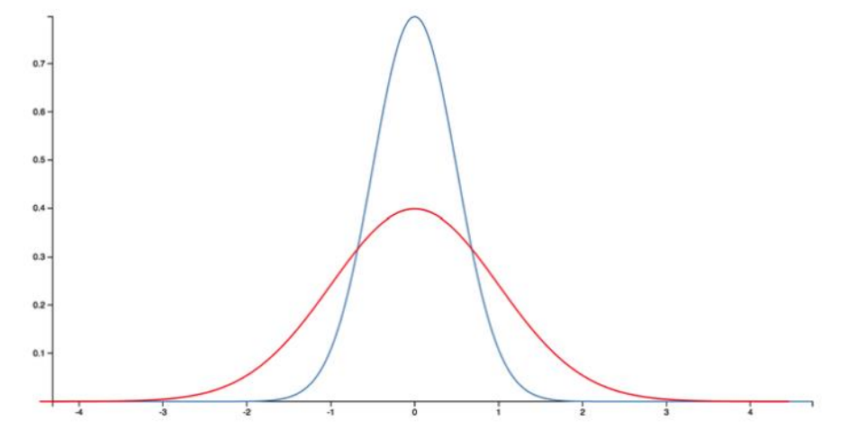

[그림 5-3] 가우시안 분포 (정규 분포 또는 종형 곡선(bell curve)이라고도 함)

**허위 상관**

통계학에서 아주 유명한 격언이 하나 있습니다. "상관은 인과를 나타내지 않는다." 두 변수가 비슷하게 움직인다고 해서 이들 사이에 연결고리가 있다고 볼 수는 없습니다.

아무 관계도 없는 측정값(http://tylervigen.com/spurious-corrleations)도 안광이 지배를 철하듯 뜻어보면 상관관가 발견되는 경우가 있습니다. [그림 5-4] 그래프는 미국 치킨 소비량과 총 원유 수입량 사이의 밀접한 상관관계를 나타냅니다.

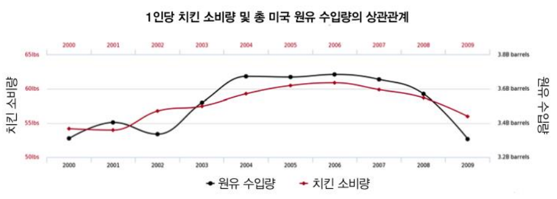

[그림 5-4] 완벽한 허위 상관(출처: 비젠(Visen))

이 두 통계치는 아무리 봐도 전혀 연관성이 없습니다. 원유 수입량과 치킨 소비량이라니요? 하지만 실무자가 주의해야 할 건 터무니없고 우스꽝스러운 상관관계가 아닙니다.

[그림 5-5]는 비디오 아케이드 게임 매출액과 컴퓨터 과학 박사 학위 수여자 인원수 사이의 상관관계를 나타낸 그래프입니다. 어떤 사회학자가 '스트레스를 받은 박사하위 과정 학생들이 몇시간씩 비디오 게임을 즐기며 심신의 안정을 찾곤 했다'며 이 두 측정값이 서로 연관되어 있다고 주장하는 모습을 상상하기란 그리 어렵지 않습니다. 사실 그러한 공통 요인은 없는데도 개똥철학을 늘어놓는 사람들이 의외로 많습니다.

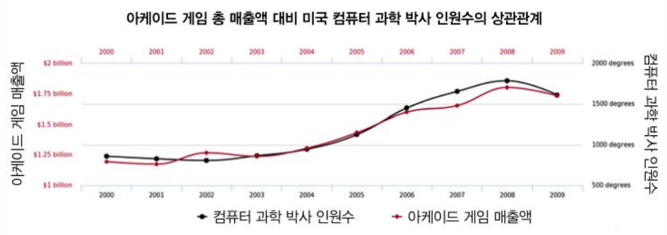

[그림 5-5] 조금 덜한 허위 상관일까? (출처: 비젠)

JVM과 성능 분석 영역에서는 그럴싸해 보이는 연결고리와 상관관계만 보고 측정값 간의 인과관계를 넘겨짚지 않도록 조심해야 합니다. 파인만 교수가 '당신 자신을 속이면 안 된다'고 말한 것과 같은 맥락입니다.

지금까지 오차의 원인을 몇 가지 사례를 들어 설명했고 허위 상관이라는 악명높은 베어 트랩도 언급했습니다. 그럼, 이제 화제를 바꿔서 각별히 주의해야 하는 JVM 성능 측정의 세부 단명을 이야기하겠습니다.

#### 비정규 통계학

정규 분포 기반의 통계학에서는 정교한 고급 수학이 별로 필요 없습니다. 고등학교나 학부 과정에서 배우는 통계학이 대부분 정규 분포 데이터 분석 위주로 접근하는 이유가 바로 이 때문입니다.

학생들은 평균과 표준편차(또는 분산) 계산법을 배우고, 학부과정에서는 왜도(Skewness), 첨도(Kurtosis) 같은 조금 더 수준 높은 내용도 배웁니다. 하지만 이런 분석 기법은 분포 그래프에 멀찍이 동떨어진 특이점이 몇 개만 있어도 결과가 왜곡되기 쉬운 심각한 단점이 있습니다.

> 자바 성능에서 특이점은 곧 느린 트랜잭션과 짜증난 고객을 가리킵니다. 이런 특이점이 오히려 더 눈여겨 봐야 할 대상이며, 특이점의 중요성을 흐리는 기법은 삼가는게 좋습니다.

다른 관점에서 한번 생각해봅시다. 이미 고객 상당수가 불만을 제기하는 상황이 아니라면, 평균 응답 시간 단축이 목표가 될 일은 거의 없습니다. 물론, 응답 시간이 줄면 전체 유저 경험이 향상되겠지만, 일반적으로 불만을 품은 소수의 고객이 지연 튜닝 활동을 벌이는 동인인 경우가 훨씬 더 많습니다. 즉, 만족스러운 서비스를 받고 있는 대다수 고객의 경험보다 특이점을 유발하는 이벤트가 더 중요한 관심사입니다.

[그림 5-6]은 메서드(또는 트랜잭션) 시간 분포를 좀 더 현실적으로 나타낸 그래프입니다. 확실히 정규 분포와는 거리가 멉니다.

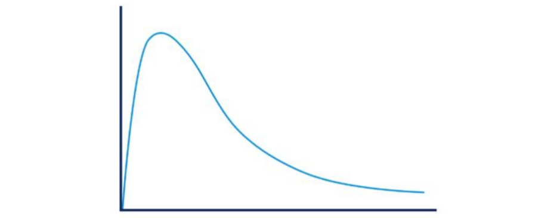

[그림 5-6] 좀 더 현실적인 트랜잭션 시간 분포도

[그림 5-6] 분포 형태는 우리가 JVM에 대해 직관적으로 알고 있는 것, 즉 모든 관련 코드가 이미 JIT 컴파일돼서 GC 사이클이 없는 핫 패스(hot path)의 존재를 시사합니다. 이는 (드문 사례는 아니지만) 최상의 시나리오로서, 이보다 더 빠른 호출은 있을 수 없습니다.

가우시간 통게학의 근본 가정과 정면으로 배치되는 이런 모습 때문에 비정규 분포를 생각하지 않을 수 없습니다.

> 정규 분포 통계학에 나오는 '기본 원칙'은 비정규 분포에는 보통 잘 안 맞습니다. 특히, 표준편차/분산, 다른 고차적률(higher moment) 같은 개념은 기본적으로 쓸모가 없습니다.

JVM이 생성한 긴 꼬리형(long-tail) 비정규 분포를 다루는 데 아주 유용한 기법 중 하나는, 백분위 수 개념을 조금 변용하는 것입니다. 분포는 수치 하나로 나타낼 수 없는, 데이터 형상, 즉 전체 그래프라는 사실을 기억해주세요.

전체 분포를 단일 결과값으로 표현하는 평균을 계산하지 말고 구간별로 샘플링을 하면 어떨까요? 정규 분포를 따르는 데이터에 적용하면 일정 구간마다 샘플을 채위하겠지만, 살짝 방법을 달리하면 JVM 통계에도 이 기법을 응용할 수 있습니다.

다음은 메서드 타이밍(method timing) 결과입니다. 긴 꼬리형 분포임을 감안해 평균, 90% 백분위 수를 차례로 구한 뒤, 이후부터는 대수적으로 죽 샘플링한 것입니다. 즉, 데이터 형상에 더 적합한 패턴에 따라 샘플링을 하느 ㄴ것입니다.

그 결과, 게터 메서드 하나를 실행하는데 평균 23ns가 걸렸고, 요청 1,000 개당 하나는 실행 시간이 한 크기 정도(order of magnitude) 나빠지며, 요청 100,000개당 하나는 실행 시간이 두 크기 정도 나빠진다는 사실을 알 수 있습니다.

긴 꼬리형 분포는 고동적 범위 분포(high dynamic range distribution)라고도 합니다. 보통 측정값의 동적 범위는 기록한 최댓값을 최솟값(0이 아니라고 가정)으로 나눈 값으로 정의합니다.

대수 백분위수(logarithmic percentiles)는 긴 꼬리형 분포를 이해하는 데 도움이 되는 간단한 도구지만, 고도 동적 범위에 분포된 데이터셋을 처리하는([HdrHistogram](https://github.com/HdrHistogram/HdrHistogram))라는 공개 라이브러리를 이용하면 좀 더 정교한 분석이 가능합니다. 이 라이브러리는 길 테네(Gile Tene, Azul Systems)가 처음 개발했고 마이크 바커(Mike Barker), 다라크 에니스(Darach Ennis), 코다 할레(Coda Hale)가 추가로 작업했습니다.

> **히스토그램**(histogram)은 **버킷**(bucket)이라는 일정한 값 범위별로 데이터를 요약해 각 버킷마다 그 출현 빈도를 표시한 그래프입니다.

HdrHistogram은 메이븐 중앙 저장소에서 내려받을 수 있습니다. 최신 버전인 2.1.12 라이브러리를 다음과 같이 pom.xml에 추가하면 됩니다.

```java
<!-- https://mvnrepository.com/artifact/org.hdrhistogram/HdrHistogram -->
<dependency>
    <groupId>org.hdrhistogram</groupId>
    <artifactId>HdrHistogram</artifactId>
    <version>2.1.12</version>
</dependency>
```

그럼, 간단한 HdrHistogram 예제를 살펴봅시다. 다음은 숫자로 가득 찬 파일을 입력받아 인접한 값 사이의 차이를 HdrHistogram으로 계산하는 코드입니다.

```java
public class BenchmarkWithHdrHistogram {

    private static final long NORMALIZER = 1000000;

    private static final Histogram HISTOGRAM = new Histogram(TimeUnit.MINUTES.toMicros(1), 2);

    public static void main(String[] args) throws Exception {
        final List<String> values = Files.readAllLines(Paths.get(args[0]));

        double last = 0;

        for(final String tVal : values) {
            double parsed = Double.parseDouble(tVal);
            double gcInterval = Double.parseDouble(tVal);
            last = parsed;
            HISTOGRAM.recordValue((long)(gcInterval * NORMALIZER));
        }
        HISTOGRAM.outputPercentileDistribution(System.out, 1000.0);
    }
}
```

실행 결과, 다음 GC 로그에서 보다시피 연이은 가비지 수집 간의 시간이 표시됩니다. 6장과 8장에서 설명하겠지만, GC는 일정한 간격으로 발생하지 않으므로 발생 빈도의 분포를 알고 있으면 도움이 됩니다.

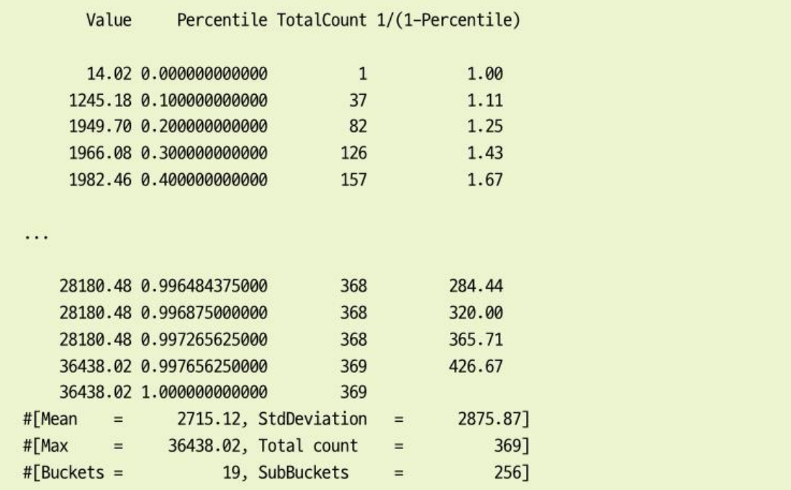

포매터로 출력한 자료만 봐서는 분석하기가 쉽지 않지만, 다행히 HdrHisotgram는 이런 자료를 멋진 히스토그램으로 보기 좋게 표시하는 [온라인 포매터](https://hdrhistogram.github.io/HdrHistogram/plotFiles.html)를 제공합니다.

[그림 5-7]은 HdrHistogram 플로터(plotter)로 그린 그래프입니다.

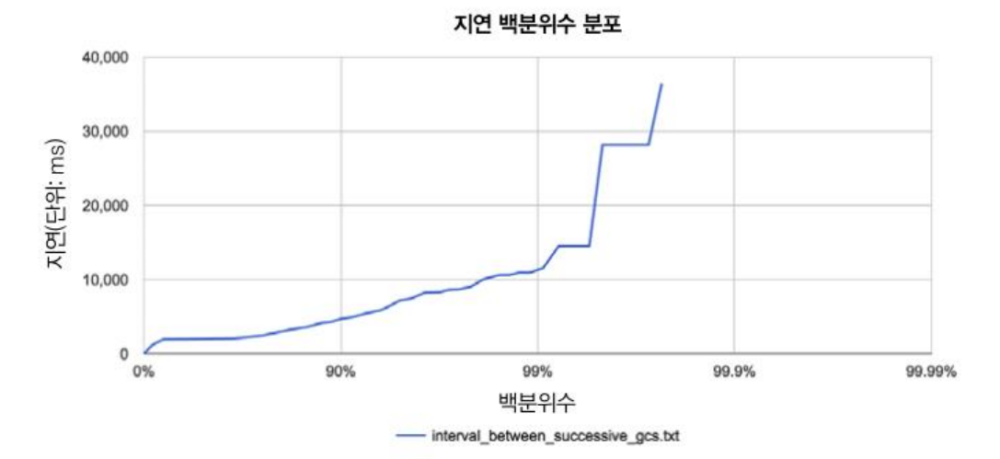

[그림 5-7] HdrHistogram으로 그린 그래프

자바 성능 튜닝 중 측정한 값은 대부분 통계적으로 심한 비정규 분포를 나타냅니다. 그래서 데이터 형상을 시각화여 파악하고 싶을 때 HdrHistogram을 이용하면 아주 유용합니다.

### 통계치 해석

---

경험 데이터와 측정 결과는 아무 의미 없이 그냥 존재하지 않습니다. 애플리케이션을 측정해서 얻은 결괏값을 해석하는 일이야말로 가장 힘들고 어려운 일입니다.

> 남들이 당신에게 뭐라든 늘 사람이 문제입니다.  
>   
> - 제럴드 웨인버그 -

[그림 5-8]은 실제 자바 애플리케이션의 메모리 할당률을 측정한 그래프로, 8장에서 배울 센섬이라는 가비지 수집 분석기로 캡처한 환면입니다. 이 정도면 제법 성능이 괜찮은 애플리케이션입니다.

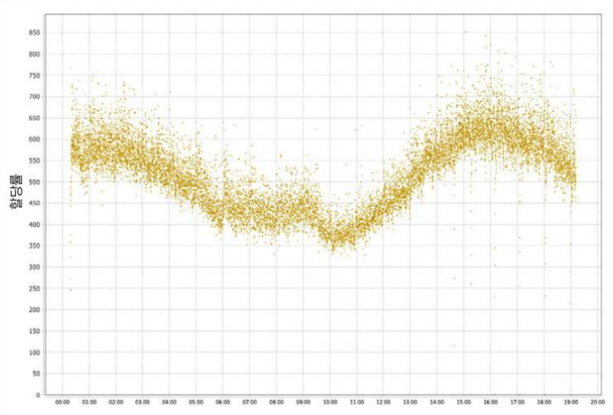

[그림 5-8] 할당률 샘플

할당 데이터는 비교적 신호가 명확한 편이라서 해석하기 쉽습니다. 측정 시간(거의 하루) 내내 할당률은 350 ~ 700 MB/s로 안정적입니다. JVM 시작 후 대략 5시간까지는 할당률이 차츰 감소하다가 9, 10시간 사이에서 바닥을 치고 다시 죽 올라가고 있습니다.

할당률은 애플리케이션이 실제로 수행 중인 작업량을 반영하므로 이렇게 하루 중 시간대별로 측정값이 차이나는 것은 당연합니다. 그러나 막상 실제 측정한 값을 해석할 때에는 이것보다 훨씬 그림이 복잡해지는 경우가 많습니다. 생텍쥐페리(Saint-Exupery)가 지은 `어린 왕자(The Litter Prince)`에 나오는 '모자/코끼리' 문제처럼 말이죠.

[그림 5-9]는 언뜻 보기에 HTTP 요청-응답 시간을 측정한 복잡한 히스토그램 같습니다. 하지만 '어린 왕자'의 화자가 말하듯, 조금만 더 상상의 나래를 펼치고 분석해보면 아무리 복잡한 그림이라도 실제로 매우 간단한 그림 조각 몇 개로 구성되어 있다는 것을 알 수 있습니다.

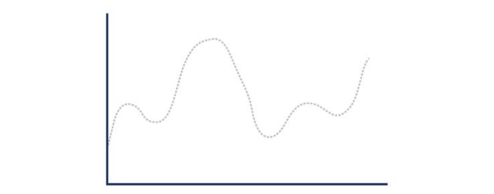

[그림 5-9] 모자일까요, 아니면 보아뱀에게 잡아먹힌 코끼리일까요?

'웹 애플리케이션 응답'은 아주 일반적인 유형의 서버 응답니다. 요청 처리 성공(2xx 응답 코드), 클라이언트 코드(4xx 응답 코드, 거의 대부분 404 에러), 서버 에러(5xx 응답 코드, 500 내부 서버 에러가 대표적임) 같은 응답 코드가 있다는 사실만 알고 있으면 응답 히스토그램을 해석할 수 있습니다.

응답 유형마다 응답 시간 분포는 다릅니다. 매핑되지 않은 URL을 클라이언트가 요청하면 웹 서버는 곧장 응답(404)을 줄 것입니다. 클라이언트 에러 응답 한 가지만 히스토그램으로 그려보면 [그림 5-10]과 같은 모습니다.

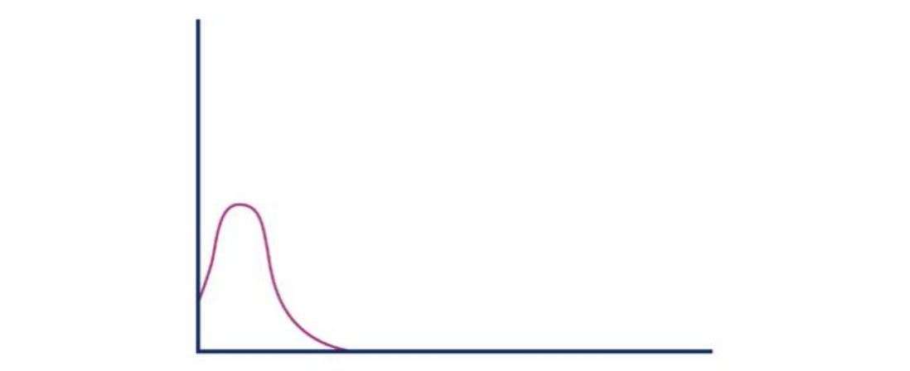

[그림 5-10] 클라이언트 오류

반면, 서버 에러는 장시간 처리하다가(가령, 백엔드 리소스가 장시간 부하를 받거나 타임아웃에 걸려) 발생하는 편입니다. 서버 에러 등답만 히스토그램을 그려보면 [그림 5-11] 같은 모양일 것입니다.

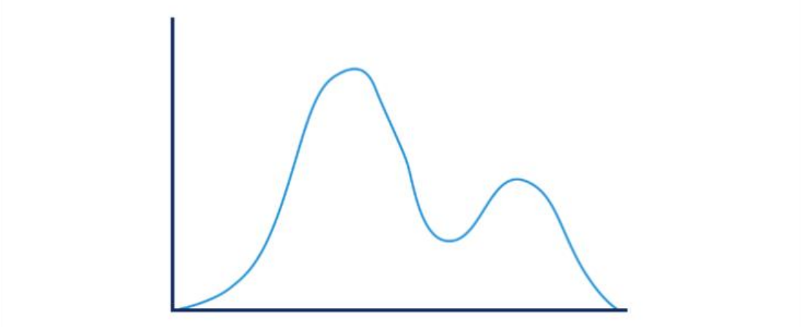

[그림 5-11] 서버 오류

성공한 요청은 **긴 꼬리형 분포**를 보이지만, 실제로는 극댓값(local maxima)이 여럿인 다봉분포(multimodel distributaion)를 나타냅니다. 일례로, [그림 5-12]를 보면 응답 시간이 완전히 다른 애플리케이션 공통 실행 경로가 둘 존재할 가능성이 있습니다.

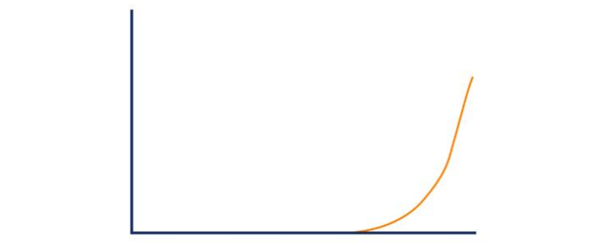

[그림 5-12] 성공 요청

유형이 다른 세 가지 응답 시간을 하나로 조합하니 [그림 5-12] 그래프가 완성되었습니다. 개별 히스토그램을 보면서 처음에 보았던 '모자' 모양을 다시 추론한 것입니다.

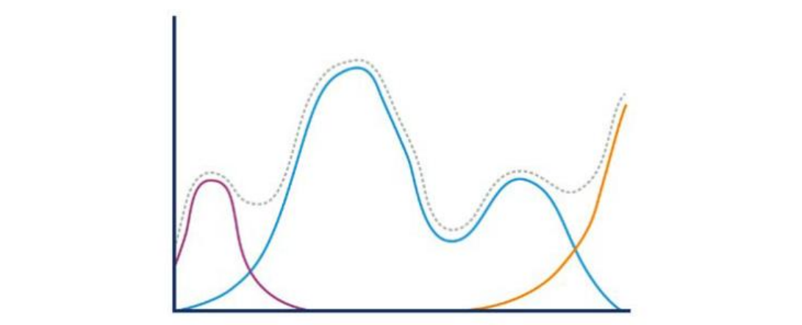

[그림 5-13] 다시 그린 모자/코끼리

이처럼 일반적인 측정값을 보다 유의미한 하위 구성 요소들로 분해하는 개념은 아주 유용합니다. 분석자는 결괏값을 보고 결론을 도출하기 전에 먼저 본인이 데이터 및 도메인을 충분히 이해해야 합니다. 데이터를 더 작은 집합으로 쪼개야 할 경우도 있습니다. 예를 들어, 같은 성공 요청이라도 업데이트, 업로드를 하는 요청과 읽기 작업이 대부분인 요청은 전혀 다른 분포를 보일 것입니다.

페이팔(paypal) 기술팀은 자신들이 통계학 및 분석 기법을 광범위하게 활용한 사례를 블로그에 공개했는데, 정말 양질의 자료가 풍성합니다. 특히, 마흐모드 하셰미(Mahmoud Hashemi)가 쓴 '소프트웨어 통계학(Statistics of Software)'이라는 글은 그들의 방법론에 입문하기 좋은 자료입니다. 필자가 방금 전 예시한 모자/코끼리 문제도 여기 나옵니다.

### 정리

---

자바 성능 분야에서 마이크로벤치마킹은 어둡의 마법과 같습니다. 뭔가 대단히 폼나는 표현이지만 실상은 꼭 그렇지 않습니다. 실무 개발자들이 늘상 실천하고 있는 일입니다. 하지만 마이크로벤치마크는 조심해서 사용해야 합니다.

* 유스케이스를 확실히 모르는 상태에서 마이크로벤치마킹하지 마세요.
* 그래도 마이크로벤치마킹을 해야 한다면 JMH를 이용하세요
* 여러분이 얻은 결과를 가능한 많은 사람과 공유하고 회사 동료들과 함께 의논하세요.
* 항상 잘못될 가능성을 염두에 두고 여러분의 생각을 지속적으로검증하세요.

마이크로벤치마킹의 한 가지 장점은, 저수준 서브시스템들이 유발한 고도로 동적인 움직임과 비정규 분포 양상을 명확히 드러낸다는 점입니다. 그래서 JVM의 복잡성을 머릿속에 정리하고 이해하는데 큰 도움이 됩니다.

### Keywords

---

#### 리차드 파인만

리처드 필립스 파인만(Richard Phillips Feynman)은 미국의 물리학자로, 노벨물리학상 수상자이고 여러 대중적 저작물들을 통해 과학의 대중화를 힘쓴 과학자입니다. 알베르트 아인슈타인과 함께 20세기 최고의 물리학자라고 일컬어집니다.(출처 위키백과)  


#### JMH

원서에 나오지 않지만, JMH는 Java Microbenchmark Harness(자바 마이크로벤치마크 도구)를 줄인 명칭입니다.  


#### 그 누구도 온전한 전체일 뿐 섬이 아닙니다

인간은 혼자 살아가는 존재가 아닌, 사회적인 존재다. 그래서 우리 모두 서로에게 꼭 필요한 존재이라는 의미  


#### 허용 오차

오차 범위라고도 하며 설문 조사 등의 결과에서 랜덤 샘플링 오차의 양을 나타내는 통계학 용어. 한 설문에 대한 허용 오차가 클수록 그 설문의 결과가 전체의 의견을 잘 반영하지 못할 수 있는 확률이 높다는 의미입니다.(출처: 위키백과)  


#### 폴딩

컴파일러가 컴파일 타임에 미리 계산 가능한 표현식을 상수로 바꾸어 처리하는 최적화 과정  


#### 다봉분포(multimodel distributaion)

2개 이상의 최빈값(가장 많이 관측되는 수, 즉 주어진 값 중에서 가장 자주 나오는 값)을 가진 확률 분포(출처: 위키백과)
