오늘은 월요일... 월요병?? 그런게 뭔가요??

공부하는데 날짜와 요일이 있을까요?? 

당연히 없지~~!! 가즈아!!!!

얼마남지 않을 개강을 위해 얼른 달려가야겠다!!

---

#### 

#### **4주차**

**[ 수업 목표 ]**

1. Flask 프레임워크를 활용해서 API를 만들 수 있다.
2. '화성에 땅사기' API를 만들고 클라이언트에 연결한다.
3. '스파르타피디아' API를 만들고 클라이언트와 연결한다.

**[목차]**

1. Flask 시작하기
2. [화성땅 공동구매]
3. [스파르타피디아]
4. 4주차 끝 & 숙제

---

**1. Flask 시작하기**

* 설치 패키지 : Flask
* 기초 실행 코드

     - app.py를 실행한 것과 html파일을 실행한 것의 차이는 html파일을 실행한 것은 파일을 열기한 것이고,

       app.py를 실행하여 localhost:5000은 서버를 열은 것으로 추가 설정을 통해 다른사람에게 공유할 수 있다.

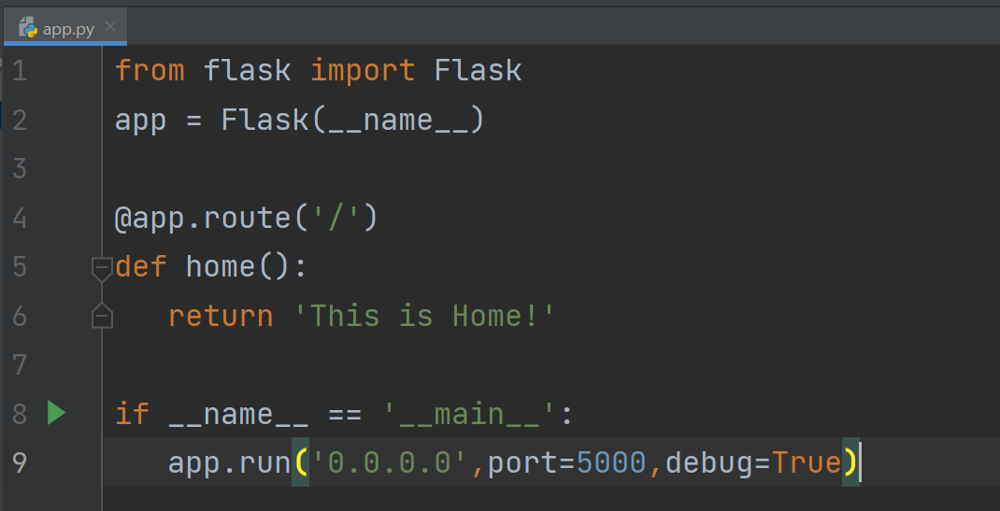

1-1. Flask 서버 기본 코드

* 폴더 구조

   - render\_template 패키지를 통해 원하는 html파일을 연결시킬 수 있다.

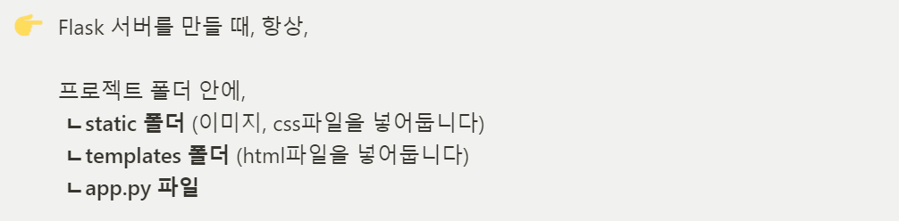

1-2. Flask 서버 폴더 구조

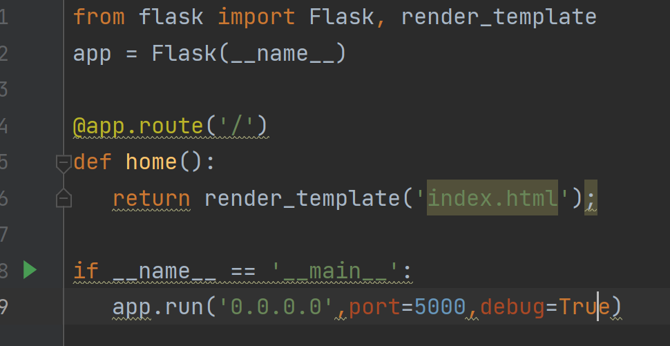

1-3. render\_tempate를 통한 html 파일 연결

* Flask GET Method

   1. 버튼 클릭

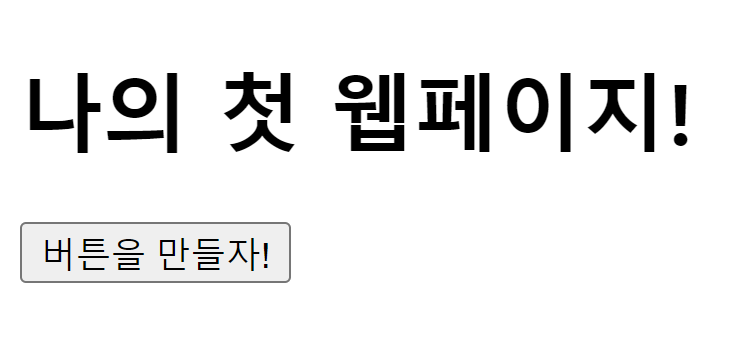

1-4. 버튼을 만들자 클릭!

   2. Ajax GET 요청

   - hey메소드가 호출되어 JQuery-Ajax 방식으로 GET 메소드를 호출시키고

     url은 /test에 title\_give 파라미터로 봄날은 간다라는 값을 주었습니다.

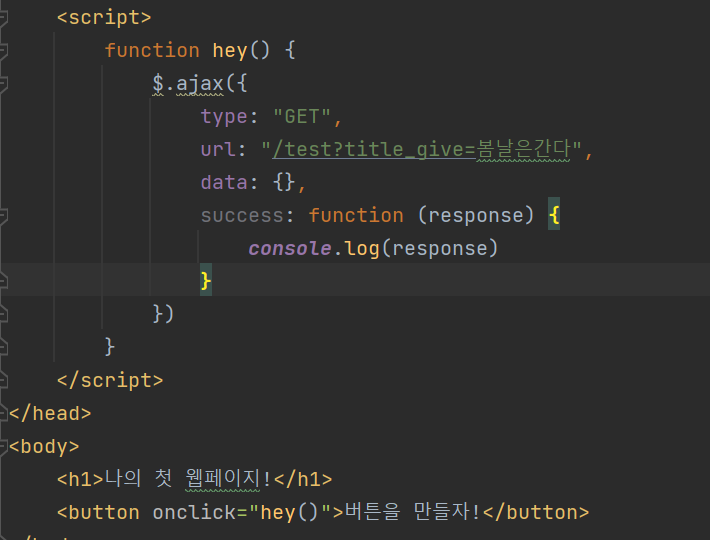

1-5. 클라이언트 Ajax GET 요청

   - ajax로 호출된 get 메소드가 test\_get 메소드를 호출하여 request.args.get("파리미터 name") 으로

     일치되는 파라미터 값을 전달받아 title\_receive 에 값을 넣고 print메소드로 서버에서 출력하였습니다.

     json형식으로 result, msg 키 값으로 데이터를 클라이언트에 보내주었습니다. 전달받은 클라이언트는

    console.log()를 통해 클라이언트에 콘솔에 출력되게 됩니다.

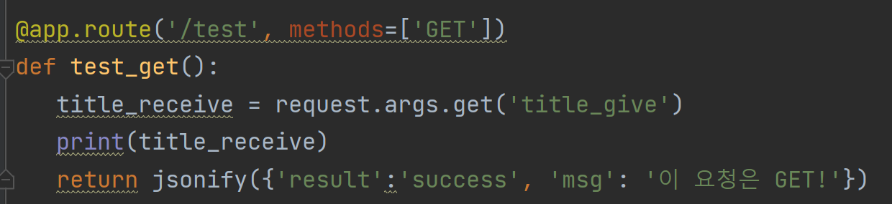

1-6. 서버 GET 메소드 응답

* Flask POST Method

   - 데이터 요청은 POST 요청으로 많이 사용하게 됩니다.

   - data에 title\_give라는 데이터를 입력하여 요청합니다.

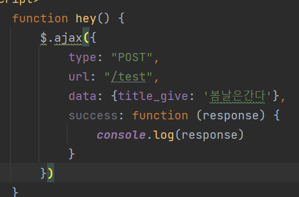

1-7. 클라이언 Ajax POST 요청

   - url과 method가 일치된 곳으로 전다라되어 함수가 호출되는데 

     이번에는 request.form[파라미터 name]에 일치되는 파라미터 값이 전달되게 된다.

     전달된 값을 서버에서 출력하고, json형태로 데이터를 보내주면 클라이언트에서 console.log로 출력한다.

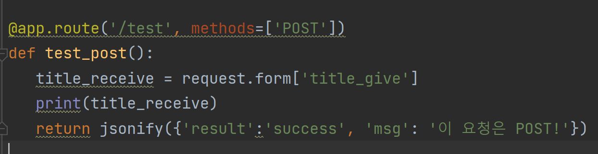

1-8. 서버 POST 메소드 응답

---

**2. 화성땅 공동구매**

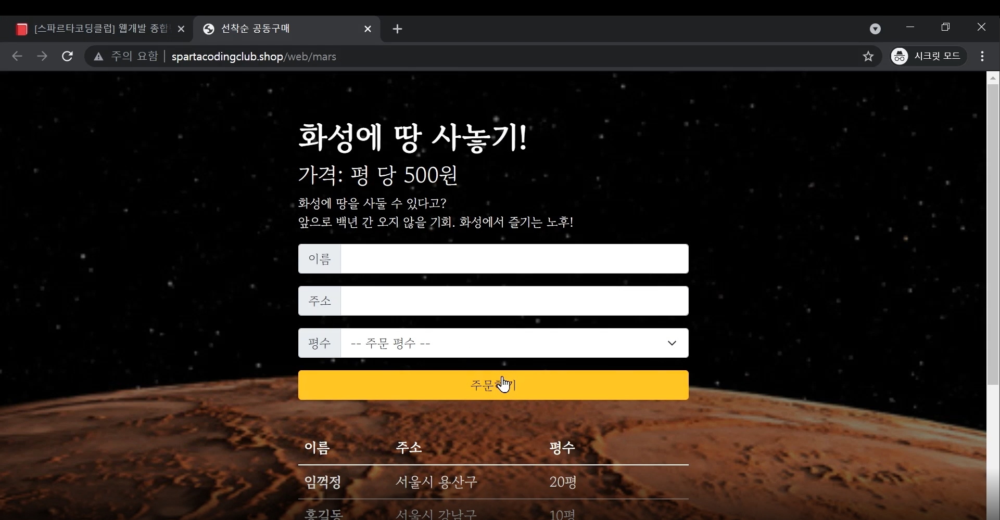

2-1. 화성땅 공동구매 미리보기

* 준비운동

   1. 폴더 구조화(동일)

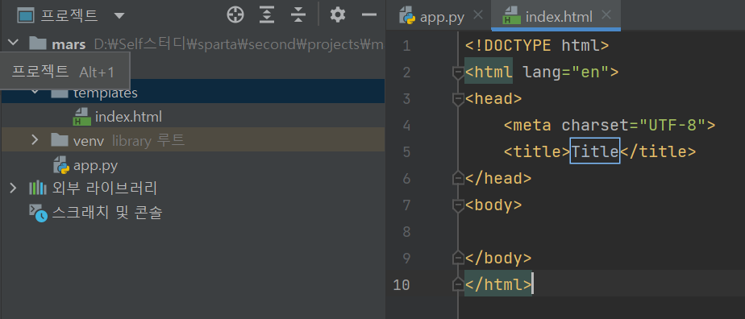

2-2. Flask 서버 폴더구조화

   2. 패키지 설치 

   - (설치 요구) : Flask, pymongo, dnspython

   3. 뼈대 준비하기

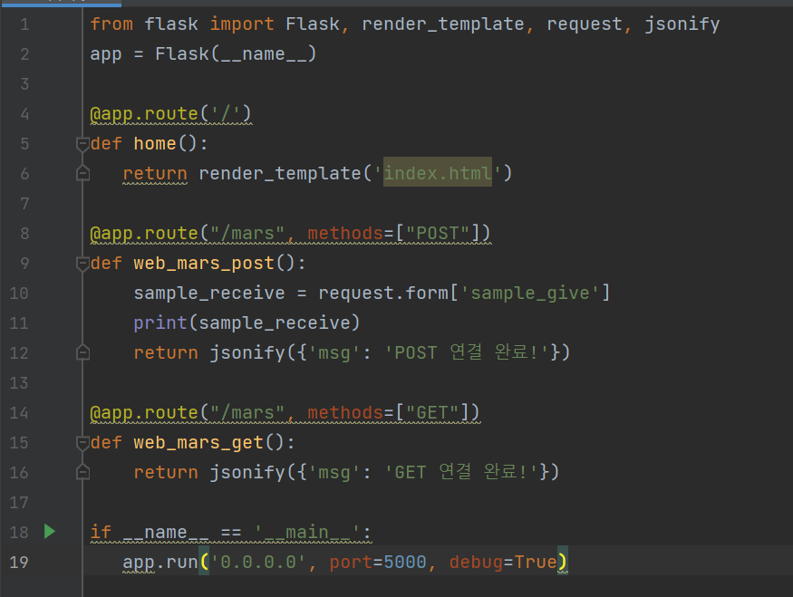

2-3. Flask App.py 뼈대 코드

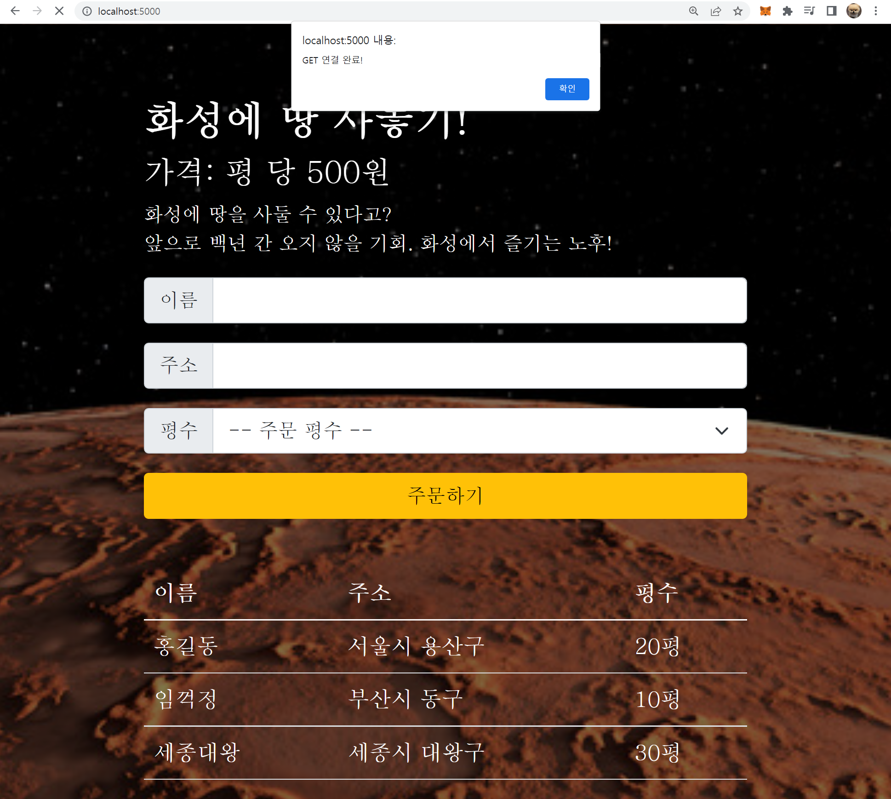

2-4. index.html 뼈대코드

   4. 구현하기

   1) Client를 통해 무엇을 해야하는지 파악(주문하기, 주문내역 보여주기)

   2) 서버 구현

   3) 클라이언트 구현

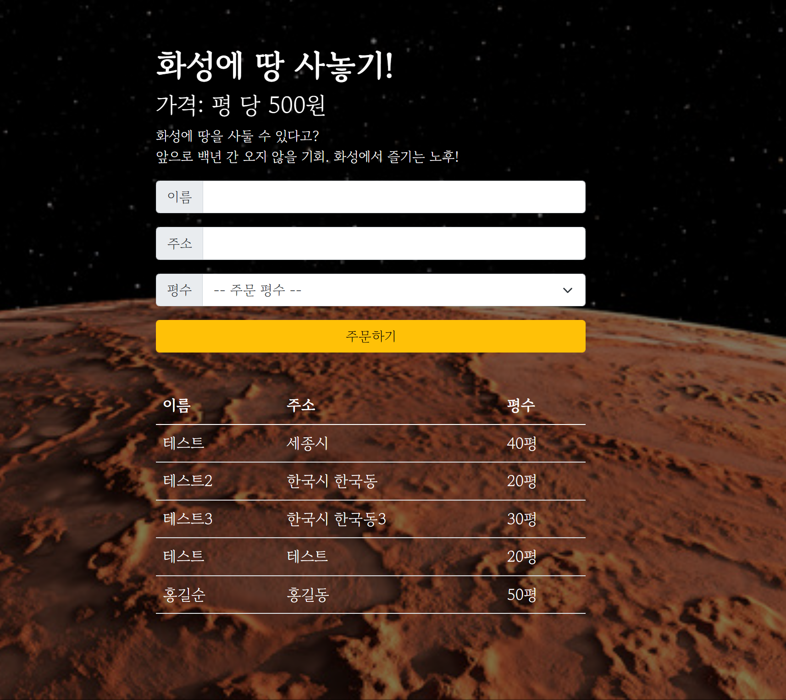

2-5. 테스트 완료 상태

---

**3. 스파르타피디아**

* 준비운동

   1. 폴더 구조화(동일)

   2. 패키지 설치

   - (설치 요구) : Flask, pymongo, dnspython,  **bs4, requests (웹 스크래핑을 위한 패키지 추가)**

* 기능구현

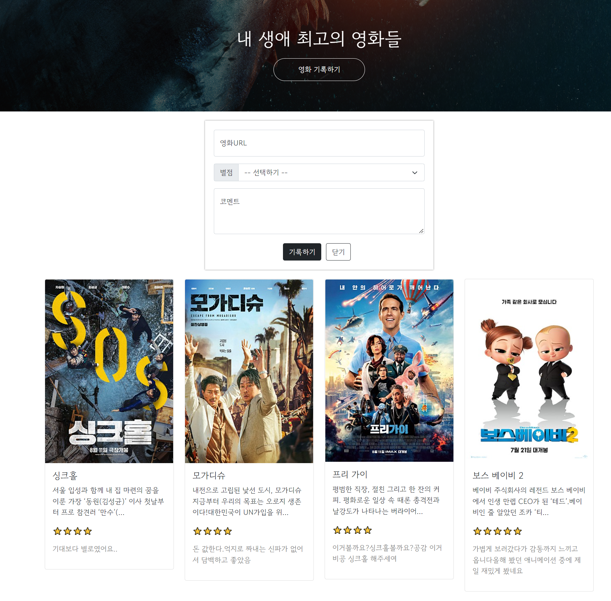

3-1. 완성본 미리보기

   1) Client에서 무엇을 구현해야하는지 생각하기

    - 영화 기록하기(URL, 별점, 코멘트)를 입력하여 기록하기

    - 영화 정보를 데이터베이스에서 읽어서 카드로 형태로 출력하기

   2) 조각기능 구현(모듈)

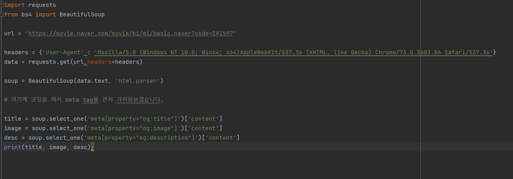

3-2. 조각기능 구현(웹 스크래핑-og태그 활용)

   3) 기능 구현

    - 주의사항 : 데이터베이스에 정수가 문자열로 저장되어있으므로 **parseInt()**를 통해서 정수형으로 변환하여야함.

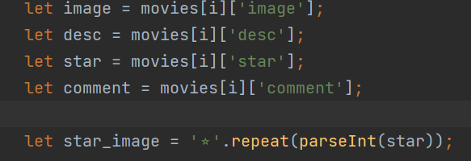

3-3. 주의사항 예시

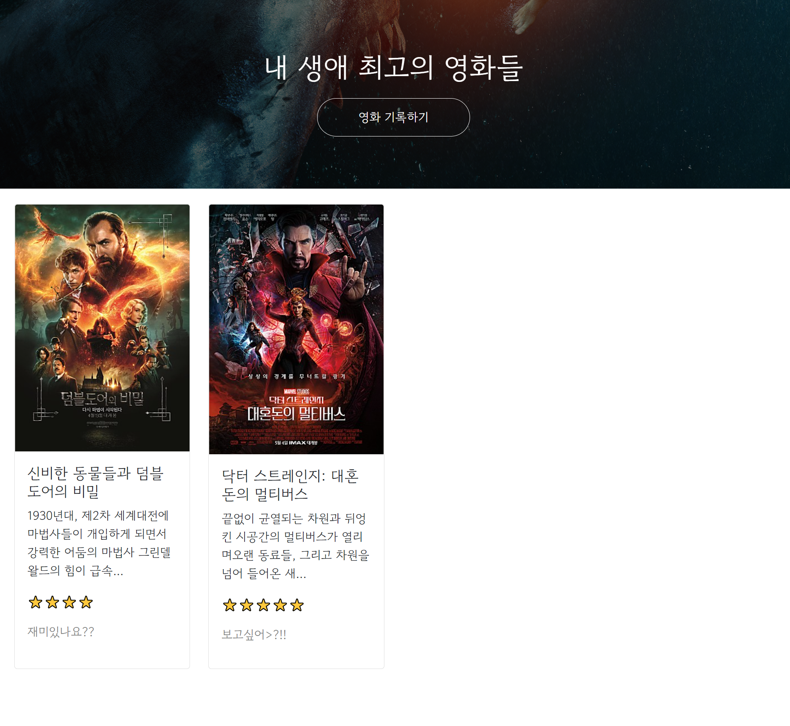

3-4. 기능구현 완료 상태

---

**4. 4주차 숙제**

    - 영화 기록한 것을 아래와 같이 영화를 추가할 수 있게 하는 것이다.

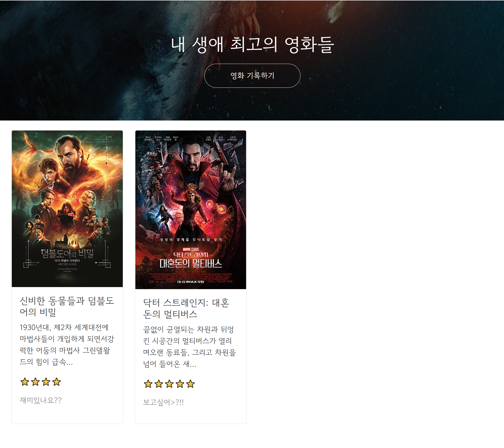

4-1. 숙제 완성본

---

**정리**

**이 과정을 진행하면서 나의 기억력을 테스트할 수 있었다...**

**지금 한 내용들이 제가 공부했던 것들이라는게**

**신기할정도로 기억이 나지 않았습니다 하하하하하하하하하하**

**기억하기 위해 반복밖에 답이 없다...**

**반복하고 또 반복!! 화이팅!!**

