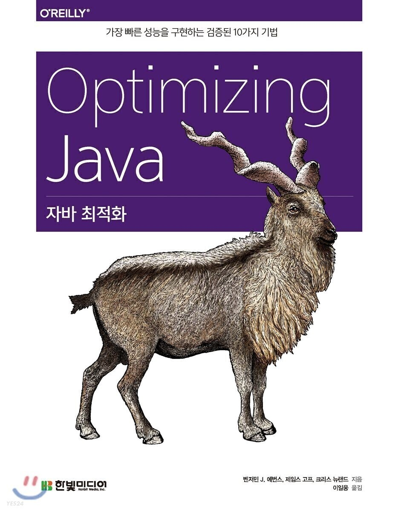

## 가비지 수집 기초

---

가비지 수집(GC)은 자바 환경을 상징하는 여러 특성 가운데서도 단연 돋보이지만, 자바 플랫폼이 처음 출시됐을 때 GC는 상당한 반감을 샀습니다. 언어 수준에서 의도적으로 수집기 작동을 제어하지 못하게 만들었다는 사실(최신 버전도 변함은 없습니다)이 알려지면서 여론은 더 나빠지게 되었습니다.  


초창기 자바 GC 성능에 대한 불만이 쏟아져 나왔지만, 외려 그 때문에 자바 플랫폼의 인지도가 높아지게 되었습니다.  

그러나 세월이 지나면서 유저가 제어할 수 없는, 강제적인 초기 GC의 비전은 그 정당성이 충분히 입증되었습니다. 사실 요즘 메모리는 손으로 직접 관리해야 한다는 의견에 동조하는 애플리케이션 개발자는 거의 없습니다. 신세대 시스템 프로그래밍 언어(예. Go, Rust)에서도 메모리 관리는 (예외적인 경우가 아니면) 프로그래머가 아닌, 컴파일러나 런타임의 영역이라고 보는 시각이 지배적입니다.  

자바 가비지 수집의 요체는, 시스템에 있는 모든 객체의 수명을 정확히 몰라도 런타임이 대신 객체를 추적하며 쓸모없는 객체를 알아서 제거하는 것입니다. 이렇게 자동 회수한 메모리는 깨끗이 비우고 재활용할 수 있습니다.  

모든 가비지 수집 구현체는 다음 두 가지 기본 원칙을 준수해야 합니다.

* 알고리즘은 반드시 모든 가비지를 수집해야 한다.
* 살아 있는 객체는 절대로 수집해선 안 된다.

두 번째 원칙이 더 중요합니다. 살아 있는 객체를 수집했다간 **세그먼테이션 결함(Segmentation fault)**이 발생하거나 프로그램 데이터가 조용히 더럽혀집니다. 자바 GC 알고리즘은 프로그램이 사용 중인 객체를 절대 수집해선 안 됩니다.  

프로그래머가 저수준 세부를 일일이 신경쓰지 않는 대가로 저수준 제어권을 포기한다는 사상이 바로 자바 관리 방식의 핵심이며, **제임스 고슬링(James Gosling)**이 블루칼라 언어라고 말한 특징이 잘 드러나는 대목입니다.  

이 장에서는 자바 가비지 수집의 기초 이론을 소개하고, 자바 플랫폼에서 가비지 수집을 완전히 이해/제어하기가 어려운 이유를 설명합니다. 또 핫스팟이 런타임에 객체를 힙에 나타내는 방법과 그 기본 특성을 자세히 알아봅시다.  

끝부분에서는 핫스팟에서 가장 단순한 상용 수집기인 병렬 수집기를 소개하고 다양한 워크로드에서의 쓰임새를 함께 알아보겠습니다.  


### 마크 앤 스위프

---

자바에서 가비지 수집이 무엇인지 자바 프로그래머들에게 질문하면 **마크 앤 스위프**(Mark and Sweep, 표시하고 쓸어 담기) 알고리즘이 기초라는 정도만 알고 있지만, 실제로 그 프로세스가 어떻게 작동하는지 자세히 모르는 사람들이 많습니다.  

이 절에서는 GC 알고리즘의 기본 개념과 이를 응용해 메모리를 어떻게 자동 회수하는지 알아봅니다. 기본 개념을 쉽게 설명하고자 알고리즘은 일부러 단순화하겠습니다(실제 JVM에서 GC가 수행되는 방법은 다릅니다.)  

가장 초보적인 마크 앤 스위프 알고리즘은 할당됐지만, 아직 회수되지 않은 객체를 가리키는 포인터를 포함한 할당 리스트(Allocated list)를 사용합니다. 전체적인 GC 알고리즘은 다음과 같습니다.

1. 할당 리스트를 순회하면서 마크 비트(Mark bit)를 지운다.
2. GC 루트로부터 살아 있는 객체를 찾는다.
3. 찾은 객체마다 마크 비트를 찾는다.
4. 찾은 객체마다 마크 비트를 세팅한다.
5. 할당 리스트를 순회하면서 마크 비트가 세팅되지 않은 객체를 찾는다.  
   1) 힙에서 메모리를 회수해 프리 리스트(free list)에 되돌린다.  
   2) 할당 리스트에서 객체를 삭제한다.

살아 있는 객체는 대부분 깊이-우선(Depth first) 방식으로 찾습니다. 이렇게 해서 생성된 객체 그래프를 **라이브** **객체 그래프(Live Object Graph)**라고 하며, 접근 가능한 **객체의 전이 폐쇄(Transitive closure of reachable Objects)**라고도 합니다.

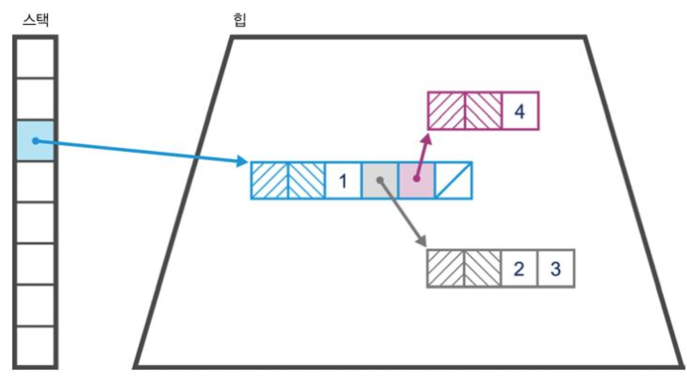

[그림 6-1] 단순 메모리 레이아웃

힙 상태는 시각화하여 살펴보기 어렵습니다. 하지만 명령줄에서 간단히 jmap -histo하면 다음과 같이 타입별로 할당된 바이트 수와 그만큼의 메모리를 차지한 전체 인스턴스의 개수를 확인할 수 있습니다.

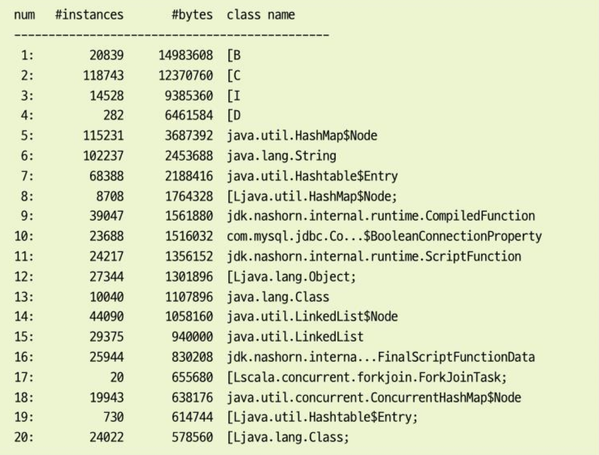


GUI 화면은 2장에서 배운 VisualVM의 Sampling 탭으로 볼 수 있습니다. VisualVM 전용 플러그인(VisualGC)을 쓰면 힙이 시시각각 변하는 모습을 지켜볼 수 있지만, 그때그때 힙 모습만 봐서는 정확히 분석을 할 수가 없으니 GC 로그를 이용해야 합니다.  


#### **가비지 수집 용어**

GC 알고리즘을 설명하는 용어는 약간 헷갈리는 편입니다(또 시간이 지나면서 의미가 달라지는 용어도 있습니다). 의미가 명확한 몇 가지 기본 용어를 살펴봅시다.

**STW(Stop-The-World)**

GC 사이클이 발생하여 가비지를 수집하는 동안에는 모든 애플리케이션 스레드가 중단됩니다. 따라서 애플리케이션 코드는 GC 스레드가 바라보는 힙 상태를 무효화할 수 없습니다. 단순 GC 알고리즘에서는 대부분 이럴 때 STW가 일어납니다.  


**동시**

GC 스레드는 애플리케이션 스레드와 동시(병행) 실행될 수 있습니다. 이는 계산 비용 면에서 아주 어렵고 비싼 작업인 데다, 실상 100% 동시 실행을 보장하는 알고리즘은 없습니다. 7.3 절에 나오는 핫스팟의 **CMS(Concurrent Mark and Sweep, 동시 마크 앤 스위프)**는 사실상 '**준 동시(Mostly concurrent)**' 수집기라고 볼 수 있습니다.  


**병렬**

여러 스레드를 동원해서 가지비 수집을 합니다.  


**정확**

정확한 GC 스킴은 전체 가비지를 한방에 수집할 수 있게 힙 상태에 관한 충분한 타입 정보를 지니고 있습니다. 대략 int와 포인터의 차이점을 언제나 분간할 수 있는 속성을 지닌 스킴이 정확한 것입니다.  


**보수**

보수적인 스킴은 정확한 스킴의 정보가 없습니다. 그래서 리소스를 낭비하는 일이 잦고 근본적으로 타입 체계를 무시하기 때문에 훨씬 비효율적입니다.  


**이동**

이동 수집기에서 객체는 메모리를 여기저기 오갈 수 있습니다. 즉, 객체 주소가 고정된 게 아닙니다. (C++처럼) 맨포인터(raw pointer)로 직접 액세스하는 환경은 이동 수집기와 잘 맞지 않습니다.  


**압착**

할당된 메모리(즉, 살아남은 객체들)는 GC 사이클 마지막에 연속된 단일 영역으로 (대개 이 영역 첫 부분부터) 배열되며, 객체 쓰기가 가능한 여백의 시작점을 가리키는 포인터가 있습니다. 압착 수집기는 **메모리 단열화(Memory fragmentation)**를 방지합니다.  


**방출**

수집 사이클 마지막에 할당된 영역을 완전히 비우고 살아남은 객체는 모두 다른 메모리 영역으로 이동(방출)합니다.

언어, 환경이 달라도 쓰는 용어는 같습니다. 가령, 파이어폭스(Firefox) 웹 브라우저(스파이더멍키, SpiderMonkey)의 자바스크립트 런타임도 가비지 수집을 하는데, 최근 수년간 자바 GC 구현체에 이미 구현된 특성(예. 정확(Exactness), 압착(Compaction))이 계속 추가되어 왔습니다.  


### 핫스팟 런타임 개요

---

앞서 나열한 일반적인 GC 용어뿐만 아니라, 구현체에 특정한 용어도 있습니다. 가비지 수집의 작동 원리를 온전히 이해하려면 핫스팟 내부도 어느 정도는 알아야 합니다.  

여러분도 알다시피, 자바 언어에서는 다음 두 가지 값만 사용합니다.

* 기본형(byte, int 등)
* 객체 레퍼런스

많은 자바 프로그래머들이 객체를 대충 뭉뚱그려 말하는데, 이 책을 읽는 여러분은 이것 하나만 명심하세요. 자바는 C++과 달리 주소를 역참조(dereference)하는 일반적인 메커니즘이 없고, 오직 오프셋 연산자(Offset operator(,))만으로 필드에 액세스하거나 객체 레퍼런스의 메서드를 호출할 수 있습니다. 또 자바는 값으로 호출(call-by-value) 방식으로만 메서드를 호출합니다. 물론, 객체 레퍼런스의 경우 복사된 값은 힙에 있는 객체의 주소입니다.  


#### **객체를 런타임에 표현하는 방법**

핫스팟은 런타임에 oop라는 구조체(Structure)로 자바 객체를 나타냅니다. oop는 평범한 객체 포인터(Ordinary object pointer)의 줄임말로, C언어 느낌이 물씬 풍기는 순수 포인터입니다. oop는 참조형(reference type) 지역 변수 안에 위치합니다. 여기서 자바 메서드의 스택 프레임으로부터 자바 힙을 구성하는 메모리 영역 내부를 가리킵니다.  

oop를 구성하는 자료 구조는 여러 가지가 있습니다. 그중 **instanceOop**는 자바 클래스의 인스턴스를 나타냅니다.  

instanceOop의 메모리 레이아웃은 모든 객체에 대해 기계어 워드 2개로 구성된 헤더로 시작합니다. Mark 워드(인스턴스 관련 메타데이터를 가리키는 포인터)가 먼저 나오고, 그 다음은 Klass 워드(클래스 메타데이터를 가리키는 포인터)가 나옵니다.  

자바 7까지는 instanceOop의 Klass 워드가 자바 힙의 일부인 펌젠(Pergen)이라는 메모리 영역을 가리켰습니다. 자바 힙에 있는 건 예외 없이 객체 헤더를 갖고 다녀야 한다는 게 기본 원칙이었고, 실제로 자바 옛 버전은 메타데이터를 klassOop으로 참조했습니다. klassOop의 메모리 레이아웃은 정말 단순해서 객체 헤더 바로 다음에 klass 메타데이터가 나옵니다.  

자바 8부터는 Klass가 자바 힙의 주 영역 밖으로(JVM 프로세스의 C 힙 밖은 아닙니다) 빠지게 되었습니다. 그래서 최신 버전의 자바는 Klass 워드가 자바 힙 밖을 가리키므로 객체 헤더가 필요 없습니다.

> klassOop를 앞에 K를 붙인 것은, 자바 Class<?> 객체를 나타내는 instanceOop와 구분하기 위함으로 둘은 전혀 다릅니다.

[그림 6-2]를 보면 차이점이 분명합니다. klassOop에는 클래스용 가상 함수 테이블(virtual function table, vtable)이 있지만, Class 객체에는 리플레션으로 호출한 Method 객체의 레퍼런스의 배열이 담겨 있습니다.

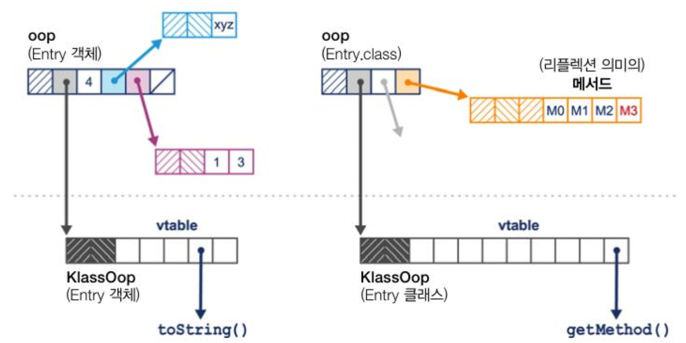

[그림 6-2] klassOop와 Class 객체

oop는 대부분 기계어 워드라서, 예전 32비트 프로세서는 32비트, 요즘 프로세서는 64비트 입니다. 그런데 이런 구조로는 메모리가 크게 낭비될 우려가 있기 때문에 핫스팟은 조금이라도 메모리를 절약할 수 있게 압축 oop(Compressed oop)라는 기법을 제공합니다. 다음 옵션을 주면 힙에 있는 다음 oop가 압축됩니다(자바 7버전 이상, 64비트 힙은 이 옵션이 디폴트)

```bash
-XX:+UseCompressedOops
```

* **힙에 있는 모든 객체의 Klass 워드**
* **참조형 인스턴스 필드**
* **객체 배열의 각 원소**

핫스팟 객체 헤더는 일반적으로 다음과 같이 구성됩니다.

* Mark 워드(32비트 환경은 4바이트, 64비트 환경은 8바이트)
* Klass 워드(압축됐을 수도 있음)
* 객체가 배열이면 length 워드(항상 32비트)
* 32비트 여백(정렬 규칙 때문에 필요할 경우)

객체 인스턴스 필드는 헤더 바로 다음에 나열됩니다. klassOop는 Klass 워드 다음에 메소드 vtable이 나옵니다. [그림 6-3]은 압축 oop의 메모리 레이아웃입니다.

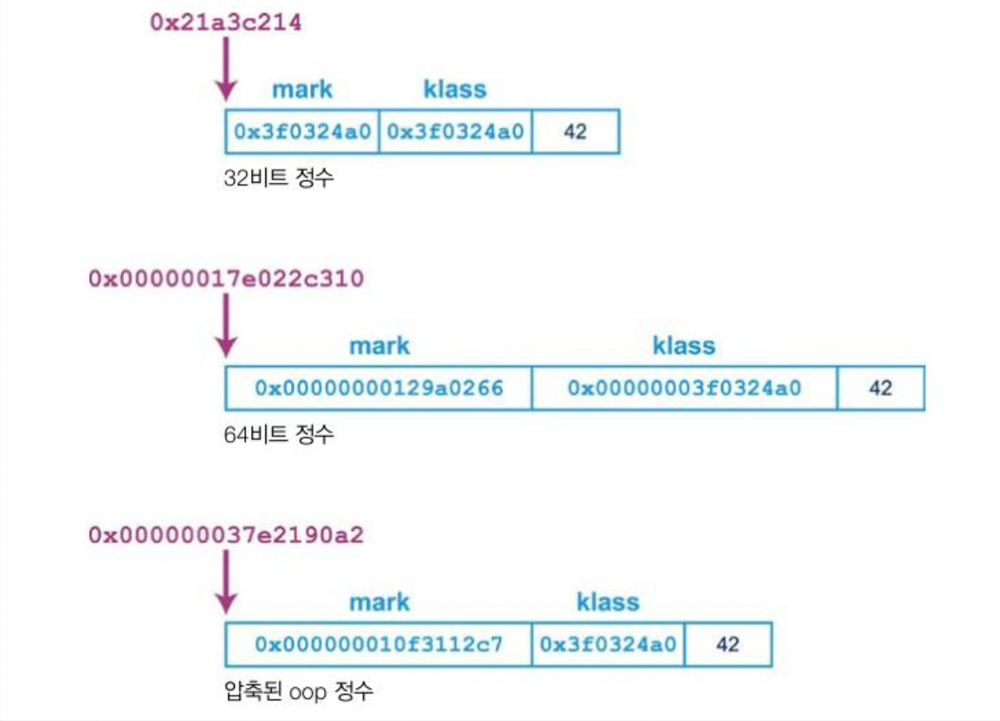

[그림 6-3] 압축 oop

과거, 지연에 극도로 민감한 일부 애플리케이션에서 힙 크기 증가 (대개 10~50%)를 대가로 압축 oop 기능을 끄면 성능이 개선되기도 했지만, 대단한 성능 향상이라고 할 정도는 아니었습니다. 4장에서 배운 '스위 만지작거리기' 안티패턴의 고전적인 사례라고 볼 수 있습니다.  

자바에서 배열은 객체입니다. 그래서 JVM의 배열도 oop로 표시되며, 배열은 Mark 워드, Klass 워드 다음에 배열 길이를 나타내는 Length 워드가 붙습니다. 자바 배열 인덱스가 32비트 값으로 제한되는 것이 이 때문입니다.

> 이렇게 배열 길이를 따로 메타데이터에 넣어 관리하므로 C/C++ 안에서 배열 길이를 몰라 대개 변수를 반드시 하나 더 넘겨야 할 일은 없습니다.

JVM 환경에서 자바 레퍼런스는 instanceOop(또는 null)를 제외한 어떤 것도 가리킬 수 없습니다. 저수준에서는 이런 의미입니다.

* 자바 값은 기본형 값 또는 instanceOop 주소(레퍼런스)에 대응되는 비트 패턴이다.
* 모든 자바 레퍼런스는 자바 힙의 주 영역에 있는 주소를 가리키는 포인터라고 볼 수 있다.
* 자바 레퍼런스가 가리키는 주소에는 Mark 워드 + Klass 워드가 들어 있다.
* klassOop와 Class<?> 인스턴스는 다르며, (klassOop는 힙의 메타데이터 영역에 있음) klassOop을 자바 변수 안에 넣을 수 없다.

핫스팟의 oop 체계는 (OpenJDK 8 소스 코드 디렉터리에 있는) .hpp 파일에 정의되어 있습니다. 다음은 oop의 전체 상속 구조입니다. 

* oop (추상 베이스)
  + instanceOop (인스턴스 객체)
  + methodOop (메서드 표현형)
  + arrayOop (배열 추상 베이스)
  + symbolOop (내부 심볼  / 스트링 클래스)
  + klassOop (Klass 헤더) (자바 7 이전만 해당)
  + markOop

이렇듯 런타임에 oop 구조체를 이용해서 한 포인터는 클래스 메타데이터를, 다른 포인터는 인스턴스 메타데이터를 가리켜 객체를 나타내는 건 드문 방식이 아닙니다. 다른 JVM이나 실행 환경(예. 애플 ios)도 이와 유사한 메커니즘을 사용합니다.  


#### **GC 루트 및 아레나**

GC 루트는 핫스팟에 관한 블로그 글이나 기사에서 자주 나오는 말입니다. GC 루트는 메모리의 '고정점(anchor point, 앵커 포인트)'로, 메모리 풀 외부에서 내부를 가리키는 포인터입니다. 메모리 풀 내부에서 같은 메모리 풀 내부의 다른 메모리 위치를 가리키는 내부 포인트(internal pointer)와 정반대인, 외부 포인터(external pointer)입니다.  

GC 루트는 다음과 같이 종류가 다양합니다.

* 스택 프레임(Stack frame)
* JNI
* 레지스터(끌어올려진(hoisted) 변수)
* (JVM 코드 캐시에서) 코드 루트
* 전역 객체
* 로드된 클래스의 메타데이터

힙에 있는 객체를 가리키는 (null 아닌) 참조형 지역 변수로 말하자면 가장 단순한 형태의 GC 루트입니다.  

핫스팟 GC는 아레나(무대)라는 메모리 영역에서 작동합니다. GC는 아주 저수준 장치라서 일반 자바 개발자가 세세하게 작동 원리를 숙지할 필요는 없지만, 성능 엔지니어는 경우에 따라 JVM 내부를 깊이 파헤쳐야 할 수도 있으므로 이런 개념과 용어를 잘 알아두면 업무에 도움이 됩니다.  

핫스팟은 자바 힙을 관리할 때 시스템 콜을 하지 않습니다. 3.6 절에서 설명했듯이, 핫스팟은 유저 공간 코드에서 힙 크기를 관리하므로 단순 측정값을 이용해 GC 서브시스템이 어떤 성능 문제를 일으키고 있는지 파악할 수 있습니다.  

이제 자바/JVM 워크로드의 가비지 수집을 일으키는 두 가지 주요 특성에 대해 자세히 살펴보겠습니다. (자바 전체 성능을 결정짓는 핵심 요인인) 자바 GC가 무엇 때문에 일어나는지 궁금한 독자는 다음 절을 정독하세요.

### **할당과 수명**

자바 애플리케이션에서 가비지 수집이 일어나는 주된 원인은 다음 두 가지입니다.

* 할당률
* 객체 수명

할당률은 일정 기간(단위는 보통 MB/s) 새로 생성된 객체가 사용한 메모리량입니다. JVM은 할당률을 직접 기록하지 않지만, 이 값은 비교적 쉽게 측정할 수 있고 센섬 같은 툴을 쓰면 정확하게 구할 수 있습니다.  

반면, 객체 수명은 대부분 측정하기(어림잡아 계산하기도) 어렵습니다. 사실, 수동 메모리 관리 시스템에서 가장 논란이 됐던 부분 중 하나가, 실제 애플리케이션에서 객체 수명을 제대로 파악하기가 너무 복잡하다는 것입니다. 그 결과, 객체 수명이 더 핵심적인 요인입니다.

> 가비지 수집은 '메모리를 회수해 재사용'하는 일입니다. 객체는 대부분 단명(short-lived)하므로 가비지 수집에서 핵심 전제는 동일한 물리 메모리 조작을 몇 번이고 게속 다시 쓸 수 있는가 하는 점입니다.

객체가 생성된 후 잠시 존재하고 그 상태를 보관하는 데 사용한 메모리를 다시 회수한다는 발상이 핵심입니다. 이게 안 된다면 가비지 수집은 무용지물입니다. 7장에서 보겠지만, 가비지 수집기는 여러 가지 따져봐야 할 트레이드 오프가 있는데, 그중 가장 중요한 것도 대개 할당 및 수명과 연관되어 있습니다.

#### **약한 세대별 가설**

약한 세대별 가설(Weak Generational Hypothesis)은 소프트웨어 시스템의 런타임 작용을 관찰한 결과 알게 된 경험 지식으로, JVM 메모리 관리의 이론적 근간을 형성합니다.

> JVM 및 유사 소프트웨어 시스템에서 객체 수명은 이원적(bimodal) 분포 양상을 보인다. 거의 대부분의 객체는 아주 짧은 시간만 살아 있지만, 나머지 객체는 기대 수명이 훨씬 길다.

이 법칙은 사람들이 객체 지향 워크로드를 상대로 실제로 실험을 하며 얻은 것으로, 결론은 '가비지를 수집하는 힙은, 단명 객체를 쉽고 빠르게 수집할 수 있게 설계해야 하며, 장수 객체와 단명 객체를 완전히 떼어놓는게 가장 좋다'는 것입니다.  

핫스팟은 몇 가지 메커니즘을 응용하여 약한 세대별 가설을 십분 활용합니다.

* 객체마다 '세대 카운트(Generational count, 객체가 지금까지 무사 통과한 가비지 수집 횟수)'를 센다.
* 큰 객체를 제외한나머지 객체는 에덴(Eden, 탁아소(Nursery)라고도 함) 공간에 생성한다. 여기서 살아남은 객체는 다른 곳으로 옮긴다.
* 장수했다고 할 정도로 충분히 오래 살아남은 객체들은 별도의 메모리 영역(올드 old 또는 테뉴어드(Tenured, 종신 세대)에 보관한다.

[그림 6-4]은 이 접근 방식을 간단히 나타낸 것입니다. 특정 가비지 수집 사이클 이상 살아남은 객체들은 테뉴어드 세대로 승격됩니다. 그럼에도 나와 있듯이, 이들 영역은 처음부터 자연스럽게 연속된 공간입니다.

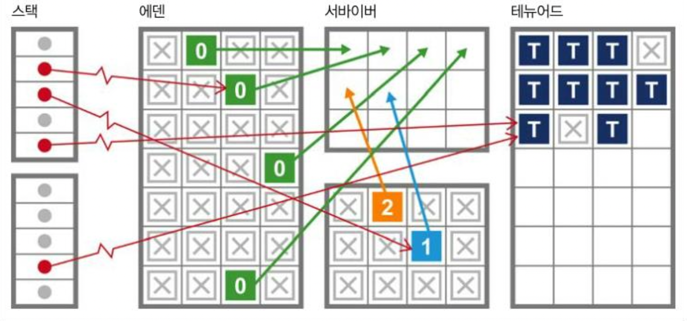

그림 6-4, 세대별 단위 수집(generational collection)


세대별 수집 목적에 따라 메모리를 상이한 영역으로 나누면 핫스팟의 마크 앤 스위프 수집의 구현에 따라서 그 결과가 더 세분화됩니다. 여기서 중요한 건, 외부에서 영(young) 세대 내부을 가리키는 포인터를 계속 추적하는 기법입니다. 덕분에 GC 사이클에서 살아남은 젊은 객체들을 집어내느라 전체 객체 그래프를 다 뒤질 필요가 없습니다.

> '늙은 객체가 젊은 객체를 참조할 일은 거의 없다'는 게 약한 세대별 가설의 두 번째 포인트입니다.

핫스팟은 카드 테이블(card table)이라는 자료 구조에 늙은 객체가 젊은 객체를 참조하는 정보를 기록합니다. 카드 테이블은 JVM이 관리하는 바이트 배열로, 각 원소는 올드 세대 공간의 512바이트 영역을 가리킵니다.  

핵심 로직은 이렇습니다. 늙은 객체 o에 있는 참조형 필드값이 바뀌면 o에 해당하는 instanceOop가 들어 있는 카드를 찾아 해당 엔트리를 더티(dirty) 마킹합니다. 핫스팟은 레퍼런스 필드를 업데이트할 때마다 단순 쓰기 배리어(write barrier)를 이용합니다. 필드 저장이 끝나면 결국 어딘가에서 다음 코드 조각이 실행됩니다.

```cpp
card[*instanceOop >> 9] = 0;
```

여기서 카드에 더티하다고 표시한 값이 0이고, 카드 테이블이 512바이트라서 9비트 우측 시프트합니다.  

자바 수집기는 오랩전부터 힙을 영/올드 영역으로 나누어 관리해왔는데, 자바 8u40 버전부터 새로운 수집기('가비지 퍼스트(Garbage First, 가비지 우선')의 품질이 완성 단계에 이르렀습니다. 7.3 절에서 배울 내용이지만, G1은 힙을 배치하는 방식 자체가 완전히 다릅니다. 오라클이 자바 9이후부터 G1을 디폴트 수집기로 굳힐 의도라서 이 새로운 힙 관리 방식은 점점 더 중요성이 커질 전망입니다.  


### 핫스팟의 가비지 수집

---

자바의 C/C++ 계열의 환경과 달리 OS를 이용해 동적으로 메모리를 관리하지 않습니다. 대신 일반 프로세스가 시작되면 JVM은 메모리를 할당(또는 예약)하고 유저 공간에서 연속된 단일 메모리 풀을 관리합니다.  

이 메모리 풀은 앞서 언급했듯이 각자의 목적에 따라 서로 다른 영역으로 구성되며, 객체는 보통 에덴 영역에 생성됩니다. 수집기가 줄곧 객체를 이동시키기 때문에 객체가 차지한 주소는 대부분 시간이 흐르면서 아주 빈번하게 바뀝니다. 이처럼 객체를 이동시키는 것을 '방출'이라고 하는데(6.1.1절 참고), 핫스팟 수집기는 대부분 방출 수집기입니다.

#### 스레드 로컬 할당

JVM은 성능을 강화하여 에덴을 관리합니다. 에덴은 대부분의 객체가 탄생하는 장소이고 단명 객체(다음 GC 사이클까지도 못 버티는 수명이 짧은 객체)는 다른 곳에는 위치할 수 없으므로 특별히 관리를 잘해야 하는 영역입니다.  

JVM은 에덴을 여러 버퍼로 나누어 각 애플리케이션 스레드가 새 객체를 할당하는 구역으로 활용하도록 배포합니다. 이렇게 하면 각 스레드는 혹여 다른 스레드가 자신의 버퍼에 객체를 할당하지는 않을까 염려할 필요가 없습니다. 이 구역을 스레드 로컬 할당 버퍼(Thread-local Allocation Buffer, TLAB)라고 합니다.

> 핫스팟은 애플리케이션 스레드에 발급한 TLAB 크기를 동적으로 조정합니다. 따라서 한 스레드가 메모리를 엄청나게 소모하고 있으면 스레드에 버퍼를 내주는 오버헤드를 줄이기 위해 더 큼지막한 TLAB를 건네줍니다.

애플리케이션 스레드가 자신의 TLAB를 배타적으로 제어한다는 건 JVM 스레드의 할당 복잡도가 O(1)이라는 뜻입니다. 스레드가 객체를 생성할 때 이 객체에 저장 공간이 할당되고 스레드-로컬 포인터는 그다음 비어 있는 메모리 주소를 가리키도록 업데이트하기 때문입니다. C 런타임 용어를 빌리면, 단순포인터 범프(pointer bump), 즉 '다음 빈' 포인터로 계속 쭉 이동시키는 부가 명령어입니다.  

[그림 6-5]를 보면, 각 애플리케이션 스레드가 새 객체를 할당할 버퍼를 갖고 있습니다. 애플리케이션 스레드가 버퍼를 다 채우면 JVM은 새 에덴 영역을 가리키는 포인터를 내어줍니다.

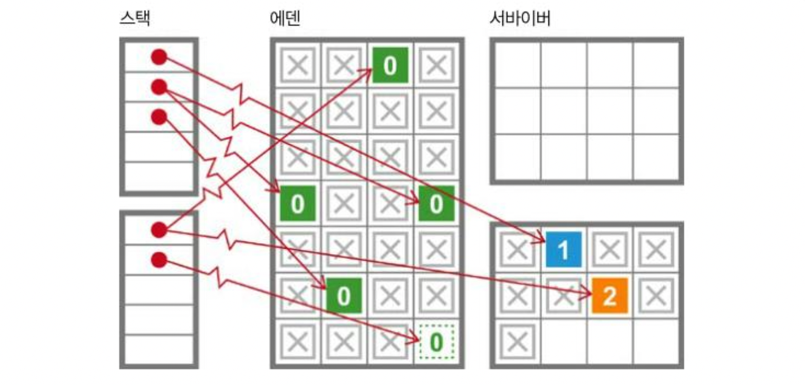

[그림 6-5] 스레드 로컬 할당

#### **반구형 수집**

반구형 (방출) 수집기(hemispheric evacuating collector)는 (보통 크기가 같은) 두 공간을 사용하는 독특한 방출 수집기입니다. 실제로 장수하지 못한 객체를 임시 수용소에 담아 두자는 아이디어입니다. 덕분에 단명 객체가 테뉴어드 세대를 어지럽히지 않게 하고 풀 GC 발생 빈도를 줄일 수 있습니다. 이 두 공간(반구)은 두 가지 기본적인 특성을 지닙니다.

* 수집기가 라이브 반구를 수집할 때 다른 반구로 압착시켜 옮기고 수집된 반구는 비워서 재사용한다.
* 절반의 공간은 항상 완전히 비운다.

물론, 이 방법을 따르면 수집기 반구 내부에 실제로 보관 가능한 메모리 공간보다 2배를 더 사용하게 되어 낭비지만, 공간이 너무 크지 않다면 유용한 기법입니다. 핫스팟은 이 반구형 기법과 에덴 공간을 접목시켜 영 세대 수집을 합니다.  

핫스팟에서는 영 힙의 반구부를 서바이버(survivor, 생존자) 공간 이라고 합니다. [그림 6-6]에서 보다시피 일반적으로 서바이버 공간은 에덴보다 작으며, 이 공간의 역할은 각 영 세대 수집을 교환하는 것입니다. 서바이버 공간을 튜닝하는 방법은 9장에서 다룹니다.

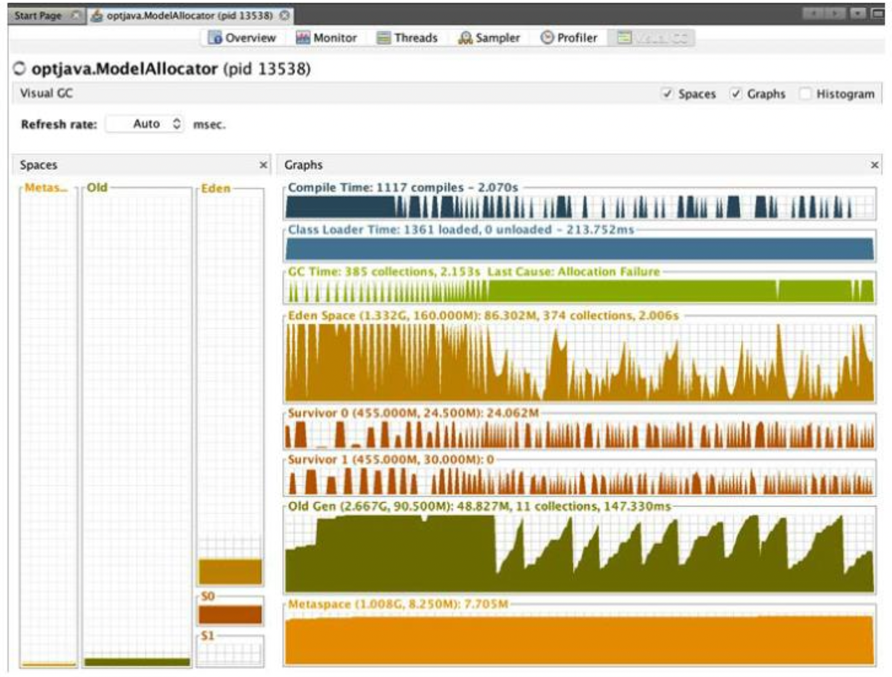

[그림 6-6] VisalGC 플러그인

2.7.1 절에서 배운 VisualGC 플러그인은 초기 GC 디버깅 툴로 유용합니다. 7장에서 다룰 내용이지만, GC 로그에는 훨신 더 쓸모있는 정보가 담겨있고 순간순간 기록한 JMX 데이터보다 더 깊이 있는 GC 분석을 가능케 합니다. 물론, 새로 분석 작업을 할 때 간단한 애플리케이션의 메모리 사용 실태를 훑어보는 용도로는 요긴합니다.  

VisualGC를 쓰면 힙에서 재배치된 객체나 각 영 세대마다 발생한 서바이버 공간 사이의 순환 등 가비지 수집의 결함 효과(Agrregate Effect)도 확인할 수 있습니다.  


### 병렬 수집기

---

자바 8 이전까지 JVM 디폴트 가비지 수집기는 병렬 수집기(parallel collector)입니다. 병렬 수집기는 처리율에 최적화되어 있고 영 GC, 풀 GC 모두 풀 STW를 일으킵니다. 애플리케이션 스레드를 모두 중단시킨 다음, 가용 CPU 코어를 총동원해 가능한 한 재빨리 메모리를 수집합니다. 병렬 수집기도 여러 가지입니다.

**Parallel GC**

가장 단순한 영 세대용 병렬 수집기입니다.

**ParNew GC**

CMS 수집기와 함께 사용할 수 있게 Parallel GC를 조금 변형한 것입니다.

**ParallelOld GC**

올드(테뉴어드) 세대용 병렬 수집기입니다.  

종류는 달라도 여러 스레드를 이용해 가급적 빠른 시간 내에 살아 있는 객체를 식별하고 기록작업을 최소화하도록 설계된 점은 비슷합니다. 많이 쓰이는 두 수집기의 차이점을 자세피 살펴보겠습니다.

#### **영 세대 병렬 수집**

영 세대 수집은 가장 흔한 가비지 수집 형태입니다. 스레드가 에덴에 객체를 할당하려는데 자신이 할당받은 TLAB 공간은 부족하고 JVM은 새 TLAB를 할당할 수 없을 때 영 세대 수집이 발생합니다. 영 세대 수집이 일어나면 JVM은 어쩔 수 없이 전체 애플리케이션 스레드를 중단시킵니다. 어떤 스레드에서 객체를 할당할 수 없다면 삽시간에 다른 스레드도 같은 처지가 될 것입니다.

> 스레드가 TLAB 밖에 객체를 할당할 수도 있지만(예: 메모리 블록이 아주 클 경우), 이러한 논 TLAB 할당률은 가급적 낮추는게 좋습니다.

전체 애플리케이션(또는 유저) 스레드가 중단되면 핫스팟은 영 세대(에덴 및 현재 비어 있지 않은 서바이버 공간)을 뒤져서 가비지 아닌 객체를 골라냅니다. 이때 GC 루트(와 올드 세대에서 출발하는 GC 루트를 식별하기 위한 카드 테이블)를 병령 마킹 스캔 작업의 출발점으로 삼습니다.  

그러고 나서, Parallel GC는 살아남은 객체를 현재 비어 있는 서바이버 공간으로 모두 방출한 후, 세대 카운트를 늘려 한 차례 이동했음을 기록합니다. 마지막으로, 에덴과 이제 막 객체들을 방출시킨 서바이버 공간을 재사용 가능한 빈 공간으로 표시하고, 애플리케이션 스레드를 재시작해 TLAB를 애플리케이션 스레드에 배포하는 프로세스를 재개합니다(그림 6-7 및 그림 6-8).

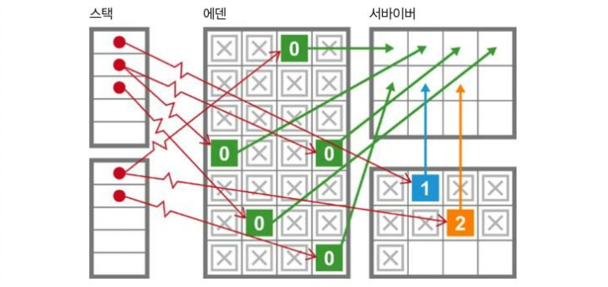

그림 6-7. 영 세대 수집

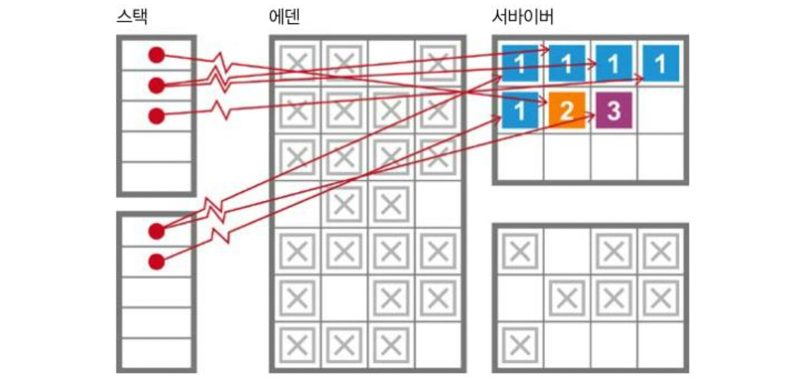

그림 6-8. 영 세대 방출

살아 있는 객체만 건드려 약한 세대별 가설의 이점을 최대한 활용하고, 가능한 코어를 총동원해 STW 중단 시간을 조금이라도 단축해 가비지를 효율적으로 수집하곘다는 의도입니다.  


#### **올드 세대 병렬 수집**

ParallelOld GC는 현재(자바 8 기준) 디폴트 올드 세대 수집기입니다. Parallel GC와 상당히 비슷하지만, 근본적인 차이점이 있습니다. Parallel GC는 객체를 방출하는 반구형 수집기이지만, ParallelOld GC는 하나의 연속된 메모리 공간에서 압착하는 수집기입니다.  

올드 세대에 더 이상 방출할 공간이 없으면 병렬 수집기는 올드 세대 내부에서 객체들을 재배치해서 늙은 객체가 죽고 빠져 버려진 공간을 회수하려고 합니다. 따라서 메모리 사용 면에서 아주 효율적이고 메모리 단편화가 일어날 일도 없습니다.  

풀 GC 사이클 내내 CPU를 점유하는 대가로 메모리는 아주 효율적으로 배치되는 것입니다. [그림 6-9]는 방출과 압착, 두 기법의 차이점을 나타낸 것입니다.

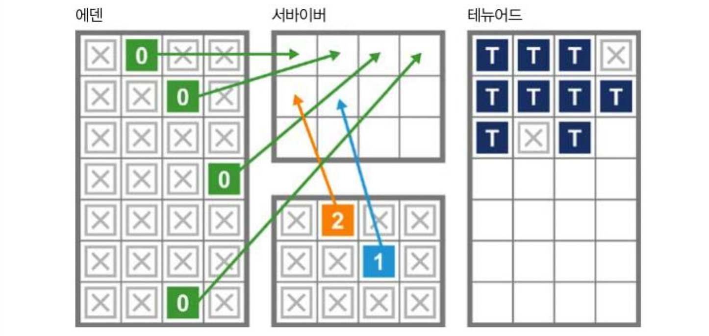

그림 6-9. 방출 vs 압축

두 메모리 공간은 애초 쓰임새부터 다르므로 수집 양상 또한 전혀 다릅니다. 영 세대 수집은 단명 객체 처리가 목적이기 때문에 영 공간의 정유 상태는 GC 이벤트가 발생할 때마다 메모리 할당 및 소거가 일어나면서 급격히 변합니다.  

반면, 올드 공간은 크게 눈에 띄는 변화가 없습니다. 이따금 큰 객체가 태뉴어드 세대에 직접 생성될 때도 있지만, 그밖에는 영 세대 객체가 승격되거나, 올드/풀 수집이 일어나 객체를 재 탐색 후 다시 배치하는 등의 수집이 일어날 때만 변합니다.  


#### 병렬 수집기의 한계

병렬 수집기는 세대 전체 콘텐츠를 대상으로 한번에, 가능한 한 효율적으로 가비지를 수집합니다. 그런데 이러한 설계 방식에도 단점이 있습니다. 우선, 풀 STW를 유발합니다. 약한 세대별 가설에 따르면 극소수 객체만 살아남기 때문에 영 수집에서는 STW가 문제 되지 않습니다.

> 영 병렬 수집기는 설계상 죽은 객체는 절대로 건드리지 않기 때문에 마킹 단계의 소요 시간은(소수) 생존 객체 수에 비례합니다.

전체 힙에서 영 영역을 작게 구성한 설계는 기본적으로 대부분의 워크로드에서 영 수집에 따른 중단 시간이 매우 짧다고 가정한 것입니다. 실제로, 최신 2기가바이트짜리(디폴트 크기) JVM에서 영 수집 중단  시간은 거의 대부분 10밀리초 이하입니다.  

그러나 올드 수집은 사정이 전혀 다릅니다. 올드 세대는 디폴트 크기 자체가 영 세대의 7배나 됩니다. 이 사실 하나만으로도 풀 수집시 STW 시간이 영 수집보다 훨씬 더 길어지리라 예상할 수 있습니다.  

또 한 가지 중요한 사실은, 영역 내 살아 있는 객체 수만큼 마킹 시간도 늘어난다는 것입니다. 올드 객체는 장수한 객체이므로 풀 수집 시 이들 중 상당수는 살아남을 공산이 큽니다.  

올드 수집의 가장 큰 약점은 STW 시간이 힙 크기에 거의 비례한다는 점입니다. 힙이 계속 커질수록 ParallelOld GC의 중단 시간도 함께 나빠지기 시작합니다.  

GC 이론에 입문한 분들 중에는 재미 삼아 STW 중단 시간을 줄여보려고 마크 앤 스위프 알고리즘을 조금 변용해보기도 하는데 절대로 그럴 수 없을 것입니다. 가비지 수집은 벌써 40년도 더 넘게 아주 활발히 연구가 이루어진 컴퓨터 과학 분야입니다. '그냥 이렇게 한번 해보면 안될까?'하는 식으로 정말 개선된 사례는 한번도 없습니다.  

중단 시간이 아주 짧은, 거의 동시에 작동하는 수집기도 있지만, 이 또한 만병통치약은 아닙니다. 가비지 수집의 근본적인 어려움은 매한가지입니다.  

GC에 순진하게 접근했다가 큰코다치는 사례 하나를 보겠습니다. TLAB 할당은 할당 성능을 엄청나게 끌어올리지만, 수집 사이클에는 전혀 도움이 안 됩니다. 다음 코드를 보면서 그 이유를 떠올려봅시다.

```java
public static void main(String[] args) {
    int[] anInt = new int[1];
    anInt[0] = 42;
    Runnable r = () -> {
        anInt[0]++;
        System.out.println("Changed: " + anInt[0]);
    }

    new Thread(r).start();
}
```

변수 antInt는 정수 하나를 포함하는 배열 객체입니다. 이 변수는 처음에 메인 스레드가 관할하는 TLAB에 할당되지만, 곧바로 새로운 스레드로 넘어갑니다. 다시 말해, 하나의 스레드에만 귀속되는 TLAB의 특성은 할당이 일어나는 지점에서만 그렇고, 기본적으로 객체가 할당되자마자 깨질 수 있습니다.  

손쉽게 스레드를 생성하는 자바의 능력은 플랫폼으로서 아주 강력한 장점이지만, 새 스레드는 곧 실행 스택을 의미하고 실행 스택의 각 프레임은 GC 루트의 원천이므로 가비지 수집 관점에서 보면 전체적인 모양새가 점점 더 복잡해집니다.  


### 할당의 역할

---

자바의 가비지 수집 프로세스는 보통 유입된 메모리 할당 요청을 수용하기에 메모리가 부족할 때 작동하여 필요한 만큼 메모리를 공급합니다. 즉 GC 사이클은 어떤 고정된, 예측 가능한 일정에 맞춰 발생하는 게 아니라, 순전히 그때그때 필요에 의해 발생합니다.  

이렇게 불확정적으로, 불규칙하게 발생한다는 점이 가비지 수집의 가장 중요한 특징입니다. GC 사이클은 하나 이사의 힙 메모리 공간이 꽉 채워져 더 이상 객체를 생성할 공간이 없을 때 일어납니다.

> 가비지 수집 로그는 기존의 시계열 해석(time series analysis) 방법으로 처리하기 어렵습니다. GC 이벤트 간의 규칙성이 거의 없어서 대다수 시계열 라이브러리로 쉽게 끼워 맞출수가 없습니다.

GC가 발생하면 모든 애플리케이션 스레드가 멈춥니다(더 이상 객체를 생성할 수 없으니 오래 실행될 자바 코드는 사실상 없는 셈입니다). JVM은 모든 코어를 총동원해 가비지를 수집하고 메모리를 회수한 후, 애플리케이션 스레드를 재개합니다.  

할당의 중요성을 설명하기 위해 아주 단순화된 사례를 들어보겠습니다. 다음과 같이 힙 매개변수 값을 설정하고 이 값들은 시간이 지나도 변하지 않는다고 가정합시다. 물론, 실제로는 애플리케이션이 힙 크기를 동저긍로 조정하지만 이건 어디까지나 간단한 예시입니다.

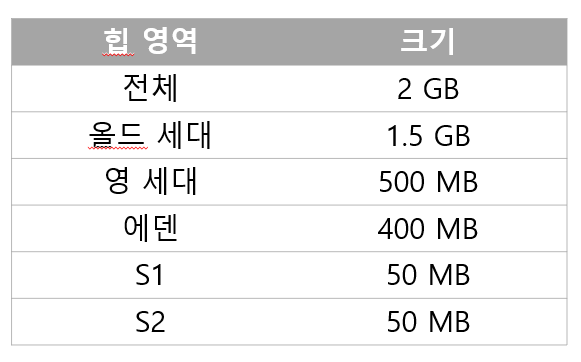

다음은 애플리케이션이 정상 상태(Steady state)에 도달한 측정한 몇 가지 GC 지표입니다.

| 할당률 | 100 MB/s |
| --- | --- |
| 영 GC 시간 | 2 ms |
| 풀 GC 시간 | 100 ms |
| 객체 수명 | 200 ms |

에덴은 4초면 다 채워지므로 정상 상태에서는 4초마다 한번씩 영 GC가 발생합니다. 에덴에 있는 객체는 대부분 사망하지만, 살아남은 객체는 서바이버 공간(SS1으로 지칭)으로 방출됩니다. 이 단순 모형에서는, 마지막 200 밀리초 이내에 생성된 객체는 사망할 시간조차 없어 무조건 살아남습니다.

| GC0 | @ 4s | 20 MB Eden => SS1 (20MB) |
| --- | --- | --- |

초가 더 지나 다시 에덴은 꽉 채워지고 객체를(SS2로 지칭) 방출시켜야 하지만, 이 단순 모형에서는 CC0 때 살아남아 SS1으로 승격된 객체는 하나도 생존하지 못합니다. 객체 수명이 겨우 200밀리초인데 4초가 더 경과했으니 살아남았을 리 만무합니다.

| GC1 | @ 8.002 s | 20 MB Eden => SS2 (20MB) |
| --- | --- | --- |

다시 말해, GC1 이후 SS2는 에덴에 새로 도착한 객체들로만 채워지고 SS2 객체 중 세대 나이 > 1인 객체는 없습니다. 한번 더 수집을 진행하면 패턴이 더 분명해집니다.

| GC2 | @ 12.004s | 20 MB Eden => SS1 (20MB) |
| --- | --- | --- |

위와 같은 이상적인 단순 모형에서는 결국 어느 객체도 테뉴어드 세대로 승격될 수 없고 이 공간은 실행하는 동안 계속 빈 상태일 것입니다. 현실과는 영 동떨어진 모형입니다.  

대신 약한 세대별 가설에 따르면, 객체 수명은 (고정된 게 아니라) 어떤 분포를 보이며, 이 분포가 불확실한 탓에 결국 일부 객체는 테뉴어드에 도달할 것입니다.  

이런 식으로 할당되는 시나리오를 간단한 시뮬레이터로 살펴봅시다. 이 시뮬레이터가 할당한 객체는 대부분 단명하지만, 일부는 꽤 오랫동안 살아남습니다. 할당을 정의하는 매개변수는 이렇습니다. 객체 크기는 x, y 할당률은 mbPerSec, 단명 객체 수명은 shortLivedMs, 시뮬레이션 대상 스레드 개수는 nThreads입니다. 이폴트 값은 다음과 같이 세팅합니다.

```java
public class ModelAllocator implements Runnable {
    private volatile boolean shutdonw = false;

    private double chanceOfLongLived = 0.02;
    private int multiplierForLongLived = 20;
    private int x = 1024;
    private int y = 1024;
    private int mbPerSec = 50;
    private int shortLivedMs = 100;
    private int nThreads = 8;
    private Executor exec = Executors.newFixedThreadPool(nThreads);
```

다음 코드는 main() 및 여타 시작/매개변수 세팅 코드를 뺀 나머지 ModelAllocator 입니다.

```java
@Override
public void run() {
    final int mainSleep = (int) (1000.0 / mbPerSec);

    while(!shutdown) {
        for(int i=0; i < mbPerSec; i++) {
            ModelObjectAllocation to = new ModelObjectAllocation(x, y, lifetime());
            exec.execute(to);
            try {
                Thread.sleep(mainSleep);
            } catch (InterruptedException ex) {
                shutdown = true;
            }
        }
    }
}

// 약한 세대별 가설을 간단히 모형화한 함수
// 객체의 기대 수명을 반환함.
// 보통 객체 수명은 아주 짧지만, 두물게 "장수하는" 객체도 있음
public int lifetime() {
    if(Math.random() < chanceOfLongLived) {
        return multiplierForLongLived * shortLivedMs;
    }

    return shortLivedMs;
}
```

메인 실행기에 단순 목 객체를 붙여 애플리케이션의 객체 할당을 흉내 내보겠습니다.

```java
public class ModelObjectAllocation implements Runnable{
    private final int[][] allocated;
    private final int lifeTime;

    public ModelObjectAllocation(final int x, final int y, final int lifeFor) {
        allocated = new int[x][y];
        lifeTime = lifeFor;
    }

    @Override
    public void run() {
        try {
            Thread.sleep(lifeTime);
            System.err.println(System.currentTimeMillis() + " : " + allocated.length);
        } catch (InterruptedException e) {

        }
    }
}
```

VisualVM로 보면 메모리 사용 패턴이 단순 톱니형으로 표시됩니다. 힙을 효율적으로 사용하는 자바 애플리케이션에서 흔히 나타나는 패턴(그림 6-10)입니다. (참고. 툴링 및 메모리 작용의 시각화는 7장에서 자세히 다룹니다)

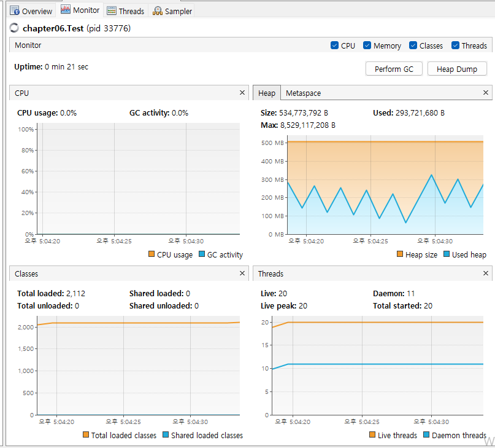

[그림 6-10] 단순 톱니형 그래프

일반적인 할당 패턴을 한 가지 더 살펴보면서 할당 이야기를 마무리하겠습니다 .할당률은 실제로 아주 심하게 변하거나 갑자기 확 치솟기도(bursty)합니다. 앞서 보았던 정상 상태의 애플리케이션에서 다음과 같은 지표를 얻었다고 합시다.  


| 2초 간 정상 상태 할당 | 100 MB/s |
| --- | --- |
| 1 초 간 할당률 급증 | 1 GB/s |
| 100초 후 정상상태로 돌아옴 | 100 MB/s |

처음 정상 상태로 2초 동안 200 MB의 객체가 에덴에 할당되었습니다. 장수 객체가 없다면 이 메모리에 있는 모든 객체의 수명은 100 ms입니다. 그리고 할당률이 확 치솟아 불과 0.2초만에 200MB가 에덴에 추가 할당됩니다. 그 결과 나이가 100 ms 이하인 객체는 다 합쳐서 100 MB입니다. 살아남은 객체 용량이 서바이버 공간보다 크기 때문에 JVM 어쩔 수 없이 바로 테뉴어드로 보냅니다.

| GC0 | @ 2.2s | 100 MB Eden => Tenured (100MB) |
| --- | --- | --- |

할당률이 가파르게 상승해 100 MB의 객체가 살아남았지만, 이 모형에서 '생존자' 전원은 금세 죽은 객체가 되므로 테뉴어드 세대는 지저분해집니다. 이런 가비지는 풀 수집이 일어나기 전까지 회수되지 않습니다.  

몇 번 더 수집이 진행되면 패턴이 도드라집니다.

| GC1 | @ 2.602s | 200MB Eden => Tenured (300 MB) |
| --- | --- | --- |
| GC2 | @ 3.004s | 200MB Eden => Tenured (500MB) |
| GC3 | @ 7.006s | 20MB Eden => SS1(20MB)[+ Tenured (500MB)] |

이상 살펴본 것처럼 수집기는 일정한 주기마다 실행되는 게 아니라, 필요에 따라 그때마다 실행됩니다. 할당률이 높을수록 GC는 더 자주 발생합니다. 할당률이 너무 높으면 객체는 어쩔 수 없이 테뉴어드로 곧장 승격될 것입니다.  

이 현상을 **조기 승격(Permature promotion)**이라고 합니다. 가비지 수집에서 가장 중요한 간접 효과이자, 많은 튜닝 활동의 출발점 중 하나입니다.  


### 정리

---

가비지 수집은 자바가 탄생한 이래, 자바 커뮤니티에서 아주 활발하게 논의된 주제입니다. 이 장에서는 성능 엔지니아가 JVM의 GC 서브 시스템을 효과적으로 다루기 위해 꼭 알아야 할 핵심 개념을 알아봤습니다.

* 마크 앤 스위프 수집
* 핫스팟 내부에서 객체를 나타내는 방법
* 약한 세대별 가설
* 핫스팟 메모리 서브시스템의 실제
* 병렬 수집기
* 할당과 그 중심적인 역할

### Keywords

---

#### 수집기 작동 제어

system.gc()라는 메서드가 있긴 하지만 실제로 이 메서드를 사용할 일은 없습니다.

#### 세그먼테이션 결함(Segmentation fault)

세그멘테이션 결함은 컴퓨터 소프트웨어의 실행 중에 일어날 수 있는 특수한 오류. 세그먼테이션 위반. 세그멘테이션 실패라고도 하며, 세그폴트(Segfault)로 줄여서 쓰기도 합니다. 세그멘테이션 결함은 프로그램이 허용되지 않은 메모리 영역에 접근을 시도하거나, 허용되지 않은 방법으로 메모리 영역에 접근을 시도할 경우 발생합니다(예를 들어, 읽기 전용 영역에 어떤 내용을 쓰려고 시도하거나, 운영체제에서 사용하는 영역에 다른 내용을 덮어쓰려 하는 경우) [출처: 위키백과]  


#### 프리 리스트

동적 메모리 할당을 계획적으로 사용된 자료 구조로, 메모리의 할다되지 않는 영역들을 연결 리스트로 연결해서 운용합니다.(출처: 위키백과)   


#### 깊이 우선 방식

알고리즘 기초 교과서에 단골처럼 등장하는 DFS(Depth-First Search, 깊이 우선 탐색)입니다. 루트 노드부터 시작해서 (깊이를 우선하여) 간선을 타고 내려가다가 막다른 골목에 이르면 마지막에 타고 내려온 간선을 따라 되돌아가며 탐색하는 방식입니다.  


#### 접근 가능한 객체의 전이 폐쇄

전이 폐쇄(Transitive closure)는 이산 수학에서 나오는 용어로, 여기서는 살아있는 객체 그래프의 어느 지점에서 출발하든 접근 가능한 모든 지점의 집합을 의미합니다.  


#### 자바는 C++과 달리 주소를 역참조하는 일반적인 메커니즘이 없다.

C/C++ 언에서는 역참조 연산자(\*)로 주소를 받아 그 주소에 저장된 값을 가져올 수 있습니다.  


#### 객체 레퍼런스의 경우 복사된 값은 힙에 있는 객체의 주소입니다.

자바 언어를 처음 배울 때 가장 헷갈리는 부분이기도 한데요. 결론적으로 자바는 C/C++와 달리 오로지 값에 의한 호출(call by value)만 합니다. 인수에 해당하는 변수가 원시형이면 그 값을 복사해서 넘기고(따라서 피부호출부(calle))에서 받은 값을 변경해도 호출부(caller)에는 아무런 영향이 없음). 객체면 이 객체를 가리키는 레퍼런스(즉, 힙 주소를 가리키는 포인터 값)를 값'으로 넘깁니다.  


#### klassOop

한마디로 klassOop는 JVM 클래스로더가 로드한 Class 객체를 JVM 수준에서 나타낸 구조체.  


#### 쓰기 배리어

늙은 객체와 젊은 객체의 관계가 맺어지면 카드 테이블 엔트리르를 더티 값으로 세팅하고, 반대로 관계가 해제되면 더티 값을 지우는 실행 엔진에 포함된 작은 코드 조각  


#### 카드 테이블이 512바이트라서 9비트 우측 시프트합니다.

2^9 = 512  


#### 자바 9이후부터 G1을 디폴트 수집기도 굳힐 의도라서 이 새로운 힙 관리 방식은 점점 더 중요성이 커질 전망입니다.

자바 9, 자바 10 버전의 기본 가비지 수집기는 G1 입니다.  


#### 시계열 해석(Time Series analysis)

시계열(time series)은 일정 시간 간격으로 배치된 데이터들의 수열을 말하며, 시계열 해석(time series analysis)은 시계열을 해석하고 이해하는 데 여러 가지 방법을 연구하는 분야입니다.(출처: 위키백과)  


#### 정상 상태(Steady State)

시간에 따라 변화가 없거나, 있더라도 규칙성을 띠는 일정한 변화를 보이는 상태

#### 생성된 객체는 사아망할 시간조차 없으니 무조건 살아남는다.

모든 객체의 수명이 200ms 이므로 200ms x 100 MB/s = 20MB의 객체만 살아남습니다.

#### 객체 수명이 겨우 200 밀리초인데 4초가 더 경과했으므로 살아남았을 리 만무하다.

8.002s에 GC1이 수행된 건 영 GC 시간(2ms = 0.002s)만큼 수집 시간이 흘렀기 때문입니다.
