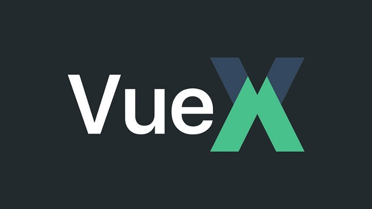

## Vuex의 범위

---

어제 오늘 Vuex를 사용하기 위해 많은 시간을 투자했다... 결국은 Vuex로 하기 힘든 일이었다...

컴포넌트 구조는 다음과 같습니다.

A Component

└ B Component

   └ D Component

└ C Component

   └ D Component

   └ E Component

      └ D Component

루트 컴포넌트 A에서 B와 C로 구성된 페이지로 분리되고 D라는 컴포넌트는 B와 C 컴포넌트에서 접근 가능하다.

이때 D 컴포넌트는 새로운 창을 통해 접근할 수 있다. C의 자식 컴포넌트인 E 컴포넌트에서도 D 컴포넌트 접근이 가능하다.

D 컴포넌트가 존재하면 D 컴포넌트로 데이터를 전달하여 D 컴포넌트의 기능을 사용할 수 있게 하고

D 컴포넌트 창이 존재하지 않으면 새로 띄우도록 하는 기능이었다.

B와 C 에서는 D 컴포넌트가 자식이기 때문에 부모 자식 간에 데이터 전달을 통해 쉽게 데이터 전달이 가능했다.

E 컴포넌트에서 호출한 D 컴포넌트는 B와 C 컴포넌트에서 호출한 D와 자식관계가 아니기 때문에 이벤트 버스를 통해 데이터를 전달하도록 구현하였다.

D 컴포넌트가 존재하는지까지 이벤트 버스를 쓰면 이벤트 버스가 너무 많이 사용되어 Vuex 를 통해 해결하려고 했다.

D 컴포넌트를 호출한 시점에 Vuex에 상태값을 변경하고 D 컴포넌트 창이 닫힐 때 Vuex 상태값을 변경하려고 했다.

근데... 아무리 변경해도 B와 C 컴포넌트 Vuex 상태값이 변경되지 않는 것을 확인할 수 있었다...

> 이유가 무엇일까?...

Vuex 의 전달 범위는 같은 창 내에서만 저장소를 공유한다. 만약 창을 띄우거나 탭을 통해 이동할 경우 이동하기 전 마지막 상태값을 전달한다. 이러한 이유 때문에... 전달되지 않는다.

정리하면 다음과 같습니다.

Vuex는 애플리케이션의 상태 관리를 위한 공식 상태 관리 패턴으로 Vuex의 상태는 기본적으로 Vue 애플리케이션 내에서 공유되며 단일 소스로 중앙 집중화되어 있으며, 여러 컴포넌트 간에 공유되고 동기화됩니다. 같은 Vue 인스턴스 내에서 공유되며 컴포넌트 간에 상태 값을 전달하고 업데이트하기 위해 사용됩니다.

그러나 Vuex의 상태를 다른 창과 실시간으로 공유하기 위해서는 몇 가지 추가적인 기술과 패턴이 필요합니다. Vuex는 기본적으로 클라이언트 측 상태 관리 도구이며, 실시간 데이터 공유를 위해서는 클라이언트-서버 아키텍처와 통신이 필요합니다.

결론부터 말하면 아직 필자는 이 기능을 끝내지 못했다... 이것을 오늘 퇴근하기 두 시간전에 알았고... 그때부터는 다른 작업을 먼저 진행했다...

이 문제를 해결하기 위한 방법은 알아보았다.

1. **실시간 통신 프로토콜**실시간 데이터 공유를 위해 **WebSocket**, **Socket.io,** 또는 **Server-Sent Events** (SSE)와 같은 실시간 통신 프로토콜을 사용할 수 있습니다. 클라이언트와 서버 간에 실시간으로 데이터를 교환하고 업데이트할 수 있습니다.
2. **백엔드 서버**  
   Vuex의 상태를 다른 창과 공유하기 위해서는 백엔드 서버가 필요합니다. 백엔드 서버는 클라이언트와의 통신을 관리하고 상태 업데이트를 처리합니다. 실시간 데이터베이스나 메시징 시스템을 사용하여 데이터를 저장하고 전파할 수 있습니다.
3. **이벤트 기반 아키텍처**  
   Vuex의 상태 변경을 다른 창과 공유하기 위해 이벤트 기반 아키텍처를 사용할 수 있습니다. Vuex 상태의 변경을 이벤트로 감지하고, 이벤트를 백엔드 서버로 전달하여 다른 창으로 전파합니다. 다른 창에서는 이벤트를 수신하고 해당 이벤트를 처리하여 상태를 업데이트할 수 있습니다.

이외에도 다양한 방법이 있겠지만... 필자는 아마도 실시간 통신 프로토콜을 사용할 것 같다... 하하하

만약 창이 아닌 탭인 경우는 다음과 같은 라이브러리가 존재합니다.

1. [Vuex-multi-tab-state](https://www.npmjs.com/package/vuex-multi-tab-state)
2. [Vuex-persist-indexeddb](https://github.com/kaodigua/vuex-persist-indexeddb)

필자는 탭이 아닌 창을 사용해야 한다... 나를 위한 라이브러리도 만들어줘~!!

> 오늘도 많은 것을 배운 하루였다...  
>   
> 처음엔 쉬울 것이라 생각했는데...
