## VisualVM 연동 및 사용 방법

---

`자바 최적화`를 공부하면서 VisualVM 경험해볼 수 있었습니다. 코드에 시간을 추가하여 시간을 줄이는 방식이 아닌 실제 코드의 성능을 파악하고 공부해보기 위해서입니다.

이를 위해 무료로 사용할 수 있는 VisualVM을 설치해보도록 하겠습니다.

### **환경**

* Window 11
* Java 11(OpenJdk 11 Temurin)
* Intel 13th 13600K
* RAM 32GB
* Intellij는 2023.1.2 (Ultimate Edition)

### VisualVM 설치

---

[VisualVM](https://visualvm.github.io/) 공식 홈페이지는 다음과 같습니다.

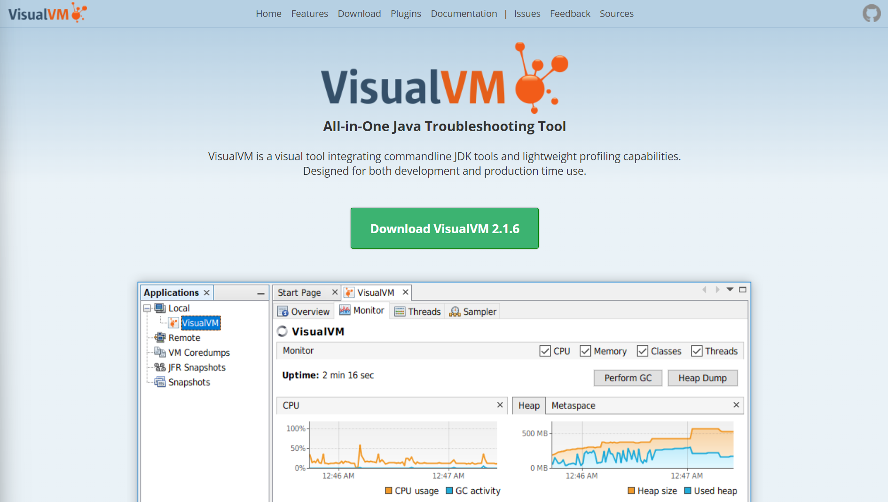

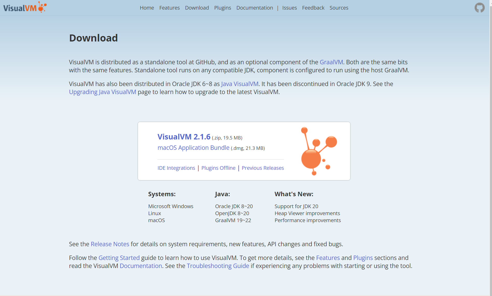

저는 알집 파일 형태로 다운 받았고 MacOS도 다운받으실 수 있습니다.

### Intellij 플러그인 설치

---

File > Settings > Plugins > VisualVM Launcher 설치

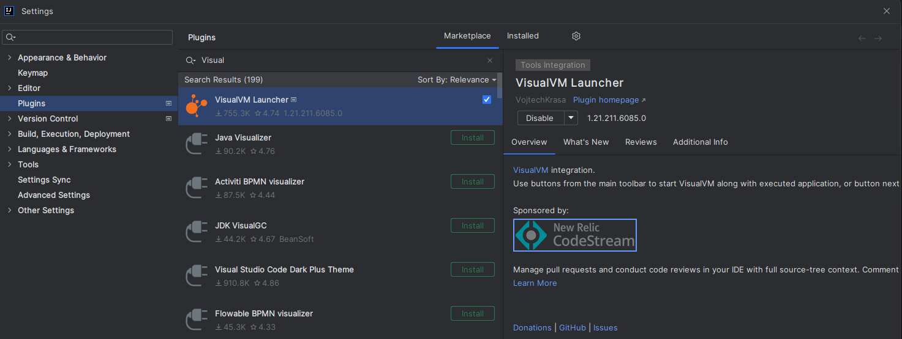

### Intellij와 VisualVM 연동

---

연동 방법은 2가지가 있습니다.

#### 메소드 실행을 이용한 방법

메소드를 실행시켜주세요.

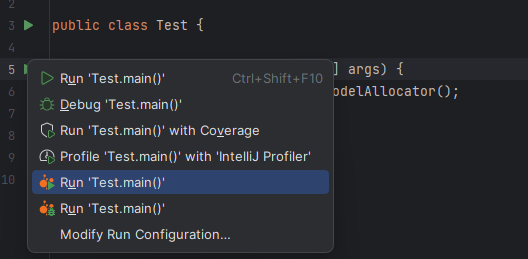

실행하시면 초기에 다음과 설정 이 뜨실 것입니다.

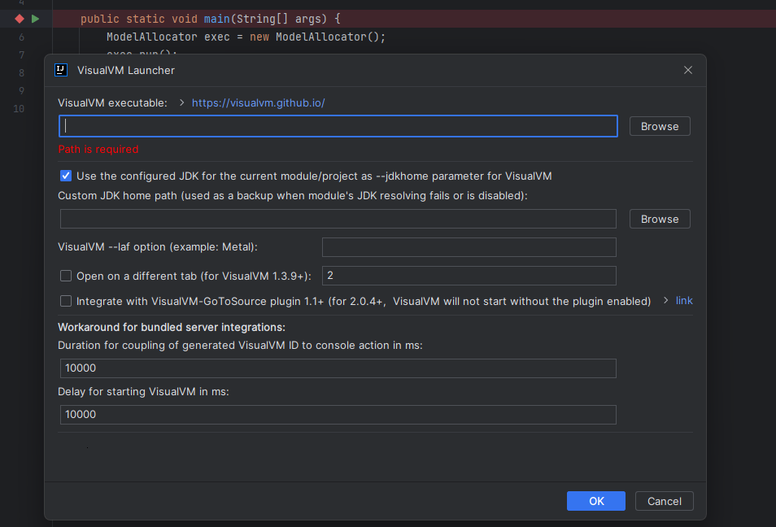

* **VisualVM executable**  
  설치한 파일의 위치로 폴더의 bin > visualvm.exe 파일을 넣어주시면 됩니다.
* **Custom JDK home path**  
  JDK의 위치입니다.

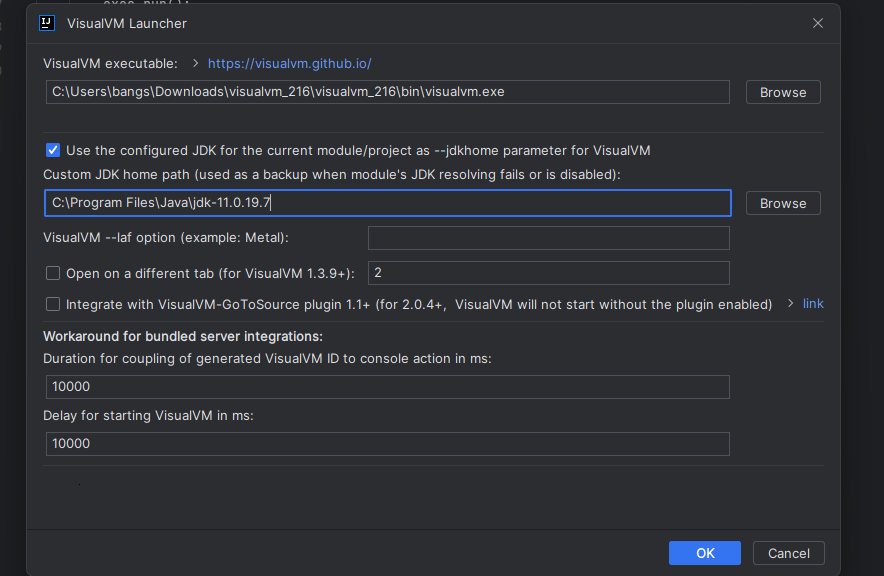

이와 같이 설정해주시면 VisualVM 프로그램이 실행됩니다.

#### 설정 창 직접 접근

File > Setting > Others Settings > VisualVM Launcher에서 위와 동일하게 설정해주시면 됩니다.

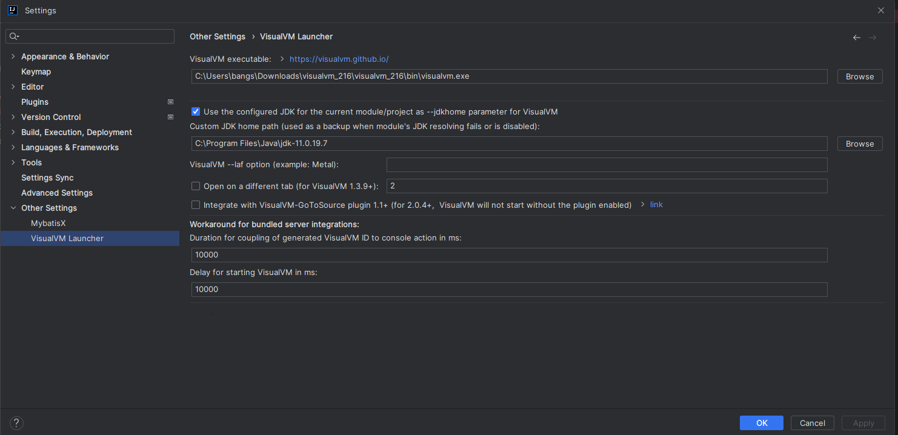

참고 구버전을 사용하실 경우 File > Settings 하단에 VisualVM Launcher가 존재하실 수 있습니다.

### VisualVM 사용법

---

#### 실행

다음과 같이 설정을 마치고 메소드를 실행해주시면 다음과 같은 화면을 보실 수 있습니다.

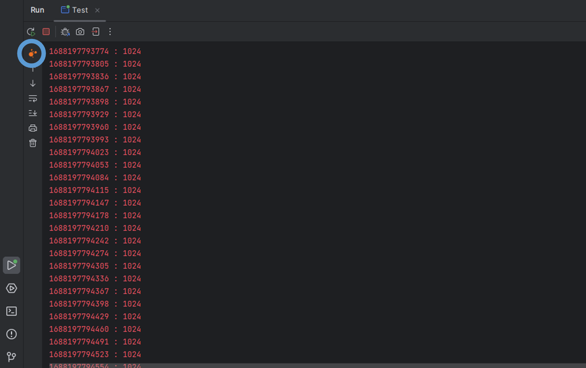

위에 버튼을 클릭해주시면 다음과 같이 동의 창이 뜨실 것입니다.

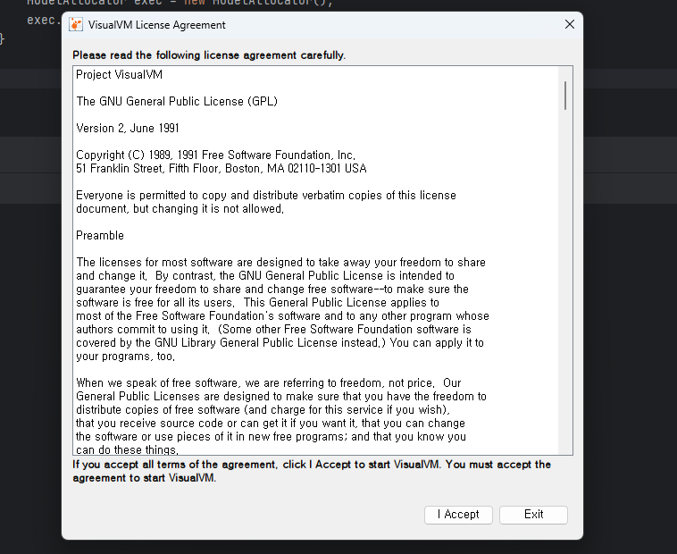

사용하실 것이므로 `I Accept` 버튼 클릭!하시면 다음과 같이 VisualVM이 이쁘게 뜨실 것입니다.

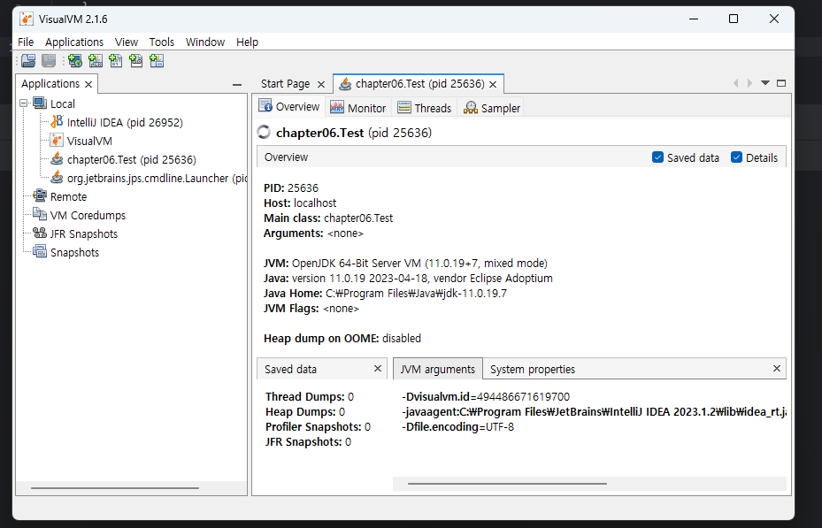

왼쪽에 실행시킨 프로그램을 실제로 확인할 수 있는데 이를 통해 Intellij의 성능과 프로그램의 성능을 확인 할 수 있습니다.

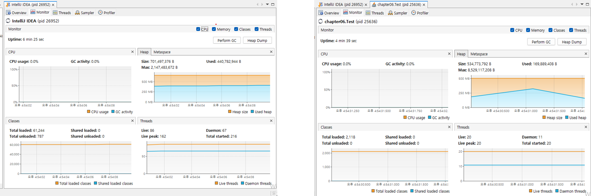

(좌) Intellij, (우) 작성된 코드

이를 통해 CPU, Heap, Classes, Threads를 확인할 수 있습니다.

#### Sampler vs Profiler

* Sampler  
  샘플링은 주기적(20ms ~ 10,000ms)으로 메소드 콜 정보(쓰레드 덤프 사용)와 메모리 사용 정보를 스냅샷하고 그 결과를 분석하여 메소드 별 혹은 쓰레드 별 CPU 실행 시간을 수집하는 것을 말한다. 그렇기에 정확한 분석은 아니지만, 분석 대상 어플리케이션의 성능에 큰 영향을 주지 않는다.
* Profiler  
  프로파일링은 메소드별 CPU 실행 시간을 분석하기 위해 함수의 진입과 진출부에 바이트 코드를  삽입하여 정확한 통계를 집계한다. 따라서 프로파일러를 실행해 보면 셋업 과정에서도 약간의 시간이 소요되며, 실행되는 과정에서도 분석 대상 어플리케이션의 성능에 영향을 미친다.

|  | Sampler | Profiler |
| --- | --- | --- |
| 동장 방식 | 주기적(20 ~ 10,000ms) | 메소드 진입부와 진출부에 통계 수집 코드 삽입 |
| 정확도 | 근접 | 정확 |
| 수집 결과 | 각 메소드 및 스레드별 CPU 실행 시간, | 각 메소드별 CPU 실행 시간 |
| 어플리케이션 영향도 | 적음 | 큼 |
