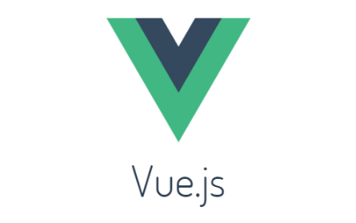
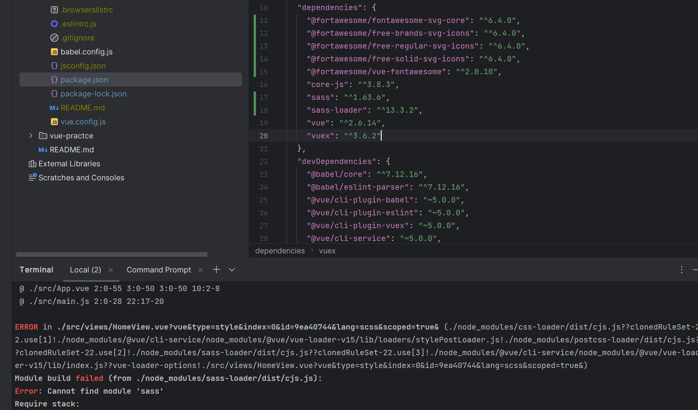

## Vue 2 Sass Loader 문제

---

### 문제

sass, sass-loader를 설치하였는데 아래 그림과 같이 지속적으로 에러가 발생하는 것을 확인할 수 있습니다.



> 이유가 무엇일까??   
> 

### 원인

이유는 다른 것이 아닌 Vue 버전에 따른 sass 지원 버전이 다르다는 것이다.

현재 사용하고 있는 Vue2에서는 sass 10 버전 이하로 사용해야한다는 것이다.

그래서 설치하였음에도 인식하지 못하는 문제가 발생하고 있는 것이다.

### 해결방법

원인에서 언급했던 것처럼 sass-loader 10버전 이하로 설치해주시면 됩니다.

```bash
# 기존 모듈 삭제
npm unistall sass-loader

# 10 버전 sass-loader 설치
npm install --save sass-loader@10
```

> Spring Boot가 정말 친절한 친구였어...  
>   
> 내가 사용하는 Spring Boot에 따라서  
> 원하는 버전을 설치해주는 좋은 친구였어...
