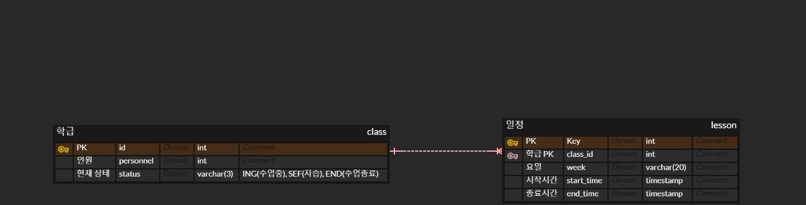

## 코드는 문제가 없다

---

최근에 작업한 기능을 리팩토링하는 과정을 거쳤다.

코드의 가독성이 떨어지고 코드의 확장성이 떨어진다고 판단되어 코드를 계속해서 리팩토링해보았다.

3번의 bulk 업데이트가 이루지게 되는데 이를 2번으로 줄여보았다.

2번에서 1번으로 줄이는 과정에서 문제가 발생하였는데, 이유를 파악하지 못하고 쿼리만 지속적으로 쳐다보았다...

이유가 무엇일까? 어떤 문제가 있을까? 하는 생각을 하면서 지속적으로 쳐다보았다... 시간이 지난 후 답을 알 수 있었다...

그 이야기를 해볼까 한다...

A 테이블과 B 테이블은 One To Many 관계이다. A 테이블의 row 1개는 B 테이블의 FK로 N개 가질 수 있다.

이때 B의 값에 따라 A의 상태 값이 변하는 구조이다.

예를들면 학급에 상태는 학급 일정에 따라 달라진다. 점심시간을 제외한 시간은 수업중이고, 그중 쉬는 시간도 있을 것이고, 자습시간도 있을 것이다.



이처럼 일정 시간마다 자식 테이블에 값에 따라 부모 테이블의 상태 값이 변경된다. 

이때 학습의 일정에 시험이 있는 날이거나 모의고사를 보는날에 경우 시간 일정이 달라진다. 그러한 것에 대한 처리를 하는 과정에서 많은 변화들이 생겼다...

일정 테이블에 두 가지 이상의 요일을 선택하여 JOIN하는 과정에서 어처구니 없는 실수를 하였다...

분명 원하는 방식으로 1row는 업데이트 된다. 하지만 나머지 rows 는 원하지 않는 방식으로 업데이트되고 있던 것이다...

업데이트 쿼리에서 GROUP BY를 할 수 없기 때문에 이를 어떻게 하나의 쿼리로 만들 수 있을까? 라는 생각을 하며 지속적으로 고민하고 고민했다... 결국 해결하지 못하고 2가지 쿼리로만 구현하였다...

흠... 어떻게 할 수 있을까??

```sql
UPDATE class c
SET c.status
  CASE
     when then
     when then
     when then
  END
Where c.status in (A, B, C);
```

이러한 방식으로 업데이트 쿼리를 작성하였는데... 흠.. 어떻게 하면 이쁘게 구성할 수 있을까??
