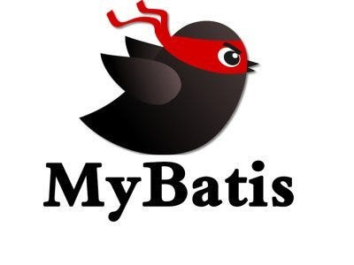

## MyBatis Mapper XML

---

MyBatis는 Mapped Statements를 이용해 쉽게 다양한 기능을 이용할 수 있습니다. 확실히 동등한 JDBC 코드와 비교한다면 코드의 95%를 즉시 절약할 수 있습니다.  

Mapper XML 파일에는 소수의 첫 번째 클래스 요소만 있습니다.

* cache - 지정된 네임스페이스에 대한 캐시 구성
* cache-ref - 다른 네임스페이스의 캐시 구성에 대한 참조
* resultMap - 데이터베이스 결과 집합에서 개체를 로드하는 방법을 설명하는 가장 복잡하고 강력한 요소
* sql - 다른 명령무넹서 참조할 수 있는 재사용 가능한 SQL 청크
* insert
* update
* delete
* select

### 조회

---

Select 문을 이용해 조회를 수행할 수 있습니다.

```sql
<select id = "selectPerson" parameterType = "int" resultType = "hashmap" >   
  ID가 #{id}인 사람에서 * 선택
</선택>
```


selectPerson은 해당 조회 쿼리에 대한 Id 값으로 Repository 에서 메소드를 통해 사용할 수 있습니다.  
명시적으로 파라미터 타입과 반환 유형을 설정할 수 있습니다.  

이외에도 다양한  속성이 존재합니다.

| **속성** | **설명** |
| --- | --- |
| id | 네임스페이스의 고유 식별자 |
| parameterType | 명령문으로 전달될 매개변수 |
| resultType | 반환될 것으로 예상되는 형식의 정규화된 클래스 이름 또는 별칭으로 resultType과 resultMap 함께 사용하면 안됩니다. |
| resultMap | 외부에 대한 명명된 참조 |
| flushCache | true로 설정하면 이 명령문이 호출될 때마다 로컬 및 2단계 캐시가 플러시됩니다.(기본값: false select) |
| useCache | true로 설정하면 이 명령문의 결과가 2단계 캐시에 캐시됩니다. (기본값: true select) |
| timeout | 예외를 발생시키기 전에 데이터베이스가 요청에서 반환될 때까지 드라이버가 대기하는 시간(초)을 설정합니다. |
| fetchSize | 드라이버가 이 설정과 동일한 크기의 행 번호 매기기 결과를 반환하도록 시도하는 드라이버 힌트 |
| statementType | **STATEMENT**, **PREPARED**또는 **CALLABLE**중 하나입니다. 이로 인해 **MyBatis**는 각각 Statement, PreparedStatement 또는 CallableStatement를 사용합니다. |
| resultSetType | **FORWARD\_ONLY|SCROLL\_SENSITIVE|SCROLL\_INSENSITIVE|DEFAULT** 중 하나(미설정과 동일). 기본값은 설정되지 않은 것입니다 |
| databaseId | 구성된 databaseIdProvider가 있는 경우 MyBatis는 databaseId 속성이 없거나 현재 속성과 일치하는 databaseId가 있는 모든 명령문을 로드합니다. 경우에 따라 databaseId 유무에 관계없이 동일한 문이 발견되면 후자는 삭제됩니다. |
| resultOrdered | 중첩된 결과 선택 문에만 적용됩니다. 이것이 참이면 중첩된 결과가 포함되거나 함께 그룹화되어 새로운 기본 결과 행이 반환될 때 이전 결과 행에 대한 참조가 더 이상 발생하지 않는다고 가정합니다. 이렇게 하면 중첩된 결과를 훨씬 더 메모리 친화적으로 채울 수 있습니다. 기본값: false |
| resultSets | 여러 결과 세트에만 적용됩니다. 문에서 반환할 결과 집합을 나열하고 각각에 이름을 지정합니다. 이름은 쉼표로 구분됩니다. |
| affectData | 트랜잭션이 적절하게 제어되도록 데이터를 반환하는 INSERT, UPDATE 또는 DELETE 문을 작성할 때 이를 true로 설정합니다. |

### Insert, Update and Delete

---

다음과 같이 INSERT, UPDATE, DELETE 쿼리 속성을 작성할 수 있습니다.

```sql
<insert
  id="insertAuthor"
  parameterType="domain.blog.Author"
  flushCache="true"
  statementType="PREPARED"
  keyProperty=""
  keyColumn=""
  useGeneratedKeys=""
  timeout="20">

<update
  id="updateAuthor"
  parameterType="domain.blog.Author"
  flushCache="true"
  statementType="PREPARED"
  timeout="20">

<delete
  id="deleteAuthor"
  parameterType="domain.blog.Author"
  flushCache="true"
  statementType="PREPARED"
  timeout="20">
```

이를 활용하여 실제 쿼리를 작성하면 다음과 같이 작성할 수 있습니다.

```sql
<insert id="insertAuthor">
  insert into Author (id,username,password,email,bio)
  values (#{id},#{username},#{password},#{email},#{bio})
</insert>

<update id="updateAuthor">
  update Author set
    username = #{username},
    password = #{password},
    email = #{email},
    bio = #{bio}
  where id = #{id}
</update>

<delete id="deleteAuthor">
  delete from Author where id = #{id}
</delete>
```

언급한 바와 같이 삽입은 여러 가지 방법으로 키 생성을 처리할 수 있는 몇 가지 추가 속성과 하위 요소가 있다는 점에서 조금 더 풍부합니다.   

첫째, 데이터베이스가 자동 생성된 키 필드(예: MySQL 및 SQL Server)를 지원하는 경우 useGeneratedKeys="true"를 설정하고 keyProperty를 대상 속성으로 설정하면 완료됩니다. 예를 들어 위의 Author 테이블이 id에 대해 자동 생성 열 유형을 사용한 경우 문은 다음과 같이 수정됩니다.

```sql
<insert id="insertAuthor" useGeneratedKeys="true" keyProperty="id">
  insert into Author (username,password,email,bio)
  values (#{username},#{password},#{email},#{bio})
</insert>
```

위와 같이 설정하면 자동으로 PK가 생성되고 쿼리에 매개변수로 전달된 인스턴스에 PK 값이 들어가게 됩니다.  

또한 Bulk Insert, update, delete를 지원합니다.

```sql
<insert id="insertAuthor" useGeneratedKeys="true" keyProperty="id">
  insert into Author (username, password, email, bio) values
  <foreach item="item" collection="list" separator=",">
    (#{item.username}, #{item.password}, #{item.email}, #{item.bio})
  </foreach>
</insert>
```

위와 같이 설정하면 여러 개를 한번에 처리하더라도 PK 값이 자동으로 생성되고 인스턴스 각각에 PK 값이 자동으로 입력되게 됩니다.  


이외에도 다양하게 사용할 수 있지만, 이번 포스팅에서는 간단한 내용에 대해서만 다루려고 합니다.  

그럼 이만!!


