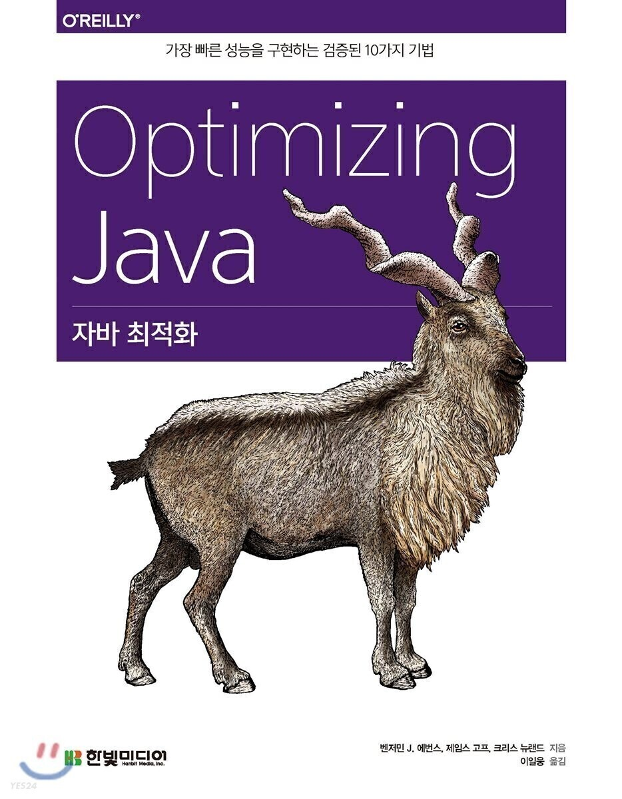

## 가비지 수집 고급

---

앞 장에서는 [**자바 가비지 수집의 기본 이론**](tistory-420.html)을 공부했습니다. 7장에서는 한 걸음 더 나아가 현대 자바의 가비지 수집 이론을 알아보겠습니다. 여러분이 엔지니어로서 적합한 수집기를 선정하려면 여러 가지 **Trade off**를 고려할 수밖에 없습니다.

거의 동시 수집기인 CMS와 최신 범용 수집기 G1 등 중단 시간이 매우 짧은, 핫스팟의 나머지 수집기를 먼저 소개합니다.

자주 사용되지는 않지만, 다음과 같은 수집기도 함께 알아봅시다.

* **Shenandoah**
* **C4**
* **Balanced**
* **레거시 핫스팟 수집기**

핫스팟 가상 머신이 이 모든 수집기를 다 사용하는 것은 아닙니다. 마지막 부분에서 다른 회사에서 만든 가상 머신인 IMB J9(원래는 상용 JVM이지만 2017년 오픈소스화됨)과 Azul(상용 JVM)의 수집기도 소개합니다.

### **트레이드 오프와 탈착형 수집기**

---

자바에 가비지 수집기가 있지만 정작 자바/JVM 명세서에는 GC를 구현하는 방법에 대해 일언반구도 없습니다. 자바 초심자에게 선뜻 잘 이해되지 않는 대목입니다. 실제로 자바 구현체 중에는 가비지 수집 기능이 전혀 없는 것도 있습니다(예: Lego Mindstorms).

썬 마이크로시스템즈(오라클 전신) 환경 내부에서 GC는 탈착형 서브시스템(Pluggable subsystem)으로 취급됩니다. 즉, 같은 자바 프로그램이라도 코드 변경 없이 여러 가지 가비지 수집기에서 돌려볼 수 있습니다. 물론, 사용하는 수집기에 따라서 프로그램 성능은 편차가 클 수 있습니다.

탈착형으로 수집기는 사용하는 것은 GC가 아주 일반적인 컴퓨팅 기법인 데다 같은 알고리즘이라도 모든 워크로드 유형에 다 적합한 것은 아니기 때문입니다. 따라서 GC 알고리즘은 앞을 다투는 관심사 간의 절충안 내지는 타협점을 반영한다고 볼 수 있습니다.

> 모든 GC 관심사를 일제히 최적화하는, 유일무이한 범용 GC 알고리즘은 없습니다.

개발자는 가비지 수집기 선정 시 다음 항목을 충분히 고민해야 합니다.

* **중단 시간**(중단 길이 또는 기간이라고도 함)
* **처리율**(애플리케이션 런타임 대비 GC 시간 %)
* **중단 빈도**(수집기 때문에 애플리케이션이 얼마나 자주 멈추는가?)
* **회수 효율**(GC 사이클 당 얼마나 많은 가비지가 수집되는가?)
* **중단 일관성**(중단 시간이 고른 편인가?)

이 중에서 단연 최고의 관심사는 중단 시간이지만, 대부분 애플리케이션에서 이것 하나만 따로 떨어뜨려 놓고 생각해선 안 됩니다.

> 중단 시간은 대부분의 워크로드에서 유용하거나 효과적인 성능 특성이 아닙니다.

예를 들어, 고도 병렬 배치 처리(Highly parallel batch processing) 시스템이나 빅 데이터 애플리케이션는 중단 기간보다 처리율이 더 큰 영향을 미칩니다. 평범한 Batch Job을 실행하면서 수십 초간 중단 이 발생했다고 큰일 나는 것은 아니므로 무조건 CPU 효율 및 처리율이 우수한 GC 알고리즘이 중단 시간이 짧은 알고리즘보다 우선입니다.

성능 엔지니어는 수집기 선정 시 다양한 트레이드 오프와 관심사를 면밀히 검토해야 합니다. 물론, 핫스팟은 사용 가능한 수집기 종류가 별로 많지 않아서 선택의 폭은 좁습니다.

오라클/OpenJDK 10버전에는 세 가지 메인 사용 수집기가 있습니다. 앞서 배운 병렬(처리율) 수집기는 이론적, 알고리즘 측면에서 가장 이해하기 쉬운 수집기입니다. 나머지 두 수집기는 이 장에서 소개하고 Parallel GC와 어떻게 다른지 살펴보겠습니다.

그 밖의 수집기는 끝부분 7.5절 이후로 대략 훓어보겠습니다. 그 중엔 사용으로 쓰면 좋지 않거나 아예 **Deprecated** 된 것들도 있습니다. **Non-Hospot** 계열 JVM에서 사용하는 수집기도 함께 알아보겠습니다.

### **동시 GC 이론**

---

그래픽/애니메이션 디스플레이 시스템처럼 특화된 시스템은 프레임률이 거의 고정되어 있어서 GC를 규칙적으로 수행할 수 있습니다.

하지만, 범용 가비지 수집기는 중단 결정을 효과적으로 내리는 데 참고할 만한 도메인 지식이 없습니다. 메모리 할당은 불확정성(nondeterminism)을 유발하는 직접적인 원인으로, 실제로도 많은 자바 응용 시스템에서 들쑥날쑥한 양상을 보입니다.

> 적절한 계산이 지연되는 건 사실 사소한 단점에 불과하다. 정작 큰 문제는, 가비지 수집이 언제 막간에 끼어들어 도저히 예측할 수 없다는 점이다.  
>   
> - 에츠에르 데이크스트라 -

최신 GC 이론은 데이크스트라가 지적한 대로 (기간, 빈도 모두) GC 기술의 가장 큰 걸림돌인, 불확정적 STW 중단 문제를 일단 해결하려고 시도합니다.

동시(적어도 부분적으로, 또는 거의 대부분 동시적인) 수집기를 써서 애플리케이션 스레드의 시행 도중 수집에 필요한 작업 일부를 수행해서 중단 시간을 줄이는 것도 한 방법입니다. 물론, 그만큼 실제 애플리케이션 작업에 투입 가능한 처리 역량을 빼앗기고 수집하는 코드 로직은 한층 더 복잡해지게 됩니다.

먼저, 본격으로 동시 수집기를 살펴보기 전에 최신 가비지 수집기의 특성과 로직을 이해하는데 필수적인 GC 용어 및 기술을 알아보겠습니다.

#### **JVM 세이프 포인트**

핫스팟 병렬 수집기에서 STW 가비지 수집을 실행하려면 애플리케이션 스레드를 모두 중단시켜야 합니다. JVM은 이런 작업을 어떻게 수행하는 걸까??

> JVM은 사실 완전히 선제적(Fully preemptive)인 멀티스레드 환경이 아니다.  
>   
> - 비밀 -

그렇다고 JVM이 순수한 협동적 환경(cooperative environment)이라는 말은 아닙니다. 실은 그 반대입니다. OS는 언제든지 선제 개입(코어에서 스레드를 제거) 할 수 있습니다. 가령, 한 스레드가 자신에게 할당된 Timeslice(시간 할당분)을 다 쓰거나, 스스로 wait() 상태로 잠들 때 그렇게 됩니다.

이렇게 OS 코어 기능처럼 JVM도 뭔가 조정 작업을 할 필요가 있습니다. 그래서 애플리케이션 스레드마다 **Safepoint(안전점)**라는 특별한 실행 지점을 둡니다. 세이프포인트는 스레드의 내부 자료 구조가 훤히 보이는 지점으로, 여기서 어떤 작업을 하기 위해 스레드는 잠시 중단될 수 있습니다.

> 세이프포인트의 효과는 (대표적으로) STW GC, 스레드 동기화 등에서 확인할 수 있습니다.

예를 들어, 풀 STW 가비지 수집기의 경우, 이 수집기가 작동하려면 안전된 객체 그래프가 필요합니다. 즉, 전체 애플리케이션 스레드를 반드시 중단시켜야합니다. GC 스레드가 OS에게 무조건 애플리케이션 스레드를 강제 중단시켜달라고 요청할 방법이 없기 때문에 (JVM 프로세스 일부로 실행 중인) 애플리케이션 스레드는 반드시 서로 공조해야 합니다. JVM은 다음 두 가지 규칙에 따라 세이프포인트를 처리합니다.

* JVM은 강제로 스레드를 세이프포인트 상태로 바꿀 수 없다.
* JVM은 스레드가 세이프포인트 상태에서 벗어나지 못하게 할 수 있다.

따라서 세이프포인트 요청을 받았을 때 그 지점에서 스레드가 제어권을 반납하게 만드는 코드(배리어)가 VM 인터프리터 구현체 어딘가에 있어야 합니다. JIT 컴파일한 메서드에도 생성된 기계어 안에 이런 배리어가 꼭 들어가 있어야 합니다. 다음은 세이프포인트 상태로 바뀌는 몇 가지 일반적인 경우입니다.

1. JVM이 전역 `**세이프포인트 시간(time to safepoint)**` 플래그를세팅한다.
2. 각 애플리케이션 스레드는 폴링(polling)하면서 이 플래그가 세팅되었는지 확인한다.
3. 애플리케이션 스레드는 잠시 멈췄다가 다시 깨어날 때까지 대기한다.

**세이프포인트 시간(time to satepoint)** 플래그를 세팅하면 모든 애플리케이션 스레드는 반드시 멈춰야합니다. 일찍 멈춘 스레드는 느리게 멈추는 다른 스레드를 기다려야 합니다(이런 대기 시간까지 중단 시간 통계치에 전부 다 반영되지는 않습니다).

일반 애플리케이션 스레드는 이런 식으로 폴링을 합니다. 인터프리터에서 바이트코드 2개를 실행할 때마다 체크합니다. 컴파일 코드에서는 보통 컴파일 메소드 밖으로 나가거나 분기가 (루프 처음으로) 회귀하는 지점에 JIT 컴파일러가 세이프포인트 폴링 코드를 삽입합니다.

스레드가 세이프포인트에 이르기까지 꽤 많은 시간이 소요될 수 있고, 이론적으로 절대 멈추지 않을 가능성도 있습니다.

> 모든 스레드를 STW 단계 시작 전에 완전히 중단시켜야 한다는 점에서(java.util.concurrent 라이브러리의 CountDownLatch에 구현된) Latch와 쓰임새가 비슷합니다.

구체적인 세이프포인트 사례를 좀 더 알아봅시다.

다음 각 경우에는 스레드는 자동으로 세이프포인트 상태가 됩니다.

* 모니터에서 차단된다.
* JNI 코드를 실행한다.

다음 경우에는 스레드가 꼭 세이프포인트 상태가 되는 것은 아닙니다.

* 바이트코드를 실행하는 도중(인터프리터 모드)
* OS가 인터럽트를 걸었다.

세이프 포인트 메커니즘은 아주 중요한 JVM의 내부 작동 원리이므로 뒷부분에서 다시 설명합니다.

#### 삼색 마킹

1978년, 데이크스트라와 램포트는 **삼색 마킹(tri-color marking)** 알고리즘에 관한 논문을 통해 동시성 알고리즘과 GC의 정확성을 증명했습니다. 이후 삼색 마킹 알고리즘은 가비지 수집 이론에서 중요한 위치를 차지했습니다.

이 알고리즘의 작동 원리는 다음과 같습니다.

* GC 루트는 흰색 표시
* 다른 객체는 모두 흰색 표시
* 마킹 스레드가 회색 노드로 랜덤하게 이동
* 이동한 노드를 검은색 표시하고 이 노드가 가리키는 모든 흰색 노드를 회색 표시
* 회색 노드가 하나도 남지 않을 때까지 위 과정 반복
* 검은색 객체는 모두 접근 가능(reachable)한 것이므로 살아남는다.
* 흰색 노드는 더 이상 접근 불가한 객체이므로 수집 대상이 된다.

조금 복잡하지만, 이것이 기본적인 알고리즘 골격입니다. [그림 7-1]는 삼색 마킹을 예시한 것입니다.

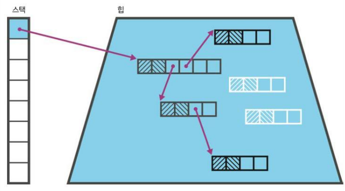

7.1 삼색 마킹

동시 수집은 SATB(Snapshot at the begining)라는 기법을 적극 활용합니다. 즉, 수집 사이클을 시작할 때 접근 가능하거나 그 이후에 할당된 객체를 라이브 객체로 간주하는 것입니다. 그래서 삼색 표시 알고리즘은 사소하지만 몇 가지 단점이 있습니다. 가령, 변경자 스레드(mutator thread)가 수집을 하는 도중에는 검은색 상태, 수집을 안 하는 동안에는 흰색 상태로 새 객체를 생성할 수 있습니다.

삼색 마킹 알고리즘에서 실행 중인 애플리케이션 스레드가 변경한 것 때문에 라이브 객체가 수집되는 현상을 방지하려면 몇 가지 로직이 추가되어야 합니다. 동시 수집기에서는 마킹 스레드가 삼색 알고리즘을 실행하는 도중에도 애플리케이션(변경자) 스레드가 계속 객체 그래프를 변경하기 때문입니다.

이미 검은색으로 표시한 객체를 마킹 스레드가 나중에 백색 객체를 참조하도록 바꾸는 상황이 연출될 수 있습니다(그림 7-2).

위 그림에서 새 흰색 객체를 가리키는 회색 객체의 레퍼런스를 모두 삭제하면 흰색 객체는 아직 접근은 가능하나 이 알고리즘 규칙에 따라 발견되지 않을 테니 결국 삭제될 것입니다.

이 문제는 여러 가지 방법으로 해결할 수 있습니다. 우선, 객체 색깔을 검은색 → 회색으로 바꾸고 변경자 스레드가 업데이트하며 처리할 노드 세트에 도로 추가하면 됩니다.

이처럼 업데이트 시 "쓰기 배리어"를 이용하는 방법은 전체 마킹 사이클 동안 삼색을 그대로 유지할 수 있기 때문에 알고리즘 측면에서 훌륭합니다.

> 동시 마킹 도중에는 절대로 검색은 객체 노드가 흰색 객체 노드를 가리킬 수 없다.  
>   
> - 삼색 불변(Tri-color invariant) -

삼색 불변의 원칙을 위배할지 모를 모든 변경 사항을 큐 형태로 넣어두고, 주 단계(main phase)가 끝난 다음 부차적인 '조정(fixup)' 단계에서 바로잡는 방법도 있습니다. 필요한 락킹 개수 등 성능 기준에 따라 삼색 마킹 문제를 해결하는 방법은 수집기마다 다릅니다.

다음 절에서는 중단 시간이 짧은 CMS 수집기를 다룹니다. CMS 수집기는 적용 범위가 제한적이지만, GC 튜닝을 할때 얼마나 많은 트레이드오프와 타협안을 고려해야 하는지 잘 모르는 분들이 많기 때문에 제일 먼저 소개하겠습니다.

CMS를 우선 살펴보면서 성능 엔지니어가 가비지 수집을 고려할 때 꼭 알아야 할 실제 이슈를 몇 가지 보여드리겠습니다. 바라건대, 좀 더 구체적인 증거에 입각해 튜닝을 하고 수집기 선정 시에도 내재된 트레이드오프를 바르게 인식한 상태에서 '민간 튜닝'의 유혹에 빠지면 안됩니다.

### CMS

---

CMS 수집기는 중단 시간을 아주 짧게 하려고 설계된, 테뉴어드(올드) 공간 전용 수집기 입니다. 보통 영 세대 수집용 병렬 수집기(Parallel GC)를 조금 변형한 수집기(Parnew)와 함께 씁니다.

CMS는 중단 시간을 최소화하기 위해 애플리케이션 스레드 실행 중에 가급적 많은 일을 합니다. 마킹은 삼색 마킹 알고리즘에 따라 수행하므로 힙을 탐색하는 도중에도 객체 그래프가 변경될 수 있습니다. 따라서 CMS는 가비지 수집의 두 번째 원칙(아직 살아 있는 객체를 수집하면 안된다)을 위반하지 않도록 반드시 레코드를 바로잡아야 합니다.

그러다 보니 수행 단계는 병렬 수집기보다 더 복잡합니다.

1. **초기 마킹(Initial Mark) (STW)**
2. **동시 마킹(Concurrent Mark)**
3. **동시 사전 정리(Concurrent Preclean)**
4. **재마킹(Remark) (STW)**
5. **동시 스위프(Concurrent Sweep)**
6. **동시 리셋(Concurrent Reset)**

두 단계(1. 초기 마킹, 4. 재마킹) 동안 모든 애플리케이션 스레드가 멈추고, 나머지 단계에서는 애플리케이션 스레드와 병행하여 GC를 수행합니다. 전체적으로 한 차례 긴 STW 중단을 일반적으로 매우 짧은 두 차례 STW 중단으로 대체한 것입니다.

초기 마킹 단계의 목적은, 해당 영역 내부에 위치한 확실한 GC 출발점(**내부 포인터, Internal pointer**라고 하며 수집 사이클 목적상 GC 루트와 동등함)을 얻는 것입니다. 이렇게 접근하면 마킹 단계에서 다른 메모리 영역은 신경 쓸 필요 없이 하나의 GC 풀에만 집중할 수 있기 때문에 유리합니다.

초기 마킹이 끝나면 동시 마킹 단계로 넘어갑니다. 삼색 마킹 알고리즘을 힙에 적용하면서 나중에 조정해야 할지 모를 변경 사항을 추적합니다.

동시 사전 정리 단계의 목표는 재마킹 단계에서 가능한 한 STW 시간을 줄이는 것입니다. 재마킹 단계는 카드 테이블을 이용해 변경자 스레드가 마킹 단계 도중 영향을 끼친 마킹을 조정합니다.

대부분 워크로드에 CMS를 적용하면 다음과 같은 효험이 있습니다.

1. 애플리케이션 스레드가 오랫동안 멈추지 않는다.
2. 단일 풀 GC 사이클 시간(벽시계 시간)이 더 길다.
3. CMS GC 사이클이 실행되는 동안, 애플리케이션 처리율은 감소한다.
4. GC가 객체를 추적해야 하므로 메모리를 더 많이 쓴다.
5. GC 수행에 훨신 더 많은 CPU 시간이 필요하다.
6. CMS는 힙을 압착하지 않으므로 테뉴어드 영역은 단편화될 수 있다.

#### **CMS 작동 원리**

많은 사람이 CMS의 강력한 힘을 너무 쉽게 간과하는 것 같습니다. CMS는 대부분 애플리케이션 스레드와 동시에 작동합니다. 기본적으로 가용 스레드 절반을 동원해 GC 동시 단계를 수행하고, 나머지 절반은 애플리케이션 스레드가 자바 코드를 실행하는데 사용합니다. 그래서 어쩔 수 없이 새로운 객체가 할당되는데, 만약 CMS 실행 도중 에덴 공간이 꽉 차버리면 어떻게 될까?

애플리케이션 스레드가 더 이상 진행할 수 없으니 당연히 실행이 중단될 것이고 CMS(STW) 영 GC가 일어날 것입니다. 그런데 영 GC는 코어 절반만 사용(나머지 절반은 CMS가 사용)하므로 병렬 수집기의 영 GC보다 더 오래 걸립니다.

영 수집이 끝나면 일부 객체는 테뉴어드로 승격될 것입니다. 아직 CMS가 실행되는 동안에 승격된 객체는 테뉴어드로 이동시켜야 하는데, 두 수집기 간에 긴밀한 조정이 필요한 부분입니다.이런 이유로 CMS는 조금 다른 영 수집기를 사용합니다.

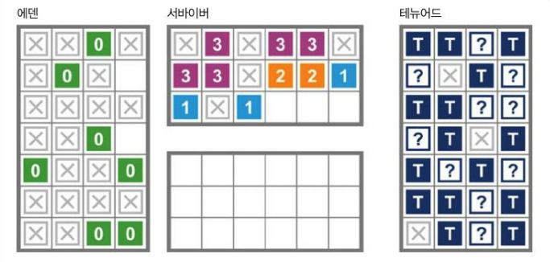

7.3 할당압이 너무 높아 CMF가 발생함

이런 현상을 **동시 모드 실패(Concurrent mode failure, CMF)**라고 하며 JVM은 풀 STW를 유발하는 ParallelOld GC 수집 방식으로 돌아갑니다. 할당압이 너무 높은 나머지 새로 승격된 객체를 올드 세대에 수용할 여력이 소진되기 전에 CMS가 올드 세대 처리를 완료할 시간이 없는 상태에 이른 것입니다.

CMF가 자주 일어나지 않게 하려면 테뉴어드가 꽉 차기 전에 CMS가 수집 사이클을 개시해야 합니다. CMS가 수집을 시작하는 테뉴어드의 힙 점유 수준은 힙 상태에 따라 달라집니다. 스위치로 지정할 수도 있고 디폴트는 75% 테뉴어드입니다.

힙 단편화는 CMF를 유발하는 또 다른 원인입니다. ParallelOld GC와 달리 테뉴어드를 압착하지 않습니다. 즉, 테뉴어드의 빈 공간은 단일 연속 블록이 아니기 때문에 CMS가 작업을 마친 후 승격된 객체를 기존에 들어간 객체 사이사이로 밀어 넣어야 합니다.

그러다 더 이상 객체를 끼워 넣을 공간이 부족하면 객체를 테뉴어드로 승격시킬 수 없게 되었습니다.

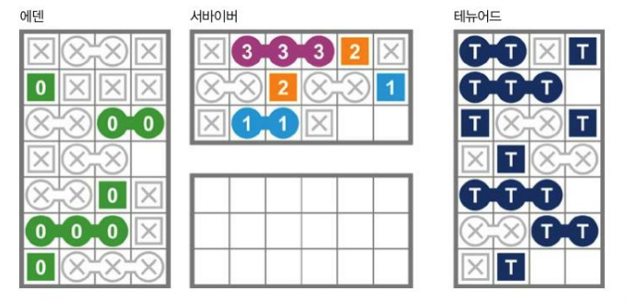

7.4 단편화 때문에 CMF가 발생함

유일한 해결책은 앞서 언급했듯이 (압착 수집기인) ParallelOld GC로 풀 수집해서 객체를 승격시킬 만한 연속 공간을 충분히 확보하는 한 가지뿐입니다.

이렇게 영 수집이 CMS보다 더 빠르거나 힙 단편화가 발생하면 풀 STW ParallelOld GC 수집으로 회귀할 수밖에 없는데, 애플리케이션 입장에서는 중대한 사건입니다. CMF를 방지하기 위해 CMS를 적용한 저지연 애플리케이션에서는 사실상 튜닝 자체가 주요 이슈입니다.

CMS는 내부적으로 프리 리스트를 이용해 사용 가능한 빈 공간을 관리합니다. 동시 스위프 단계에서 스위퍼 스레드가 여유 공간을 더 큰 덩어리로 만들고 단편화로 인해 CMF가 발생하지 않도록 연속된 빈 블록들을 하나로 뭉칩니다.

하지만 스위퍼는 변경자와 동시에 작동하므로 스레드가 서로 적절히 동기화되지 않는 한 새로 할당된 블록이 잘못 스위프(청소)될 가능성이 있습니다. 이런 일이 없게끔 스위퍼 스레드는 작업 도중 프리 리스트를 잠급니다.

#### **CMS 기본 JVM 플래그**

CMS 수집기는 다음 플래그로 작동합니다.

```bash
-XX:+UseConcMarkSweepGC
```

최신 핫스팟 버전에서 이 플래그를 쓰면 ParNew GC(병렬 영 수집기를 조금 변형한 수집기)도 함께 작동합니다.

CMS는 일반적으로 플래그 가짓수가 엄청나게 많습니다(60개가 넘습니다). CMS가 제공하는 다양한 옵션을 하나씩 바꿔가며 최적화해보고픈 벤치마킹 욕구를 느낄 수 있지만, 대부분 '숲을 못보고 나무만 보다' 또는 '민간 뉴닝'인 안티 패턴에 빠질 위험이 있으니 삼가할 일입니다.

### **G1**

G1(Garbage First, 가비지 우선)은 병렬 수집기, CMS와는 전혀 스타일이 다른 수집기입니다. 자바 6에서 처음 선보일 당시에는 지극히 실험적이고 불안정한 모습이었지만, 자바 7을 거치며 광범위하게 수정이 되었고 자바 8u40부터는 쓸 만한 수집기로 발전했습니다.

> 워크로드 종류와 상관 없이 자바 8u40 이전에는 G1을 사용하지 않는 편이 좋습니다.

처음부터 중단 시 간이 짧은 새로운 수집기로 설계된 G1은 다음과 같은 특성이 있습니다.

* CMS보다 훨씬 튜닝하기 쉽다.
* 조기 승격에 덜 취약하다
* 대용량 힙에서 확장성(특히, 중단시간)이 우수하다.
* 풀 STW 수집을 없앨 수(또는 풀 STW 수집으로 되돌아갈 일을 확 줄일 수) 있다.

하지만 시간이 지나면서 G1은 대용량 힙에서 중단 시간이 짧은 범용 수집기(말하자면, 새로운 보통 수집기)로 점점 더 굳혀졌습니다.

> 오라클은 자바 9부터 엔드 유저에게 어떤 영향이 있든 상관없이 G1을 디폴트 수집기로 정해 병렬 수집기를 대체하겠다고 밝혔습니다. 따라서 성능 분석가들은 G1의 작동 원리를 잘 알고 있어야 하며, 8에서 9로 자바 버전 이전 시 애플리케이션을 다시 꼼꼼히 테스트해봐야 합니다.

[그림 7-5]는 영역 기반의 G1 힙 레이아웃을 나타낸 그림입니다.

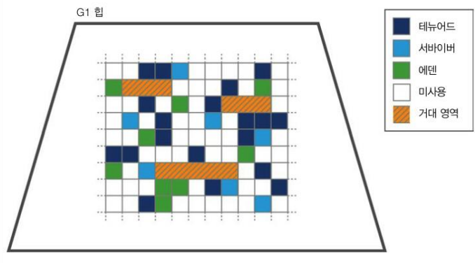

7.5 G1 영역

G1 알고리즘에서는 1, 2, 4, 8, 16, 32, 64 메가 바이트 크기의 영역을 사용할 수 있습니다. 기본적으로 힙에는 2,048 ~ 4095개의 영역이 있고, 이 개수에 따라 영역 크기도 조정됩니다.

영역 크기는 다음 값을 구한 뒤,

```bash
<힙 크기> / 2048
```

허용된 영역 크기 값에 가장 가까운 수치로 반올림하여 계산합니다. 그러면 영역 개수는 다음 식으로 구할 수 있습니다.

```bash
영역 개수 = <힙 크기> / <영역 크기>
```

이 값은 런타임 스위치로도 변경할 수 있습니다.

#### G1 알고리즘 설계

G1 수집기가 하는 일은 대략 다음과 같습니다.

* 동시 마킹 단계를 이용한다.
* 방출 수집기다.
* '통계적으로 압착'한다.

G1 수집기는 워밍업을 하는 동안, GC 사이클이 한번 돌 때마다 얼마나 많은 '일반' 영역에서 가비지 수집할 수 있는지 그 수치를 보관합니다. 제일 마지막에 GC가 발생한 이후로 새로 할당된 객체를 감다하기에 충분한 메모리를  수집할 수 있따면, G1은 할당보다 뒤처지지 않는 것입니다.

TLAB 할당, 서바이버 공간으로 방출, 테뉴어드 영역으로 승격 등의 개념은 앞서 살펴본 다른 핫스팟 수집기와 대동소이합니다.

> 영역을 절반 이상으로 점유한 객체는 거대 객체(humonogous object)로 간주하여 거대 영역(humonogous region)이라는 별도 공간에 곧바로 할당됩니다. 거대 영역은 (에덴이 아닌) 테뉴어드 세대에 속한, 연속된 빈 공간입니다.

G1에서도 에덴, 서바이버 영역으로 이루어진 영 세대 개념은 같지만, 세대를 구성하는 영역이 연속되어 있지 않다는 차이점이 있습니다. 영 세대의 크기는 전체 중단 시간 목표에 따라 조정됩니다.

앞서 ParallelOld GC를 설명할 때 6.3.1절에서 '올드 객체가 영 객체를 참조하는 일은 거의 없다'는 휴리스틱을 언급했습니다. 핫스팟 병렬/CMS 수집기는 카드 테이블이라는 장치를 활용한다는 설명도 했었습니다.

G1 수집기에도 기억 세트(remembered set, RSet)라는 비슷한 장치로 영역을 추적합니다. RSet은 영역별로 하나씩, 외부에서 힙 영역 내부를 참조하는 레퍼런스를 관리하기 위한 장치입니다. 덕분에 G1은 영역 내부를 바라보는 레퍼런스를 찾으려고 전체 힙을 다 쥐질 필요 없이 RSet만 꺼내 보면 됩니다.

[그림 7-6]은 G1은 RSet을 이용해 할당기와 수집기 간에 역할을 분담한 장면입니다.

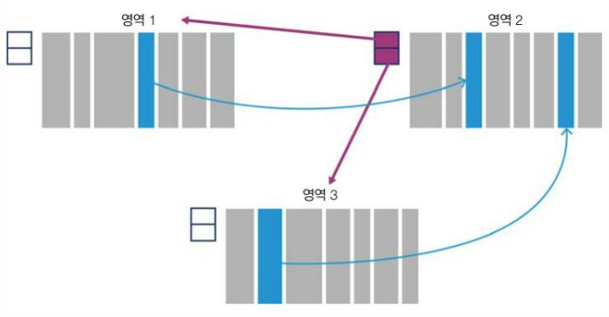

7-6. RSet

RSet, 카드 테이블은 모두 부유 가비지(Floating Garbage)라는 GC 문제를 해결하는 데 유용합니다. 부유 가비지는 현재 수집 세트 외부에서 죽은 객체가 참조하는 바람에 이미 죽었어야 할 객체가 계속 살아 있는 현상입니다. 즉, 전역 마킹상으로는 죽은 객체처럼 보일 수 있지만, 사용한 루트 세트에 따라 범위가 제한적인 로컬 마킹상에서는 살아 있는 객체로 잘못 인식되는 것입니다.

#### G1 단계

G1의 수집 단계는 앞 서 보았던 CMS와 같은 수집기와 비슷합니다.

1. 초기 마킹(STW)
2. 동시 루트 탐색
3. 동시 마킹
4. 재마킹(STW)
5. 정리(STW)

동시 루트 탐색은 초기 마킹 단계의 서바이버 영역에서 올드 세대를 가리키는 레퍼런스를 찾는 동시 단계로, 반드시 다음 영 GC 탐색을 시작하기 전에 끝내야 합니다. 마킹 작업은 재마킹 단계에서 완료됩니다. 레퍼런스(**Weak**/**Soft** 레퍼런스를 포함)를 처리하고 SATB 방식으로 정리하는 작업도 재마킹 단계에서 합니다.

정리 단계는 Accounting 및 RSet '씻기 scrubbling' 태스크를 수행하며 대부분 STW를 일으킵니다. 어카운팅은 이제 완전히 자유의 몸이 되어 (에덴 영역에서) 재사용 준비를 마친 영역을 식별하는 작업입니다.

#### G1 기본 JVM 플래그

자바 8 이전까지는 다음 스위치로 G1을 작동시킵니다.

```bash
+XX:UseG1GC
```

G1의 주목표는 중단 시간 단축이라고 했습니다. 그래서 가비지 수집이 일어날 때마다 애플리케이션의 최대 중단 시간을 개발자가 지정할 수 있게 해놓는 것인데, 이는 어디까지나 목표치에 불과하며 실제로 애플리케이션이 이 기준에 맞추리란 보장은 없습니다. 너무 값을 낮게 잡으면 GC 서브시스템이 목표에 맞추지 못할 것입니다.

> 가비지 수집은 할당에 의해서 일어나는데, 대부분의 자바 애플리케이션에서 할당 양상을 예측하기는 어렵습니다. G1이 중단 시간 목표를 맞추기 힘든 것도 같은 맥락입니다.

다음은 디폴트 중단 시간 목표를 200밀리초로 설정하는 스위치입니다.

```bash
-XX:MaxGCPauseMillis=200
```

실제로 중단 시간을 100밀리초 이하로 설정하면 현실성이 너무 떨어져 수집기가 지키지 못할 공산이 큽니다. 디폴트 영역 크기값을변경하는 방법도 있습니다.

```bash
-XX:G1HeapRegionSize=<n>
```

<n>은 1부터 64까지의 2의 제곱수(power)입니다(단위: MB). G1의 다른 플래그는 8장에서 튜닝을 설명할 때 다시 보겠습니다.

전반적으로 G1은 안정된 알고리즘으로서 오라클의 전폭적인 지원을 받고 있습니다(자바 8u40부터 권장 수집기로 추천했습니다). 하지만 진짜 저지연 워크로드에서 아직 G1은 CMS 중단 시간보다 긴 편이라서, 순수하게 중단 시간만 놓고 봤을 때 과연 CMS 류의 수집기에 필적할 정도로인지는 의문입니다. 하지만 오라클 JVM 팀은 G1에 기술 역량을 집중하고 있고 계속 조금씩 개선되고 있는 실정입니다.

#### 셰난도아

오라클이 차세대 범용 수집기 개발에 전력을 다하는 동안 레드햇(Red Hat) 진영에서는 OpenJDK 프로젝트 일환으로 셰난도아([Shenandoah](https://access.redhat.com/documentation/ko-kr/openjdk/8/html/using_shenandoah_garbage_collector_with_openjdk_8/shenandoah-gc-overview))라는 자체 수집기를 제작했습니다. 이 책이 작성된 시점 셰난도아는 아직 실험적인 수집기로 운영계에 사용할 정도는 아니지만, 유망한 특성들이 있어서 적어도 소개할 만한 가치는 충분합니다.

셰난도아 역시 G1처럼 주목표는 (특히 대용량 힙에서) 중단 시간 단축입니다. 이를 달성하고자 셰난도아는 동시 압축(concurrent compaction)을 합니다. 수집 단계는 다음과 같습니다. 

1. 초기 마킹(STW)
2. 동시 마킹
3. 최종 마킹(STW)
4. 동시 압착

언뜻 보면 CMS, G1 단계와 비슷하고 접근 방식(예: SATB)도 유사한 부분이 있지만, 근본적인 차이점이 있습니다.

우선, 셰난도아의 가장 두드러진 특성은 브룩스 포인트(Brroks pointer)입니다. 이 포인터는 객체당 메모리 워드를 하나 더 써서 이전 가비지 수집 단계에서 객체가 재배치되었는지 여부를 표시하고 새 버전 객체 콘텐츠의 위치를 가리킵니다.

[그림 7-7]은 셰냔도아의 oop 힙 레이아웃입니다. 이런 메커니즘을 '포워딩 포인터(forwading pointer)'라고도 부릅니다. 재배치되지 않은 객체의 브룩스 포인터는 메모리 다음 워드를 가리킵니다.

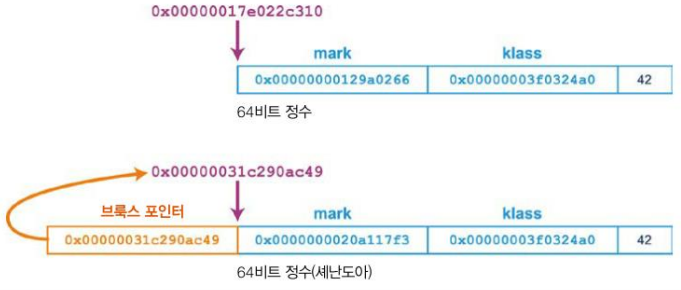

7.7 브룩스 포인터

> 브룩스 포인터는 하드웨어 수준에서 지원되는 CAS(Compare-and-swap) 기능에 의존하여 포워딩 주소를 아토믹 하게 수정합니다.  
>   
> \* CAS는 변수의 예상되는 값과 실제 값을 비교해서 두 값이 일치하면 실제 값을 새로운 값으로 교체하는 동시성 알고리즘 설계 시 많이 사용하는 기술이빈다. 요즘 나온 CPU는 대부분 CAS 기능 내장되어 있습니다.

동시 마킹 단계에서는 힙을 죽 훑어 살아 있는 객체를 모두 마킹합니다. 포워딩 포인터가 있는 oop를 가리키는 객체 레퍼런스가 있으면 새 oop 위치를 직접 참조하도록 레퍼런스를 수정합니다(그림 7-8).

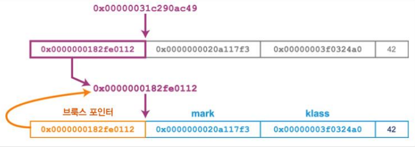

7-8. 포워딩 포인터 수정

최종 마킹 단계에서 셰난도아는 STW하고 루트 세트를 재탐색한 후, 방출한 사본을 가리키도록 루트를 복사하고 수정합니다.

#### **동시 압착**

(애플리케이션 스레드와 동시 실행 중인) GC 스레드는 다음과 같이 방출합니다.

1. 객체를 TLAB로 (추측하여, speculatively) 복사한다.
2. CAS로 브룩스 포인터가 추측성 사본(cpeculative copy)를 가리키도록 수정한다.
3. 이 작업이 성공하면 압착 스레드가 승리한 것으로, 이후 이 버전의 객체는 모두 브룩스 포인터를 경유해서 액세스하게 된다.
4. 이 작업이 실패하면 압착 스레드가 실패한 것으로, 추측성 사본을 원상복구하고 승리한 스레드가 남긴 브룩스 포인터를 따라간다.

셰난도아는 동시 수집기라서 수집 사이클 동안에는 애플리케이션 스레드가 생성하는 가비지가 더 많습니다. 그래서 애플리케이션 실행 중에 수집을 할당 페이스에 맞추어야 합니다.

#### 셰난도아 얻기

셰난도아 수집기는 오라클 자바 빌드 버전이나 대다수 OpenJDK 배포판에서는 구할 수 없고, Redhat fedora 같은 리눅스 배포판에 아이스티 바이너리 일부로 실려 있습니다.

다른 OS 유저는 (적어도 이 글을 쓰는 현재는) 소스를 내려받아 컴파일해야 하는데, 리눅스에서는 쉬운 일이지만 OS마다 컴파일러가 다르고(예: 맥 OS는 gcc 대신 clang을 사용) 미묘한 환경 문제가 있어서 조금 까다롭습니다.

어쨌든, 빌드 파일을 손에 넣었다면 다음 스위치로 셰난도아를 작동시킬 수 있습니다.

```bash
-XX:+UseShenandoahGC
```

[그림 7-9]는 셰난도아와 다른 수집기의 중단 시간을 서로 비교한 그래프입니다.

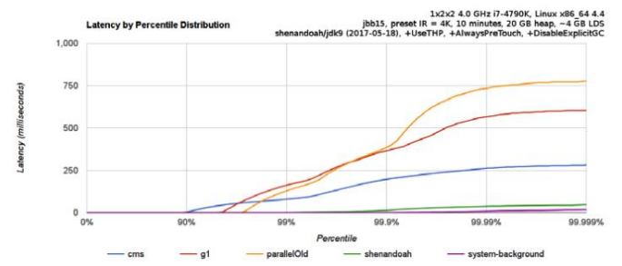

7-9. 셰난도아와 다른 수집기의 비교자료(출처. 시필레프)

셰난도아에서 저평가된 특징 중 하나는 세대별 수집기가 아니란 사실입니다 .제품급 수집기에 가깝게 발전할수록 이렇게 설계한 결과는 점점 더 뚜렷해지겠지만, 성능에 민감한 애플리케이션에는 영향 미칠 가능성이 있습니다.

### C4(아줄 징)

아줄 시스템 사는 두 가지 자바 플랫폼을 출시했습니다. 먼저, 줄루(Zulu)는 다중 플랫폼에서 사용 가능한 OpenJDK 기반의 FOSS 솔루션입니다. Zing은 리눅스에서만 쓸수 있는 상용 플랫폼으로, OpenJDK에 있는 자바 클래스 라이브러리를 (오라클 상용 라이선스 하에) 사용하지만 완전히 다른 가상 머신입니다.

> 징은 처음부터 64비트 머신용으로 설계되었고 앞으로도 32비트 아키텍처는 지원할 계획은 없습니다.

징 VM은 C4(Continuously Concurrent Compacting Collector, 연속 동시 압축 수집기) 가비지 수집기를 비롯해 레디나우(ReadyNow)와 팰콘(Falcom) 컴파일러 등 신박한 소프트웨어 기술을 자랑합니다.

셰난도아처럼 동시 압착 알고리즘을 사용하지만, 징은 브룩스 포인터 대신 64비트 워드 하나로 이루어진 객체 헤더를 사용합니다(핫스팟은 객체 헤더가 워드 2개로 구성됩니다). 이 단일 워드 헤더에는 klass 포인터 대신 kid(25비트 정도의 숫자형 klass ID)가 들어 있습니다.

징 객체 헤더는 [그림 7-10]과 같은 모습입니다. 주소 비트 대신, 로드값 배리어(Loaded Value Barrier, LVB)용 oop 레퍼런스 비트 일부를 사용합니다.

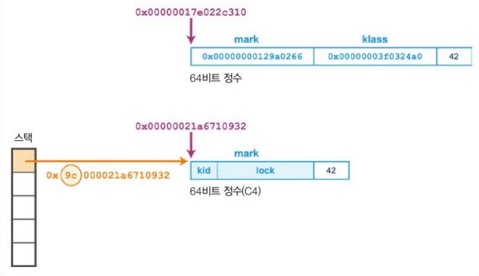

7-10. 징의 객체 헤더 레이아웃

헤더의 하위 32비트에는 락 정보를 보관합니다. 락 상태와 관련 추가 정보가 여기에 답깁니다.(예를들어, 씬락(Thin Lock)은 씬락을 소유한 스레드 ID가 저장됩니다.)

> 징은 압축 oop 같은 기술은 지원하지 않으므로 30기가 바이트 이하의 힙에서는 객체 헤더가 핫스팟보다 크고 힙 공간을 더 많이 차지합니다.

징은 처음부터 64비트 아키텍처 전용으로 설계된 까닭에 메타데이터를 32비트에 끼워 맞출(또는 확장된 구조체를 할당해서 포인터 간접화(indirection)을 통해 해결할) 필요가 없습니다. 32비트 핫스팟의 진기한 포인터 묘기를 볼 일도 없습니다.

#### 로드값 배리어

셰난도아 수집기에서는 애플리케이션 스레드에 의해 재배치되었을지 모를 객체의 레퍼런스를 로드할 가능성이 있으므로 브룩스 포인터를 이용해 새 위치를 추적합니다. 로드값 배리어(LVB)는 이런 패턴을 지양하고 로드한 레퍼런스 각자의 로딩이 끝나자마자 현재 객체 위치를 직접 가리키게 만들자는 아이디어입니다. 아줄에서는 이것을 **자가 치유 배리어**(Self-healing barrier)라고 부릅니다.

수집기가 재배치한 객체 레퍼런스를 징이 따라가면 무엇보다 해당 객체의 새 위치를 먼저 바라보도록 애플리케이션 스레드가 레퍼런스를 수정합니다. 덕분에 고질적인 재배치 문제가 '치유(healing)'됩니다. 다시 말해, 각 레퍼런스가 최대 한번만 수정되기 때문에 다시 쓸 일이 없는 레퍼런스에는 아무 작업도 하지 않습니다.

헤더 워드뿐만 아니라, 징의 객체 레퍼런스(즉, 스택에 위치하여 힙에 저장된 객체를 바라보는 지역 변수)는 객체의 GC 상태와 관련된 메타데이터를 나타내는 일부 레퍼런스 비트를 사용합니다. 레퍼런스 자신의 비트를 사용하니까 단일 헤더 워드 비트를 통째 다 쓰는 것보다 공간을 절약할 수 있습니다.

징에는 다음과 같은 Reference 구조체가 정의되어 있습니다.

```java
String Reference {
   unsigned inPageVa: 21;    //  0-20 비트
   unsigned PageNumber: 21;  // 21-41 비트
   unsigned NMT: 1;          //    42 비트
   unsigned spaceID: 2;      // 43-44 비트
   unsigned unused: 19;      // 45-63 비트
};

int Expected_NMT_Value[4] = {0, 0, 0, 0};

// 공간 ID 값
// 00 NULL 및 논힙 포인터
// 01 올드 세대 레퍼런스
// 02 뉴 세대 레퍼런스
// 11 사용 안함
```

NMT(Not Marked Through) 메타데이터 비트는 현재 수집 사이클에서 객체가 이미 마킹되었는지 여부를 나타냅니다. C4는 살아 있는 객체를 마킹할 용도로 타깃 상태(target state)를 관리하는데, 객체가 마킹 도중 재배치되면 NMT 비트를 타깃 상태와 동일하게 세팅합니다. 수집 사이클이 끝날 때 C4가 타깃 상태 비트를 뒤집기 때문에 생존한 객체는 모두 다음 사이클로 넘어갈 준비가 끝납니다.

C4의 전체 GC 단계는 다음과 같습니다.

1. 마킹
2. 재배치
3. 재매핑

G1 처럼 재배치 단계에서는 가장 성긴(spase) 페이지에 집중됩니다. 

C4는 교대 압착(hand-voer-hand)라는 기술로 연속적으로 압착하빈다. 물리 메모리 주소와 가상 메모리 주소의 단절이라는, 가상 메모리 체계의 특성을 활용하는 기술입니다. 평상시 가상 메모리 서브시스템은 프로세스 주소 공간에 가상 페이지와 하부 물리 페이지 사이의 매핑 정보를 관리합니다.

> 시스템 콜로 자바 힙 메모리를 관리하지 않는 핫스팟과 달리, 징은 GC 사이클의 일부로서 커널에 시스템 콜을 합니다.

징의 방출 기법에 따라 객체는 다른 페이지에 복사되는 형태로 재배치되는데, 그 결과 자연스럽게 서로 다른 물리 주소에 대응됩니다. 어떤 페이지에 있는 객체를 모두 복사한 다음, 물리 페이지를 싹 다 비우고 OS에 반납하는 것입니다. 아직 매핑되지 않은 가상 페이지를 가리키는 애플리케이션 레퍼런스가 남아 있겠지만, 메모리 폴트가 발생하기 전에 LVB가 이런 레퍼런스를 도맡아 처리합니다.

징의 C4 수집기는 항상 두 가지 수집 알고리즘(영 객체용 하나, 올드 객체용 하나)을 실행합니다. 따라서 오버헤드는 어쩔 수 없이 발생하지만 (CMS 같은) 동시 수집기 튜닝 시 수집기가 백투백(꼬리에 꼬리를 무는 형태) 모드로 실행된다고 보는 것이 오버헤드와 용량 계획 면에서 유리합니다.

성능 엔지니어는 징과 C4 수집기로 이전하면 어떤 점이 좋은지, 트레이드 오프는 무엇인지 주의 깊에 살펴야 합니다. '넘겨짚지 마라, 직접 측정해라' 정신은 다르 데서도 마찬가지지만 VM을 선정할 때 특히 중요합니다.

### 밸런스드(IBM J9)

J9는 IBM이 제작한 JVM 입니다. 원래 사용 JVM이었지만 지금은 오픈 소스화 단계를 밟고 있고 이름도 오픈 J9으로 바꾸었습니다. J9에는 핫스팟 디폴트 병렬 수집기와 비슷한, 처리율인 ㅗㅍ은 수집기를 비롯해 여러 가지 수집기가 내장되어 있습니다. 

그중 밸런스드(Balanced) 수집기는 영역 기반 수집기로, 64비트 J9 JVM에서 사용할 수 있고 4기가 바이트 이상의 힙에 맞게 설계되었습니다. 다음은 이 수집기의 주요 목표입니다.

* 대용량 자바 힙에서 중단 시간이 길어지는 현상을 개선
* 중단 시간이 최악인 경우를 최소화
* 불균일 기억 장치 액세스(Non-Uniform Memory Access, NUMA) 성능을 인지하여 활용

첫 번째 목표를 달성하기 위해 힙을 여러 개의 영역으로 분할해 각자 독립적으로 관리/수집합니다. 밸러스드 수집기도 G1처럼 최대 2,048개 영역을 관리하며 이 개수에 맞게 영역 크기를 정합니다. 영역 크기는 G1과 똑같이 2의 제곱수지만 최소 512킬로바이트 이상의 되어야 합니다.

밸런스드도 세대별 영역 기반의 수집기이므로 나이가 있고 새 객체는 나이가 0인 영역(에덴)에 할당합니다. 에덴이 꽉 차면 수집이 일어나는데, IBM 용어로는 부분 가비지 수집(Partial Garbase Collection, PGC)이라고 합니다.

PGC는 에덴 영역을 모두 수집하는 STW 작어븡로, 나이가 더 많이 든 영역도 그럴만한 가치가 있다고 판단되면 추가로 수집합니다. 이런 면에서는 G1의 혼합 수집(Mixed Collection)과 비슷합니다.

> PGC가 끝나면 생존 객체가 위치한 영역은 한살 더 먹습니다. 그래서 세대별 영역(Generational Region)이라고도 합니다.

J9 GC 정책과 다르게 클래스 언로딩을 점진적으로 수행할 수 있다는 이점도 있습니다. 밸런스드 수집기는 PGC 도중 현재 수집 대상의 일부인 클래스로더를 수집할 수 있습니다. 전역 수집하는 동안에만 클래스로더 수집이 가능한 다른 J9 수집기와는 차이가 있습니다.

PGC는 스스로 수집하기로 결정한 영역만 바라볼 수 있으므로 부유 가비지가 생길수 있습니다. 그래서 밸런스드 수집기는 전역 마킹 단계(Gloabl Mark Phase, GMP)를 따로 두고 전체 자바 힙을 탐색하면서 수집할 죽은 객체를 표시하는, 부분적인 동시 작업을 수행합니다. GMP가 끝난 후, 해당 데이터에 PGC를 수행하는 것입니다. 따라서 힙 내부 부유 가비지 양은 마지막 GMP가 시작된 이후로 죽은 객체 수를 초과할 수 없습니다.

밸런스드 수집기는 전역 가비시 수집(Global Garabage Collection, GGC)라는 작업도 수행합니다. GGC는 힙을 압축하는 풀 STW 수집으로, 핫스팟에서 CMF 발생 시 일어나는 풀 수집과 비슷합니다.

#### J9 객체 헤더

기본 J9 객체 헤더는 64비트(압축 레퍼런스(Compressed reference) 사용 시 32 비트) 클래스 슬롯(Class Slot)입니다.

> 압축 레퍼런스는 57기가 바이트 이하의 힙에서 기본 적용되며, 핫스팟의 압축 oop와 비슷한 기술입니다.

객체 유형에 따라 헤더에 슬롯이 더 추가될 수 있습니다.

* 동기화한 객체에는 모니터 슬롯(Monitor Slot)이 있다.
* JVM 내부 구조에 편입된 객체에는 해시 슬롯(Hashed Slot)이 있다.

모니터 슬롯, 해시 슬롯은 객체 헤더와 꼭 붙어 있을 필요는 없습니다. 객체 어디에나 보관할 수 있어서 정렬 떄문에 공간을 낭비할 일도 없습니다.

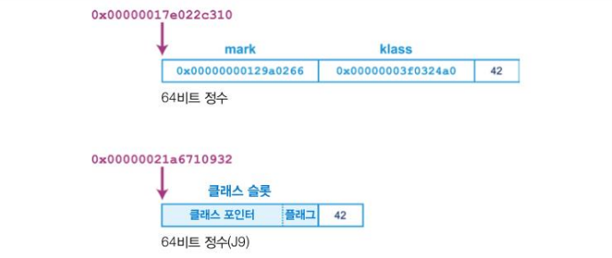

7.11 J9 객체 레이아웃

클래스 슬롯의 최상위 24(또는 56) 비트는 클래스 구조를 가리키는 포인터로, 자바 8의 메타 공간(Metaspace)과 비스한 오프 힙(Off-heap) 메모리 입니다.

#### 밸런스드에서 큰 배열 처리하기

자바에서 큰 배열을 할당하면 충분히 큰, 연속된 공간을 찾아야 하므로 대부분 압축 수집이 일어납니다. 이미 CMS를 설명할 때 다루었던 내용입니다. 여유 공간을 큰 덩어리로 합쳐도 할당 공간이 부족해서 CMF가 발생할 때도 있습니다.

영역 기반의 수집기에서 하나의 영역보다 더 큰 자바 배열 객체를 할당하지 말라는 법은 없스빈다. 그래서 밸런스드 수집기는 불연속된 여러 덩이에 큰 배열을 할당할 수 있도록 Arraylet이라는 형태로 나타냅니다. 힙 객체가 여러 영역에 걸쳐있는 유일한 상황입니다.

어레이잇은 유저 자바 코드에서 안 보이고 JVM이 투명하게 처리합니다. 할당기는 큰 배열을 Spine(스파인)이라는 주 객체와 배열 리프들로 표현합니다. 배열 리프는 실제 배열 엔트리를 담고 있고, 스파인 엔트리는 이 배열 리프들을 가리키는 자료 구조입니다. 따라서 한 단계 더 에두른 오버헤드만 추가하는 정도로 엔트리를 읽을 수 있습니다. [그림 7-12]는 어레이릿을 나타낸 그림입니다.

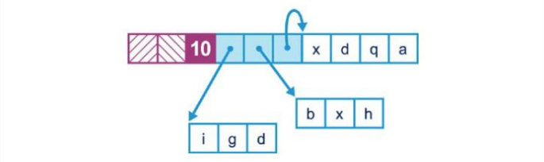

7-12. J9 어레이릿

> 어레이릿은 (일반 자바 코드에서는 안 되지만) JNI API를 통해서 들여다볼 수 있습니다. 따라서 JNI 코드를 다른 JVM에서 이식해올 때 프로그래머는 스파인/리프를 잘 살펴봐야 합니다.

여러 영역에 걸쳐 부분 GC를 수행하면 참조 객체(referer), 피참조 객체(referent) 영역 정보를 관리하는 오버헤드가 발새앟므로 전체 GC 소요 기간은 더 걸리지만 평균 중단 시간은 줄어듭니다.

무엇보다 중요한 건, 힙이 꽉 찼을 때 최후의 수단으로 동원하는 (중단 시간에 최악의 영향을 미치는) 풀 STW 수집이나 압착이 필요한 경우의 수가 현저히 줄어든다는 점입니다.

밸런스드 수집기는 영역 및 불연속된 큰 배열을 관리하는 오버헤드가 있으므로 중단 시간을 줄이는 일이 직접적인 최리율을 높이는 것보다 더 중요한 애플리케이션이 적합합니다.

#### NUMA와 밸런스드

NUMA는 일반적으로 중대형 서버용 멀티프로세스 시스템에서 사용하는 메모리 아키텍처입니다. 이런 시스템에서는 메모리와 프로세스 사이에 거리라는 개념이 있어서 프로세스와 메모리를 노드로 묶습니다. 어떤 노드에 있는 프로세스가 다른 노드에 있는 메모리에 액세스하는 건 얼마든지 가능하지만, 아무래도 로컬 메모리(즉, 같은 노드에 속한 메모리)에 액세스할 때 가장 빠를 것입니다.

여러 NUMA 노드에 걸쳐 실행되는 JVM에서 밸런스드 수집기는 노드별로 자바 힙을 분리할 수 있습니다 .애플리케이션 스레드는 자신이 선호나는 특정 노드에서 실행되고 그 노드에 속한 메모리 영역에 객체를 할당하도ㅓ록 조정됩니다. 

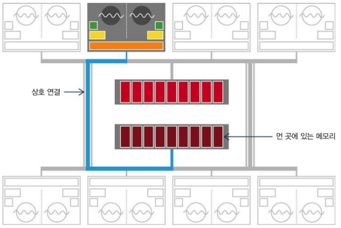

7-13. 불균일 기억 장치 액세스

부분 가지비 수집기는 어떤 객체를 그 자신을 참조하는 다른 객체. 스레드와 가급적 가까운 위치에 두려고 합니다. 그러면 스레드가 참조하는 메모리가 로컬일 가능성이 커져서 성능이 좋아집니다. 이런 과정은 애플리케이션 모르게 발생합니다.

### 레거시 핫스팟 수집기

핫스팟 초기 버저에는 다양한 수집기가 있스빈다. 하지만 이들은 운영계 용도로는 적합하지 않으니 가급적 사용하시면 안됩니다. 자바 8버전에서는 Deprecated 되었다가 자바 9부터 사용이 금지된(제거도니) 수집기 조합도 있습니다.

#### Serial 및 Searial Old

Serail/SerialOld GC는 Parallel/ParallelOld GC와 작동 원리는 거의 같지만, CPU 한 코어만 사용해 GC를 수행합니다. 물론 동시 수집이 안 되고 풀 STW을 일으킵니다. 최신 멀티코어 시스템에서 이런 구닥다리 수집기로 성능 향상을 기대한다는 건 말도 되지 않으니 절대 사용하지 마세요.

이런 수집기를 쓰는 구형 애플리케잇녀도 아직 어딘가에는 있을 수 있습니다. 성능 엔지니어는 그런 수집가기 있다는 사실과 스위치 사용법과 구형 수집기를 제거하는 방법 정도는 알아두어야 합니다.

Serial/SerialOld GC는 자바 8부터 Deprecated된 수집기라서 아주 옛날 자바 버전으로 개발된 초창기 렏거시 애플리케이션에는 아직도 쓰일 것입니다.

#### 증분 CMS(iCMS)

보통 iCMS라고 줄여 쓰는 증분(incremental) CMS는 예전에 동시 수집을 시도했던 수집기입니다. CMS에 도입하려고 헀던 일부 아이디어는 훗날 G1에도 영향을 미쳤습니다. 중분 CMS는 다음 스위치로 켭니다.

```bash
-XX:+CMSIncrementalMode
```

아직도 iCMS가 성능 면에서 꽤 괜찮은, 특수한 사례(코어가 한두개 뿐인 많이 낡은 하드웨어에 배포한 애플리케이션 등)가 있다고 주장하는 전문가도 있지만, 서버급 애플리케이션에서 iCMS는 사용하지 않는 것이 좋습니다. 자바 9부터는 아예 사라졌습니다.

#### Deprecated된 GC 조합

자바 가비지 수집기는 특정 자바 버전에서 Deprecated 되었다가 그다음 버전부터 아예 제거해버리는 식으로 진행되었습니다. [표 7-1]은 자바 9부터 권장하지 않으며 자바 9에서 제거된 GC 플래그 조합들입니다.

| **조합** | **플래그** |
| --- | --- |
| DefNew + CMS | -XX:-UseParNewGC -XX:+UseConcMarkSweepGC |
| ParNew + SerialOld | -XX:+UseParNewGC |
| ParNew + iCMS | -Xincgc |
| ParNew + iCMS | -XX:+CMSIncrementalMode -XX:+UseConcMarkSweepGC |
| ParNew + iCMS | -XX:+CMSIncrementalMode -XX:+UseConcMarkSweepGC -XX:-UseParNewGC |
| CMS foreground | -XX:+UseCMSCompactAtFullCollection |
| CMS foreground | -XX:+CMSFullGCsBeforeCompaction |
| CMS foreground | -XX:+UseCMSCollectionPassing |

엡실론

엡실론 수집기(Epsilon collecotr)는 레거시 수집기는 아니지만, 어느 운영계 환경에서건 절대 사용 금물인 수집기라 언급합니다. 앞서 소개한 레거시 수집기는 발견 시 위험하여 삭제할 대상으로 표시하는 게 맞지만, 엡실론은 조금 다릅니다.

엡실론은 테스트 전용으로 설계된, 아무 일도 안 하는 시험 수집기입니다. 실제로 가비지 수집 활동을 일체 하지 않습니다. 따라서 엡실론이 실행되는 동안 할당된 힙 메모리는 한 바이트, 한 바이트가 사실상 메모리 누수입니다. 절대 회수할 수 없는 메모리라서 JVM은 결국 언젠가(아주 단시간 내에) 메모리가 고갈되어 멎게 됩니다.

> 메모리 할당만 처리하고 실제로 메모리는 전혀 회수하지 않는 GC를 개발하라. 사용 가능한 자바 힙이 고갈되면 질서 정연하게 JVM을 셧다운하라.  
>   
> - 엡실론 JEP -

이런 수집기는 다음과 같은 작업에는 유용할 것입니다.

* 테스트 및 마이크로벤치마크 수행
* 회귀 테스트
* 할당률이 낮거나 0인 자바 애플리케잇녀 또는 라이브러리 코드의 테스트

JMG 테스트를 할 때 성능을 저해할 만한 GC 이벤트를 확실히 배제할 수 있어 좋습니다. 메모리 할당 회귀 테스트(변경된 코드 때문에 할당 양상이 급격히 달라지지 않나 확인함) 역시 작업이 한결 수월해질 것입니다. 개발자는 제한된 할당 개수만 받도록 엡실론을 구성한 상태에서 결국 힙 고갈로 인해 더 이상 할당할 수 없을 때까지 테스트를 돌려볼 수 있습니다.

끝으로, VM-GC 인터페이스를 개발하는 과정에서 인터페이스 자체를 점검하는 최소한의 테스트 케이스를 수립할 때 엡실론은 유용합니다.

### 정리

---

가비지 수집은 자바 성능 및 튜닝에서 정말 중요한 요소입니다. 자바의 풍부한 가비지 수집기는 플랫폼의 강력한 장점이지만, 새로 입문하는 사람들은 지레 겁먹게 하는 주제이기도 합니다. 특히, 가비지마다 트레이드오프와 성능 결과를 꼼꼼하게 잘 기술한 문서 자료가 부족해서 더 그런 것 같습니다.

이 장에서는 성능 엔지니어가 결정해야 할 사항들과 애플리케이션에 사용할 적절한 수집기를 선택할 때 고려해야 할 트레이드오프에 대해 간략히 살펴보았습니다. 몇 가지 기반 이론을 살펴보고 이를 토대로 구현된 다양한 현대 GC 알고리즘을 알아봤습니다.

### Keyword

---

* **자바/JVM 명세서**  
  [자바 공식문서](https://docs.oracle.com/javase/specs/)를 통해 버전별로 내려받아 읽어볼 수 있습니다.
* **GC 구현 방법에 대해 이야기가 없는 이유**  
  실제로 JVM 명세서에는 `객체용 힙 공간은 (가비지 수집기라는) 자동 저장소 관리 시스템으로 회수한다. 어떤 일이 있어도 객체를 명시적으로 해제해서는 안 된다`라고만 짤막하게 작성되어 있습니다.[[참고](https://docs.oracle.com/javase/specs/jvms/se11/html/jvms-2.html#jvms-2.5.3)]
* **완전히 선제적(Fullyt preemptive)인 멀티스레드 환경이 아니다.**`협동적(cooperative)` 환경에서는 한 스레드가 제어권을 양보하거나 인터럽트나 시스템 호출 등으로 차단될 때까지 계속 실행되는 반면, `선제적(preemptive)`환경에서는 JVM이 중간에 끼어들어 우선순위가 낮은 스레드를 끌어 내리고 우선순위가 높은 스레드로 대체하는 일을 합니다.
