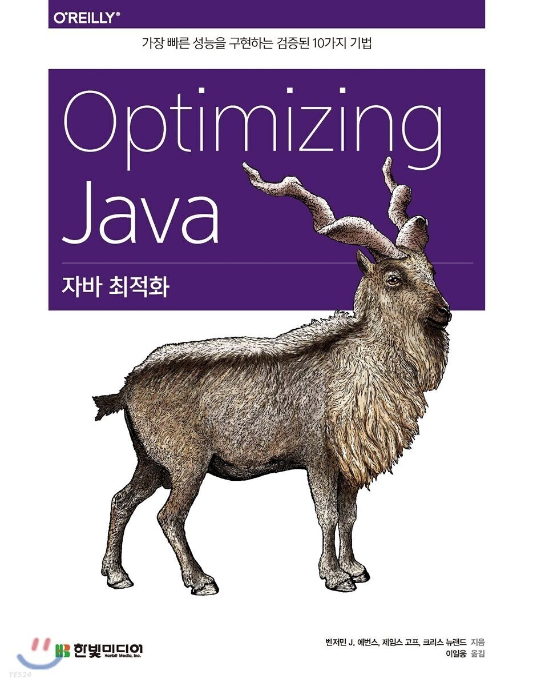

## GC 로깅, 모니터링, 튜닝, 툴

---

이 장에서는 GC 로깅 및 모니터링이라는 광범위한 주제를 다룹니다. 자바 성능 튜닝에서 가장 중요하고 가시적이면서도, 가장 많은 오해를 사는 부분입니다.

### **GC 로깅 개요**

---

GC 로그는 더없이 훌륭한 원천 정보입니다. 특히, 시스템이 내려간 원인의 단서를 찾는 '**콜드 케이스(Cold case)**' 분석을 할 때 매우 유용합니다. 파일에 씌여진 로그를 분석하는 작업이므로 애플리케이션 프로세스가 살아 있지 않아도 됩니다.

모든 중요한 애플리케이션에는 다음 두 가지를 설정해야 합니다.

* GC 로그를 생성한다.
* 애플리케이션 출려고가는 별도로 특정 파일에 GC 로그를 보관한다.

특히, 운영계 애플리케이션은 말할 나위가 없습니다. GC 로깅은 사실 오버헤드가 거의 없는 것이나 다름 없으니 주요 JVM 프로세스는 항상 로깅을 켜놓아야 합니다.

#### **GC 로깅 켜기**

먼저 애플리케이션 시작 시 다음 스위치를 추가합니다. 모름지기(데스크톱 앱을 제외하고) 자바/ JVM 애플리케이션이라면 무조건 켜야 하는 필수 로깅 플래그입니다.

```bash
-Xloggc:gc.log -XX:+PrintGCDetails -XX:+PrintenuringDistribution
-XX:+PrintGCTimeStamps -XX:+PrintGCDatestamps
```

각각의 자세한 용도는 표를 통해 정리했습니다.

| 플래그 | 작용 |
| --- | --- |
| -Xloggc:gc.log | GC 이벤트에 로깅할 파일을 지정한다. |
| -XX:+PrintGCDetails | GC 이벤트 세부 정보를 로깅한다. |
| -XX:+PrintTenuringDistribution | 툴링에 꼭 필요한, 부가적인 GC 이벤트 세부 정보를 추가한다. |
| -XX:+PrintGCTImeStamps | GC 이벤트 발생 시간을(VM 시간 이후 경과한 시간을 초 단위로) 출력한다. |
| -XX:+PrintGCDateStamps | GC 이벤트 발생 시간을 (벽시계 시간 기준으로) 출력한다. |

다음은 필수 플래그에서 성능 엔지니어가 주의해야 할 사항입니다.

* 기존 플래그 **verbose:gc**는 지우고 대신 **PrintGCDetails**를 사용한다.
* **PrintTenuringDistribution**은 다소 독특한 플래그로, 이 플래그가 제공하는 정보를 사람이 이용하기는 어렵습니다. 중요한 메모리압(Memory Pressure, 메모리 할당 압박) 효과, 조기 승격 등의 이벤트 계산 시 필요한 기초 데이터를 제공합니다.
* **PrintGCDatestamps**와 **PrintGCTimestamps**는 둘 다 필요합니다. 전자는 GC 이벤트와 애플리케이션 이벤트(로그파일)를, 후자는 GC와 다른 내부 JVM 이벤트를 각각 연관짓는 용도로 쓰입니다.

로그를 이 정도로 세세히 남겨도 JVM 성능에 이렇다 할 영향은 없습니다. 생성되는 로그량은 할당률, 사용중인 수집기, 힙 크기(힙이 작으면 더 자주 GC하므로 로그가 더 자주 쌓임)에 따라 달라질 것입니다.

대략 어느 정도인가 하면, (6장에서 살펴봤던) 할당기 샘플을 초당 50메가바이트 할당하는 조건으로 30분 돌려도 로그는 600킬로바이트 이하로 쌓입니다.

필수 플래그 이외에도 로그 순환(rotation) 관련 플래그가 있습니다.

| 플래그 | 작용 |
| --- | --- |
| -XX:+UseGCLogFileRotation | 로그 순환 기능을 켠다. |
| -XX:+NumberOfGCLogFIles=<n> | 보관 가능한 최대 로그파일 개수를 설정한다. |
| -XX:+GCLogFileSize=<size> | 순환 직전 각 파일의 최대 크기를 설정한다. |

로그 순환 정책은 (데브옵스를 비롯한) 운영팀과 협의해서 합리적으로 수립해야 합니다. 

#### **GC  로그 vs JMX**

2.7절에서 소개한 **VisualGC**는 JVM 힙 상태를 실시간 표시하는 툴입니다. 실제로 자바 관리 확장(Java Management eXtension, JMX) 인터페이스를 통해 JVM 데이터를 수집합니다. JMS은 이 책에서 따로 설명하지 않지만, JMX가 GC에 영향을 주기 때문에 성능 엔지니어는 다음 사항을 숙지해야 합니다.

* GC 로그 데이터는 실제로 가비지 수집 이벤트가 발생해서 쌓이지만, JMX는 데이터를 샘플링하여 얻습니다.
* GC 로그 데이터는 캡처 영향도가 거의 없지만, JMS는 프록시 및 원격 메서드 호출(Remote Method Invocation, RMI) 과정에서 암묵적인 비용이 듭니다.
* GC 로그 데이터에는 자바 메모리 관리에 연관된 성능 데이터가 50가지 이상 있지만, JMX는 10가지도 안됩니다.

**JMX**는 성능 데이터 원천으로서 스트리밍된 데이터를 즉시 제공한다는 점에서는 GC 로그보다 낫지만, jClarity 센섬(8.2절 참고)같은 툴도 GC 로그 데이터를 스트리밍하는 API를 제공하므로 별반 차이가 없습니다.

> ⚠️ 기본적인 힙 사용 실태를 파악하는 용도로는 JMX가 제격이지만, 더 깊이 있느 진단을 하려고 하면 금세 부족합을 느끼게 됩니다.

JMX로 가져온 빈은 표준 빈이고 쉽게 액세스할 수 있습니다. 데이터 시각화 툴은 VisualVM 외에도 다양한 상용 제품들이 있습니다.

#### JMX의 단점

JMX를 이용해 애플리케이션을 모니터링하는 클라이언트는 대부분 런타임을 샘플링하여 현재 상태를 업데이트 받습니다. 클라이언트는 계속 넘겨받기 위해 런타임에 있는 JMX 빈을 폴링합니다.

문제는 가비지 수집입니다. 수집기가 언제 실행될지 클라이언트는 알 도리가 없습니다. 다시 말해, **각 수집 사이클 전후의 메모리 상태 역시 알 수 없으므로 GC 데이터를 깊이 있고 정확하게 분석할 수 없습니다.**

물론, JMX로 얻은 데이터가 분석할 만한 가치가 없는 건 아니지만, 장기적 추이를 파악하는 정도로 쓸 수밖에 없습니다. 가비지 수집기를 정확하게 튜닝하려면 정보가 더 필요합니다. 특히, 각 수집 전후의  힙 상태 정보가 대단히 중요합니다.

또 메모리압(할당률)을 분석하는 활동이 매우 중요한데, JMX는 데이터를 수집하는 방식 때문에 이마저도 아예 불가능합니다.

그뿐만 아니라, JMXConnector 명세를 구현한 코드는 내부적으로 RMI에 의존하므로 **RMI 기반 통신 채널의 고질적인 문제점**에 취약합니다.

* 방화벽에 포트를 열어야 하기 때문에 부차 소켓 접속(Secondary socket connection)이 맺어질 수 있다.
* 프록시 객체를 이용해 remove() 메서드 호출을 대행한다.
* 자바 종료화(finalization)에 의존한다.

접속을 해제하는 작업량이 매우 적은 RMI 접속도 있지만, 정리 작업은 종료화에 의존합니다. 즉, 가비지 수집기를 돌려 객체를 회수해야 합니다.

JMS 접속은 수명주기 특성상, 풀 GC를 하기 전에는 RMI 객체가 수집되지 않고 남아 있을 가능성이 큽니다. 종료화가 미치는 영향과 종료화를 삼가해야 하는 이유는 11.6절에서 다시 이야기합니다.

RMI를 사용하는 애플리케이션은 기본 1시간에 한번씩 풀 GC가 발생합니다. 이미 RMI를 사용 중이라면 JMX를 붙인다고 더 나빠질 것은 없겠지만, 그 외에는 JMX를 사용하는 순간부터 추가 부하는 피할 수 없습니다.

#### **GC 로그 데이터의 장점**

최신 가비지 수집기는 수많은 부품이 한데 조립된, 엄청나게 복잡한 구현체입니다. 수집기의 성능 역시 불가능하지 않지만 그만큼 예측하기 힘듭니다. 이처럼 전체 구성 컴포넌트가 서로 맞물려 작동하면서 최종적 동작, 성능이 귀결되는 소프트웨어를 발현적(Emergent)이라고 합니다. 상이한 압력이 각기 다른 컴포넌트에 서로 다른 방식으로 작용하므로 매우 유동적인 비용 모델입니다.

처음에 자바 GC를 개발한 사람들은 GC 로깅을 JVM 구현체 디버깅 용도로 추가했습니다. 결국, 60개 가까운 GC 플래그로 생성된 데이터 상당수가 성능 디버깅 목적으로 쓰이게 되었습니다.

시간이 흐르면서 애플리케이션에서 가비지 수집 프로세스 튜닝을 맡았던 사람들은, GC 튜닝의 복잡함을 감안하더라도 런타임에서 무슨 일이 발생했는지 정확히 파악하는 데 GC 로그가 아주 유용하다는 사실을 깨달았습니다. 이제는 GC 로그 수집 및 분석은 튜닝 활동에서 절대 빠질 수 없습니다.

> GC 로그는 핫스팟 JVM 내부에서 논블로킹(Non-blocking) 쓰기 메커니즘을 이요해 남깁니다. 로깅이 애플리케이션 성능에 미치는 영향은 거의 0이므로 운영계는 무조건 켜두어야 합니다.

GC 로그에 쌓인 기초 데이터는 특정 GC 이벤트와 연관 지을 수 있어서 모든 의미 있는 분석 작업(어느 지점에서 수집 비용이 발생하는지, 어떻게 튜닝해야 긍정적인 결과를 얻을 수 있을지 등)을 수행할 수 있습니다.

### **로그 파싱 툴**

---

GC 로그 메시지는 어떤 정해진 언어나 VM 명세 표준 포맷이 따로 없습니다. 로그에 무슨 메시지를 남길지는 핫스팟 GC 개발팀 마음이라 마이너 릴리즈 간에도 포맷이 조금씩 다릅니다.

단순한 로그 포맷을 파싱하는 것은 어렵지 않지만, GC 로그 플래그가 하나둘 추가되면서 실제 출력되는 로그도 엄청나게 복잡해졌습니다. 특히, 동시 수집기가 생성하는 로그는 진짜 복잡합니다.

GC 설정을 변경해서 로그 출력 포맷이 달라지면 수동 GC 로그 파서를 쓰는 시스템에서 로깅이 끊어지는 사태가 곧잘 벌어집니다. GC 로그를 자세히 조사해보면 하필 로그가 가장 필요한 때에 수동 파서가 변경된 로그 포맷을 처리하지 못했다는 사실을 뒤늦게 발견합니다.

> 여러분 스스로 GC 로그를 파싱하려고 하지 말고 반드시 툴을 사용하세요.

이 절에서는 유지 보수가 가장 활발한 상용 툴, 오픈 소스 툴을 하나씩 소개합니다. 가비지캣(GarbageCat) 같은 툴은 거의(또는 전혀) 관리가 안되고 있습니다.

#### **센섬**

센섬은 jClarity 사가 제작한 사용 메모리 분석기입니다.  (단일 JVM에서 간단히 분석 가능한) 데스크톱 툴로 써도 되고 (여러 JVM을 대상으로 하느) 서비스 모니터링 용도로도 사용할 수 있습니다. 센섬은 최고의 GC 로그 파싱, 정보 추출, 자동 분석 기능을 제공하는 것이 목표입니다.

[그림 8-1]은 센섬 데스크톱 버전으로 G1 가비지 수집기를 실행 중인 금융 거래 애플리케이션의 할당률을 측정한 그래프입니다. 단순한 뷰이지만 거래 시장에서 애플리케이션 할당률이 매우 낮은 시간대가 있음을 한눈에 알 수 있습니다.

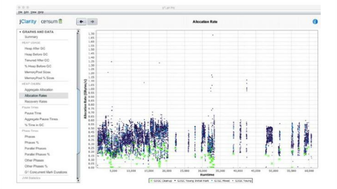

8-1. 센섬 할당 뷰

중간 시간 그래프 같은 뷰도 제공합니다. [그림 8-2]는 SaaS버전에서 조회한 중단 시간 그래프입니다.

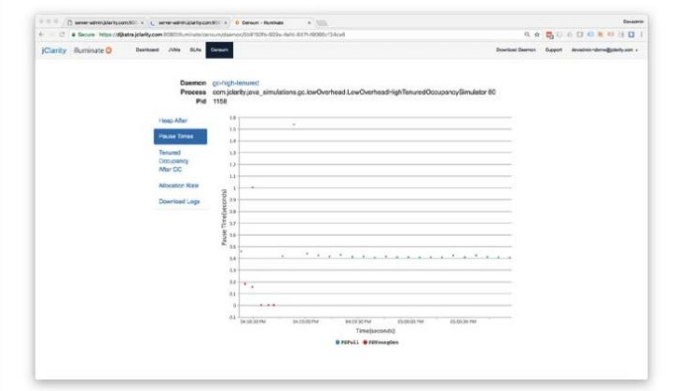

8-2. 센섬 중단 시간 뷰

센섬 SaaS 모니터링 서비스를 이용하면 좋은 점이, 전체 클러스터 상태를 한눈에 볼 수 있습니다(그림 8-3). 한번에 한 JVM씩 보면서 모니터링하는 것보다 엄청 편합니다.

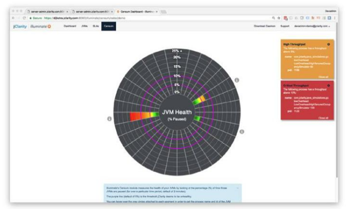

8-3. 센섬 클러스터 상태 보기

센섬 개발팀은 OpenJDK 소스에 체크인된 코드베이스 중 로깅 관련 소스 코드를 낱낱이 분석해서 변경된 로그파일 포맷을 철저히 반영하빈다. 그 어느 툴보다도 다양한 GC 로그 설정을 지원하며, 썬/오라클 자바 1.4.2부터 현재 버전까지 모든 수집기를 지원합니다.

다음은 센섬 최신 버전이 지원하는 자동 분석 기능입니다.

* 정확한 할당률
* 조기 승력
* 공격적인(확 치솟는) 할당
* 유저 이탈
* 메모리 누수 감지
* 힙 크기 조정 및 용량 계획
* VM에 대한 OS 간섭
* 크기를 잘못 잡은 메모리 풀

시험 라이선스 등 자세한 정보는 [jClarity](https://www.jclarity.com/) 공식 문서를 참고해주세요. 

#### **GCViewer**

GCViewer(GC 뷰어)는 GC 로그 파싱 및 그래프 출력 등 기본 기능을 갖춘 데스크톱 툴입니다. 오픈 소스라서 무료인 점이 가장 큰 장점이지만 상용 툴에 비해 빈약한 기능은 감수해야 합니다.

[소스](https://github.com/chewiebug/GCViewer)를 내려받아 컴파일/빌드 후 실행 가능한 JAR  파일로 패키징하세요.

GC 로그파일은 GCViewer 메인 UI에서 열어볼 수 있습니다(참고 8-4).

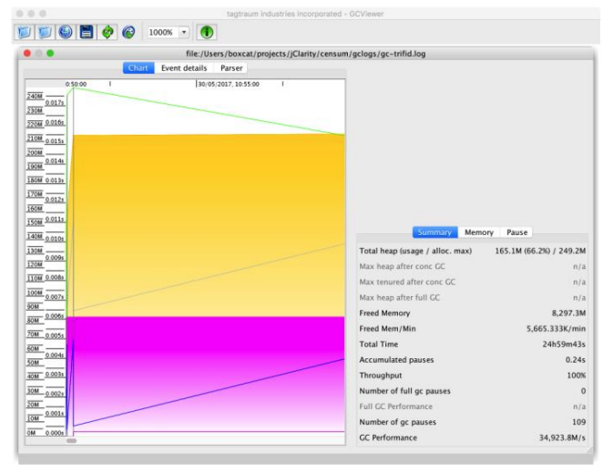

8-4. GCViewer

GCViewer는 분석 기능은 없고 특정 GC 핫스팟 로그 포맷만 파싱할 수 있습니다.

GCViewer를 파싱 라이브러리로 쓰고 결과 데이터를 시각화 툴로 내보내는 방법도 있지만, 기존 오픈 소스 코드 베이스에 추가 개발을 해야 하는 부담이 있습니다.

#### 같은 데이터를 여러 가지 형태로 시각화하기

똑같은 데이터라도 시각화한 모습은 툴마다 다를 수 있습니다. 6.6절에서 보았던 단순 톱니형 패턴은 전체 힙 크기를 측정해서 그린 샘플 뷰입니다.

동일한 GC 로그 데이터를 GCViewer 에서 `Heap Occupancy after GC(GC 이후 힙 점유)' 뷰로 보면 [그림 8-5]처럼 나타납니다.

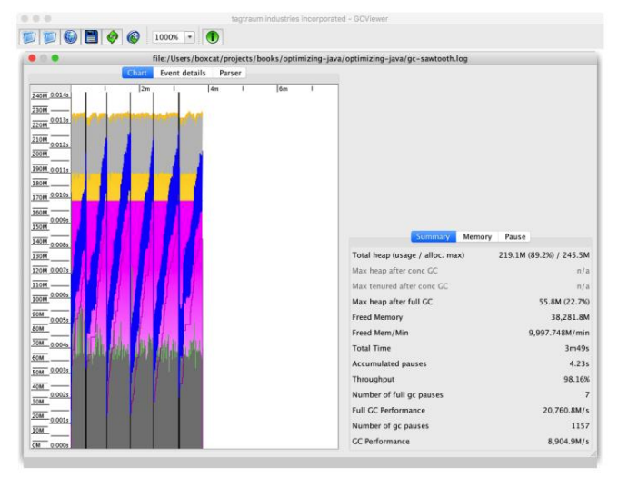

8-5. GCViewer에서 본 단순 톱니형 패턴

같은 톱니형 패턴이지만 센섬은 조금 다르게 보여줍니다(그림 8-6).

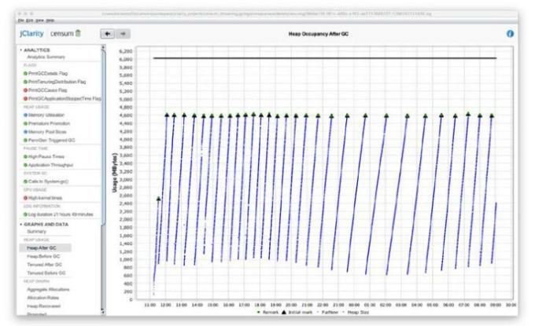

8-6. 센섬에서 본 단순 톱니형 패턴

눈에 보이는 모습은 다르지만 '힙 상태가 정상 가동 중'이라는 메시지는 같습니다.

### **GC 기본 튜닝**

---

'GC는 언제 튜닝해야 할까?" JVM 튜닝 전략을 수립하는 엔지니어가 자주 물어보는 질문입니다. GC 튜닝 역시 다른 기법처럼 전체 진단 과정의 일부여야 합니다. 다음 사실을 기억하면 실무에서 GC 튜닝을 할 때 도움이 될 것입니다.

1. GC가 성능 문제를 일으키는 근원이라고 확인하거나 그렇지 않다고 배제하는 행위는 저렴하다.
2. UAT에서 GC 플래그를 켜는 것도 저렴한 행위이다.
3. 메모리 프로파일러, 실행 프로파일러를 설정하는 작업은 결코 저렴하지 않다.

엔지니어는 튜닝을 수행하면서 다음 네 가지 주요 인자를 면밀히 관찰/측정해야 합니다.

* 할당
* 중단 민감도
* 처리율 추이
* 객체 수명

이 중에서 가장 중요한 요인은 할당입니다.

> 처리율에는 여러 가지 요인이 영향을 미칩니다. 가령, 동시 수집기는 실행 시 여러 코어는 점유합니다.

[표 8-3] 은 힙 크기를 조정하는 기본 플래그입니다.

| 플래그 | 작용 |
| --- | --- |
| -Xms<size> | 힙 메모리의 최소 크기를 설정한다. |
| -Xmx<size> | 힙 메모리의 최대 크기를 설정한다. |
| -XX:MaxPermSize=<size> | 펌젠 메모리의 최대 크기를 설정한다. (자바 7이전) |
| -XX:MaxMetaspaceSize=<size> | 메타스페이스 메모리의 최대 크기를 설정한다. (자바 8 이후) |

MaxPermSize는 자바 7이전에만 적용되는 레거시 플래그입니다. 자바 8부터는 펌젠이 사라지고 메타스페이스로 교체되었습니다.

> 자바 8 애플리케이션에 MaxPermSize 설정값이 있으면 반드시 지우세요. JVM이 그냥 무시하기 때문에 애플리케이션에 아무 상관도 없습니다.

튜닝 시 GC 플래그는 다음과 같이 추가합니다.

* 한번에 한 플래그씩 추가한다.
* 각 플래그가 무슨 작용을 하는지 숙지해야 한다.
* 부수 효과를 일으키는 플래그 조합도 있음을 명심한다.

현재 이벤트가 발생 중이라면, 성능 문제를 일으키는 원인이 GC인지 아닌지 판단하는 건 어렵지 않습니다. 먼저, vmstat 같은 툴로 고수준의 머신 지표를 체크하고(3.6절 참고) 성능이 떨어진 시스템에 로그인해서 다음을 확인하세요.

* CPU 사용률이 100%에 가까운가?
* 대부분의 시간(90% 이상)이 유저 공간에서 소비되는가?
* GC 로그가 쌓이고 있다면 현재 GC가 실행 중이라는 증거다.

위 내용은 지금 문제가 발생 중이고 엔지니어가 실시간 관측할 수 있다는 전제하에 가능합니다. 지난 이벤트를 조사하려면 충분한 (CPU 사용률, 타임스탬프가 찍힌 GC 로그 등) 모니터링 이력 데이터가 있어야 합니다.

세 가지 조건이 다 맞는다면 GC가 성능 이슈를 일으키고 있을 가능성이 크고 철저한 조사와 튜닝이 필요합니다. 테스트는 지극히 간단하고 결과는 분명합니다. 'GC는 문제없어' 또는 'GC가 문제야' 둘 중 하나입니다.

GC 가 성능 문제의 출처라고 밝힌 다음에는 할당과 중단 시간 양상을 파악한 다음, GC를 튜닝하고 필요 시 메모리 프로파일러를 활용하세요.

#### **할당이란?**

할당률 분석은 튜닝 방법뿐만 아니라, 실제로 가비지를 튜닝하면 성능이 개선될지 여부를 판단하는 데 꼭 필요한 과정입니다.

영 세대 수집 이벤트 데이터를 활용하면 할당된 데이터양, 단위 수집 시간을 계산할 수 있고, 일정 시간 동안의 평균 할당률을 산출할 수 있습니다.

> 수작업으로 할당률을 계산하느라 시간, 노력을 낭비하지 말고 툴을 써서 계산하세요.

필자의 경험상, 할당률의 1GB/s  이상으로 일정 시간 지속한다면 십중팔구 가비지 수집기 튜닝만으로는 해결할 수 없는 성능 문제가 터진 것입니다. 이 경우 성능을 향상시키려면 애플리케이션 핵심부의 할당 로직을 제거하는 리팩터링을 수행하여 메모리 효율을 개선하는 방법밖에 없습니다.

VisualVM(2.7절), jmap(6.1절)으로 단순 메모리 히스토그램만 보아도 메모리가 어떤 식으로 할당되는지 파악할 수 있습니다. 초기 할당 전략은 다음 네 가지 단순 영역에 집중하는 것이 좋습니다.

* 굳이 없어도 그만인, 사소한 객체 할당(예: 로그 디버깅 메시지)
* 박싱 비용
* 도메인 객체
* 엄청나게 많은 Non-JDK 프레임워크 객체

먼저 첫 번째 항목은, 불필요한 객체를 생성하는 부위를 찾아 그냥 제거하면 됩니다. 과도한 박싱도 그중 하나지만, 이밖에도 쓸데없이 객체를 생성하는 출처(예: JSON 직렬화/역직렬화용 자동 생성 코드나 ORM 코드)는 다양합니다.

드물지만 도메인 객체나 메모리를 많이 차지하는 일도 있습니다. 주로 다음 타입이 문제입니다.

* char[]: 스트링을 구성하는 문자(character, 캐릭터)
* byte[]: 바이너리 데이터
* double[]: 계산 데이터
* 맵 엔트리
* Object[]
* 내부 자료 구조(예: methodOop, klassOop)

단순 힙 히스토그램을 그려보면 불필요한 도메인 객체가 히스토그램의 상위권을 점유하면서 과하게 생성되는 모습을 지켜볼 수 있습니다. 이럴 때는 도메인 객체의 예상 데이터양을 재빨리 계산해 실제 측정된 데이터양과 비슷한 수준인지 확인합니다.

6.4.1절에서 배운 스레드 로컬 할당 기법은 스레드마다 객체를 할당할 공간을 개별 발급하여 O(1) 할당을 달성합니다.

TLAB은 스레드 당 크기가 동적 조정되며, 일반 객체는 남은 TLAB 공간에 할당됩니다. 여유 공간이 없으면 스레드는 VM에게 새 TLAB을 달라고 요청한 다음 재시도합니다.

객체가 너무 뚱뚱해서 빈 TLAB에 안 들어가면 VM은 TLAB 외부 영역에 위치한 에덴에 직접 객체를 할당 시도합니다. 이것도 실패하면 영 GC를 수행하는 다음 단계로 넘어갑니다(힙 크기가 재조정되겠습니다). 그래도 공간이 부족하면 최후의 방법으로 테뉴어드 영역에 객체를 직접 할당합니다.

따라서 결국 덩치 큰 배열(특히 byte[], char[])만 곧바로 테뉴어드에 할당될 가능성이 큽니다.

핫스팟은 TLAB 및 큰 객체의 조기 승격에 관한 튜닝 플래그를 제공합니다.

```bash
-XX:PretenureSizeThreshold=<n>
-XX:MinTLABSize=<n>
```

다른 스위치도 마찬가지지만, 각 스위치가 어떤 영향을 미치는지 제대로 벤치마킹도 안 하고 확실히 근거 없이 막연히 사용하면 안 됩니다. 대부분 기본 내장된 동적 기능만 이용해도 충분하며, 설정을 바꿔도 크게 눈에 띄는 영향은 없습니다.

또 할당률은 테뉴어드로 승격되는 객체 수에 영향을 끼칩니다. 단명 자바 객체의 (벽시계 시간으로 나타낸) 수명이 불변이라고 가정하면 할당률이 높을수록 영 GC 발생 주기는 짧아집니다. 너무 자주 수집이 일어나면 단명 객체는 장례를 치를 시간도 없이 테뉴어드로 잘못 승격될 가능성이 큽니다.

즉, 할당이 폭주하면 6.6절에서 보았던 조기 승격 문제가 불거질 것입니다. JVM은 이런 일이 없도록 테뉴어드 승격 없이 엄청난 양의 생존 데이터를 담아 서바이버 공간을 동적 조정합니다. 

조기 승격 문제는 다음 스위치가 요긴하게 쓰입니다.

> -XX:MaxTenuringThreshold=<n>

테뉴어드 영역으로 승격되기 전까지 객체가 통과해야 할 가비지 수집 횟수를 설정하는 것입니다. 디폴트 값은 4회이고 1 ~ 15 사이의 한계치를 설정할 수 있습니다. 이 값을 바꿀 때는 다음 두 가지 상충되는 관심사를 잘 따져봐야 합니다.

* 한계치가 높을수록 진짜 장수한 객체를 더 많이 복사한다.
* 한계치가 너무 낮으면 단명 객체가 승격되어 테뉴어드에 메모리압을 가중시킨다.

한계치를 너무 낮게 잡으면 테뉴어드로 승격되는 객체가 증가하고 그만큼 더 빨리 공간을 차지하게 되어 풀 수집이 더 자주 발생합니다. 매사 그렇듯, 논디폴트(non-default) 값으로 성능이 확실히 나아진 벤치마킹 사례가 없는 한 스위치를 함부로 변경하지 마세요.

#### 중단 시간이란?

개발자는 중단 시간에 대한 인지 편향으로 종종 시달립니다. 대부분의 애플리케이션에서 100 밀리초 정도의 중단 시간은 무시할 만합니다. 어차피 인간의 눈은 데이터 항목을 초당 5회밖에 처리 못하므로, 인간이 조작하는 (웹 애플리케이션 등의) 애플리케이션에서 100 ~ 200 밀리초 정도의 중단은 눈치채기도 어렵습니다.

중단 시간 튜닝 시 유용한 휴리스틱을 하나 소개합니다. 애플리케이션의 응답 요건에 따라 허용 가능한 중단 시간을 다음 세대역으로 나누어 표현하는 것입니다.

1. **> 1초:** 1초 이상 걸려도 괜찮다.
2. **1초 ~ 100밀리초:** 100밀리초 이상 1초 이하 정도는 괜찮다.
3. **< 100밀리초:** 100밀리초까지는 괜찮다.

중간 민감도를 애플리케이션 힙 크기와 대략 연관 지어보면 어떤 수집기가 가장 적합한지 가늠할 수 있습니다(표 8-4).

| 허용 중단 시간 | | | |
| --- | --- | --- | --- |
| >1s | 1s-100ms | < 100ms | < 2GB |
| Parallel | Parallel | CMS | < 4GB |
| Parallel | Parallel/G1 | CMS | < 4GB |
| Parallel | Parallel/G1 | CMS | < 10GB |
| Parallel/G1 | Parallel/G1 | CMS | < 20GB |
| Parallel/G1 | G1 | CMS | > 20GB |

물론, 어디까지나 튜닝의 시초로 삼을 만한 경험적 가이드일 뿐, 100% 정확한 규칙은 아닙니다.

향후 G1이 수집기로 굳혀지면 현재 ParallelOld 수집기로 처리하는 것보다 더 폭넗은 유스케이스를 커버할 수 있을 것입니다. CMS 유스케이스까지 처리할 정도로 확장될 수도 있지만, 가능성은 그리 크지 않아 보입니다.

> 동시 수집기를 사용할 경우, 중단 시간을 튜닝하려고 하기 전에 할당률부터 줄여야 합니다. 할당률이 낮아지면 동시 수집기에 가해지는 메모리압도 낮아지므로 수집 사이클이 할당 속도를 따라가기 쉬워집니다. 또 중단 시간에 민감한 애플리케이션에서 반드시 방지해야 할 CMF 이벤트 발생 확률이 감소합니다.

#### **수집기 스레드와 GC 루트**

스스로 'GC 스레드처럼 생각' 하려고 마음먹으면 갖가지 환경에서 수집기가 어떻게 작동하는지 파악할 수 있습니다. 그러나 GC의 다른 영역과 마찬가지로, 여기에도 근본적인 트레이드 오프가 도사리고 있습니다. 예를 들어, GC 루트 탐색 시간은 다음과 같은 요인의 영향을 받습니다.

* **애플리케이션 스레드 개수**
* **코드 캐시에 쌓인 컴파일드 코드량**
* **힙 크기**

이 셋은 GC 루트 탐색에 큰 영향을 끼칩니다. 런타임 조건 및 적용 가능한 병렬화 정도에 따라서도 달라집니다.

예를 들어, 마킹 단계에서 엄청나게 큰 Object[]를 발견되었다고 합시다. 탐색은 단일 스레드로 수행하므로 작업 훔쳐오기(work stealing)는 불가능합니다. 따라서 극단적으로는 이 단일 스레드의 탐색 시간이 전체 마킹 시간을 결정짓게 됩니다.

객체 그래프가 복잡해질수록 이런 현상은 더욱 심해집니다. 그래프 내부에 객체 체인이 길게 늘어지면서 마킹 시간도 점점 더 길어질 것입니다.

애플리케이션 스레드가 너무 많아도 스택 프레임을 더 많이 탐색해야 하고 세이프포인트에 도달하는 시간도 길어지는 등 GC 시간에 영향을 끼칩니다. 베어 메탈과 가상 환경에 존재하는 스레드 스케쥴러도 압박합니다.

JNI 프레임과 JIT 컴파일드 코드용 캐시 등 다른 GC 루트 원천들도 있습니다(9.4절에서 자세히 설명합니다).

> ⚠️ 코드 캐시에서 GC 루트를 탐색하는 작업도 (적어도 자바 8까지는) 싱글 스레드입니다.

세 가지 중 스택, 힙 탐색은 비교적 병렬화가 잘 됩니다. 세대 수집기 역시 (Parallel GC와 CMS은 카드 테이블, G1은 RSet 같은 장치로써) 다른 메모리 풀에서 넘어온 루트를 추적합니다.

6.3.1 절에서 설명했듯이 카드 테이블은 올드 세대에서 영 세대를 되참조하는 메모리를 블록을 가리킵니다. 1바이트가 512바이트의 올드 세대를 나타내므로 올드 세대 1기가 바이트는 2메가바이트의 카드 테이블을 탐색해야 합니다.

카드 테이블 탐색 시간이 얼마나 걸리는지 감이 잘 안 올 겁니다. 20기가바이트 힙의 카드 테이블을 탐색하는 장면을 시뮬레이션하는 단순 벤치마크 코드를 작성해보겠습니다.

```java
@State(Scope.Benchmark)
@BenchmarkMode(Mode.Throughput)
@Warmup(iterations = 5, time = 1, timeUnit = TimeUnit.SECONDS)
@Measurement(iterations = 5, time = 1, timeUnit = TimeUnit.SECONDS)
@OutputTimeUnit(TimeUnit.SECONDS)
@Fork(1)
public class SimulateCardTable {

   // 올드 세대는 힙의 3/4을 차지하며, 1G 올드 세대에 카드 테이블은 2M 필요함
   private static Final int SIZE_FOR_20_GIG_HEAP = 15 * 2 * 1024 * 1024;

   private statis Final byte[] cards = new byte[SIZE_FOR_20_GIG_HEAP];

   public statis Final void setup() {
       Final Random r = new Random(System.nanoTime());
       for (int i=0; i<100_000; i++) {
           cards[r.nextInt(SIZE_FOR_20_GIG_HEAP)] = 1;
       }
   }

   @Benchmark
   public int scanCardTable() {
       int found = 0;
       for(int i=0; i<SIZE_FOR_20_GIG_HEAP; i++) {
          if(cards[i] > 0)
             found++;
       }

       return found;
   }

}
```

실행 결과는 다음과 같습니다.

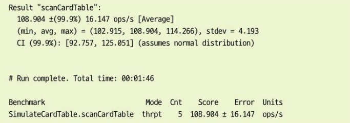

결과를 보니 20기가바이트 힙의 카드 테이블을 탐색하는 시간은 10밀리초 정도 입니다. 스레드 하나를 실행한 수치지만, 대략 영 수집 중단 시간의 최저치를 가늠해 볼 수 있습니다.

지금까지 대부분의 수집기에 고루 해당되는 일반적인 기법들을 살펴봤습니다. 이제 수집기별로 특화된 튜닝 방법을 알아보겠습니다. 

### Parallel GC 튜닝

Parallel GC는 가장 단순한 수집기라서 튜닝 역시 제일 쉽습니다. 사실, 최소한의 튜닝만으로도 충분합니다. 이 수집기의 목표와 트레이드 오프는 뚜렷합니다.

* 풀 STW
* GC 처리율이 높고 계산 비용이 싸다.
* 부분 수집이 일어날 가능성은 없다.
* 중단 시간은 힙 크기에 비례하여 늘어난다.

이와 같은 특성이 별문제가 안 되는 애플리케이션에서는 (특히, 힙이 4기가바이트 이하로 작을 경우) Parallel GC가 아주 효과적인 선택입니다.

과거에는 다음과 같은 크기 플래그를 적용해 다양한 메모리 풀의 상대적 크기를 조정했던 애플리케이션도 있습니다. 

| 플래그 | 작용 |
| --- | --- |
| -XX:NewRatio=<n> | (옛 플래그) 영 세대/전체 힙 비율 |
| -XX:SurviorRatio=<n> | (옛 플래그) 서바이버 공간/영 세대 비율 |
| -XX:NewSize=<n> | (옛 플래그) 최소 영 세대 크기 |
| -XX:MaxNewSize=<n> | (옛 플래그) 최대 영 세대 크기 |
| -XX:MaxHeapFreeRatio | (옛 플래그) 팽창을 막기 위한 GC 이후 최소 힙 여유 공간 비율(%) |
| -XX:MaxHeapFreeRatio | (옛 플래그) 수축을 막기 위한 GC 이후 최대 힙 여유 공간 비율(%) |

다음은 SurvivorRatio, NewRatio, 전체 힙 크기의 관계를 나타낸 수식입니다.

```java
플래그 세트:

-XX:NewRatio=N
-XX:SurvivorRatio=K

영 세대 = 1 / (N + 1) x 힙
올드 세대 = N / (N + 1) x 힙

에덴 = (K - 2) / K x 힙
서바이버1 = 1 / K x 힙
서바이버2 = 1 / K x 힙
```

대부분의 최신 애플리케이션은 사람보다 프로그램이 크기를 알아서 잘 결정하기 때문에 이렇게 명시적으로 크기를 설정하는 일은 삼가는 게 좋습니다. 이런 스위치는 Parallel GC 에서 어쩔 수 없는 경우, 최후의 수단으로만 사용합니다.

### CMS 튜닝

---

CMS는 튜닝이 까다롭기로 소문난 수집기입니다. 그도 그럴 것이, CMS로 최상의 성능을 얻는 과정에는 여러 가지 복잡성과 트레이드 오프가 있습니다.

'**중단 시간은 나쁘다, 고로 동시 마킹 수집기가 좋다**'는 단순 선입관에 사로잡힌 개발자가 많은 것 같습니다. CMS처럼 중단 시간이 짧은 수집기는 정말로 STW 중단 시간을 단축시켜야 하는 유스케이스에 한해 어쩔 수 없을 때만 사용해야 합니다. 안 그러면 딱히 이렇다 할 애플리케이션 성능 향상도 못 본 채, 팀원 모두 튜닝하기 힘든 수집기를 붙들고 고생할 것입니다.

CMS 플래그의 가짓수는 실로 방대합니다. (Java 8u131 기준 100여개) 어찌 됐건 플래그 값을 바꾸면 성능이 좋아지지 않을까 유혹에 빠지기 쉽지만, 4장에서 필자가 언급했던 안티패턴의 늪에 빠질 우려가 있습니다.

* 스위치 만지작거리기
* 민간 튜닝
* 숲을 못 보고 나무만 보다

분별 있는 성능 엔지니어라면 이러한 인지 함정의 희생양이 되지 않도록 단호히 유혹을 거부해야 합니다.

> 실제로 CMS를 사용하는 대부분의 애플리케이션에서 플래그 값을 바꾼다고 눈에 띄게 성능이 개선되는 경우는 흔치 않습니다.

그럼에도 CMS 성능을 개선하기 (또는 수용할 만한 성능을 얻기) 위해 위험을 무릅쓰고 튜닝을 감행해야 할 때도 있습니다. 먼저, 처리율부터 봅시다.

CMS 수집이 일어나면 기본적으로 코어 절반은 GC에 할당되므로 애플리케이션 처리율은 그만큼 반토막 납니다. 여기서 한 가지 유용한 경험 법칙은 CMF 발생 직전의 수집기 상태를 살펴보는 것입니다.

CMS 수집이 끝나자마자 곧바로 새 CMS 수집이 시작되는 **백투백** 수집 현상은 동시 수집기가 얼마 못 가 고장날 거라는 신호입니다. 애플리케이션의 메모리 할당 속도가 회수 속도를 능가하면서 결국 CMF가 일어나겠습니다.

백투백 현상이 일어나면 사실상 전체 애플리케이션 실행 처리율은 50%나 떨어집니다. 성능 엔지니어는 튜닝할 때 이런 최악의 상황이 발생해도 괜찮은지 알단 고민해보고, 괜찮지 않다면 호스트에 코어 수를 늘리는 해결 방안을 모색해야 합니다.

CMS 수집 중 GC에 할당된 코어 수를 줄이는 방법도 있습니다. 물론 그만큼 수집 수행 CPU 시간이 줄어들고 부하 급증 시 애플리케이션의 회복력이 떨어지는(결국 CMF에 더 취약해짐) 위험은 감수해야 합니다. 동시 GC 스레드 개수는 다음 스위치로 조절합니다.

```java
-XX:ConcGCThreads=<n>
```

디폴트 설정 상태에서 애플리케이션이 충분히 신속하게 메모리를 회수하지 못하는 경우에 GC 스레드 수를 줄이면 상황이 더욱 악화될 뿐이다.

CMS에서 STW는 두 단계에서 발생합니다.

**초기 마킹**

GC 루트가 직접 가리키는 내부 노드를 마킹한다.

**재마킹**

카드 테이블을 이용해 조정 작업이 필요한 객체를 식별한다.

따라서 모든 애플리케이션 스레드는 CMS가 한번 일어날 때마다 반드시 2회 멈추는데, 세이프 포인트에 예민한 저지연 애플리케이션에서는 중요한 영향을 미칠 수 잇습니다.

다음 두 플래그를 함께 적용하면 도움이 됩니다.

```java
-XX:CMSInitiatingOccupancyFraction=<n>
-XX:+UseCMSInitiatingOccupanyOnly
```

할당률이 오라가락하는 상황에서 겪게 될 딜레마를 잘 나타낸 플래그들입니다.

**CMSInitiaingOccupancyFraction**(CMS 초기 점유율)는 CMS가 언제 수집을 시작할지 설정하는 플래그입니다. CMS가 실행되면 영 수집을 통해 올드 영역으로 승격되는 객체들을 수용할 여유 공간이 필요합니다.

다른 핫스팟 GC도 마찬가지만, 여유 공간 역시 JVM 자체 수집한 통계치에 따라 그 크기가 조정되지만, 첫 번째 CMS를 가동시킬 추정치를 **CMSInitiatingOccupancyFraction** 플래그에 미리 정해놓는 것입니다. 기본적으로 최초의 CMS 풀 GC는 힙이 75% 찼을 때 시작됩니다.

**UseCMSInitiatingOccupancyOnly** 플래그를 함께 설정하면 초기 점유 공간을 동적 크기 조정하는 기능이 꺼집니다. 이 플래그는 함부로 켜면 안 됩니다. 그런데 실제로 (매개변수 값을 75이상으로) 여유 공간을 줄일 일은 거의 없습니다.

할당률이 심하게 튀는(bursty) CMS 애플리케이션이라면 여유 공간을 늘리고(매개변수 값을 줄이고) 능동적 크기 조정(adaptive sizing) 기능을 끄는 전략을 구사하겠습니다. CMS의 동시 GC를 더 자주 일으키는 대가를 치르더라도 CMF를 줄여보자는 것입니다.

#### 단편화로 인한 CMF

튜닝 분석에 필요한 데이터가 GC 로그에만 존재하는 다른 사례입니다. **프리 리스트 통계치**를 바탕으로 언제 JVM에서 (힙 단편화로 인한) CMF가 발생할지 미리 알 수 는 없을까요? 이런 종류의 CMF는 7.2.1절에서도 살펴봤듯이 CMS가 프리 리스트 때문에 발생합니다.

다음 JVM 스위치를 추가하면,

```java
-XX:PrintFLSStatistics=1
```

GC 로그에 몇몇 추가 정보가 표시됩니다(Statistics for BinaryTreeDictionary 벤치마크 자료임).

```java
Total Free Space: 40115394
(총 프리 공간)

Max Chunk Size: 38808526
(최대 청크 크기)

Number of Blocks: 1360
(블록 개수)

Av. Block Size: 29496
(평균 블록 크기)

Tree Height: 22
(트리 높이)
```

평균 블록 크기와 최대 청크 크기를 보니 메모리 청크의 크기 분포를 대략 짐작할 수 있습니다. 덩치 큰 라이브 객체를 테뉴어드로 옮기려고 하는데 그만한 크기의 청크가 바닥난 경우, GC 승격이 악화되어 결국 CMF로 이어지겠습니다.

JVM은 다시 Parallel GC로 들아가 힙을 압착하고 프리 리스트를 병합하며 STW 중단은 길어질 것입니다. 실시간으로 분석하면 이러한 시간이 긴 중단이 임박했음을 미리 알 수 있어 좋습니다. 로그를 파싱하거나 센섬 같은 툴을 써서 CMF에 근접했다는 사실을 자동 감지할 수 있습니다.

### G1 튜닝

---

엔드 유저가 최대 힙 크기와 최대 GC 중단 시간을 간단히 설정하면 나머지는 수집기가 알아서 처리하는 하는 것이 G1 튜닝의 최종 목표입니다. 그러나 아직 현실은 조금 동떨어져 있습니다.

CMS처럼 G1도 구성 옵션이 꽤 많지만, 그중에는 여전히 실험적이고 VM내부에 (가시적인 튜닝 지표 측면에서) 잘 드러나지 않는 것들도 있습니다. 튜닝을 해서 뭔가 바꿔도 어떤 영향을 미칠지 알아차리기 어려운 것입니다. 그래도 이런 옵션을 지정해서 튜닝해야 할 경우(이미 현재 튜닝 시나리오에 포함되어 있다면) 다음 스위치를 반드시 지정합니다.

```java
-XX:+UnlockExperimentalVMOptions
```

특히, 이 스위치는 -XX:G1NewSizePercent=<n>나 -XX:G1MaxNewSizePercent=<n>을 사용할 경우 꼭 필요합니다. 언젠가 이런 옵션도 당연하게 인식돼서 실험적인 옵션들은 불필요해지겠지만 아직 확실한 로드맵은 없습니다.

[그림 8-7]은 자바FX애플리케이션으로 G1 힙의 영역별 모습을 그린 재미난 이미지입니다.

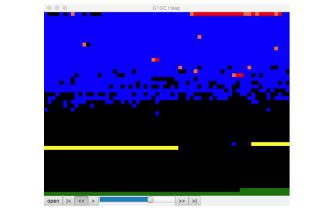

8-7. G1 힙을 영역별로 시각화

G1 GC 로그를 파싱해서 G1 힙의 영역별 레이아웃을 시각화하는 작은 오픈 소스 자바FX 애플리케이션입니다. 커크 페퍼다인(Kirk Pepperdine)이 개발했고 깃허브에서 소스 코드를 얻을 수 있습니다. 이 책을 쓰고 있는 지금도 활발히 개발되고 있습니다.

G1 튜닝에서 가장 큰 문제는, 이 수집기가 처음 등장한 이후로 내부적으로 상당히 많이 변화를 겪었다는 사실입니다. 따라서 초창히 G1에 관한 글들은 지금은 맞지 않는 경우가 많아서 섣불리 민간 튜닝을 하면 심각한 문제가 발생할 수 있습니다.

따라서 이 절은 일부 개선이 이루어진 부분과 G1이 확실히 CMS를 능가할 것으로 전망되는 부분만 짚어보는 거로 마무리하겠습니다. CMS는 압착을 하지 않으므로 시간이 갈수록 힙은 단편화됩니다. 그러다 결국 CMF가 발생하고 JVM은 (상당히 긴 STW 중단을 유발하는) 풀 병렬 수집을 단행할 것입니다.

G1 수집기는 할당률에 뒤처지지 않는 한 계속 조금씩 압착하므로 CMF가 일어날 가능성은 전혀 없습니다. 어떤 애플리케이션에서 할당률이 계속 높은 상태로 대부분 단명 객체가 생성되고 있다면 다음 튜닝을 고려해봄 직합니다.

* 영 세대를 크게 설정한다.
* 테뉴어드 한계치를 최대 15 정도로 늘려 잡는다.
* 애플리케이션에서 수용 가능한 최장 중단 시간 목표를 정한다.

이와 같이 에덴 및 서바이버 영역을 구성하면 순수 단명 객체가 승격될 가능성이 현저히 줄어듭니다. 올드 세대압도 낮아지고 올드 영역을 정리할 일도 줄어들 것입니다. 사실, GC 튜닝 세계에서 100% 장담할 수 있는 건 거의 없습니다. 그래도 힙을 튜닝하는 수고는 따르지만 G1이 CMS보다 월등히 낫다는 사실을 보여주는 워크로드 사례입니다.

### jHiccup

---

**jHiccup**(제이히컵)은 5.3.2절에서 배운 HdrHistogram과 연관된 툴로, 깃허브에서 내려받을 수 있습니다. JVM이 연속적으로 실행되지 못한 지점, 즉 'Hiccup(딸꾹질)'을 보여주는 계측 도구입니다. 히컵을 일으키는 가장 흔한 원인은 GC STW 중단이지만, OS나 플랫폼 관련 문제 때문에 발생하기도 합니다. 따라서 jHiccup은 GC 튜닝에도 좋지만 초저지연(ultra-low-latency) 작업을 할 때 유용합니다.

jHiccup이 어떻게 작동하는지는 7.5절에서 셰난도아 수집기를 소개하고 다른 수집기와의 성능 대조 그래프를 소개할 때 설명한 바 있습니다(그림 7-9).

> jHiccup 원작자(질 테네)는 원래 핫스팟이 아줄 징 JVM보다 못한 점을 부각시키려고 이 툴을 개발했노라 흔쾌히 인정했지만, 핫스팟을 튜닝할 때에도 요긴한 아주 쓸모있는 툴입니다.

jHiccup은 자바 명령줄에서 -javaagent:jHiccup.jar를 지정해 자바 에이전트로 사용합니다. (다른 명령줄 툴처럼) Attach API로도 사용할 수 있습니다. 형식은 이렇습니다.

```java
jHiccup -p <프로세스 ID>
```

실행 중인 애플리케이션 jHiccup을 주입하는 명령입니다.

jHiccup은 HdrHistogram의 입력 데이터로 사용 가능한 히스토그램 로그 형식으로 결과를 출력합니다. 실제로 어떤 모습인지 6.6절에서 보았던 할당 애플리케이션 모델을 다시 살펴봅시다.

간단한 쉘 스크립트를 작성해서 애플리케이션에 GC 로깅 플래그를 정확히 설정하고 jHiccup을 에이전트로 실행합시다.

```java
#!/bin/bash

# Simple script for running jHiccup against a run of the model toy allocator

CP=./target/optimizing-java-1.0.0-SNAPSHOT.jar

JHICCUP_OPTS=
-javaagent:~/.m2/repository/org/jhiccup/jHiccup/2.0.7/jHiccup-2.0.7.jar

GC_LOG_OPTS="-Xloggc:gc-jHiccup.log -XX:+PrintGCDetails -XX:+PrintGCDateStamps -XX:+PrintGCTimeStamps -XX:+PrintTenuringDistribution"

MEM_OPTS="-Xmx1G"

JAVA_BIN=`which java`

if [ $JAVA_HOME ]; then
    JAVA_CMD=$JAVA_HOME/bin/java
elif [ $JAVA_BIN ]; then
    JAVA_CMD=$JAVA_BIN
else
    echo "For this command to run, either $JAVA_HOME must be set, or java must be in the path."
    exit 1

Fi

exec $JAVA_CMD -cp $CP $JHICCUP_OPTS $GC_LOG_OPTS $MEM_OPTS
  optjava.ModelAllocator
```

스크립트 실행 결과, GC 로그와 더불어 jHiccup에 내장된 jHiccupLogProcessor 툴에 입력 데이터로 활용하기 좋은 .hlog 파일이 생성됩니다. [그림 8-8]은 기본 jHiccup 뷰입니다.

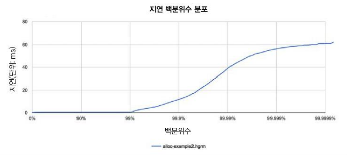

8.8 jHiccup에서 본 ModelAllocator

다음과 같이 아주 간단히 jHiccup 명령을 실행해서 얻은 그래프입니다.

```java
jHiccupLogProcessor -i hiccup-example2.hlog -o alloc-example2
```

이외에도 쓸만한 스위치가 많이 있으니 다음 명령으로 전체 옵션을 확인하세요.

```java
jHiccupLogProcessor -h
```

성능 엔지니어는 같은 애플리케이션이라도 여러 가지 뷰를 파악하면서 완벽을 가해야 할 때가 많습니다. 이번에는 센섬에서 얻은 그래피입니다(그림 8-9).

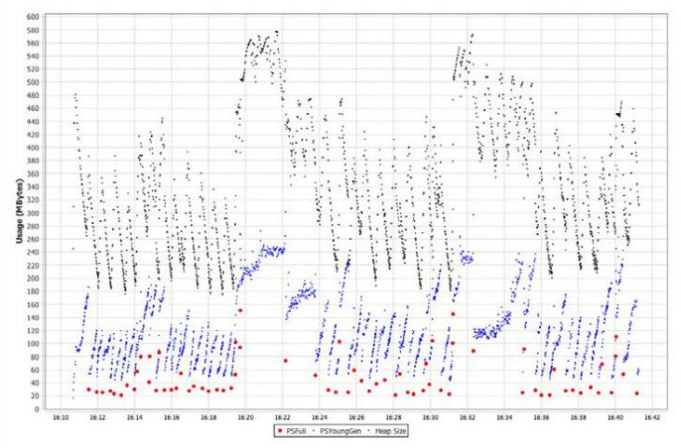

8-9. 센섬으로 본 ModelAllocator

GC 회수 후 힙 크기 그래프를 보면 핫스팟이 힙 크기 재조정을 시도했으나 안정된 상태에 이르지 못한 모습니다. 이런 현상을 **ModelAllocator** 같은 단순한 애플리케이션에서도 자주 일어납니다. 이처럼 JVM은 매우 동적인 환경이라서 개발자가 GC 기술을 너무 지나치게 저수준까지 파고들 이유가 없습니다.

끝으로, HdrHistogram과 jHiccup에 관한 기술적인 세부 내용이 궁금한 독자는 닛산 와카(Nitsan Wakart)가 게시한 [블로그 게시글](http://psy-lob-saw.blogspot.com/2015/02/hdrhistogram-better-latency-capture.html)을 한번 읽어보세요.

### 정리

---

수박 겉핥기지만 GC 튜닝의 세계를 간략히 짚어보았습니다. 개별 수집기에 특정한 기술 위주로 설명했지만, 일반화하여 적용 가능한 기반 기술도 있습니다. GC 로그를 다루는 기본 원칙과 유용한 툴을 살펴보았습니다.

다음 장에서는 애플리케이션 코드를 실행하는 JVM의 또 다른 주요 서브시스템을 집중 조명합니다. 인터프리터를 간략히 살펴본 다음, JIT 컴파일에 대헛, 그리고 표준(즉, AOT) 컴파일과는 어떤 관계가 있는지 알아보겠습니다.

### Keyword

---

**Cold Case**

원래 콜드 케이스(Cold Case)는 진상이 명확히 밝혀지지 않은 범죄나 사고를 가리키는 요어로 여기서는 '원인을 알 수 없는 현상'정도를 비유하는 용도로 사용하고 있습니다.

**work stealing**

멀티스레드 프로그래밍에서 흔히 쓰이는 스케줄링 전략, 스레드마다 전용 큐를 두고 스레드 풀에서 일감을 가져다 자신의 큐에 넣고 실행하다 보면 특정 스레드에 일감이 몰리게 되는 현상이 발생합니다. 따라서 놀고 있는 스레드가 다른 바쁜 스레드의 큐에 있는 일감을 훔쳐와 자신의 큐에 넣고 실행시킴으로써 전체적인 부하를 분산시키는 것입니다.
