오늘은 피곤한 화요일... 화요병?

그런거 없어요 그냥 공부만 해야지

공부만 공부만 공부만...

개발하자!!

오늘하면 2회독 끝~!!

(자바를 다시들어야할 것 같은데.. 기억이 안낭....)

---

### **5주차**

**[수업 목표]**

* Flask 프레임워크를 활용해서 API를 만들 수 있다.
* '버킷리스트'를 완성한다.
* EC2에 내 프로젝트를 올리고, 자랑한다!

**[목차]**

* 버킷리스트
* Flask 서버 + 도메인 연결
* og 태그

---

**0. 사전준비**

- [파일질라 다운로드](https://filezilla-project.org/download.php)

(파일질라는 서버에 파일을 간편하게 업로드 할 수 있는 프로그램)

[Download FileZilla Client for Windows (64bit x86)

Download FileZilla Client for Windows (64bit x86) The latest stable version of FileZilla Client is 3.59.0 Please select the file appropriate for your platform below. Please select your edition of FileZilla Client FileZilla FileZilla with manual FileZilla P

filezilla-project.org](https://filezilla-project.org/download.php)

- [가비아 도메인 구입](https://www.gabia.com/)

(가비아는 저렴한 비용으로 도메인을 구입하여 사용할 수 있게 연결시키는 서비스)

[웹을 넘어 클라우드로. 가비아

그룹웨어부터 멀티클라우드까지 하나의 클라우드 허브

www.gabia.com](https://www.gabia.com/)

---

**1. [ 버킷리스트 ]**

1) 폴더 구조화

- static(JS, CSS 파일 저장용도), templates(html파일), app.py 생성

2) 패키지 설치

- Flask(서버용), dnspyhton(DNS 패키지), pymongo(DB)

3) 구현

> **HTTP Method는 크게 GET, POST, PUT, DELETE가 대표적입니다.**  
> **보통 CURD에서 Create(POST), Update(PUT), Read(GET), Delete(Delete)을 사용합니다.**  
>   
> (3)번에 경우 수업에서 POST 요청으로 사용하였다. POST를 사용하여도 되지만, 일부만 수정할 경우 PUT으로 사용하는 것이 좋다고 배웠기 때문에 PUT으로 수정하였다.

(1) 페이지 요청 시 데이터베이스에서 버킷리스트들을 가져와서 출력한다.(GET)

(2) 값을 입력하고 '기록하기' 버튼을 누르면 버킷리스트가 추가된다.(POST)

(3) '완료' 버튼을 누르면 해당 버킷은 버킷리스트를 완료한 것으로 변경된다.(PUT)

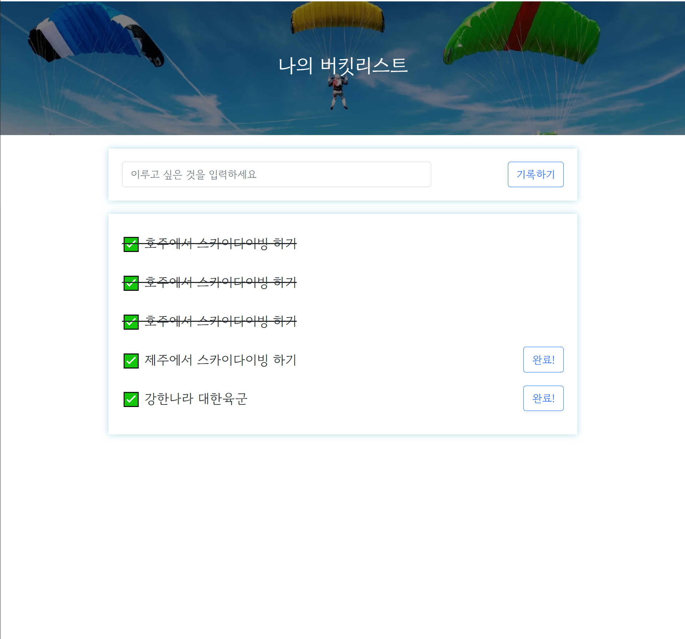

1-1 버킷리스트 구현

---

**2. Flask 서버 + 도메인 연결**

**(1) 문제**

**- 내 컴퓨터를 항상 켜둘 수 없다.**

**- 모두가 접근할 수 있는 공개 주소인 공개 IP로 나의 웹 서비스에 접근할 수 있도록 할 경우 보안상에 문제가 생길 수 있다.**

**(2) 해결책**

**=> 클라우드 환경에서 내 서버를 돌리게 하고, 도메인을 통해 접근할 수 있도록 한다.**

**(3) AWS EC2 사용방법**

**- 인스턴스 생성하여 Ubuntu 20.04 LTS(프리티어) 선택!!  (프리티어가 무료임)**

**- 인스턴스를 삭제하고 싶은 경우, 인스턴스 종료**

**- 인스턴스를 **중지하고 싶을 경우, 인스턴스 중지****

**(4) EC2 원격접속**

1. git bash 실행(관리자 모드 X)
2. ssh -i (생성한 키 파일 경로) ubuntu@(AWS EC2 인스턴스의 ip)

**(5) EC2 설정**

> [ Python3 → Python] : 파이썬 파일 실행 명령어  
> sudo update-alternatives --install /usr/bin/python python /usr/bin/python3 10

> [ pip3 -> pip ] : 패키지 설치 명령어  
> sudo apt-get update  
>  sudo apt-get install -y python3-pip  
>  sudo update-alternatives --install /usr/bin/pip pip /usr/bin/pip3 1

> [ port forwarding ] : 80포트로 접근시 리다이렉트로 5000번 연결   
> sudo iptables -t nat -A PREROUTING -i eth0 -p tcp --dport 80 -j REDIRECT --to-port 5000

**(6) Filezila 연결**

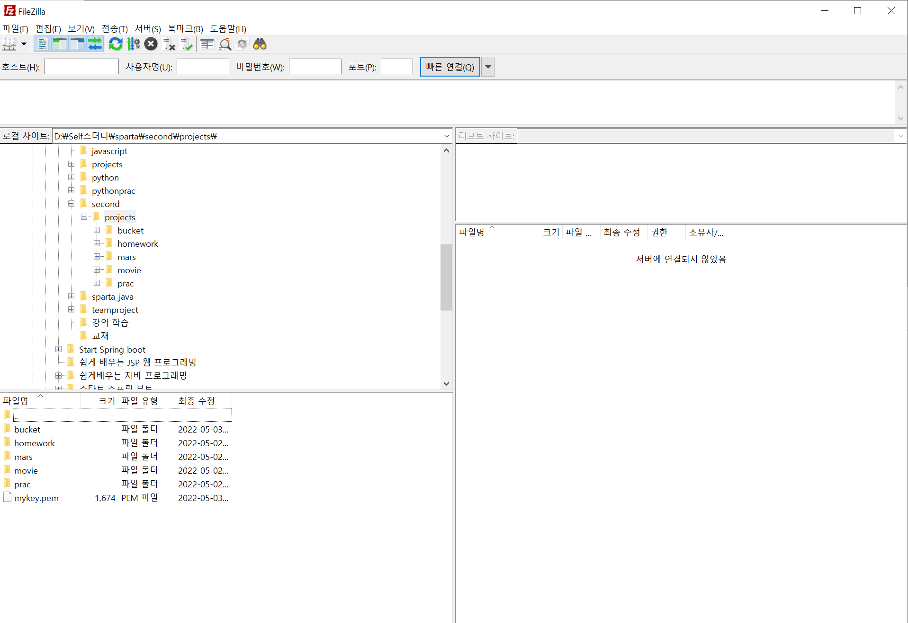

2-1. 파일질라 실행

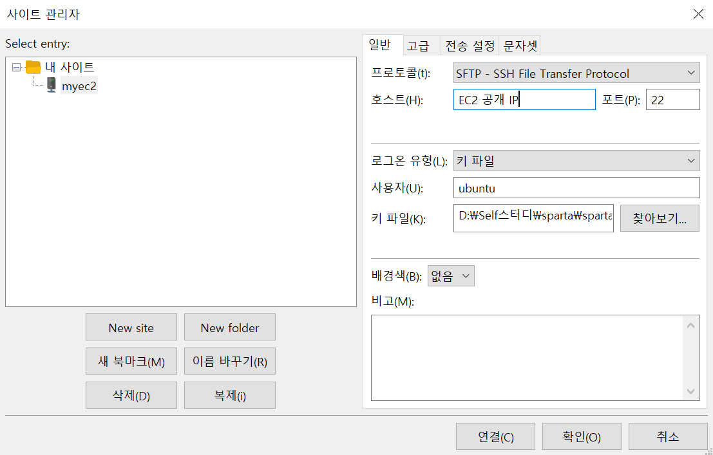

2-2. 파일질라 서버 연결

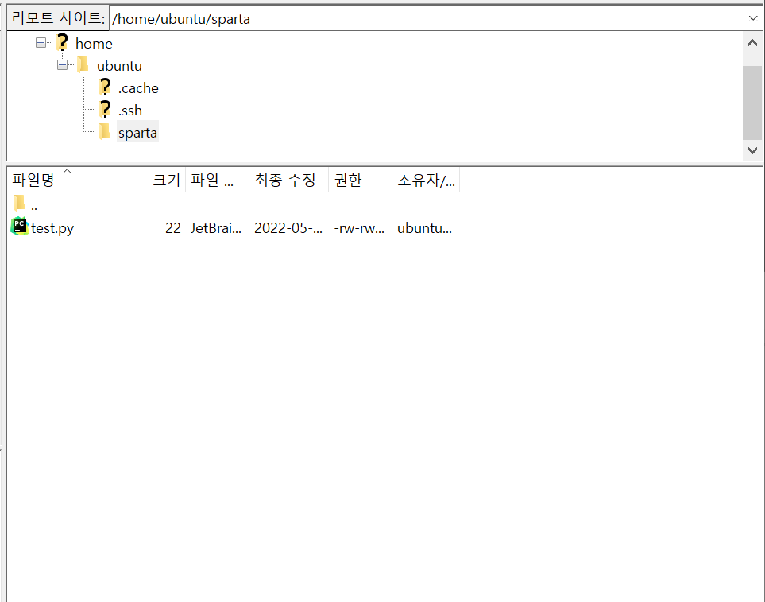

2-3. 파일질라 파일&nbsp; 업로드

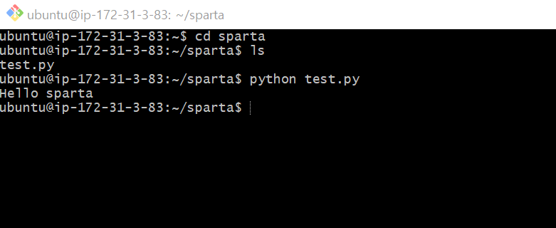

2-4. 업로드된 파일 테스트

- .idea와 venv를 제외한 파일을 업로드하면 된다.

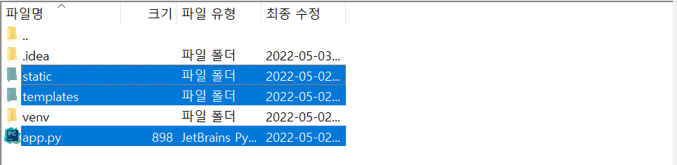

2-5. 업로드

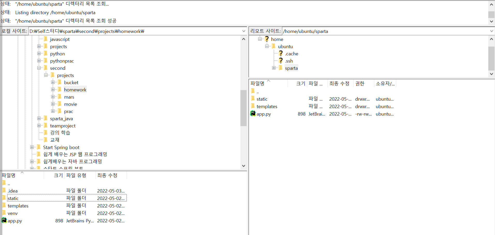

2-6. python 프로젝트 업로딩

**(7) 패키지 설치**

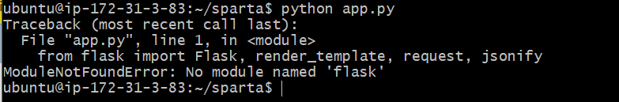

2-7. flask 패키지 설치 필요

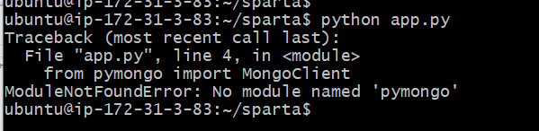

2-8. pymongo 패키지 설치 필요

> 패키지를 설치했다면 연결이 될까??  
> 정답은 X 이유는 포트를 열어주지 않았기 때문입니다.

**(8) 포트 연결**

1. 인스턴스에서 보안 선택
2. 보안에서 보안그룹 선택
3. 인바운드 규칙 편집 선택
4. 규칙 추가를 클릭하여 5000번 포트, Anywhere IPv4 과 80포트Anywhere IPv4를 두개 추가해준다.

> 현재 gitbash를 끌경우, 서버를 종료된다.  
> 그러면 어떻게 해야 서버가 계속 살아있을까??

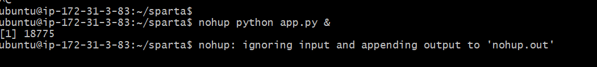

2-9. flask 서버 계속 키는 방법

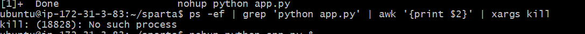

2-10. flask 서버 중지

**(9) 도메인 연결**

[**초미니홈피 - 팬명록**](http://artist-bang.shop/)

---

**3. og태그**

**(1) SNS에 공유했을 때 원하는 모습으로 꾸밀 수 있는 태그**

3-1. og 태그 활용

(2) og태그를 변경하였는데, 바뀌지 않을 경우 해결방법

1. [카카오톡 og태그 초기화](https://developers.kakao.com/tool/clear/og)
2. [페이스북 og태그 초기화](https://developers.facebook.com/tools/debug/)

---

정리

내일은 드디어.. 항해99 입학 테스트다...

내가 달려온 것이 물거품이 되지 않기 위해서는

무조건적으로 통과를 해야한다..!!!!

아자아자 화이팅!! 달리자!!

내가 해야할 것은 코딩 코딩 코딩!!

