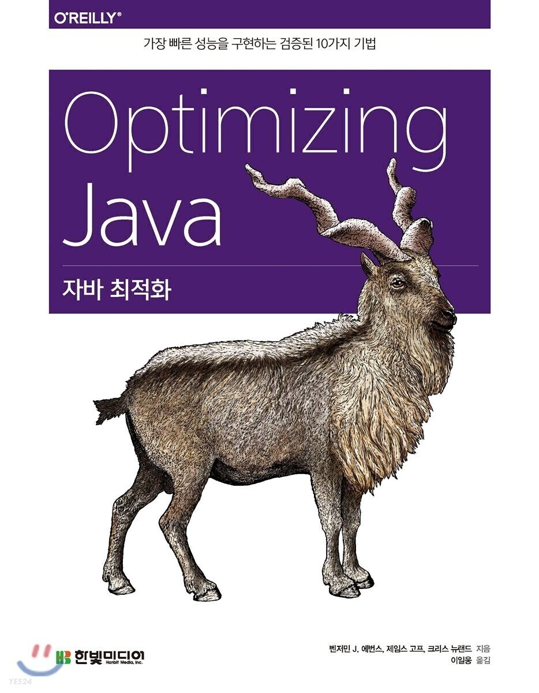

## JVM의 코드 실행

---

JVM이 제공하는 가장 중요한 서비스는 메모리 관리와 사용하기 쉬운 애플리케이션 코드 실행 컨테이너입니다. 가비지 수집은 6~8장에서 자세히 다루었으니 이번 장부터는 코드 실행으로 화제를 돌려보겠습니다.

> 표준 자바 구현체가 코드를 실행하는 방법은 보통 VMSpec이라고 부르는 자바 가상 머신 명세에 기술되어 있습니다.

VMSpec을 보면 인터프리터로 자바 바이트코드를 실행하는 사양이 나오지만, 인터프리터로 해석하여 구동하는 환경은 대체로 기계어를 직접 실행하는 프로그램 환경보다 성능이 떨어집니다. 그래서 대부분의 최신 제품급 자바 환경은 동적 컴파일 기능을 통해 이 문제를 해결합니다.

바로 2장에서도 소개한 JIT 컴파일 기법입니다. JVM이 실행 중인 메서드를 지켜보고 있다가 직접 실행 가능한 코드로 컴파일 메서드를 분별하는 메커니즘입니다.

이 장에서는 바이트코드 해석을 간략히 살펴본 다음, 여러분이 익숙한 다른 인터프리터와 핫스팟의 차이점을 알아봅니다. 이어서 프로파일 기반 최적화의 기초 개념을 다루고 코드 캐시 및 핫스팟 컴파일 서브시스템의 기본적인 내용을 다룹니다.

다음 장에서는 핫스팟에서 가장 일반적인 최적화 이면에 숨겨진 메커니즘, 즉 매우 빠른 컴파일드 메서드를 어떻게 생성하고 튜닝은 어느 정도까지 가능한지, 그 한계점은 무엇인지 설명합니다.

### 바이트코드 해석

---

2.1절에서 간단히 살펴봤듯이 JVM 인터프리터는 일종의 스택 머신(Stack Machine)처럼 작동하므로 물리적 CPU와는 달리 계산 결과를 바로 보관하는 레지스터는 없습니다. 대신, 작업한 값은 모두 평가 스택에 놓고 스택 머신 명령어로 스택 최상단에 위치한 값을 변환하는 식으로 작동합니다.

JVM은 다음 세 공간에 주로 데이터를 담아 놓습니다.

* **평가 스택**: 메서드별로 하나씩 생성된다.
* **로컬 변수**: 결과를 임시 저장한다(특정 메서드별로 존재한다).
* **객체 힙**: 메서드끼리, 스레드끼리 공유된다.

[그림 9.1 ~ 9.5]는 자바 프로그래머가 쉽게 이해할 수 있게 평가 스택을 이용해 계산하는 VM 작업을 의사코드 형태로 나타낸 것입니다.

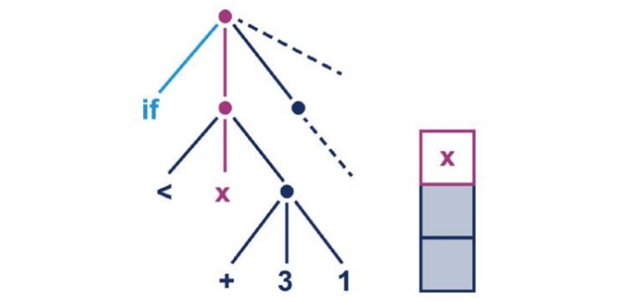

9-1. 초기 해석 상태

인터프리터는 우측 서브트리를 계산해서 x 콘텐츠와 비교할 값을 결정합니다.

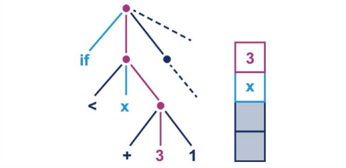

9-2. 서브트리 평가

다음 서브트리 제일 앞에 있는 값(정수형 상수 3)이 스택에 로드됩니다.

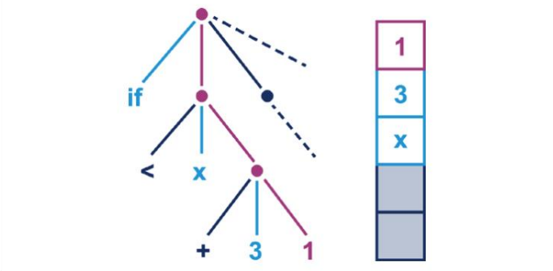

9-3. 서브트리 평가

이제 또 다른 정수값 1도 스택에 로드됩니다. 실제 JVM에서 이런 값들을 클래스 파일의 상수 영역에서 로드됩니다.

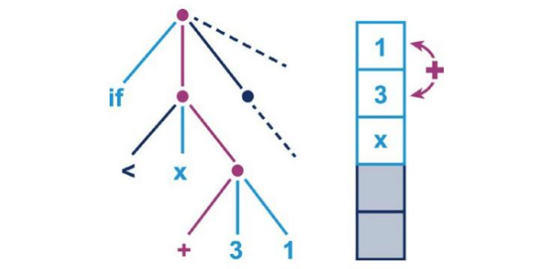

9-4. 서브트리 평가

그리고 스택 위에 나란히 얹어놓은 두 원소를 더하고 싹 지운 다음, 덧셈 결과값으로 대체합니다.

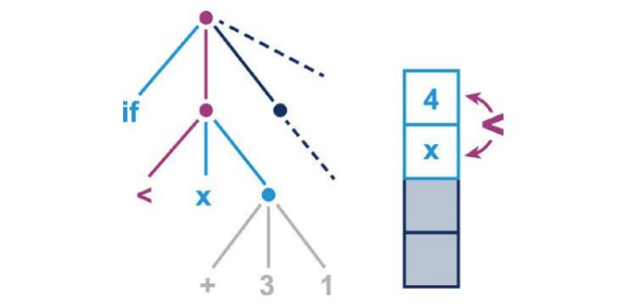

9-5. 최종 서브트리 평가

이제 이 덧셈 결과값을, 다른 서브트리를 평가하는 내내 평가 스택에 있었던 x와 비교합니다.

#### JVM 바이트코드 개요

JVM에서 각 스택 머신 작업 코드(옵코드)는 1바이트로 나타냅니다(그래서 이름도 바이트코드입니다). 따라서 옵코드는 0부터 255까지 지정 가능하며, 그중에서 약 200개를 사용하고 있습니다(자바 10버전 기준).

바이트코드 명령어는 스택 상단에 위치한 두 값의 기본형을 구분할 수 있게 표기합니다(예를 들어, iadd와 dadd는 각각 int값과 double).

> 바이트코드 명령어는 대부분, 한쪽은 각 기본형, 다른 한쪽은 참조형으로 쓸 수 있게 '패밀리(군, 집단)' 단위로 구성됩니다.

예를 들어, store 패밀리는 명령어마다 제각기 의미가 있습니다. dstore는 '스택 상단을 double형 지역 변수로 스토어하라'. astore는 '스택 상단을 참조형 지역 변수로 스토어하라'는 뜻입니다. 둘 다 지역 변수와 주어진 값의 타입이 서로 맞아야 합니다.

자바는 처음부터 이식성을 염두에 두고 설계된 언어입니다. 그래서 JVM은 빅 엔디언(Big Endian), 리틀 엔디언(Little Endian) 하드웨어 아키텍처 모두 바이트코드 변경없이 실행 가능하도록 명세에 규정되어 있습니다. 따라서 JVM 바이트코드는 (반대쪽 엔디언을 따르는 하드웨어에서도 소프트웨어상의 차이점을 처리해야 하므로) 둘 중 어느 엔디언을 따를지 결정해야 합니다.

> 바이트코드는 빅 엔디언이므로 최상위 바이트(Most significant byte, MSB)가 가장 먼저 옵니다.

load 같은 옵코드 군에는 단축형(Shortcut form)이 있어서 인수를 생략할 수 있고 그만큼 클래스 파일의 인수 바이트 공간을 절약할 수 있습니다. 특히, 현재 객체(즉, this)를 스택 상단에 넣는 aload\_0 같은 명령어는 워낙 자주 쓰여서 클래스 파일 크기가 상당히 줄어듭니다.

자바 플랫폼 초창기에는 자바 클래스 파일의 크기를 최대한 압축시키는 문제가 꽤 중요한 설계 결정(design decision)이었습니다. 클래스 파일(애플릿, applet)을 14.4Kbps 모뎀을 통해 내려받아야 했습니다.

> 자바 1.0 이후 새로 추가된 옵코드 invokedynamic 하나뿐입니다. jsr과 ret 두 옵코드는 디프리케이트되었습니다.

단축형 명령어, 타입별 명령어를 쓰다보니 필요한 옵코드 개수가 급증했고 여러 옵코드가 개념상 동일한 작업을 나타내는 경우도 있습니다. 그래서 사실 바이트코드는 개념적으로 아주 단순하지만, 바이트코드로 나타낼 수 있는 기본 작업보다 훨씬 많은 옵코드가 할당되어 있습니다.

주요 바이트코드를 하나씩 유형별로 살펴보겠습니다. 앞으로 표시하는 테이블에서 c1은 2바이트짜리 상수 풀 인덱스, i1은 현재 메서드의 지역 변수이고, 괄호는 해당 옵코드 패밀리 중 단축형을 지닌 옵코드가 있음을 의미합니다.

먼저, 스택에 데이터를 넣고 빼는 옵코드로 구성된 로드/스토어 카테고리입니다. 상수 풀에서 데이터를 로드하거나 스택 상단을 힙에 있는 객체 필드에 저장하는 등의 작업을 합니다.

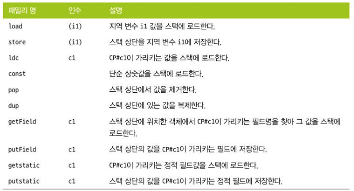

9-1. &nbsp; 로드/스토어 카테고리

ldc와 const는 분명히 구별해야 합니다. ldc는 현재 클래스의 상수 풀에 있는 상수를 로드하는 바이트코드입니다. 스트링, 기본형 상수, 클래스 리터럴, 기타 프로그램 실행에 필요한 (내부) 상수가 여기에 해당됩니다.

const는 매개변수 없이 aconst\_null, dconst\_0, iconst\_m1(-1을 로드) 형태로 진짜 상수만 로드하는 옵코드입니다.

다음은 산술 바이트코드입니다. 기본형에만 적용되며 순수하게 스택 기반으로 연산을 수행하므로 인수는 없습니다(표 9-2).

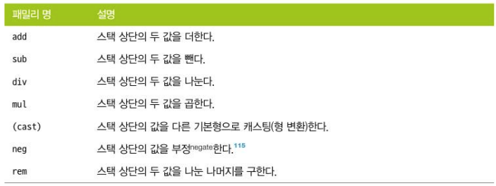

9-2. 산술 카테고리

[표 9-3]은 흐름을 제어하는 바이트코드입니다. 소스 코드의 순회, 분기문을 바이트코드 수준으로 표현하는 옵코드들입니다. 자바 for, if, while, switch 문을 컴파일하면 모두 이런 흐름 제어 옵코드로 변환됩니다.


9-3. 흐름 제어 카테고리

> tableswitch, loopupswitch는 이 책의 범위를 벗어나므로 다루지 않습니다.

바이트코드가 몇 개 안 되어 보이지만, if 옵코드 패밀리에 속한 옵코드가 상당히 많아서 실제 가짓수는 꽤 됩니다. 2장에서 javap 실행 결과 보았던 **if\_icmpge**(**if-integer-compare-greater-or-equal**, 어떤 정수값보다 크거나 같으면) 외에도 갖가지 자바 if문에 대응되는 변형 옵코드들이 많습니다.

jsr, ret 역시 흐름 제어 패밀리에 속한 바이트코드지만 자바 6 이후 디프리케이트되었습니다. 자바 플랫폼에서는 더 이상 올바른 옵코드가 아니므로 테이블에서 제외시켰습니다.

[표 9-4]는 가장 중요한 메서드 호출 바이트코드입니다. 자바 프로그램에서는 새 메서드로 제어권을 넘기는 유일한 장치입니다. 자바 플랫폼은 지역 흐름 제어와 다른 메서드로 제어권을 넘기는 행위를 분명히 구분합니다.

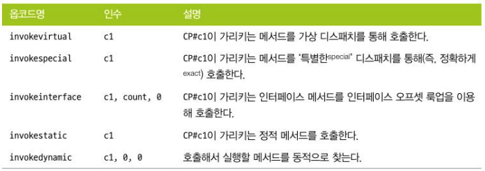

9-4. 메서드 호출 카테고리

JVM 설계 구조상 메서드 호출 옵코드를 명시적으로 사용해야 하므로 기계어에는 이와 동등한 호출 작업이 없습니다.

대신, JVM 바이트코드는 몇 가지 전문 용어를 사용합니다. 호출부(call site)는 메서드(호출자, caller) 내부에서 다른 메서드(피호출자 callee)를 호출한 지점입니다. 비정적(nonstatic) 메서드 호출의 경우, 어느 객체에 있는 메서드인지 반드시 해석해야(찾아야) 하는데, 이렇게 찾은 객체를 수신자 객체(receiver object), 이 객체의 런타임 타입을 수신자 타입(receiver type이라고 합니다.

> 정적 메서드 호출은 항상 invokestatic으로 컴파일되며 수신자 객체는 없습니다.

VM 수준에서 들여다 보는 일이 낯선 자바 프로그래머에겐, 자바 객체가 메서드 호출을 할 때 실제 호출 컨텍스트에 따라 세 바이트코드(invokevirtual, invokespecial, invokeinterface) 중 하나로 바뀐다는 사실이 뜻밖일 것입니다.

> 간단한 자바 코드를 작성해서 javap로 역어셈블(disassemble)해보면 어떤 조건일 때 특정 바이트코드로 바뀌는지 바로 확인할 수 있어 좋습니다.

인스턴스 메서드 호출은 보통 invokevirtual로 변환되며, 자바 인터페이스에 선언된 메서드를 호출할 경우 invokeinterface로 바뀝니다. 또 컴파일 타임에 디스패치할 메서드를 특정할 수 있는 경우(즉, private 메서드나 super클래스 호출) invokespecial 명령어로 컴파일됩니다.

invokedynamic이 처음 등장했을 때 이 새로운 바이트코드를 javac가 강제로 내어놓게 할 방법이 없었습니다. 애초에 invokedynamic은 장기적인 실험 및 논자바(non-Java) 동적 언어(특히, 제이루비(JRuby)를 지원하고자 추가된 기술이었습니다.

그런데 자바 8 이후로 invokedynamic은 자바 언어의 핵심으로 급부상하였고 자바 언어의 고급 기능을 지원하는 데 활용되고 있습니다. 다음 코드는 자바 8람다를 사용한 간단한 예제입니다.

```java
public class LambdaExample {
    private static final String HELLO = "hello";

    public static void main(String[] args) throws InterruptedException {
        Runnable r = () -> System.out.println(HELLO);
        Thread t = new Thread(r);

        t.start();
        t.join();
    }
}
```

단순 람다 표현식을 컴파일하면 다음 바이트코드로 변환됩니다.

```java
// class version 55.0 (55)
// access flags 0x21
public class chapter09/LambdaExample {

  // compiled from: LambdaExample.java
  // access flags 0x19
  public final static INNERCLASS java/lang/invoke/MethodHandles$Lookup java/lang/invoke/MethodHandles Lookup

  // access flags 0x1A
  private final static Ljava/lang/String; HELLO = "hello"

  // access flags 0x1
  public <init>()V
   L0
    LINENUMBER 3 L0
    ALOAD 0
    INVOKESPECIAL java/lang/Object.<init> ()V
    RETURN
   L1
    LOCALVARIABLE this Lchapter09/LambdaExample; L0 L1 0
    MAXSTACK = 1
    MAXLOCALS = 1

  // access flags 0x9
  public static main([Ljava/lang/String;)V throws java/lang/InterruptedException 
   L0
    LINENUMBER 7 L0
    INVOKEDYNAMIC run()Ljava/lang/Runnable; [
      // handle kind 0x6 : INVOKESTATIC
      java/lang/invoke/LambdaMetafactory.metafactory(Ljava/lang/invoke/MethodHandles$Lookup;Ljava/lang/String;Ljava/lang/invoke/MethodType;Ljava/lang/invoke/MethodType;Ljava/lang/invoke/MethodHandle;Ljava/lang/invoke/MethodType;)Ljava/lang/invoke/CallSite;
      // arguments:
      ()V, 
      // handle kind 0x6 : INVOKESTATIC
      chapter09/LambdaExample.lambda$main$0()V, 
      ()V
    ]
    ASTORE 1
   L1
    LINENUMBER 8 L1
    NEW java/lang/Thread
    DUP
    ALOAD 1
    INVOKESPECIAL java/lang/Thread.<init> (Ljava/lang/Runnable;)V
    ASTORE 2
   L2
    LINENUMBER 10 L2
    ALOAD 2
    INVOKEVIRTUAL java/lang/Thread.start ()V
   L3
    LINENUMBER 11 L3
    ALOAD 2
    INVOKEVIRTUAL java/lang/Thread.join ()V
   L4
    LINENUMBER 12 L4
    RETURN
   L5
    LOCALVARIABLE args [Ljava/lang/String; L0 L5 0
    LOCALVARIABLE r Ljava/lang/Runnable; L1 L5 1
    LOCALVARIABLE t Ljava/lang/Thread; L2 L5 2
    MAXSTACK = 3
    MAXLOCALS = 3

  // access flags 0x100A
  private static synthetic lambda$main$0()V
   L0
    LINENUMBER 7 L0
    GETSTATIC java/lang/System.out : Ljava/io/PrintStream;
    LDC "hello"
    INVOKEVIRTUAL java/io/PrintStream.println (Ljava/lang/String;)V
    RETURN
    MAXSTACK = 2
    MAXLOCALS = 0
}
```

아직 아무것도 모르는 분들도 invokedynamic 명령어 형식을 잘 보면 어떤 메서드가 호출되고 그 결과값이 스택에 놓여진다는 사실은 알 수 있을 것입니다.

바이트코드를 좀 더 파헤쳐 보면 짐작대로 이 값은 바로 람다 표현식을 가리키는 객체 레퍼런스입니다. 이 객체 레퍼런스는 invokedynamic 명령어에 의해 호출되는 플랫폼 팩토리 메서드가 생성됩니다. 이런 호출 과정 덕분에 클래스의 상수 풀에서 확장된 엔트리를 참조하여 런타임에 동적으로 호출할 수 있게 된 것입니다.

자바 프로그래머 입장에서는 invokedynamic 유스케이스로 람다 표현식만큼 확실한 건 없겠지만, 그밖에도 이 옵코드는 제이루비, 내쉬혼(Nashorn) 자바스크립트처럼 JVM에서 작동하는 논자바 언어를 비롯해 점점 더 많은 자바 프레임워크에서 사용되고 있습니다. 많은 사람에게 이 명령어는 그냥 호기심의 대상일지 몰라도 성능 엔지니어는 정확히 알고 있어야 합니다.

마지막으로, 플랫폼 옵코드입니다. 객체별로 힙 저장 공간을 새로 할당하거나, 고유 락(동기화 시 사용하는 모니터)을 다루는 명령어들입니다.

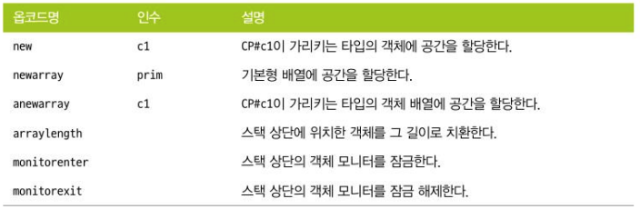

9-5. 플랫폼 카테고리

newarray 및 anewarray는 옵코드 실행 시 할당할 배열 길이가 스택 상단에 놓여져 있어야 합니다.

바이트코드는 구현 복잡도에 따라 대단위(coarse-grained) 바이트코드와 소단위(fine-grained) 바이트코드로 명확히 구분됩니다.

가령, 산술 연산은 매우 소단위 작업이고 핫스팟에서 순수 어셈블리어로 구현되는 반면, 대단위 연산(이를테면, 상수 풀 룩업, 특히 메서드 디스패치가 필요한 작업들)은 핫스팟 VM을 다시 호출할 수 밖에 없습니다.

바이트코드의 개별 의미와 함께 인터프리터로 해석된 코드의 세이프포인트에 대해 짚고 넘어가겠습니다. 7장에서 세이프포인트란 개념은, JVM이 어떤 관리 작업을 수행하고 내부 상태를 일관되게 유지하는 데 필요한 지점이라고 했습니다. 그리고 세이프포인트에는 (실행 중인 애플리케이션 스레드에 의해 아주 일반적인방법으로 변경되는) 객체 그래프가 들어 있습니다.

일관된 상태를 유지하려면 JVM이 관리 작업 수행 도중 공유 힙이 변경되지 않게 모든 애플리케이션 스레드를 멈추어야 합니다. 그런데 이런 작업을 어떻게 하는 것일까요??

JVM 애플리케이션 스레드 하나하나가 진짜 OS 스레드라는 사실을 먼저 상기하셔야 합니다. 또, 인터프리티드 메서드를 실행하는 스레드에 대해 옵코드가 디스패치되는 시점에서 애플리케이션 스레드가 실행하는 것은 유저 코드가 아니라 JVM 인터프리터 코드입니다. 따라서 힙 상태 일관성이 보장되고 애플리케이션 스레드를 멈출 수 있습니다.

따라서 '바이트코드 사이사이'가 애플리케이션 스레드를 멈추기에 이상적인 시점이자, 가장 단순한 세이프포인터입니다.

JIT 컴파일드 메서드는 해결 방법이 좀 더 복잡하지만, 기본적으로 JIT 컴파일러가 생성한 기계어 안에 이와 동등한 배리어를 끼워넣습니다.

#### 단순 인터프리터

가장 단순한 인터프리터는 switch 문이 포함된 while 루프 형태일 것입니다. [오슬롯(Ocelot) 프로젝트](https://github.com/kittylyst/ocelotvm)가 바로 그런 유형의 인터프리터로, 교육용으로는 JVM 인터프리터 일부를 구현한 작품입니다. 인터프리터 구현을 처음 배우는 독자는 0.1.1 버전부터 시작하는 게 좋습니다.

인터프리터의 execMethod() 메서드는 단일 메서드의 바이트코드를 해석합니다. 정수 계산, "Hello World" 출력 정도를 할 수 있는 옵코드가 구현되어 있습니다.

아주 간단한 프로그램이라도 온전하게 처리하려면 상수 풀 룩업 같은 복잡한 작업도 제대로 구현되어 있습니다. 하지만 기초 뼈대만 있어도 인터프리터의 기본 구조는 명확하게 그려볼 수 있습니다.

```java
public EvalValue execMethod(final byte[] instr) {
        if(instr == null || instr.length == 0) {
            return null;
        }

        EvaluationStack eval = new EvaluationStack();

        int current = 0;
        // LOOP;
        while (true) {
            byte b = instr[current++];

            Opcode op = table[b & 0xff];

            if(op == null) {
                System.err.println("Unrecognized opcode byte: " + (b & 0xff));
                System.exit(1);
            }

            byte num = op.numParams();

            switch (op) {
                case IADD:
                    eval.iadd();
                    break;
                case ICONST_0:
                    eval.iconst(0);
                // 생략
                case IRETURN:
                    return eval.pop();
                case ISTORE:
                    istore(instr[current++]);
                    break;
                case ISUB:
                    eval.isub();
                    break;
                // 더미 구현체
                case ALOAD:
                case ALOAD_0:
                case ASTORE:
                case GETSTATIC:
                case INVOKEVIRTUAL:
                case LDC:
                    System.out.print("Executing " + op + " with param bytes: ");
                    for(int i = current; i < current + num; i++) {
                        System.out.print(instr[i] + " ");
                    }
                    current += num;
                    System.out.println();
                    break;
                case RETURN:
                    return null;
                default:
                    System.out.println("Saw " + op + " : can't happen. Exit");
                    System.exit(1);
            }
        }
    }
```

메서드에서 한번에 한 바이트코드씩 읽어들여 옵코드별로 분기하는 코드입니다. 매개변수가 딸린 옵코드는 읽는 위치가 정확한지 확인하기 위해 스트림에서도 읽습니다.

임시값은 execMethod() 메서드에서 지역 변수인 EvaluationStack에서 평가됩니다. 산술 옵코드는 이 스택 위에서 정수 계산을 합니다.

메서드 호출 기능은 오슬롯 0.1.1 버전에 구현되어 있지 않습니다. 상수 풀에서 메서드를 찾아 호출한 메서드에 대응되는 바이트코드를 찾은 다음, execMethod() 메서드를 재귀 호출하는 로직이 있어야겠습니다. 0.2 버전에는 정적 메서드를 호출하는 로직이 구현돼 있습니다.

#### 핫스팟에 특정한 내용

핫스팟은 상용 제품급 JVM이자, 완전한 구현체입니다. 그뿐만 아니라, 인터프리티드 모드에서도 빠르게 실행될 수 있도록 여러 고급 확장 기능을 지니고 있습니다. 연습용으로 예시한 오슬롯 같은 단순 인터프리터와 달리, 핫스팟은 템플릿 인터프리터(template interpreter)라서 시작할 때마다 동적으로 인터프리터를 구축합니다.

이런 까닭에 이해하기가 훨씬 더 복잡하고 처음 접하는 사람들에겐 인터프리터 소스 코드조차 분석하기가 만만찮습니다. 게다가 핫스팟은 (산술 연산처럼) 단순한 VM 작업을 구현하고 네이티브 플랫폼의 스택 프레임 레이아웃을 최대한 활용하여 성능을 조금이라도 높이기 위해 상당히 많은 어셈블리어(Assembly language) 코드로 작성돼 있습니다.

VMSpec에 없는 핫스팟 전용(즉, 프라이빗) 바이트코드까지 정의해서 씁니다. 특정 옵코드의 일반적인 유스케이스와 핫(hot)하게 쓰는 경우를 차별화하려는 의도입니다.

이러한 설계 방식은 엄청나게 다양한 특이 사례(edge case)를 다루는 데 도움이 됩니다. 예를 들어, Final 메서드는 오버라이드할 수 없느니 javac로 컴파일하면 invokespecial 옵코드가 나오리라 예상할 수 있습니다. 그러나 자바 언어 명세 3.4.17절에는 다음과 같은 문구가 있습니다.

> final 메서드를 final 아닌 메서드로 변경하는 건 기존 바이너리와의 호환성을 깨드리지 않는다.

다음 자바 코드를 봅시다.

```java
public class A {
    public Final void fMethod() {
        // 작업 수행
    }
}

public class CallA {
    public void otherMethod(A obj) {
        obj.fMethod();
    }
}
```

Final 메서드 호출부가 invokespecial로 컴파일되면 CallA:otherMethod는 다음 바이트코드로 바뀔 것입니다.

```java
public void otherMethod() 
   Code:
      0: aload_1
      1: invokespecial  #4               // Method A.fMethod: ()V
      4: return
```

그런데 A 클래스에서 fMethod() 메서드를 논 Final() 메서드로 바꾸면 이 메서드는 서브클래스(B라고 하죠)에서 오버라이드 가능합니다. 이제 B 인스턴스를 otherMethod() 메서드의 인수로 넘기면 어떻게 될까요? 바이트코드 수준에서는 invokedspecial 명령어가 실행될 테니 메서드를 잘못 호출하고 말것입니다.

이것은 자바의 객체 지향 원칙을 위배하는 것으로, 엄밀히 말하면 (객체 지향 프로그래밍의 선구조 중 한 사람인 바바라 리스코프(Barbara Liskov의 이름을 딴) 리스코프 치환 원칙(Liskov Substitution Principle)에도 맞지 않습 니다. 이 원칙은 간단히 말해, 서브클래스의 인스턴스는 슈퍼클래스의 인스턴스가 올 수 있는 곳이면 어디라도 사용 가능하다는 것입니다. 소프트웨어 공학의 유명한 SOLID 원칙의 L(Liskov)자가 바로 이 리스코프 원칙입니다.

그러므로 Final 메서드 호출은 반드시 invokevirtual 명령어로 컴파일돼야 하지만, Final 메서드는 오버라이드가 안 된다는 점을 JVM도 알고 있기 때문에 핫스팟 인터프리터에는 final 메서드를 디스패치하는 전용 프라이빗 바이트코드가 준비돼 있습니다.

한 가지 더 예를 들겠습니다. 자바 언어 명세를 보면, 종료화(자세한 메커니즘은 11.6절 참고) 대상 객체는 반드시 종료화 서브시스템에 등록해야 한다고 씌어 있습니다. Object 생성자의 Object::<init> 호출이 완료되면 곧바로 객체를 등록해야 하는데, JVMTI처럼 바이트코드를 건드리는 툴에서는 이런 코드 위치가 모호할 수 있습니다. 그래서 핫스팟은 '진짜' Object 생성자에서 반환되는 지점을 표시하는 프라이빗 바이트코드를 따로 두어 엄격하게 명세를 준수합니다.

전체 옵코드 목록은 hotspot/src/share/vm/interpreter/bytecodes.cpp 파일을 참고하세요. 핫스팟 전용 옵코드는 'JVM bytecoeds' 주석 아래 나열되어 있습니다.

### AOT와 JIT 컴파일

---

실행 가능한 코드를 만드는 AOT 컴파일 및 JIT 컴파일, 두 방식을 알아보고 서로 비교하겠습니다.

JIT 컴파일은 AOT 컴파일에 비해 비교적 최근에 개발되었지만, 자바 역사 20년을 통틀어 두 컴파일 방식은 서로의 성공적인 기법을 차용하면서 끊임없이 발전해왔습니다.

#### AOT 컴파일

C/C++ 개발 경험자라면 AOT 컴파일은 익숙한 개념입니다. 사람이 읽을 수 있는 프로그램 소스 코드를 외부 프로그램(컴파일러)에 넣고 바로 실행 가능한 기계어를 뽑아내는 과정입니다.

> 소스 코드를 AOT 컴파일(미리)하면 어떤 식으로든 최적화할 기회는 단 한번뿐입니다.

AOT의 목표는 프로그램을 실행할 플랫폼과 프로세서 아키텍처에 딱 맞은 실행 코드를 얻는 것입니다. 이렇게 대상이 고정된 바이너리는 프로세스별로 특수한 기능을 십분 활용해 프로그램 속도를 높일 수 있습니다.

하지만 대부분의 실행 코드는 자신이 어떤 플랫폼에서 실행될지 모르는 상태에서 생성되므로 AOT 컴파일은 자신이 사용 가능한 프로세서 기능에 대해 가장 보수적인 선택을 해야 합니다. 어떤 기능이 있을 거란 전체하에 컴파일한 코드가 실제로 그렇지 못한 환경에서 실행되면 바이너리가 전혀 작동하지 않겠습니다.

AOT 컴파일한 바이너리는 CPU 기능을 최대한 활용하지 못하는 경우가 다반사고 성능 향상의 숙제가 남습니다.

#### JIT 컴파일

JIT 컴파일은 런타임에 프로그램을 (보통 편의상 어떤 중간 형식을 거쳐) 고도로 최적화한 기계어로 변환하는 기법입니다. 핫스팟을 비롯한 대부분의 주요 상용 JVM이 이 방식으로 작동됩니다.

프로그램의 런타임 실행 정보를 수집해서 어느 부분이 자주 쓰이고, 어느 부분을 최적화해야 가장 효과가 좋은지 프로파일을 만들어 결정을 내리는 것입니다.

> 이러한 기법을 프로파일 기반 최적화(profile-guided optimization, PGO)라고 합니다.

JIT 서브시스템은 실행 프로그램과 VM 리소스를 공유하므로 프로파일링 및 최적화 비용 및 성능 향상 기대치 사이의 균형을 맞추어야 합니다.

바이트코드를 네이티브 코드로 컴파일하는 비용은 런타임에 지불됩니다. 이 과정에서 프로그램 실행에만 온전히 동원됐을 이부 리소스(CPU 사이클, 메모리)가 소비되므로 JIT 컴파일은 산발적으로 수행됩니다. 또 VM은 최적화하면 가장 좋은 지점을 파악하기 위해(즉, 어디가 '핫스팟(절호점)'인지 찾고자) 각종 프로그램 관련 지표를 수집합니다.

[그림 2-3]에서 봤던 전체 아키텍처를 떠올려 봅시다. 프로파일링 서비시스템은 현재 어느 메서드가 실행 중인지 향시 추적합니다. 컴파일하기 적정한 한계치를 넘어선 메서드가 발견되면 에미터 서브시스템이 컴파일 스레드를 가동해 바이트코드를 기계어로 변환합니다.

> 최신 버전의 javac는 일부로 '우둔한 바이트코드(dump bytecode)'로 컴파일하게 설계되었습니다. 지극히 한정된 최적화만 수행하는 대신 JIT 컴파일러가 이해하기 쉬운 형태로 프로그램을 표현합니다.

5.1절에서 예로 든 사례를 보면, PGO 결과 JVM 웜업 문제가 발생했습니다. 애플리케이션이 시작되고 성능이 불안정한 모습을 보이면 자바 개발자는 자연스레 이런 의문을 품게 되었습니다. '컴파일 코드를 그냥 디스크에 저장했다가 다음 애플리케이션 시작할 때 그대로 꺼내스면 안 되나?', '애플리케이션을 실행할 때마다 이렇게 최적화를 재수행하고 컴파일 결정을 하는 건 낭비 아닌가?'

실행 중인 애플리케이션 코드의 속성을 잘못 이해했기 때문에 이런 의문이 드는 것입니다. 필자가 금융 업계에서 경험한 사례를 하나 들어봅시다.

미국 정보는 매월 한번씩 수치를 발표합니다. 비농업고용지수(Nonfarm payrolls, NFP) 발표일에 으레 다른 날에는 찾아보기 어려운, 극히 비정상적인 트래픽이 거래 시스템에 집중됩니다. 시스템이 한가한 날에 최적화 결과를 저장했다가 NFP 바룦일에 실행해보면 처음부터 최적화를 계산하면서 실행하는 것만큼 효율이 나오지 않습니다. 실제로 미리 계산된 최적화를 이용한 시스템이 PGO를 활용한 시스템보다 경쟁력이 떨어집니다.

핫스팟은 프로파일링 정보를 보관하지 않고 VM이 꺼지면 일체 폐기합니다. 따라서 항상 프로파일은 처음부터 다시 만들어집니다.

#### AOT 컴파일 vs JIT 컴파일

AOT 컴파일은 상대적으로 이해하기 쉽습니다. 소스 코드에서 바로 기계어가 생성되고 컴파일 단위별로 대응되는 기계어를 어셈블리로 바로 사용할 수 있습니다. 그래서 코드의 성능 특성이 그리 복잡하지 않습니다.

반면, AOT는 최적화 결정을 내리는 데 유용한 런타임 정보를 포기하는 만큼 장점이 상쇄됩니다. 링크 타임 최적화(Link-Time optimization, LTO)나 PGO 같은 기법이 gcc 및 여타 컴파일러에서도 모습을 드러내기 시작했지만, 핫스팟에 구현된 기술에 비하면 아직 초기 개발 단계에 불과합니다.

AOT 컴파일 도중 프로세서의 특정 기능을 타깃으로 정하면 해당 프로세서에만 사용 가능한 실행 코드가 만들어집니다. 저지연 또는 극단적으로 성능이 중요한 유스케이스에는 유용한 기법일 것입니다. 아무래도 실제로 애플리케이션을 실행할 하드웨어와 똑같은 하드웨어에서 빌드하면 컴파일러가 모든 프로세서의 최적화 기법을 총동원할 수 있습니다.

문제는 확장성입니다. 다양한 아키텍처에서 최대 성능을 내려면 아키텍처마다 특화된 실행 코드가 필요합니다.

핫스팟은 새로 릴리즈를 할 때마다 새로운 프로세서 기능에 관한 최적화 코드를 추가할 수 있고, 애플리케이션은 기존 클래스 및 JAR 파일을 다시 컴파일하지 않아도 신기능을 십분 활용할 수 있습니다. JIT 컴파일러가 점점 좋아지고 핫스팟 VM 새 버전이 릴리즈될 때마다 조금씩 프로그램 성능이 향상되는 것도 어찌 보면 당연한 일입니다.

그런데 '자바 프로그램은 AOT 컴파일을 할 수 없다'는 말은 사실일까요? 아뇨, 사실과 다릅니다. 이미 수년 전부터 자바 프로그램의 AOT 컴파일을 지원하는 상용 VM이 나왔고 AOT 컴파일을 자바 애플리케이션을 배포하는 주요 경로를 활용하는 환경도 있습니다.

자바 9부터 핫스팟 VM은, 우선 JDK 코어 클래스를 대상으로 AOT 컴파일 옵션을 제공하기 시작했습니다. 이는 (매우 제한적이나마) 자바 소스에서 AOT 컴파일 바이너리를 생성하려는 첫 삽을 뜬 것으로, 그간 자바 대중화의 원동력이었던 기존 JIT 환경에서 벗어나려는 출발점입니다.

### 핫스팟 JIT 기초

---

핫스팟의 기본 컴파일 단위는 전체 메서드입니다. 따라서 한 메서드에 해당하는 바이트 코드는 한꺼번에 네이티브 코드로 컴파일됩니다. 핫스팟은 핫 루프를 온-스택 치환(on-stack replacement, OSR)이라는 기법을 이용해 컴파일하는 기능도 지원합니다.

OSR은 어떤 메서드가 컴파일할 만큼 자주 호출되지는 않지만, 컴파일하기 적합한 루프가 포함돼 있고 루프 바디 자체가 메서드인 경우 사용합니다.

다음 절에서 살펴보겠지만, 핫스팟은 주로 (객체 oop의 klass 워드로 가리키는) klass 메타 데이터 구조체에 있는 vtable을 이용해 JIT 컴파일을 구현합니다.

#### klass 워드, vtable, 포인터 스위즐링

핫스팟은, 멀티스레드 C++ 애플리케이션입니다. 그래서 실행 중인 모든 자바 프로그램은 OS 관점에서는 실제로 한 멀티스레드 애플리케이션의 일부일 뿐입니다. 싱글 스레드 자바 애플리케이션이라고 해도 결국 VM 스레드와 함께 실행되는 구조입니다.

JIT 컴파일 서브시스템을 구성하는 스레드는 핫스팟 내부에 가장 중요한 스레드들입니다. 컴파일 대상 메서드를 찾아내는 프로파일링 스레드와 실제 기계어를 생성하는 컴파일러 스레드도 다 여기에 포함됩니다.

컴파일 대상으로 낙점된 메서드는 컴파일러 스레드에 올려놓고 백그라운드에서 컴파일합니다. 전체 프로세스는 [그림 9-6]과 같습니다.

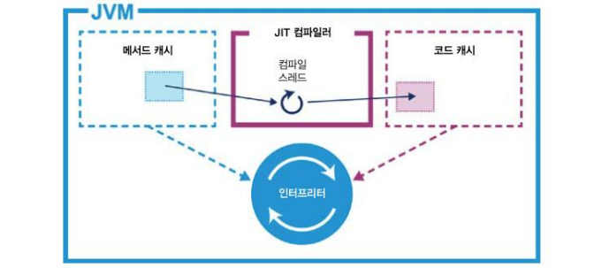

9-6. 하나의 메서드를 단순 컴파일하는 과정

최적화된 기계어가 생성되면 해당 klass의 vtable은 새로 컴파일된 코드를 가리키도록 수정됩니다.

> 이렇게 vtable 포인터를 업데이트하는 작업을 **포인터 스위즐링(pointer swizzling)**이라고 합니다.

앞으로 이 메서드를 호출하는 코드는 컴파일 형식으로 받겠지만, 현재 인터프리터 형식으로 실행 중인 스레드는 끝까지 인터프리터 모드로 현재 호출을 완료합니다. 다음에 다시 호출하면 컴파일 형식을 들고 갈 것입니다.

OpenJDK는 x86, x86-64, ARM 을 비롯한 수많은 아키텍처에 맞게 이식되어 왔습니다. 오라클은 리눅스, 맥 OS, 윈도우 OS를 공식 지원하며, SPARC, Power, MIPS, S390 역시 다양한 수준으로 지원합니다. 이밖에도 BSD, 임베디드 시스템 등 다양한 네이티브 환경을 지원하는 오픈 소스 프로젝트도 있습니다.

#### JIT 컴파일 로깅

성능 엔지니어라면 다음 JVM 스위치를 반드시 기억해야 합니다.

```bash
-XX:+PrintCompilation
```

이 스위치를 켜면 컴파일 이벤트 로그가 표준 출력 스트림에 생성되므로 성능 엔지니어는 이 로그를 보고 어떤 메서드가 컴파일되고 있는지 파악할 수 있습니다.

예를 들어, 3장에서 보았던 캐싱 코드(예제 3-1)를 다음과 같이 실행하면,

```bash
java -XX:+PrintCompilation Caching
```

이런 로그가 출력될 것입니다(자바 11 기준).

```bash
     28    5     n 0       jdk.internal.misc.Unsafe::getObjectVolatile (native)   
     28    2       3       java.lang.Object::<init> (1 bytes)
     29    1       3       java.lang.String::isLatin1 (19 bytes)
     29    3       3       java.util.concurrent.ConcurrentHashMap::tabAt (22 bytes)
     29    6       3       java.lang.String::coder (15 bytes)
     29    4       3       jdk.internal.misc.Unsafe::getObjectAcquire (7 bytes)
     30    7       3       java.lang.StringLatin1::hashCode (42 bytes)
     30    8       3       java.lang.String::hashCode (49 bytes)
     30   11       3       java.util.ImmutableCollections$SetN::probe (56 bytes)
     31   15       3       java.lang.StringLatin1::equals (36 bytes)
     31   16       3       java.util.ImmutableCollections$SetN::hashCode (46 bytes)
     31    9       3       java.lang.Math::floorMod (10 bytes)
     31   10       3       java.lang.Math::floorDiv (22 bytes)
     31   12       3       java.lang.String::equals (65 bytes)
     31   20       4       java.lang.StringLatin1::hashCode (42 bytes)
     31   18       3       java.util.ImmutableCollections::emptySet (4 bytes)
     32   17       3       java.util.Objects::equals (23 bytes)
     32   19       3       java.util.Objects::requireNonNull (14 bytes)
     32   21       3       java.util.Set::of (4 bytes)
     32   25       3       java.util.AbstractCollection::<init> (5 bytes)
     32   26       3       java.util.ImmutableCollections$AbstractImmutableCollection::<init> (5 bytes)
     32   23       3       java.util.ImmutableCollections$AbstractImmutableSet::<init> (5 bytes)
     32   24       3       java.util.Set::of (66 bytes)
     33   13       3       java.lang.String::charAt (25 bytes)
     33    7       3       java.lang.StringLatin1::hashCode (42 bytes)   made not entrant
     33   14       3       java.lang.StringLatin1::charAt (28 bytes)
     33   28       1       java.lang.module.ModuleDescriptor::name (5 bytes)
     34   22       4       java.lang.Object::<init> (1 bytes)
     34   30       3       java.net.URI::hash (33 bytes)
     34   29       1       java.lang.module.ModuleReference::descriptor (5 bytes)
     34    2       3       java.lang.Object::<init> (1 bytes)   made not entrant
     34   27       3       java.lang.module.ModuleDescriptor$Exports::<init> (20 bytes)
     34   31     n 0       java.lang.System::arraycopy (native)   (static)
     35   33       3       java.util.ImmutableCollections$SetN$SetNIterator::nextIndex (56 bytes)
     35   34       3       java.util.ImmutableCollections$SetN$SetNIterator::hasNext (13 bytes)
     35   35       3       java.util.ImmutableCollections$SetN$SetNIterator::next (47 bytes)
     35   32       3       java.util.concurrent.ConcurrentHashMap::spread (10 bytes)
     38   36     n 0       java.lang.invoke.MethodHandle::linkToStatic(LLLLLLL)L (native)   (static)
     39   37       1       java.lang.Enum::ordinal (5 bytes)
     39   38     n 0       java.lang.invoke.MethodHandle::linkToStatic(LL)I (native)   (static)
     40   39     n 0       java.lang.Object::hashCode (native)
     40   40   !   3       java.util.concurrent.ConcurrentHashMap::putVal (432 bytes)
     40   41     n 0       java.lang.invoke.MethodHandle::invokeBasic(LLLLLL)L (native)
     40   42       3       java.util.concurrent.ConcurrentHashMap::addCount (279 bytes)
     40   43     n 0       jdk.internal.misc.Unsafe::compareAndSetLong (native)
     40   44     n 0       java.lang.invoke.MethodHandle::linkToSpecial(LLLLLLLL)L (native)   (static)
     41   45       3       java.lang.String::length (11 bytes)
     42   46       1       java.lang.Class::getClassLoader0 (5 bytes)
     43   47     n 0       java.lang.invoke.MethodHandle::linkToStatic(LLL)L (native)   (static)
     43   48     n 0       java.lang.invoke.MethodHandle::linkToStatic(LLLL)L (native)   (static)
     43   49       1       java.lang.invoke.MethodType$ConcurrentWeakInternSet$WeakEntry::hashCode (5 bytes)
     43   51     n 0       java.lang.Class::isPrimitive (native)
     43   50       3       java.lang.Math::min (11 bytes)
     44   52       1       java.lang.invoke.MethodType::returnType (5 bytes)
     44   53       3       java.lang.String::toCharArray (25 bytes)
     45   54     n 0       java.lang.invoke.MethodHandle::invokeBasic()L (native)
     45   55     n 0       java.lang.invoke.MethodHandle::linkToSpecial(LL)L (native)   (static)
     45   56       3       java.lang.StringLatin1::canEncode (13 bytes)
     45   57       3       java.lang.invoke.MemberName::testFlags (16 bytes)
     45   58     n 0       java.lang.invoke.MethodHandle::linkToStatic(LLL)I (native)   (static)
     46   59       3       java.lang.invoke.MethodTypeForm::canonicalize (233 bytes)
     46   60     n 0       java.lang.invoke.MethodHandle::linkToStatic(LL)L (native)   (static)
     46   61     n 0       java.lang.invoke.MethodHandle::invokeBasic(L)L (native)
     46   62     n 0       java.lang.invoke.MethodHandle::linkToSpecial(LLL)L (native)   (static)
     46   63       3       java.lang.ref.Reference::<init> (25 bytes)
     46   64     n 0       java.lang.invoke.MethodHandle::linkToVirtual(LL)L (native)   (static)
     47   65       3       java.lang.invoke.MemberName::isInvocable (7 bytes)
     47   69     n 0       java.lang.invoke.MethodHandle::linkToSpecial(LL)V (native)   (static)
     48   66       3       java.lang.invoke.MemberName::testAnyFlags (15 bytes)
     48   68       3       java.lang.invoke.MethodType::hashCode (53 bytes)
     48   67   !   3       java.lang.ref.ReferenceQueue::poll (28 bytes)
     48   73     n 0       java.lang.invoke.MethodHandle::linkToInterface(LLL)I (native)   (static)
     48   71       3       java.lang.invoke.MethodType$ConcurrentWeakInternSet::expungeStaleElements (27 bytes)
     48   72       3       java.util.concurrent.ConcurrentHashMap::get (162 bytes)
     48   70       1       java.lang.invoke.MemberName::getDeclaringClass (5 bytes)
     48   74     n 0       jdk.internal.misc.Unsafe::compareAndSetObject (native)
     48   75       3       java.lang.String::<init> (15 bytes)
     48   76       3       jdk.internal.org.objectweb.asm.ByteVector::putShort (52 bytes)
     49   78       3       jdk.internal.org.objectweb.asm.ClassWriter::get (49 bytes)
     49   77       3       jdk.internal.org.objectweb.asm.Item::set (219 bytes)
     49   79       3       java.lang.ref.Reference::<init> (7 bytes)
     49   81       3       jdk.internal.org.objectweb.asm.ByteVector::putUTF8 (142 bytes)
     49   80       4       java.lang.String::isLatin1 (19 bytes)
     49   82       3       java.lang.invoke.MethodType::checkPtype (19 bytes)
     49   83     n 0       java.lang.invoke.MethodHandle::linkToSpecial(LL)I (native)   (static)
     50    1       3       java.lang.String::isLatin1 (19 bytes)   made not entrant
     50   84       3       java.lang.AbstractStringBuilder::ensureCapacityInternal (39 bytes)
     50   85       3       java.util.concurrent.ConcurrentHashMap::putIfAbsent (8 bytes)
     50   86       3       jdk.internal.org.objectweb.asm.Item::<init> (66 bytes)
     50   87       3       jdk.internal.org.objectweb.asm.ClassWriter::put (152 bytes)
     50   88       3       jdk.internal.org.objectweb.asm.ClassWriter::newUTF8 (70 bytes)
     50   89       1       java.util.stream.FindOps$FindSink::cancellationRequested (5 bytes)
     50   90       1       java.util.Spliterators$IteratorSpliterator::characteristics (5 bytes)
     50   92       3       java.util.stream.ReferencePipeline$2$1::accept (27 bytes)
     51   91       1       java.util.ImmutableCollections$SetN::size (5 bytes)
     51   93       3       java.util.HashMap::hash (20 bytes)
     51   94       3       java.util.ImmutableCollections$MapN::probe (60 bytes)
     51   98       3       java.util.HashMap::putVal (300 bytes)
     51   99       3       java.util.HashMap$Node::<init> (26 bytes)
     51  100       3       java.util.HashMap::newNode (13 bytes)
     51  110       3       java.util.HashMap$HashIterator::nextNode (100 bytes)
     51  103       3       java.util.HashMap::put (13 bytes)
     52  101       3       java.util.HashMap::getNode (148 bytes)
     52  102       3       java.util.HashMap::afterNodeInsertion (1 bytes)
     52  118       3       java.util.HashMap$HashIterator::<init> (79 bytes)
     52  108       3       java.util.HashMap$HashIterator::hasNext (13 bytes)
     52   95       3       java.util.ImmutableCollections$MapN::get (35 bytes)
     52  113       3       jdk.internal.module.ModuleReferenceImpl::hashCode (56 bytes)
     52  125       3       java.lang.module.ModuleDescriptor$Exports::isQualified (18 bytes)
     52  126       4       java.lang.String::hashCode (49 bytes)
     52  122       3       java.util.AbstractCollection::isEmpty (13 bytes)
     52  109       3       java.util.HashMap::get (23 bytes)
     53  123       1       java.lang.module.ModuleDescriptor$Exports::source (5 bytes)
     53  121       3       java.util.ImmutableCollections$Set12::size (13 bytes)
     53  130       3       java.util.HashMap::resize (356 bytes)
     53  117       3       java.util.HashMap$KeyIterator::next (8 bytes)
     53  115       3       java.lang.module.ResolvedModule::hashCode (16 bytes)
     53  124       1       java.lang.module.ModuleDescriptor$Exports::targets (5 bytes)
     53  139       4       java.util.HashMap::hash (20 bytes)
     54  106       3       java.lang.module.ModuleDescriptor::hashCode (170 bytes)
     54  105       1       java.lang.module.ModuleDescriptor$Requires::name (5 bytes)
     54  137       4       java.util.ImmutableCollections$SetN$SetNIterator::next (47 bytes)
     54  107       3       java.util.HashSet::add (20 bytes)
     54    8       3       java.lang.String::hashCode (49 bytes)   made not entrant
     54  112       3       java.util.ImmutableCollections$Set12$1::hasNext (13 bytes)
     54   93       3       java.util.HashMap::hash (20 bytes)   made not entrant
     54  134       4       java.util.ImmutableCollections$SetN$SetNIterator::hasNext (13 bytes)
     54  128       3       java.util.ImmutableCollections$Set12::contains (28 bytes)
     55  129       3       java.util.HashMap::putIfAbsent (13 bytes)
     55  131       4       java.util.ImmutableCollections$SetN$SetNIterator::nextIndex (56 bytes)
     55   34       3       java.util.ImmutableCollections$SetN$SetNIterator::hasNext (13 bytes)   made not entrant
     55  150       3       java.lang.StringLatin1::indexOf (61 bytes)
     55  116       3       java.util.HashMap::containsKey (18 bytes)
     55  142       4       java.util.AbstractCollection::isEmpty (13 bytes)
     55  133       3       java.util.ImmutableCollections$SetN::contains (26 bytes)
     55   33       3       java.util.ImmutableCollections$SetN$SetNIterator::nextIndex (56 bytes)   made not entrant
     56  136       1       java.lang.module.ResolvedModule::reference (5 bytes)
     56  104       1       java.lang.module.ModuleDescriptor$Requires::modifiers (5 bytes)
     56  114       1       java.lang.module.ModuleDescriptor::isAutomatic (5 bytes)
     56   35       3       java.util.ImmutableCollections$SetN$SetNIterator::next (47 bytes)   made not entrant
     56  122       3       java.util.AbstractCollection::isEmpty (13 bytes)   made not entrant
     56  147       4       java.lang.module.ModuleDescriptor$Exports::isQualified (18 bytes)
     56   97       3       java.util.Optional::<init> (13 bytes)
     56   96       3       java.util.Optional::of (9 bytes)
     56  140       4       java.lang.String::equals (65 bytes)
     57  154       4       java.lang.String::coder (15 bytes)
     57  151       3       java.util.concurrent.ConcurrentHashMap::casTabAt (21 bytes)
     57  125       3       java.lang.module.ModuleDescriptor$Exports::isQualified (18 bytes)   made not entrant
     57  143       3       java.util.Arrays::copyOfRange (63 bytes)
     57  141       3       java.util.ImmutableCollections$Set12$1::next (92 bytes)
     57    6       3       java.lang.String::coder (15 bytes)   made not entrant
     57  160       4       java.util.HashMap::putVal (300 bytes)
     57  159       3       java.util.ImmutableCollections$Set12$1::<init> (21 bytes)
     57  158       3       java.util.ImmutableCollections$Set12::iterator (9 bytes)
     58  157       3       java.util.AbstractMap::<init> (5 bytes)
     58  127       4       java.util.HashMap::afterNodeInsertion (1 bytes)
     58   12       3       java.lang.String::equals (65 bytes)   made not entrant
     58  146       3       java.util.HashSet::iterator (13 bytes)
     58  145       3       java.util.HashMap$KeyIterator::<init> (11 bytes)
     58  120       3       java.util.HashMap$KeySet::iterator (12 bytes)
     58  119       3       java.util.HashMap::keySet (25 bytes)
     58  102       3       java.util.HashMap::afterNodeInsertion (1 bytes)   made not entrant
     58  162       4       java.util.HashMap::newNode (13 bytes)
     59  132       1       java.lang.module.ModuleDescriptor::provides (5 bytes)
     59  161       3       java.util.AbstractSet::<init> (5 bytes)
     59  163       3       java.util.HashMap::<init> (11 bytes)
     59  167       3       java.util.HashMap$ValueIterator::next (8 bytes)
     59  152       3       java.util.ImmutableCollections$SetN::iterator (9 bytes)
     59  111       1       java.lang.module.ModuleDescriptor::requires (5 bytes)
     59  166       1       java.lang.module.ModuleDescriptor::isOpen (5 bytes)
     59  165       3       java.lang.module.ResolvedModule::name (11 bytes)
     60  171     n 0       java.lang.Module::addExportsToAllUnnamed0 (native)   (static)
     60  144       1       java.lang.module.ModuleDescriptor$Provides::service (5 bytes)
     60  169       3       jdk.internal.module.ModuleBootstrap$2::hasNext (30 bytes)
     60  149       1       java.util.KeyValueHolder::getValue (5 bytes)
     60  148       1       java.util.KeyValueHolder::getKey (5 bytes)
     60  138       1       java.lang.module.ModuleDescriptor::uses (5 bytes)
     60  168       3       java.util.ImmutableCollections$SetN$SetNIterator::<init> (40 bytes)
     60  170       3       jdk.internal.module.ModuleBootstrap$2::next (52 bytes)
     61  164       1       java.lang.module.ResolvedModule::configuration (5 bytes)
     61  100       3       java.util.HashMap::newNode (13 bytes)   made not entrant
     61  135       1       java.lang.module.ModuleDescriptor::exports (5 bytes)
     61  172       1       java.lang.Module::getDescriptor (5 bytes)
     61  156       1       java.lang.module.ModuleDescriptor$Version::toString (5 bytes)
     61  155       3       java.lang.StringLatin1::newString (17 bytes)
     61  153       1       java.lang.module.ModuleDescriptor::packages (5 bytes)
     62  177       3       java.lang.String::indexOf (29 bytes)
     62  174       3       java.lang.AbstractStringBuilder::getCoder (15 bytes)
     62  173       3       java.lang.AbstractStringBuilder::putStringAt (29 bytes)
     63  176       3       java.lang.String::indexOf (7 bytes)
     63  175       3       java.lang.String::getBytes (44 bytes)
     63  178       3       java.lang.CharacterDataLatin1::getProperties (11 bytes)
     65  179       3       java.lang.System::getSecurityManager (4 bytes)
     65   98       3       java.util.HashMap::putVal (300 bytes)   made not entrant
     66  186     n 0       jdk.internal.misc.Unsafe::getByte (native)
     66  182   !   3       java.nio.DirectByteBuffer::get (28 bytes)
     66  181       3       java.nio.Buffer::hasRemaining (17 bytes)
     66  180       3       java.lang.ref.Reference::reachabilityFence (1 bytes)
     66  187       4       java.lang.String::charAt (25 bytes)
     66  185       3       jdk.internal.misc.Unsafe::getByte (7 bytes)
     66  184       3       java.nio.DirectByteBuffer::ix (10 bytes)
     66  183       3       java.nio.Buffer::nextGetIndex (30 bytes)
     66  189       3       java.util.concurrent.ConcurrentHashMap$Node::<init> (20 bytes)
     67  188       1       java.lang.Class::getModule (5 bytes)
     67   13       3       java.lang.String::charAt (25 bytes)   made not entrant
     67  190       1       java.nio.Buffer::limit (5 bytes)
     67  191       3       java.lang.ref.WeakReference::<init> (6 bytes)
     70  192       3       java.lang.StringLatin1::lastIndexOf (40 bytes)
     71  193       3       jdk.internal.misc.Unsafe::putObjectRelease (9 bytes)
     71  194     n 0       jdk.internal.misc.Unsafe::putObjectVolatile (native)
     71  195       3       java.util.concurrent.ConcurrentHashMap::setTabAt (20 bytes)
     72  196       3       java.lang.String::isEmpty (14 bytes)
     72  198       3       java.lang.AbstractStringBuilder::append (45 bytes)
     72  197       3       java.lang.StringBuilder::append (8 bytes)
     72  199       1       java.nio.Buffer::position (5 bytes)
     72  200       3       java.lang.String::checkBoundsBeginEnd (60 bytes)
     72  201       3       java.util.Arrays::copyOf (19 bytes)
     72  203       3       java.lang.String::substring (58 bytes)
     73  202       3       java.nio.Buffer::position (52 bytes)
     73  205       3       java.nio.Buffer::limit (65 bytes)
     73  204       3       java.nio.ByteBuffer::position (8 bytes)
     73  209       3       java.nio.MappedByteBuffer::limit (8 bytes)
     73  208       3       java.nio.MappedByteBuffer::position (8 bytes)
     73  206       3       java.nio.ByteBuffer::limit (8 bytes)
     73  211       3       java.lang.CharacterData::of (120 bytes)
     73  210       3       jdk.internal.jimage.ImageStringsReader::unmaskedHashCode (173 bytes)
     73  207       1       java.nio.DirectByteBuffer::address (5 bytes)
     74  212       3       java.lang.AbstractStringBuilder::isLatin1 (19 bytes)
     74  213       3       java.lang.AbstractStringBuilder::newCapacity (55 bytes)
     74  214       1       java.security.ProtectionDomain::getCodeSource (5 bytes)
     74  216       3       java.lang.String::lastIndexOf (12 bytes)
     74  215       3       java.nio.ByteOrder::nativeOrder (4 bytes)
     75  218       3       java.lang.StringUTF16::compress (50 bytes)
     75  217       3       java.lang.String::lastIndexOf (29 bytes)
     75  225       3       java.lang.StringLatin1::replace (196 bytes)
     75  220       3       java.lang.invoke.MethodType::makeImpl (108 bytes)
     75  219       1       java.lang.invoke.MethodType::form (5 bytes)
     75  221       3       java.lang.invoke.MethodType::<init> (15 bytes)
     75  222       3       java.lang.invoke.MethodType$ConcurrentWeakInternSet::get (54 bytes)
     75  223       3       java.lang.invoke.MethodType$ConcurrentWeakInternSet$WeakEntry::<init> (14 bytes)
     75  226       3       java.lang.StringBuilder::append (8 bytes)
     76  224       3       java.lang.Class::getName (18 bytes)
     76  227       4       java.util.Objects::requireNonNull (14 bytes)
     76  228       3       java.nio.Buffer::<init> (99 bytes)
     76  233       4       java.nio.Buffer::hasRemaining (17 bytes)
     76  232   !   4       java.nio.DirectByteBuffer::get (28 bytes)
     76  229       3       java.nio.ByteBuffer::<init> (45 bytes)
     76  231       3       jdk.internal.jimage.ImageStringsReader::charsFromByteBuffer (186 bytes)
     76  230       3       jdk.internal.jimage.ImageStringsReader::charsFromByteBufferLength (47 bytes)
     76   19       3       java.util.Objects::requireNonNull (14 bytes)   made not entrant
     77  181       3       java.nio.Buffer::hasRemaining (17 bytes)   made not entrant
     77  234       3       java.nio.MappedByteBuffer::<init> (15 bytes)
     77  235       3       java.nio.ByteBuffer::<init> (12 bytes)
     77  236       3       java.nio.MappedByteBuffer::limit (6 bytes)
     77  182   !   3       java.nio.DirectByteBuffer::get (28 bytes)   made not entrant
     77  238       3       java.nio.MappedByteBuffer::limit (6 bytes)
     77  237       3       java.nio.MappedByteBuffer::position (6 bytes)
     78  240       1       java.security.CodeSource::getLocationNoFragString (5 bytes)
     78  241       1       jdk.internal.loader.BuiltinClassLoader$LoadedModule::loader (5 bytes)
     78  239       3       java.nio.MappedByteBuffer::position (6 bytes)
     78  242       3       java.lang.ClassLoader::checkName (37 bytes)
     78  243       3       java.lang.String::regionMatches (187 bytes)
     78  244       3       java.lang.AbstractStringBuilder::<init> (39 bytes)
     78  246     n 0       java.lang.Class::isArray (native)
     79  245       3       java.lang.StringBuilder::toString (35 bytes)
     79  247       3       java.lang.StringBuilder::<init> (7 bytes)
     79  251       3       java.nio.DirectByteBuffer::<init> (35 bytes)
     79  250       3       java.lang.String::<init> (10 bytes)
     79  249       3       java.lang.StringUTF16::compress (20 bytes)
     79  248       3       java.lang.String::<init> (74 bytes)
     79  254       3       java.nio.DirectByteBufferR::slice (62 bytes)
     79  253       3       java.nio.DirectByteBufferR::<init> (19 bytes)
     80  252   !   3       jdk.internal.jimage.BasicImageReader::slice (32 bytes)
     80  255       3       java.nio.MappedByteBuffer::rewind (5 bytes)
     80  261       3       java.util.Optional::orElse (16 bytes)
     80  258       1       java.security.CodeSource::getLocation (5 bytes)
     80  257       3       java.nio.ByteBuffer::rewind (7 bytes)
     80  256       3       java.nio.MappedByteBuffer::rewind (7 bytes)
     80  262       3       java.lang.Character::toLowerCase (9 bytes)
     81  260       1       java.net.URL::getHost (5 bytes)
     81  259       1       java.net.URL::getProtocol (5 bytes)
     81  264       3       jdk.internal.jimage.ImageLocation::getAttribute (44 bytes)
     81  263       3       java.lang.CharacterDataLatin1::toLowerCase (39 bytes)
     81  266     n 0       java.lang.invoke.MethodHandle::linkToStatic(IL)I (native)   (static)
     81  265       1       java.lang.invoke.MethodType::ptypes (5 bytes)
     82  160       4       java.util.HashMap::putVal (300 bytes)   made not entrant
     82  267       4       java.util.HashMap::putVal (300 bytes)
     83  273       3       java.util.regex.Pattern$BmpCharPropertyGreedy::match (89 bytes)
     83  270       3       java.util.regex.ASCII::isSpace (8 bytes)
     83  269       3       java.util.regex.CharPredicates::lambda$ASCII_SPACE$17 (20 bytes)
     83  268       3       java.util.regex.CharPredicates$$Lambda$15/0x000000080008fc40::is (5 bytes)
     83  272       3       java.util.regex.ASCII::getType (17 bytes)
     83  271       3       java.util.regex.ASCII::isType (15 bytes)
     83  274       3       java.util.regex.Pattern::has (15 bytes)
     83  275       3       java.util.regex.Pattern::peek (26 bytes)
     84  276       1       java.util.LinkedHashMap::removeEldestEntry (2 bytes)
     84  277       3       java.lang.Enum::<init> (15 bytes)
     84  278       3       java.lang.invoke.MethodType::parameterType (7 bytes)
     84  279       1       java.lang.invoke.MethodHandle::type (5 bytes)
     84  280     n 0       java.lang.invoke.MethodHandle::linkToStatic(L)L (native)   (static)
     85  281     n 0       java.lang.Object::getClass (native)
     86  282       3       jdk.internal.jimage.ImageStringsReader::get (9 bytes)
     86  284       3       jdk.internal.jimage.ImageStringsReader::stringFromByteBuffer (28 bytes)
     86  283       3       jdk.internal.jimage.BasicImageReader::getString (48 bytes)
     86  285       3       jdk.internal.misc.VM::initLevel (4 bytes)
     86  286     n 0       java.lang.invoke.MethodHandle::invokeBasic(LL)L (native)
     86  287     n 0       java.lang.invoke.MethodHandle::linkToSpecial(LLLL)L (native)   (static)
     87  288       3       java.lang.AbstractStringBuilder::append (77 bytes)
     87  289       3       java.lang.Object::equals (11 bytes)
     87  290       3       jdk.internal.org.objectweb.asm.ByteVector::putByte (39 bytes)
     87  142       4       java.util.AbstractCollection::isEmpty (13 bytes)   made not entrant
     88  291       3       jdk.internal.misc.VM::isModuleSystemInited (13 bytes)
     88  292       4       java.lang.StringLatin1::indexOf (61 bytes)
     89  293       3       java.lang.Class::getClassLoader (28 bytes)
     89  296       3       java.lang.invoke.MethodType::parameterCount (6 bytes)
     89  295       3       jdk.internal.org.objectweb.asm.ByteVector::put12 (64 bytes)
     89  294       3       java.lang.invoke.MemberName::testAllFlags (7 bytes)
     89  297       3       java.lang.String::replace (42 bytes)
     90  150       3       java.lang.StringLatin1::indexOf (61 bytes)   made not entrant
     90  298       3       java.lang.invoke.MethodType::checkSlotCount (33 bytes)
     90  299       3       jdk.internal.org.objectweb.asm.Item::isEqualTo (354 bytes)
     91  301     n 0       jdk.internal.misc.Unsafe::getInt (native)
     91  300       3       jdk.internal.misc.Unsafe::getInt (7 bytes)
     91  302     n 0       java.lang.Object::clone (native)
     91  303       3       java.lang.invoke.MethodType::equals (29 bytes)
     91  304       1       sun.invoke.util.Wrapper::basicTypeChar (5 bytes)
     92  305       1       java.net.URL::getFile (5 bytes)
     92  306   !   3       java.lang.invoke.MemberName::getMethodType (203 bytes)
     93  307       3       java.lang.String::checkBoundsOffCount (61 bytes)
     94  308       4       java.util.concurrent.ConcurrentHashMap::tabAt (22 bytes)
     94    3       3       java.util.concurrent.ConcurrentHashMap::tabAt (22 bytes)   made not entrant
     95  309   !   3       java.nio.DirectIntBufferU::get (29 bytes)
     95  311       3       java.nio.DirectIntBufferU::ix (10 bytes)
     95  310       3       java.nio.Buffer::checkIndex (22 bytes)
     95  312     n 0       java.lang.invoke.MethodHandle::invokeBasic(LLL)L (native)
     95  313     n 0       java.lang.invoke.MethodHandle::linkToSpecial(LLLLL)L (native)   (static)
     96  314       3       java.lang.Character::charCount (12 bytes)
     96  315       3       java.lang.invoke.MethodType$ConcurrentWeakInternSet$WeakEntry::equals (49 bytes)
     96  316       3       jdk.internal.org.objectweb.asm.Type::getArgumentsAndReturnSizes (151 bytes)
     96  318       1       java.net.URL::getPort (5 bytes)
     96  317       1       jdk.internal.jimage.ImageHeader::getTableLength (5 bytes)
     96  325       3       java.lang.String::startsWith (138 bytes)
     96  319       1       java.net.URL::getAuthority (5 bytes)
     96  320       1       java.net.URL::getPath (5 bytes)
     96  327       3       java.lang.ClassLoader::getClassLoadingLock (35 bytes)
     97  326       3       java.util.Locale::getDefault (4 bytes)
     97  322       1       java.net.URL::getRef (5 bytes)
     97  321       1       java.net.URL::getQuery (5 bytes)
     97  332   !   3       jdk.internal.loader.BuiltinClassLoader::loadClassOrNull (143 bytes)
     97  331       3       java.security.CodeSource::getCertificates (98 bytes)
     97  330       3       jdk.internal.loader.BuiltinClassLoader::findLoadedModule (33 bytes)
     97  323       1       jdk.internal.loader.BuiltinClassLoader$LoadedModule::mref (5 bytes)
     97  324       1       jdk.internal.loader.BuiltinClassLoader$LoadedModule::codeSourceURL (5 bytes)
     99  334       3       java.lang.ClassLoader::loadClass (7 bytes)
     99  328       1       java.net.URLStreamHandler::getDefaultPort (2 bytes)
     99  333       3       java.lang.String::startsWith (7 bytes)
     99  335       3       jdk.internal.loader.BuiltinClassLoader::loadClass (22 bytes)
    100  337       3       jdk.internal.jimage.ImageStringsReader::hashCode (31 bytes)
    100  336       3       jdk.internal.jimage.ImageLocation::decompress (153 bytes)
    100  339       3       jdk.internal.loader.ClassLoaders$AppClassLoader::loadClass (40 bytes)
    100  340       4       jdk.internal.jimage.ImageStringsReader::unmaskedHashCode (173 bytes)
    100  338       3       java.lang.Class::getPackageName (81 bytes)
    100  329       1       java.nio.DirectByteBufferR::isDirect (2 bytes)
    100  341     n 0       java.lang.invoke.MethodHandle::linkToSpecial(LLL)V (native)   (static)
    101  342       3       java.lang.invoke.MemberName::initResolved (53 bytes)
    101  343       1       java.lang.invoke.MethodHandles$Lookup::lookupClass (5 bytes)
    102  344       3       java.lang.String::concat (115 bytes)
    102  210       3       jdk.internal.jimage.ImageStringsReader::unmaskedHashCode (173 bytes)   made not entrant
    103  345     n 0       java.lang.Class::initClassName (native)
    103  346       4       java.util.concurrent.ConcurrentHashMap::spread (10 bytes)
    103  347     n 0       java.lang.String::intern (native)
    104   32       3       java.util.concurrent.ConcurrentHashMap::spread (10 bytes)   made not entrant
    104  348       3       jdk.internal.module.SystemModuleFinders$SystemImage::reader (4 bytes)
    104  349       3       jdk.internal.jimage.ImageReader::requireOpen (18 bytes)
    104  352       3       java.lang.StringLatin1::toLowerCase (180 bytes)
    104  351       3       java.lang.String::toLowerCase (29 bytes)
    104  350       3       java.lang.String::toLowerCase (8 bytes)
    105  353     n 0       java.lang.invoke.MethodHandle::linkToSpecial(LLLIILL)I (native)   (static)
    105  354       4       java.lang.StringLatin1::canEncode (13 bytes)
    105  355       3       jdk.internal.org.objectweb.asm.ByteVector::putInt (74 bytes)
    105  356     n 0       java.lang.invoke.MethodHandle::linkToStatic(LLLIIL)L (native)   (static)
    105   56       3       java.lang.StringLatin1::canEncode (13 bytes)   made not entrant
    106  357     n 0       java.lang.invoke.MethodHandle::invokeBasic(LLLII)L (native)
    106  358       1       java.lang.invoke.MethodTypeForm::erasedType (5 bytes)
    106  359     n 0       java.lang.invoke.MethodHandle::linkToSpecial(LLLLIIL)L (native)   (static)
    106  360       3       sun.invoke.util.Wrapper::forBasicType (16 bytes)
    106  362       3       java.lang.invoke.MemberName::getReferenceKind (12 bytes)
    106  361       3       sun.invoke.util.BytecodeDescriptor::unparseSig (91 bytes)
    106  364       3       jdk.internal.org.objectweb.asm.ClassWriter::newStringishItem (68 bytes)
    107  363       3       java.lang.invoke.MethodType::checkPtypes (61 bytes)
    108  365       3       java.lang.reflect.Modifier::isStatic (13 bytes)
    108  366     n 0       java.lang.invoke.MethodHandle::linkToStatic(LL)V (native)   (static)
    109  367       3       sun.invoke.util.VerifyAccess::isTypeVisible (118 bytes)
    109  368       4       java.lang.String::length (11 bytes)
    110  369     n 0       java.lang.invoke.MethodHandle::linkToStatic(LLIL)I (native)   (static)
    110   45       3       java.lang.String::length (11 bytes)   made not entrant
    110  370     n 0       java.lang.invoke.MethodHandle::linkToSpecial(LLLL)V (native)   (static)
    110  371     n 0       java.lang.invoke.MethodHandle::linkToVirtual(LLL)I (native)   (static)
    111  372       3       jdk.internal.org.objectweb.asm.ClassWriter::newClass (11 bytes)
    111  375     n 0       java.lang.invoke.MethodHandle::linkToInterface(LLL)V (native)   (static)
    111  374       3       java.lang.invoke.MemberName::isStatic (8 bytes)
    111  373       3       jdk.internal.org.objectweb.asm.ClassWriter::put122 (15 bytes)
    112  376     n 0       java.lang.ClassLoader::findLoadedClass0 (native)
    112  377       4       java.lang.System::getSecurityManager (4 bytes)
    112  378       3       java.lang.StringLatin1::indexOf (121 bytes)
    113  179       3       java.lang.System::getSecurityManager (4 bytes)   made not entrant
    114  379       3       jdk.internal.loader.BuiltinClassLoader::moduleReaderFor (45 bytes)
    114  382  s    3       jdk.internal.jimage.BasicImageReader::findLocation (115 bytes)
    114  381       3       jdk.internal.jimage.ImageReader::findLocation (14 bytes)
    114  380       3       jdk.internal.module.SystemModuleFinders$SystemModuleReader::findImageLocation (42 bytes)
    114  385       3       jdk.internal.jimage.BasicImageReader::getAttributes (48 bytes)
    115  383       3       jdk.internal.jimage.ImageStringsReader::hashCode (8 bytes)
    115  387   !   3       java.util.concurrent.ConcurrentHashMap::computeIfAbsent (576 bytes)
    115  389       3       java.util.Arrays::equals (57 bytes)
    115  384       3       jdk.internal.module.SystemModuleFinders$SystemModuleReader::read (25 bytes)
    115  388       3       java.nio.Buffer::remaining (20 bytes)
    115  390       4       jdk.internal.org.objectweb.asm.ByteVector::putUTF8 (142 bytes)
    115  386       3       jdk.internal.jimage.ImageLocation::verify (50 bytes)
    115  391       3       java.nio.ByteBuffer::order (48 bytes)
    116  392       4       java.lang.StringUTF16::compress (50 bytes)
    116  393       3       sun.net.util.URLUtil::urlNoFragString (114 bytes)
    116  395       3       jdk.internal.jimage.ImageLocation::getContentOffset (6 bytes)
    116  394       3       java.net.URL::getDefaultPort (8 bytes)
    116  396       3       jdk.internal.jimage.ImageLocation::getCompressedSize (7 bytes)
    116  397       3       jdk.internal.jimage.ImageLocation::getUncompressedSize (7 bytes)
    116  398   !   3       jdk.internal.jimage.BasicImageReader::readBuffer (232 bytes)
    117  402       3       java.lang.StringLatin1::inflate (34 bytes)
    117  400       3       java.security.SecureClassLoader::defineClass (12 bytes)
    117  399       3       java.security.CodeSource::<init> (52 bytes)
    117  403       3       java.security.SecureClassLoader$CodeSourceKey::equals (56 bytes)
    117  405   !   3       jdk.internal.loader.BuiltinClassLoader::defineClass (162 bytes)
    117  401   !   3       java.lang.ClassLoader::checkCerts (195 bytes)
    117  404       3       java.security.CodeSource::matchCerts (254 bytes)
    118  406       3       java.lang.invoke.MemberName::getMethodOrFieldType (72 bytes)
    118  407       3       java.lang.invoke.MemberName::isConstructor (7 bytes)
    118  408       1       java.lang.invoke.MethodTypeForm::basicType (5 bytes)
    119   81       3       jdk.internal.org.objectweb.asm.ByteVector::putUTF8 (142 bytes)   made not entrant
    119  218       3       java.lang.StringUTF16::compress (50 bytes)   made not entrant
    121  409       4       java.lang.StringLatin1::lastIndexOf (40 bytes)
    122  410       4       jdk.internal.jimage.ImageStringsReader::charsFromByteBufferLength (47 bytes)
    122  192       3       java.lang.StringLatin1::lastIndexOf (40 bytes)   made not entrant
    122  230       3       jdk.internal.jimage.ImageStringsReader::charsFromByteBufferLength (47 bytes)   made not entrant
    123  411       4       jdk.internal.jimage.ImageStringsReader::charsFromByteBuffer (186 bytes)
    124  412       4       java.lang.AbstractStringBuilder::ensureCapacityInternal (39 bytes)
    124  413       4       java.lang.StringLatin1::replace (196 bytes)
    124  414   !   3       jdk.internal.jimage.BasicImageReader::getResourceBuffer (201 bytes)
    125  415       3       jdk.internal.jimage.ImageLocation::verifyName (187 bytes)
    125  416       3       java.security.SecureClassLoader$CodeSourceKey::<init> (10 bytes)
    125  424     n 0       java.lang.ClassLoader::defineClass2 (native)   (static)
    125  417       3       java.security.SecureClassLoader$1::<init> (15 bytes)
    125  418       3       java.security.SecureClassLoader$CodeSourceKey::hashCode (21 bytes)
    125  419       3       java.lang.ClassLoader::preDefineClass (116 bytes)
    126  420       3       java.lang.ClassLoader::defineClassSourceLocation (28 bytes)
    126   84       3       java.lang.AbstractStringBuilder::ensureCapacityInternal (39 bytes)   made not entrant
    126  433       3       java.security.SecureClassLoader::getProtectionDomain (38 bytes)
    126  435       3       java.lang.ClassLoader::compareCerts (201 bytes)
    126  434       3       java.lang.ClassLoader::defineClass (108 bytes)
    126  231       3       jdk.internal.jimage.ImageStringsReader::charsFromByteBuffer (186 bytes)   made not entrant
    126  436       4       java.lang.String::regionMatches (187 bytes)
    127  428       3       java.lang.ClassLoader::postDefineClass (39 bytes)
    127  429       3       java.lang.ClassLoader::getNamedPackage (73 bytes)
    127  431       3       jdk.internal.jimage.ImageReader::releaseByteBuffer (5 bytes)
    127  430       3       jdk.internal.module.SystemModuleFinders$SystemModuleReader::release (10 bytes)
    127  432       3       jdk.internal.jimage.BasicImageReader::releaseByteBuffer (16 bytes)
    127  422       3       java.net.URL::toExternalForm (9 bytes)
    127  425       3       java.lang.ClassLoader::addClass (9 bytes)
    127  421       3       java.net.URL::toString (5 bytes)
    128  426  s    3       java.util.Vector::addElement (24 bytes)
    128  423       3       java.net.URLStreamHandler::toExternalForm (156 bytes)
    128  427       3       java.util.Vector::add (23 bytes)
    128  243       3       java.lang.String::regionMatches (187 bytes)   made not entrant
    129  225       3       java.lang.StringLatin1::replace (196 bytes)   made not entrant
    130  437       4       java.nio.Buffer::position (52 bytes)
    131  438       4       java.nio.Buffer::limit (65 bytes)
    131  202       3       java.nio.Buffer::position (52 bytes)   made not entrant
    131  205       3       java.nio.Buffer::limit (65 bytes)   made not entrant
    135  439       3       java.lang.invoke.MethodTypeForm::canonicalize (64 bytes)
    135  440       3       java.lang.invoke.MethodType$ConcurrentWeakInternSet::add (66 bytes)
    135  441       3       jdk.internal.org.objectweb.asm.MethodWriter::visitVarInsn (300 bytes)
    137  442       4       java.lang.AbstractStringBuilder::append (45 bytes)
    137  443       4       java.lang.String::getBytes (44 bytes)
    137  175       3       java.lang.String::getBytes (44 bytes)   made not entrant
    138  444       3       java.lang.invoke.LambdaForm$BasicType::basicType (19 bytes)
    138  445     n 0       java.lang.Class::isInterface (native)
    138  446       3       java.lang.invoke.MemberName::isResolved (13 bytes)
    139  198       3       java.lang.AbstractStringBuilder::append (45 bytes)   made not entrant
    141  447       3       java.lang.reflect.Modifier::isPublic (12 bytes)
    144  448       3       java.lang.Math::max (11 bytes)
    144  449       3       jdk.internal.org.objectweb.asm.ByteVector::<init> (13 bytes)
    144  451       3       java.lang.invoke.MemberName::getName (25 bytes)
    144  450       3       jdk.internal.org.objectweb.asm.ByteVector::putByteArray (49 bytes)
    155  452       4       java.util.concurrent.ConcurrentHashMap::casTabAt (21 bytes)
    155  454     n 0       jdk.internal.misc.Unsafe::compareAndSetInt (native)
    155  453       3       java.util.concurrent.ConcurrentHashMap$Node::<init> (14 bytes)
    156  455       3       com.sun.tools.javac.util.Context::checkState (13 bytes)
    156  456       1       java.lang.reflect.Method::getName (5 bytes)
    156  151       3       java.util.concurrent.ConcurrentHashMap::casTabAt (21 bytes)   made not entrant
    158  458       3       com.sun.tools.javac.util.Name$Table::hashValue (36 bytes)
    158  459       1       com.sun.tools.javac.util.SharedNameTable$NameImpl::getByteOffset (5 bytes)
    158  457       1       com.sun.tools.javac.util.SharedNameTable$NameImpl::getByteLength (5 bytes)
    158  462       1       com.sun.tools.javac.util.SharedNameTable$NameImpl::hashCode (5 bytes)
    159  461       3       com.sun.tools.javac.util.SharedNameTable$NameImpl::getByteArray (11 bytes)
    159  460       3       com.sun.tools.javac.util.Convert::chars2utf (159 bytes)
    159  465       3       com.sun.tools.javac.util.Assert::checkNonNull (9 bytes)
    159  464       3       com.sun.tools.javac.util.Name$Table::equals (44 bytes)
    159  463       3       jdk.internal.org.objectweb.asm.Item::<init> (5 bytes)
    159  467       1       com.sun.tools.javac.code.Symbol$PackageSymbol::getQualifiedName (5 bytes)
    159  468       3       com.sun.tools.javac.util.SharedNameTable$NameImpl::<init> (6 bytes)
    159  466       3       com.sun.tools.javac.util.ArrayUtils::ensureCapacity (30 bytes)
    159  470       1       java.util.Collections$EmptyMap::get (2 bytes)
    159  472     n 0       java.lang.Class::isAssignableFrom (native)
    160  469       3       com.sun.tools.javac.util.Name::<init> (10 bytes)
    160  471       3       com.sun.tools.javac.util.Name::lastIndexOf (42 bytes)
    161  473       3       com.sun.tools.javac.util.Context::uncheckedCast (2 bytes)
    161  474       3       java.lang.invoke.MethodHandles$Lookup::lookupClassOrNull (17 bytes)
    161  475     n 0       java.lang.invoke.MethodHandle::linkToVirtual(LL)I (native)   (static)
    162  476       3       java.lang.invoke.MethodType::toMethodDescriptorString (28 bytes)
    162  478       3       java.lang.invoke.LambdaForm$MH/0x0000000800060440::invoke (8 bytes)
    162  477       3       java.lang.invoke.Invokers$Holder::linkToTargetMethod (8 bytes)
    162  479       3       java.lang.reflect.Modifier::isProtected (12 bytes)
    162  480       3       java.lang.invoke.BootstrapMethodInvoker::maybeReBox (28 bytes)
    162  481       3       java.lang.invoke.MemberName::getType (19 bytes)
    162  482       3       java.lang.invoke.TypeConvertingMethodAdapter::descriptorToName (36 bytes)
    162  485       3       java.lang.invoke.LambdaForm::uncustomize (57 bytes)
    162  484       3       java.lang.ref.SoftReference::get (29 bytes)
    162  483       3       java.lang.invoke.LambdaForm::forceInterpretation (14 bytes)
    163  487       3       sun.invoke.util.BytecodeDescriptor::unparse (37 bytes)
    163  486       3       java.lang.invoke.MethodHandleNatives::refKindIsField (32 bytes)
    163  488     n 0       jdk.internal.reflect.Reflection::getClassAccessFlags (native)   (static)
    163  489     n 0       java.lang.invoke.MethodHandle::linkToStatic(LLLLL)L (native)   (static)
    163  490       3       java.lang.invoke.LambdaForm::argument (27 bytes)
    163  491     n 0       java.lang.invoke.MethodHandle::invokeBasic(LLLL)L (native)
    164  492     n 0       java.lang.invoke.MethodHandle::linkToSpecial(LLLLLL)L (native)   (static)
    164  493       3       java.lang.invoke.MemberName::flagsMods (72 bytes)
    164  496       3       sun.invoke.util.VerifyAccess::getClassModifiers (24 bytes)
    164  495       3       sun.invoke.util.VerifyAccess::isClassAccessible (182 bytes)
    164  494       3       java.lang.invoke.MemberName::init (66 bytes)
    164  497       3       java.util.HashSet::contains (9 bytes)
    164  498     n 0       java.lang.invoke.MethodHandle::linkToStatic(LLLLLL)L (native)   (static)
    165  499     n 0       java.lang.invoke.MethodHandle::invokeBasic(LLLLL)L (native)
    165  500     n 0       java.lang.invoke.MethodHandle::linkToSpecial(LLLLLLL)L (native)   (static)
    165  502       3       jdk.internal.org.objectweb.asm.ByteVector::enlarge (51 bytes)
    165  501       3       jdk.internal.org.objectweb.asm.MethodVisitor::<init> (35 bytes)
    165  503       3       java.lang.invoke.MemberName::isCallerSensitive (7 bytes)
    165  504       3       java.lang.invoke.DirectMethodHandle::internalMemberName (8 bytes)
    166  505       3       java.lang.invoke.MethodHandle::<init> (37 bytes)
    166  506       3       java.lang.invoke.LambdaForm::prepare (112 bytes)
    166  267       4       java.util.HashMap::putVal (300 bytes)   made not entrant
    167  507       3       com.sun.tools.javac.util.Context::get (82 bytes)
    169  508       4       java.util.Arrays::copyOfRange (63 bytes)
    170  143       3       java.util.Arrays::copyOfRange (63 bytes)   made not entrant
    172  509       3       java.lang.String::toString (2 bytes)
    172  510       3       java.util.HashMap::putVal (300 bytes)
    173  511       3       java.util.EnumMap::unmaskNull (13 bytes)
    173  513       3       java.util.EnumMap::typeCheck (59 bytes)
    173  512       3       java.util.EnumMap::put (51 bytes)
    173  514       3       java.util.EnumMap::maskNull (12 bytes)
    173  515       3       java.util.EnumMap::put (10 bytes)
    173  517     n 0       java.lang.Class::getSuperclass (native)
    173  516       3       jdk.internal.misc.SharedSecrets::getJavaLangAccess (4 bytes)
    173  518       3       java.lang.System$2::getEnumConstantsShared (8 bytes)
    173  520       1       java.lang.Enum::name (5 bytes)
    173  519   !   3       java.lang.Class::getEnumConstantsShared (71 bytes)
    174  523       3       com.sun.tools.javac.util.SharedNameTable::fromChars (187 bytes)
    174  524       1       com.sun.tools.javac.util.SharedNameTable$NameImpl::getIndex (5 bytes)
    174  522       3       com.sun.tools.javac.util.Name$Table::fromString (14 bytes)
    174  521       3       com.sun.tools.javac.util.Names::fromString (9 bytes)
    181  525       3       java.lang.String::codePointAt (50 bytes)
    182  526       3       java.lang.String::checkIndex (46 bytes)
    182  527       3       java.util.regex.Pattern::isSupplementary (20 bytes)
    182  528       3       java.lang.Character::isSurrogate (18 bytes)
    182  529     n 0       java.lang.invoke.MethodHandle::linkToStatic(LIL)I (native)   (static)
    183  530       3       jdk.internal.org.objectweb.asm.ClassWriter::newNameType (10 bytes)
    183  532       4       java.lang.invoke.MethodType::parameterType (7 bytes)
    183  531       3       jdk.internal.org.objectweb.asm.ClassWriter::newNameTypeItem (71 bytes)
    183  533       3       java.util.regex.Pattern$Node::<init> (12 bytes)
    183  534     n 0       java.lang.invoke.MethodHandle::linkToStatic(IIL)I (native)   (static)
    183  278       3       java.lang.invoke.MethodType::parameterType (7 bytes)   made not entrant
    183  535       3       java.lang.invoke.LambdaForm$Name::initIndex (26 bytes)
    184  536     n 0       java.lang.invoke.MethodHandle::linkToStatic(IL)L (native)   (static)
    184  537   !   3       java.lang.invoke.MemberName::clone (14 bytes)
    184  538     n 0       java.lang.invoke.MethodHandle::invokeBasic(I)L (native)
    184  539     n 0       java.lang.invoke.MethodHandle::linkToSpecial(LIL)L (native)   (static)
    184  540       1       java.lang.invoke.InfoFromMemberName::getReferenceKind (5 bytes)
    184  541   !   3       java.lang.invoke.MemberName$Factory::resolve (157 bytes)
    184  542     n 0       java.lang.invoke.MethodHandleNatives::resolve (native)   (static)
    185  544     n 0       java.lang.invoke.MethodHandle::linkToStatic(IIIL)I (native)   (static)
    185  543       3       sun.invoke.util.Wrapper::hashPrim (30 bytes)
    185  546       3       java.lang.invoke.InnerClassLambdaMetafactory::getOpcodeOffset (38 bytes)
    185  545       3       sun.invoke.util.Wrapper::findPrimitiveType (25 bytes)
    185  547     n 0       java.lang.invoke.MethodHandle::linkToStatic(IIL)L (native)   (static)
    185  548       3       java.lang.invoke.MethodType::erase (8 bytes)
    185  549     n 0       java.lang.invoke.MethodHandle::invokeBasic(II)L (native)
    185  550     n 0       java.lang.invoke.MethodHandle::linkToSpecial(LIIL)L (native)   (static)
    186  551       3       sun.invoke.util.Wrapper::forPrimitiveType (49 bytes)
    190  552       4       java.lang.Math::min (11 bytes)
    190   50       3       java.lang.Math::min (11 bytes)   made not entrant
    190  554       3       com.sun.tools.javac.parser.UnicodeReader::scanChar (45 bytes)
    190  553       3       com.sun.tools.javac.util.List::nil (4 bytes)
    190  555       3       com.sun.tools.javac.parser.UnicodeReader::putChar (41 bytes)
    190  557       3       com.sun.tools.javac.parser.UnicodeReader::putChar (10 bytes)
    190  556       3       com.sun.tools.javac.util.ArrayUtils::ensureCapacity (30 bytes)
    191  559     n 0       java.lang.System::identityHashCode (native)   (static)
    191  558       3       java.util.ArrayList::isEmpty (13 bytes)
    191  562       3       com.sun.tools.javac.util.IntHashTable::hash (5 bytes)
    191  560       3       com.sun.tools.javac.util.IntHashTable::put (99 bytes)
    191  561       3       com.sun.tools.javac.util.IntHashTable::lookup (100 bytes)
    191  564       1       com.sun.tools.javac.parser.Scanner::prevToken (5 bytes)
    191  563       1       com.sun.tools.javac.util.List$1::isEmpty (2 bytes)
    191  567       3       com.sun.tools.javac.parser.Tokens$Token::<init> (30 bytes)
    191  565       3       com.sun.tools.javac.parser.Scanner::token (30 bytes)
    191  569       3       com.sun.tools.javac.parser.Scanner::nextToken (52 bytes)
    191  568       3       com.sun.tools.javac.parser.JavacParser::nextToken (23 bytes)
    192  570   !   3       com.sun.tools.javac.parser.JavaTokenizer::readToken (2179 bytes)
    192  571       3       com.sun.tools.javac.parser.Scanner::token (6 bytes)
    192  573       3       jdk.internal.org.objectweb.asm.MethodWriter::visitInsn (114 bytes)
    192  572       3       com.sun.tools.javac.util.List::<init> (15 bytes)
    192  566       1       java.util.ArrayList::size (5 bytes)
    193  574       4       java.lang.StringBuilder::append (8 bytes)
    193  575       4       java.lang.invoke.MethodType::parameterCount (6 bytes)
    193  576       3       java.util.Arrays::copyOf (40 bytes)
    193  577       3       java.util.ImmutableCollections$ListN::get (7 bytes)
    193  578       1       java.util.concurrent.CopyOnWriteArrayList::setArray (6 bytes)
    193  296       3       java.lang.invoke.MethodType::parameterCount (6 bytes)   made not entrant
    194  579       4       java.nio.Buffer::<init> (99 bytes)
    194  580       4       java.nio.ByteBuffer::<init> (45 bytes)
    194   22       4       java.lang.Object::<init> (1 bytes)   made not entrant
    195  228       3       java.nio.Buffer::<init> (99 bytes)   made not entrant
    196  197       3       java.lang.StringBuilder::append (8 bytes)   made not entrant
    196  581       4       java.nio.MappedByteBuffer::limit (6 bytes)
    196  229       3       java.nio.ByteBuffer::<init> (45 bytes)   made not entrant
    197  238       3       java.nio.MappedByteBuffer::limit (6 bytes)   made not entrant
    198  582       3       sun.nio.fs.WindowsPathParser::isSlash (18 bytes)
    199  583       3       java.lang.invoke.MemberName::getInvocationType (56 bytes)
    199  584       3       java.lang.invoke.MethodType::basicType (8 bytes)
    199  580       4       java.nio.ByteBuffer::<init> (45 bytes)   made not entrant
    199  579       4       java.nio.Buffer::<init> (99 bytes)   made not entrant
    199  585       3       java.util.ArrayList::add (25 bytes)
    199  589       4       java.nio.DirectByteBuffer::<init> (35 bytes)
    200  594       2       java.nio.Buffer::<init> (99 bytes)
    200  588       4       java.nio.MappedByteBuffer::position (6 bytes)
    200  586       3       java.util.ArrayList::add (23 bytes)
    200  587       4       java.nio.MappedByteBuffer::limit (6 bytes)
    200  595       1       jdk.internal.jimage.ImageLocation::getStrings (5 bytes)
    200  237       3       java.nio.MappedByteBuffer::position (6 bytes)   made not entrant
    200  592       4       java.lang.Object::<init> (1 bytes)
    201  236       3       java.nio.MappedByteBuffer::limit (6 bytes)   made not entrant
    201  591       4       java.nio.ByteBuffer::<init> (45 bytes)
    201  593       4       jdk.internal.jimage.ImageLocation::decompress (153 bytes)
    201  596     n 0       java.lang.invoke.MethodHandle::linkToVirtual(LLL)V (native)   (static)
    201  597       3       jdk.internal.org.objectweb.asm.Label::<init> (5 bytes)
    201  598       3       java.lang.invoke.MethodTypeForm::canonicalizeAll (66 bytes)
    201  599       3       jdk.internal.org.objectweb.asm.Label::resolve (214 bytes)
    201  251       3       java.nio.DirectByteBuffer::<init> (35 bytes)   made not entrant
    202  600       3       jdk.internal.org.objectweb.asm.MethodWriter::visitLabel (321 bytes)
    202  601       3       jdk.internal.org.objectweb.asm.MethodWriter::noSuccessor (95 bytes)
    202  590       4       java.nio.ByteOrder::nativeOrder (4 bytes)
    202  602       3       java.util.AbstractList::<init> (10 bytes)
    202  215       3       java.nio.ByteOrder::nativeOrder (4 bytes)   made not entrant
    203  604       3       jdk.internal.jimage.ImageLocation::getAttributeString (54 bytes)
    203  606       3       java.util.ArrayList::<init> (12 bytes)
    203  605       3       jdk.internal.jimage.ImageLocation::<init> (27 bytes)
    203  603       3       jdk.internal.jimage.ImageReader$SharedImageReader::makeDirectory (25 bytes)
    203  608       1       jdk.internal.jimage.BasicImageReader::getStrings (5 bytes)
    203  607       1       jdk.internal.jimage.ImageReader$Node::getName (5 bytes)
    204  609       3       jdk.internal.jimage.ImageLocation::getModuleOffset (7 bytes)
    204  336       3       jdk.internal.jimage.ImageLocation::decompress (153 bytes)   made not entrant
    204  612       3       java.util.stream.Sink$ChainedReference::cancellationRequested (10 bytes)
    204  611       3       jdk.internal.jimage.ImageLocation::getParentOffset (7 bytes)
    204  610       3       jdk.internal.jimage.ImageLocation::getModule (6 bytes)
    204  614       3       java.util.Objects::requireNonNull (15 bytes)
    204  613       4       java.nio.MappedByteBuffer::position (6 bytes)
    204  618       3       jdk.internal.jimage.ImageLocation::getExtensionOffset (7 bytes)
    204  617       3       jdk.internal.jimage.ImageLocation::getBase (6 bytes)
    204  616       3       jdk.internal.jimage.ImageLocation::getFullName (109 bytes)
    205  615       3       jdk.internal.jimage.ImageReader$SharedImageReader::makeDirectories (54 bytes)
    205  621       3       java.util.LinkedHashMap$Entry::<init> (10 bytes)
    205  620       3       java.util.LinkedHashMap::newNode (23 bytes)
    205  619       4       java.nio.DirectByteBufferR::slice (62 bytes)
    205  239       3       java.nio.MappedByteBuffer::position (6 bytes)   made not entrant
    205  622       3       java.util.LinkedHashMap::linkNodeLast (33 bytes)
    205  623       3       java.util.LinkedHashMap::afterNodeInsertion (40 bytes)
    205  625       1       jdk.internal.jrtfs.JrtFileSystem::isOpen (5 bytes)
    205  624       1       java.nio.Buffer::capacity (5 bytes)
    206  628       1       jdk.internal.jrtfs.JrtFileSystem::provider (5 bytes)
    206  627       1       jdk.internal.jrtfs.JrtPath::getFileSystem (5 bytes)
    206  626       1       jdk.internal.jimage.ImageReader$Node::isCompleted (5 bytes)
    206  630       1       java.util.Collections$1::hasNext (5 bytes)
    206  629       1       jdk.internal.jimage.ImageReader$Node::isLink (2 bytes)
    206  631       3       com.sun.tools.javac.util.Name::getBytes (18 bytes)
    206  632       3       com.sun.tools.javac.util.SharedNameTable::fromUtf (174 bytes)
    206  634       3       com.sun.tools.javac.code.AnnoConstruct::<init> (5 bytes)
    206  633       3       java.util.LinkedHashMap::get (33 bytes)
    206  637       3       java.util.regex.Pattern::unread (11 bytes)
    206  635       3       java.util.regex.Pattern::nextEscaped (19 bytes)
    207  254       3       java.nio.DirectByteBufferR::slice (62 bytes)   made not entrant
    207  638       3       java.util.regex.Pattern::next (33 bytes)
    207  636       3       java.util.regex.Pattern$Node::study (21 bytes)
    207  640       3       com.sun.tools.javac.code.Kinds$KindSelector::contains (18 bytes)
    207  639       3       com.sun.tools.javac.code.Kinds$Kind::matches (9 bytes)
    207  641       3       java.util.Collections$UnmodifiableCollection$1::next (10 bytes)
    207  643       3       java.util.regex.Pattern::append (39 bytes)
    207  645       3       java.util.regex.Matcher::reset (128 bytes)
    207  648       3       com.sun.tools.javac.code.Symbol::<init> (45 bytes)
    207  647       3       java.util.regex.Pattern::closure (365 bytes)
    207  642       1       com.sun.tools.javac.code.Symbol::getQualifiedName (5 bytes)
    208  646       3       com.sun.tools.javac.util.Name::append (53 bytes)
    208  644       3       java.util.HashMap::isEmpty (13 bytes)
    208  649       3       com.sun.tools.javac.code.Type::<init> (20 bytes)
    208  650       3       java.lang.invoke.Invokers$Holder::linkToTargetMethod (9 bytes)
    208  651       3       java.lang.invoke.DirectMethodHandle$Holder::invokeStatic (14 bytes)
    208  653       3       jdk.internal.jrtfs.JrtPath::getFileSystem (5 bytes)
    209  652       3       java.nio.file.Files::provider (10 bytes)
    209  656       3       jdk.internal.jrtfs.JrtFileSystem::checkNode (40 bytes)
    209  655  s    3       jdk.internal.jimage.ImageReader$SharedImageReader::buildRootDirectory (71 bytes)
    209  654       3       jdk.internal.jimage.ImageReader::ensureOpen (18 bytes)
    209  658       3       jdk.internal.jrtfs.JrtPath::getResolvedPath (39 bytes)
    209  657       3       jdk.internal.jrtfs.JrtFileSystem::ensureOpen (16 bytes)
    209  659   !   3       jdk.internal.jrtfs.JrtFileSystem::lookup (23 bytes)
    209  665       3       jdk.internal.jrtfs.SystemImage$1::findNode (9 bytes)
    209  666       3       jdk.internal.jimage.ImageReader::findNode (13 bytes)
    209  667  s    3       jdk.internal.jimage.ImageReader$SharedImageReader::findNode (36 bytes)
    210  670       3       java.util.regex.Pattern::atom (422 bytes)
    210  664       3       jdk.internal.jrtfs.JrtPath::hashCode (8 bytes)
    210  663       3       jdk.internal.jrtfs.JrtFileSystemProvider::toJrtPath (27 bytes)
    210  661       3       java.lang.StringLatin1::indexOf (25 bytes)
    210  660       3       java.lang.String::indexOf (65 bytes)
    210  675       4       java.util.HashMap::getNode (148 bytes)
    210  662       1       jdk.internal.jimage.ImageReader$Directory::isDirectory (2 bytes)
    210  668       1       jdk.internal.jimage.ImageReader$Resource::isCompleted (2 bytes)
    210  669       3       java.util.Collections$UnmodifiableCollection$1::hasNext (10 bytes)
    210  671       3       java.util.regex.Pattern::escape (1323 bytes)
    210  677       3       java.nio.file.Files::readAttributes (11 bytes)
    210  672       3       jdk.internal.jrtfs.JrtPath::<init> (31 bytes)
    211  674       3       java.util.regex.Pattern::skip (23 bytes)
    211  679       3       jdk.internal.jrtfs.JrtPath::getAttributes (28 bytes)
    211  684       4       java.lang.String::isEmpty (14 bytes)
    211  678       3       jdk.internal.jrtfs.JrtFileSystemProvider::readAttributes (23 bytes)
    211  685     n 0       java.lang.invoke.MethodHandle::linkToSpecial(LLLL)I (native)   (static)
    211  681       3       jdk.internal.jrtfs.JrtFileAttributes::<init> (10 bytes)
    211  680       3       jdk.internal.jrtfs.JrtFileSystem::getFileAttributes (42 bytes)
    211  196       3       java.lang.String::isEmpty (14 bytes)   made not entrant
    211  682       3       jdk.internal.jrtfs.JrtFileAttributes::isDirectory (8 bytes)
    212  673       1       jdk.internal.jimage.ImageReader$Node::isDirectory (2 bytes)
    212  676       3       com.sun.tools.javac.file.Locations::getHandler (33 bytes)
    212  683       1       com.sun.tools.javac.file.Locations$ModuleLocationHandler::getName (5 bytes)
    212  687       3       jdk.internal.org.objectweb.asm.ClassWriter::newMethodItem (91 bytes)
    212  686       3       jdk.internal.org.objectweb.asm.MethodWriter::visitMethodInsn (228 bytes)
    212  691       3       jdk.internal.org.objectweb.asm.MethodWriter::visitMaxs (1144 bytes)
    213  689       3       jdk.internal.org.objectweb.asm.MethodWriter::<init> (247 bytes)
    213  694     n 0       java.lang.Class::getModifiers (native)
    213  688       3       jdk.internal.org.objectweb.asm.ClassWriter::visitMethod (20 bytes)
    213  690       3       jdk.internal.org.objectweb.asm.MethodVisitor::<init> (7 bytes)
    213  693       3       jdk.internal.org.objectweb.asm.MethodWriter::getSize (838 bytes)
    213  101       3       java.util.HashMap::getNode (148 bytes)   made not entrant
    214  692       3       jdk.internal.org.objectweb.asm.MethodWriter::visitEnd (1 bytes)
    214  695       3       java.util.EnumSet::typeCheck (59 bytes)
    214  696       3       java.lang.invoke.MethodHandleNatives::refKindIsMethod (19 bytes)
    215  697       3       java.lang.invoke.MethodHandleNatives::findMethodHandleType (7 bytes)
    215  698       3       java.lang.invoke.MethodHandles$Lookup::checkAccess (226 bytes)
    215  699       3       java.util.EnumSet::noneOf (63 bytes)
    215  701       3       java.util.EnumSet::<init> (15 bytes)
    215  700       3       java.util.EnumSet::getUniverse (10 bytes)
    215  702       3       com.sun.tools.javac.util.List::of (12 bytes)
    216  703       3       com.sun.tools.javac.jvm.ClassReader::nextChar (46 bytes)
    216  705       3       jdk.internal.jimage.ImageBufferCache$2::compare (28 bytes)
    216  704       3       jdk.internal.jimage.ImageBufferCache$2::compare (13 bytes)
    216  707       3       com.sun.tools.javac.util.Assert::check (8 bytes)
    216  706       3       java.lang.Integer::compare (20 bytes)
    216  709       4       com.sun.tools.javac.util.Name$Table::hashValue (36 bytes)
    216  708       3       java.util.HashMap::getOrDefault (23 bytes)
    216  720       4       java.util.HashMap::resize (356 bytes)
    216  711       3       com.sun.tools.javac.util.ListBuffer::append (66 bytes)
    216  712       3       com.sun.tools.javac.util.List::prepend (10 bytes)
    217  710       3       java.util.Collections::emptyMap (4 bytes)
    217  721       3       com.sun.tools.javac.jvm.ClassFile::internalize (51 bytes)
    217  716       3       com.sun.tools.javac.code.Symbol$TypeSymbol::<init> (13 bytes)
    217  722       4       com.sun.tools.javac.jvm.ClassReader::nextChar (46 bytes)
    217  718       3       com.sun.tools.javac.jvm.ClassReader::readPool (520 bytes)
    217  717       3       com.sun.tools.javac.jvm.ClassReader::readName (55 bytes)
    217  714       3       com.sun.tools.javac.util.Name::subName (28 bytes)
    217  703       3       com.sun.tools.javac.jvm.ClassReader::nextChar (46 bytes)   made not entrant
    217  713       3       com.sun.tools.javac.jvm.ClassReader::getChar (28 bytes)
    218  715       3       com.sun.tools.javac.code.Symtab::getPackage (26 bytes)
    218  727       4       com.sun.tools.javac.util.Name$Table::equals (44 bytes)
    218  719       3       com.sun.tools.javac.code.Symbol$TypeSymbol::formFullName (87 bytes)
    218  726       3       com.sun.tools.javac.code.Symtab::enterPackage (79 bytes)
    218  730       3       com.sun.tools.javac.util.List::nonEmpty (13 bytes)
    218  458       3       com.sun.tools.javac.util.Name$Table::hashValue (36 bytes)   made not entrant
    218  732       4       com.sun.tools.javac.util.List::of (12 bytes)
    218  723       3       com.sun.tools.javac.code.Symtab::enterModule (59 bytes)
    218  735       3       com.sun.tools.javac.util.ListBuffer::copy (72 bytes)
    219  731       3       com.sun.tools.javac.util.ListBuffer::toList (10 bytes)
    219  729       3       com.sun.tools.javac.util.ListBuffer::add (8 bytes)
    219  733       3       com.sun.tools.javac.util.Names::fromUtf (9 bytes)
    219  734       3       com.sun.tools.javac.util.Name$Table::fromUtf (9 bytes)
    219  724       3       com.sun.tools.javac.code.Symbol$PackageSymbol::<init> (20 bytes)
    220  728       3       com.sun.tools.javac.util.List$3::hasNext (16 bytes)
    220  725       3       com.sun.tools.javac.code.Symbol$PackageSymbol::<init> (26 bytes)
    220  736       3       com.sun.tools.javac.util.List$3::next (39 bytes)
    220  737       3       com.sun.tools.javac.code.Directive::<init> (5 bytes)
    220  739       3       com.sun.tools.javac.jvm.ClassReader::readClassName (148 bytes)
    220  738       3       java.util.HashMap::computeIfAbsent (330 bytes)
    220  702       3       com.sun.tools.javac.util.List::of (12 bytes)   made not entrant
    221  740       3       com.sun.tools.javac.util.ListBuffer::clear (23 bytes)
    221  464       3       com.sun.tools.javac.util.Name$Table::equals (44 bytes)   made not entrant
    221  741       3       java.util.AbstractQueue::<init> (5 bytes)
    221  745       3       com.sun.tools.javac.code.Symtab$$Lambda$43/0x00000008000d7c40::apply (8 bytes)
    221  743       3       java.lang.String::<init> (14 bytes)
    221  742       3       com.sun.tools.javac.util.ListBuffer::<init> (9 bytes)
    222  744       3       java.lang.String::rangeCheck (9 bytes)
    222  747       4       com.sun.tools.javac.util.List::nil (4 bytes)
    222  746       3       com.sun.tools.javac.code.Symtab::lambda$doEnterPackage$7 (8 bytes)
    222  749       3       java.lang.String::endsWith (15 bytes)
    222  748       1       jdk.internal.jrtfs.JrtPath::toString (5 bytes)
    222  553       3       com.sun.tools.javac.util.List::nil (4 bytes)   made not entrant
    222  750       3       java.lang.Class::getComponentType (14 bytes)
    222  751       3       java.util.RegularEnumSet::contains (57 bytes)
    222  752       3       com.sun.tools.javac.jvm.ClassReader::readModuleName (6 bytes)
    222  753       3       com.sun.tools.javac.util.Convert::shortName (45 bytes)
    222  754       3       com.sun.tools.javac.code.Symtab::doEnterPackage (42 bytes)
    223  756       3       java.lang.String::substring (68 bytes)
    223  755       3       com.sun.tools.javac.jvm.ClassFile::internalize (16 bytes)
    223  758       3       com.sun.tools.javac.jvm.ClassReader::readExportsFlags (57 bytes)
    223  759       3       com.sun.tools.javac.code.Directive$ExportsDirective::<init> (20 bytes)
    223  757       3       com.sun.tools.javac.code.Directive$ExportsFlag::values (10 bytes)
    223  762       3       java.util.stream.AbstractPipeline::isParallel (8 bytes)
    223  761       3       java.util.HashMap::afterNodeAccess (1 bytes)
    223  760       1       java.util.stream.MatchOps$BooleanTerminalSink::cancellationRequested (5 bytes)
    223  766       3       jdk.internal.misc.Unsafe::checkPrimitivePointer (19 bytes)
    223  764       3       com.sun.tools.javac.jvm.ClassReader::nextInt (93 bytes)
    224  763       3       com.sun.tools.javac.util.List::iterator (20 bytes)
    224  770       3       com.sun.tools.javac.jvm.ClassReader$InterimProvidesDirective::<init> (15 bytes)
    224  769       3       java.util.Spliterators$IteratorSpliterator::tryAdvance (77 bytes)
    224  771     n 0       java.lang.Thread::currentThread (native)   (static)
    224  768       3       jdk.internal.jrtfs.JrtPath::getFileName (78 bytes)
    224  767       3       jdk.internal.misc.Unsafe::checkPointer (19 bytes)
    224  765       1       java.util.stream.AbstractPipeline::getStreamAndOpFlags (5 bytes)
    224  772       3       java.util.RegularEnumSet::add (9 bytes)
    224  773       3       java.util.RegularEnumSet::add (40 bytes)
    224  776       3       java.lang.invoke.DirectMethodHandle$Holder::invokeStatic (15 bytes)
    225  775       3       java.lang.invoke.Invokers$Holder::linkToTargetMethod (10 bytes)
    225  774       4       com.sun.tools.javac.util.SharedNameTable$NameImpl::getByteArray (11 bytes)
    225  778       1       com.sun.tools.javac.util.List$2::hasNext (2 bytes)
    225  777       3       com.sun.tools.javac.util.Convert::utf2chars (135 bytes)
    225  781       1       java.util.HashMap$Node::getKey (5 bytes)
    225  780       4       com.sun.tools.javac.util.List::nonEmpty (13 bytes)
    225  779       3       com.sun.tools.javac.code.Symbol::complete (30 bytes)
    225  461       3       com.sun.tools.javac.util.SharedNameTable$NameImpl::getByteArray (11 bytes)   made not entrant
    225  782       3       jdk.internal.org.objectweb.asm.MethodWriter::visitCode (1 bytes)
    225  730       3       com.sun.tools.javac.util.List::nonEmpty (13 bytes)   made not entrant
    226  783       3       java.lang.invoke.MethodHandles$Lookup::<init> (15 bytes)
    226  784       1       java.lang.invoke.DirectMethodHandle::internalMemberName (5 bytes)
    226  787       3       java.lang.invoke.MethodHandleNatives::canBeCalledVirtual (93 bytes)
    226  786       3       java.lang.invoke.MethodHandleNatives::isCallerSensitive (29 bytes)
    226  785       3       java.lang.invoke.MethodHandles$Lookup::in (168 bytes)
    226  130       3       java.util.HashMap::resize (356 bytes)   made not entrant
    226  788       3       java.lang.invoke.AbstractValidatingLambdaMetafactory::isAdaptableTo (126 bytes)
    227  789       3       java.util.LinkedHashMap$LinkedHashIterator::hasNext (13 bytes)
    227  790       3       java.util.LinkedHashMap$LinkedHashIterator::nextNode (54 bytes)
    227  791     n 0       java.lang.invoke.MethodHandle::linkToSpecial(LLLLLL)V (native)   (static)
    227  792       3       java.lang.invoke.InnerClassLambdaMetafactory::getLoadOpcode (25 bytes)
    227  793       3       java.lang.invoke.InnerClassLambdaMetafactory::getParameterSize (27 bytes)
    228  794       4       java.util.HashMap::get (23 bytes)
    228  795       4       java.util.HashMap::put (13 bytes)
    228  796       3       com.sun.tools.javac.util.List::contains (45 bytes)
    228  797       3       java.util.LinkedHashMap$LinkedKeyIterator::next (8 bytes)
    228  798       4       java.util.HashMap::putVal (300 bytes)
    228  801       3       java.util.HashSet::<init> (16 bytes)
    228  803   !   3       com.sun.tools.javac.comp.Modules::addVisiblePackages (263 bytes)
    229  804       3       java.util.ArrayList::<init> (61 bytes)
    230  805       3       java.lang.ThreadLocal::getMap (5 bytes)
    230  808       3       java.lang.Character::toUpperCase (9 bytes)
    230  807       3       java.lang.Character::toUpperCase (6 bytes)
    230  806       3       java.lang.ThreadLocal::get (38 bytes)
    231  810       3       java.lang.ThreadLocal$ThreadLocalMap::getEntry (42 bytes)
    231  809       3       java.lang.CharacterDataLatin1::toUpperCase (53 bytes)
    231  811       3       java.lang.invoke.MemberName$Factory::resolveOrFail (53 bytes)
    231  109       3       java.util.HashMap::get (23 bytes)   made not entrant
    231  812       3       sun.invoke.util.VerifyAccess::isSamePackage (32 bytes)
    231  799       4       java.lang.Object::equals (11 bytes)
    231  289       3       java.lang.Object::equals (11 bytes)   made not entrant
    231  802       4       com.sun.tools.javac.util.List$3::next (39 bytes)
    232  813       3       java.lang.invoke.MethodHandles$Lookup::isClassAccessible (32 bytes)
    232  815     n 0       java.lang.invoke.MethodHandle::linkToSpecial(LLLLL)I (native)   (static)
    232  736       3       com.sun.tools.javac.util.List$3::next (39 bytes)   made not entrant
    232  800       4       com.sun.tools.javac.util.List$3::hasNext (16 bytes)
    233  728       3       com.sun.tools.javac.util.List$3::hasNext (16 bytes)   made not entrant
    233  814       4       java.lang.ref.Reference::reachabilityFence (1 bytes)
    233  180       3       java.lang.ref.Reference::reachabilityFence (1 bytes)   made not entrant
    234  103       3       java.util.HashMap::put (13 bytes)   made not entrant
    234  816       3       com.sun.tools.javac.util.Name::toString (16 bytes)
    234  510       3       java.util.HashMap::putVal (300 bytes)   made not entrant
    234  817       3       com.sun.tools.javac.util.Convert::utf2string (26 bytes)
    234  818   !   3       jdk.internal.jimage.ImageReader$SharedImageReader::imageFileAttributes (45 bytes)
    234  821       4       java.lang.String::<init> (74 bytes)
    234  820       3       jdk.internal.jimage.ImageReader$Directory::addChild (12 bytes)
    234  819       3       jdk.internal.jimage.ImageReader$Node::<init> (27 bytes)
    234  826       3       jdk.internal.misc.Unsafe::getIntUnaligned (12 bytes)
    234  825       3       java.nio.ByteBufferAsIntBufferL::byteOffset (9 bytes)
    235  824       3       java.nio.ByteBufferAsIntBufferL::get (27 bytes)
    235  823       4       jdk.internal.jimage.BasicImageReader::getString (48 bytes)
    235  822       4       java.nio.MappedByteBuffer::rewind (5 bytes)
    235  830       3       jdk.internal.jimage.ImageLocation::readFrom (26 bytes)
    235  829       3       jdk.internal.jimage.BasicImageReader::getLocation (6 bytes)
    235  828       3       jdk.internal.misc.Unsafe::convEndian (16 bytes)
    235  827       3       jdk.internal.misc.Unsafe::getIntUnaligned (83 bytes)
    235  255       3       java.nio.MappedByteBuffer::rewind (5 bytes)   made not entrant
    235  835       3       jdk.internal.jimage.ImageLocation::getParent (6 bytes)
    236  832       3       jdk.internal.jimage.ImageReader$SharedImageReader::lambda$handleModulesSubTree$1 (43 bytes)
    236  834       4       jdk.internal.jimage.ImageLocation::getAttribute (44 bytes)
    236  831       3       jdk.internal.jimage.ImageReader$SharedImageReader$$Lambda$91/0x0000000800134040::visit (13 bytes)
    236  248       3       java.lang.String::<init> (74 bytes)   made not entrant
    236  833       3       jdk.internal.jimage.ImageLocation::getFullName (6 bytes)
    236  837       3       java.lang.ref.Cleaner$1::apply (9 bytes)
    236  838       4       java.lang.StringBuilder::append (8 bytes)
    236  836       3       jdk.internal.ref.CleanerImpl::getCleanerImpl (13 bytes)
    236  264       3       jdk.internal.jimage.ImageLocation::getAttribute (44 bytes)   made not entrant
    236  840       3       java.util.stream.AbstractSpinedBuffer::count (31 bytes)
    237  839       4       java.lang.AbstractStringBuilder::append (77 bytes)
    237  846       3       java.util.stream.ReduceOps$3ReducingSink::accept (15 bytes)
    237  841       3       jdk.internal.jrtfs.JrtPath::normalize (97 bytes)
    237  847       3       java.util.stream.ReferencePipeline$3$1::accept (23 bytes)
    237  843       3       jdk.internal.jrtfs.JrtPath::isAbsolute (29 bytes)
    237  842       3       java.lang.StringBuilder::<init> (6 bytes)
    237  848       3       jdk.internal.jrtfs.JrtPath::<init> (23 bytes)
    237  849       3       jdk.internal.jrtfs.JrtPath::resolve (125 bytes)
    237  852       3       java.util.ArrayList$ArrayListSpliterator::getFence (35 bytes)
    237  850       3       jdk.internal.jrtfs.JrtPath::checkPath (47 bytes)
    238  845       1       jdk.internal.jimage.ImageReader$Node::getNameString (5 bytes)
    238  844       1       java.util.stream.Sink::cancellationRequested (2 bytes)
    238  858       3       java.lang.AbstractStringBuilder::appendChars (133 bytes)
    238  851       1       java.nio.file.Files$AcceptAllFilter::accept (2 bytes)
    238  860   !   3       java.nio.file.Files::isDirectory (42 bytes)
    238  861       3       jdk.internal.jrtfs.JrtPath::getResolved (50 bytes)
    238  853   !   3       java.nio.file.Files$2::hasNext (23 bytes)
    238  857       3       java.lang.AbstractStringBuilder::checkRange (60 bytes)
    239  865       3       java.lang.StringBuilder::append (10 bytes)
    239  863       3       java.lang.String::indexOf (18 bytes)
    239  866       3       java.lang.AbstractStringBuilder::append (43 bytes)
    239  226       3       java.lang.StringBuilder::append (8 bytes)   made not entrant
    239  859       4       java.lang.StringLatin1::indexOf (121 bytes)
    239  870       3       java.lang.String::replace (149 bytes)
    239  864       3       java.lang.String::indexOf (113 bytes)
    239  288       3       java.lang.AbstractStringBuilder::append (77 bytes)   made not entrant
    240  867       3       java.util.ArrayList$Itr::hasNext (20 bytes)
    240  869       4       java.lang.StringLatin1::charAt (28 bytes)
    240  868       3       jdk.internal.jrtfs.JrtPath::getFileName (5 bytes)
    240  854       3       java.nio.file.Files$AcceptAllFilter::accept (9 bytes)
    240  862       1       jdk.internal.jrtfs.JrtFileSystem::getSeparator (3 bytes)
    240   14       3       java.lang.StringLatin1::charAt (28 bytes)   made not entrant
    240  855       3       java.nio.file.Files$2::next (5 bytes)
    241  872       3       com.sun.tools.javac.file.JavacFileManager::isValidFile (13 bytes)
    241  873       4       java.lang.String::checkBoundsBeginEnd (60 bytes)
    241  856   !   3       java.nio.file.Files$2::next (26 bytes)
    241  871       3       com.sun.tools.javac.file.BaseFileManager::getKind (55 bytes)
    241  874       3       jdk.internal.jimage.ImageLocation::buildName (128 bytes)
    241  200       3       java.lang.String::checkBoundsBeginEnd (60 bytes)   made not entrant
    241  875       4       jdk.internal.jimage.ImageLocation::getAttributeString (54 bytes)
    242  878       3       com.sun.tools.javac.file.BaseFileManager::nullCheck (5 bytes)
    242  880       3       java.lang.Character::codePointAt (51 bytes)
    242  879       3       java.util.regex.Matcher::match (154 bytes)
    242  378       3       java.lang.StringLatin1::indexOf (121 bytes)   made not entrant
    242  883       3       java.util.regex.Pattern::sequence (645 bytes)
    242  881       3       java.lang.Character::isJavaIdentifierPart (9 bytes)
    242  876       4       java.lang.AbstractStringBuilder::<init> (39 bytes)
    243  886       3       java.lang.StringLatin1::lastIndexOf (125 bytes)
    243  859       4       java.lang.StringLatin1::indexOf (121 bytes)   made not entrant
    243  882       3       java.lang.CharacterDataLatin1::isJavaIdentifierPart (20 bytes)
    243  884       3       java.util.regex.Pattern::expr (142 bytes)
    243  890       3       java.util.regex.Pattern::RemoveQEQuoting (346 bytes)
    244  889       3       java.util.regex.Pattern::compile (498 bytes)
    244  244       3       java.lang.AbstractStringBuilder::<init> (39 bytes)   made not entrant
    244  885       3       java.util.regex.Pattern$TreeInfo::reset (21 bytes)
    244  893       4       java.lang.StringLatin1::indexOf (121 bytes)
    244  887       3       java.util.regex.Pattern::compile (10 bytes)
    244  888   !   3       java.util.regex.Pattern::<init> (144 bytes)
    244  897       3       java.util.regex.Pattern::newSlice (181 bytes)
    245  894       3       java.lang.String::lastIndexOf (10 bytes)
    245  892       3       java.util.Collections$UnmodifiableCollection::<init> (22 bytes)
    245  891       3       java.util.regex.Pattern$Start::<init> (35 bytes)
    245  895       3       com.sun.tools.javac.comp.Annotate$AnnotationTypeMetadata::notAnAnnotationType (4 bytes)
    245  901       3       java.lang.String::lastIndexOf (18 bytes)
    245  904       3       java.util.ArrayList::iterator (9 bytes)
    245  903       3       com.sun.tools.javac.file.BaseFileManager::getKind (15 bytes)
    246  902       3       java.lang.String::lastIndexOf (104 bytes)
    246  898       3       com.sun.tools.javac.file.JavacFileManager::checkNotModuleOrientedLocation (47 bytes)
    246  905       3       java.util.ArrayList$Itr::<init> (26 bytes)
    246  910       3       com.sun.tools.javac.code.Scope$ScopeImpl::getIndex (101 bytes)
    246  906   !   3       java.util.regex.Pattern::matcher (44 bytes)
    246  900       3       java.lang.CharacterDataLatin1::getType (11 bytes)
    246  899       3       java.lang.Character::getType (9 bytes)
    247  912       3       java.lang.Character::isLetterOrDigit (19 bytes)
    247  907       3       java.util.regex.Matcher::<init> (95 bytes)
    247  909       3       com.sun.tools.javac.file.PathFileObject::getKind (8 bytes)
    247  914       3       java.util.regex.Matcher::matches (10 bytes)
    247  913       3       java.util.Collections::unmodifiableCollection (9 bytes)
    247  917       3       java.util.regex.Pattern::matches (16 bytes)
    247  916       3       java.lang.String::matches (6 bytes)
    247  915       3       javax.tools.JavaFileManager$Location::isModuleOrientedLocation (12 bytes)
    248  283       3       jdk.internal.jimage.BasicImageReader::getString (48 bytes)   made not entrant
    248  919       3       java.util.regex.Pattern$Bound::match (34 bytes)
    248  918       3       java.util.regex.Pattern$SliceNode::study (37 bytes)
    248  911       4       java.lang.String::checkIndex (46 bytes)
    248  922       3       java.util.regex.Pattern$Slice::match (79 bytes)
    248  921       3       java.util.regex.Pattern$Bound::isWord (38 bytes)
    248  920       3       java.util.regex.Pattern$Bound::check (174 bytes)
    248  927       4       java.lang.Character::charCount (12 bytes)
    248  938       3       javax.lang.model.SourceVersion::isIdentifier (71 bytes)
    248  526       3       java.lang.String::checkIndex (46 bytes)   made not entrant
    249  314       3       java.lang.Character::charCount (12 bytes)   made not entrant
    249  939       4       java.lang.AbstractStringBuilder::appendChars (133 bytes)
    249  930       3       com.sun.tools.javac.code.ClassFinder$1::hasNext (113 bytes)
    249  924       4       java.lang.String::codePointAt (50 bytes)
    249  823       4       jdk.internal.jimage.BasicImageReader::getString (48 bytes)   made not entrant
    249  923       3       com.sun.tools.javac.file.Locations$ModuleLocationHandler::getPaths (8 bytes)
    249  926       3       com.sun.tools.javac.code.Symbol::flatName (5 bytes)
    249  925       3       com.sun.tools.javac.code.Symbol$TypeSymbol::formFlatName (92 bytes)
    249  931       3       javax.tools.ForwardingJavaFileManager::inferBinaryName (12 bytes)
    250  929       3       com.sun.tools.javac.file.Locations::getLocation (19 bytes)
    250  928       3       com.sun.tools.javac.file.JavacFileManager::getLocationAsPaths (14 bytes)
    250  525       3       java.lang.String::codePointAt (50 bytes)   made not entrant
    250  896       4       java.lang.String::toString (2 bytes)
    250  933       3       com.sun.tools.javac.file.PathFileObject$DirectoryFileObject::inferBinaryName (8 bytes)
    250  932       3       com.sun.tools.javac.file.JavacFileManager::inferBinaryName (53 bytes)
    250  509       3       java.lang.String::toString (2 bytes)   made not entrant
    250  935       3       com.sun.tools.javac.file.PathFileObject::toBinaryName (11 bytes)
    250  934       3       com.sun.tools.javac.file.PathFileObject::toBinaryName (10 bytes)
    251  937       3       com.sun.tools.javac.util.Assert::checkNonNull (18 bytes)
    251  936       3       com.sun.tools.javac.file.PathFileObject::removeExtension (23 bytes)
    251  908       4       java.lang.CharacterData::of (120 bytes)
    251  941     n 0       java.lang.invoke.MethodHandle::linkToSpecial(LLL)I (native)   (static)
    251  940       3       java.lang.invoke.MethodTypeForm::cachedLambdaForm (44 bytes)
    251  211       3       java.lang.CharacterData::of (120 bytes)   made not entrant
    251  944       3       java.lang.invoke.MethodTypeForm::unpack (30 bytes)
    251  943       3       java.lang.invoke.MethodTypeForm::parameterSlotCount (9 bytes)
    252  942       3       java.lang.invoke.MethodType::parameterSlotCount (8 bytes)
    252  877       4       java.lang.String::substring (58 bytes)
    252  858       3       java.lang.AbstractStringBuilder::appendChars (133 bytes)   made not entrant
    252  945       4       java.util.Collections::emptyMap (4 bytes)
    252  710       3       java.util.Collections::emptyMap (4 bytes)   made not entrant
    253  946       3       java.lang.invoke.MethodHandles$Lookup::checkSymbolicClass (24 bytes)
    253  948       3       java.lang.Integer::getChars (131 bytes)
    253  947       3       java.lang.Integer::stringSize (47 bytes)
    253  604       3       jdk.internal.jimage.ImageLocation::getAttributeString (54 bytes)   made not entrant
    254  203       3       java.lang.String::substring (58 bytes)   made not entrant
    254  949       1       java.lang.invoke.MethodHandleNatives::isPullModeBSM (2 bytes)
    255  950       1       java.lang.invoke.MethodHandleImpl::isCompileConstant (2 bytes)
    255  951       3       java.lang.invoke.ConstantCallSite::getTarget (20 bytes)
    255  952       3       java.lang.StringBuilder::append (8 bytes)
    255  953       3       java.lang.AbstractStringBuilder::append (55 bytes)
    255  954     n 0       java.lang.invoke.MethodHandle::linkToInterface(LL)L (native)   (static)
    256  955       4       jdk.internal.org.objectweb.asm.ByteVector::putShort (52 bytes)
    256  956       3       java.util.stream.PipelineHelper::<init> (5 bytes)
    256  957       3       java.util.stream.StreamOpFlag::combineOpFlags (9 bytes)
    256  958       3       java.util.stream.StreamOpFlag::getMask (30 bytes)
    256   76       3       jdk.internal.org.objectweb.asm.ByteVector::putShort (52 bytes)   made not entrant
    257  959       3       com.sun.tools.javac.code.Type$ClassType::<init> (38 bytes)
    257  960       1       com.sun.tools.javac.code.Symbol::flags (5 bytes)
    257  963       3       com.sun.tools.javac.code.Symtab$$Lambda$54/0x00000008000d4c40::<init> (10 bytes)
    257  962       3       com.sun.tools.javac.code.Symtab$$Lambda$54/0x00000008000d4c40::get$Lambda (9 bytes)
    257  964       4       com.sun.tools.javac.util.ListBuffer::toList (10 bytes)
    257  961       3       com.sun.tools.javac.code.Symtab::getClass (42 bytes)
    257  975       3       com.sun.tools.javac.util.Name::isEmpty (13 bytes)
    257  970       3       com.sun.tools.javac.code.Scope$ScopeListenerList::walkReferences (101 bytes)
    257  968       3       com.sun.tools.javac.util.Names::fromUtf (11 bytes)
    258  731       3       com.sun.tools.javac.util.ListBuffer::toList (10 bytes)   made not entrant
    258  965       3       com.sun.tools.javac.jvm.ClassReader::sigToType (880 bytes)
    258  966       1       com.sun.tools.javac.code.Type$MethodType::getParameterTypes (5 bytes)
    258  977       3       com.sun.tools.javac.util.Convert::packagePart (12 bytes)
    258  971       3       com.sun.tools.javac.code.Scope$Entry::<init> (26 bytes)
    258  973       3       com.sun.tools.javac.code.Scope$ScopeImpl::enter (108 bytes)
    258  972       3       com.sun.tools.javac.code.Scope$ScopeListenerList::symbolAdded (8 bytes)
    258  980     n 0       java.lang.invoke.MethodHandle::linkToStatic(L)V (native)   (static)
    258  967   !   3       com.sun.tools.javac.jvm.ClassReader$AttributeReader::accepts (214 bytes)
    259  978       3       jdk.internal.org.objectweb.asm.MethodWriter::visitFieldInsn (256 bytes)
    259  976       1       com.sun.tools.javac.code.Symbol$ClassSymbol::flatName (5 bytes)
    259  979       3       jdk.internal.org.objectweb.asm.ClassWriter::newFieldItem (77 bytes)
    259  981       4       com.sun.tools.javac.util.SharedNameTable::fromUtf (174 bytes)
    259  969       3       com.sun.tools.javac.code.Symbol$ClassSymbol::<init> (61 bytes)
    259  974       1       com.sun.tools.javac.code.Type$ClassType::getEnclosingType (5 bytes)
    259  982       4       jdk.internal.jimage.BasicImageReader::getString (48 bytes)
    260  983       3       com.sun.tools.javac.code.Scope::<init> (21 bytes)
    260  984       3       com.sun.tools.javac.code.Scope$ScopeListenerList::<init> (12 bytes)
    260  985       3       com.sun.tools.javac.code.Type$ClassType::<init> (11 bytes)
    260  987       3       com.sun.tools.javac.code.Scope$WriteableScope::<init> (6 bytes)
    260  986       3       com.sun.tools.javac.code.Scope$ScopeImpl::<init> (46 bytes)
    260  988   !   3       com.sun.tools.javac.jvm.ClassReader::classSigToType (498 bytes)
    260  989       3       com.sun.tools.javac.code.Symtab::lookupPackage (259 bytes)
    260  991       3       com.sun.tools.javac.code.Symtab::enterClass (71 bytes)
    261  990       3       com.sun.tools.javac.code.Symtab::lookupPackage (8 bytes)
    261  992   !   3       com.sun.tools.javac.code.Symbol$ClassSymbol::complete (52 bytes)
    262  875       4       jdk.internal.jimage.ImageLocation::getAttributeString (54 bytes)   made not entrant
    262  993       4       jdk.internal.jimage.ImageLocation::getAttributeString (54 bytes)
    262  997       1       java.util.stream.ReferencePipeline$StatelessOp::opIsStateful (2 bytes)
    262 1000       3       java.util.ArrayList$ArrayListSpliterator::tryAdvance (79 bytes)
    262  999       3       java.util.stream.StreamSpliterators$WrappingSpliterator::lambda$initPartialTraversalState$0 (14 bytes)
    263 1017       3       java.util.stream.SpinedBuffer::clear (88 bytes)
    263  998       3       java.util.stream.StreamSpliterators$WrappingSpliterator$$Lambda$96/0x0000000800170440::getAsBoolean (8 bytes)
    263 1001       3       java.util.Spliterators$1Adapter::hasNext (23 bytes)
    263 1005       3       java.util.stream.StreamSpliterators$AbstractWrappingSpliterator::fillBuffer (64 bytes)
    263 1004       3       java.util.stream.StreamSpliterators$AbstractWrappingSpliterator::doAdvance (106 bytes)
    263 1003       3       java.util.stream.StreamSpliterators$WrappingSpliterator::tryAdvance (36 bytes)
    263 1006       3       java.util.Spliterators$1Adapter::accept (11 bytes)
    263 1002   !   3       jdk.internal.jrtfs.JrtDirectoryStream$1::hasNext (41 bytes)
    264 1008       3       jdk.internal.jrtfs.JrtFileSystem$$Lambda$92/0x0000000800134440::apply (16 bytes)
    264 1020       3       com.sun.tools.javac.file.RelativePath::<init> (10 bytes)
    264 1007       3       java.util.Spliterators$1Adapter::next (32 bytes)
    264 1010       3       jdk.internal.jrtfs.JrtFileSystem$$Lambda$93/0x0000000800133840::test (12 bytes)
    264 1009       3       jdk.internal.jrtfs.JrtFileSystem::lambda$iteratorOf$2 (20 bytes)
    264 1012       3       java.util.stream.StreamSpliterators$WrappingSpliterator$$Lambda$95/0x0000000800170040::accept (9 bytes)
    264 1011   !   3       jdk.internal.jrtfs.JrtFileSystem::lambda$iteratorOf$3 (11 bytes)
    264 1013       3       java.util.stream.SpinedBuffer::accept (94 bytes)
    265 1032       3       com.sun.tools.javac.code.ClassFinder::includeClassFile (304 bytes)
    265 1015       3       jdk.internal.jrtfs.JrtDirectoryStream$1::next (5 bytes)
    265 1014       3       java.util.stream.SpinedBuffer::get (123 bytes)
    265 1021       3       com.sun.tools.javac.file.RelativePath::resolveAgainst (27 bytes)
    265 1016   !   3       jdk.internal.jrtfs.JrtDirectoryStream$1::next (48 bytes)
    265 1027       3       java.lang.CharacterDataLatin1::isJavaIdentifierStart (23 bytes)
    265 1024       3       com.sun.tools.javac.code.Scope$ScopeImpl::lookup (71 bytes)
    265 1026       3       com.sun.tools.javac.code.Symtab::lambda$doEnterClass$5 (8 bytes)
    266 1025       3       com.sun.tools.javac.code.Symtab$$Lambda$55/0x00000008000d4040::apply (8 bytes)
    266 1029       3       com.sun.tools.javac.code.Symtab::enterClass (124 bytes)
    266 1030       3       com.sun.tools.javac.code.ClassFinder$1::next (5 bytes)
    266 1022       3       com.sun.tools.javac.file.RelativePath$RelativeFile::<init> (26 bytes)
    266 1018       3       java.util.stream.Collectors$$Lambda$121/0x0000000800177440::accept (11 bytes)
    266 1031       3       com.sun.tools.javac.code.ClassFinder$1::next (27 bytes)
    266 1034       3       com.sun.tools.javac.code.Symtab::defineClass (21 bytes)
    267 1035       3       com.sun.tools.javac.code.Symbol$ClassSymbol::<init> (29 bytes)
    267 1037       3       java.lang.invoke.MemberName::checkForTypeAlias (168 bytes)
    267 1036       3       com.sun.tools.javac.code.Symtab::doEnterClass (30 bytes)
    267 1038       3       jdk.internal.org.objectweb.asm.MethodVisitor::visitVarInsn (17 bytes)
    267 1039       3       com.sun.tools.javac.code.Type::hasTag (14 bytes)
    267 1040     n 0       java.lang.invoke.MethodHandle::linkToStatic(LLLL)I (native)   (static)
    268 1041       1       com.sun.tools.javac.code.Type$JCPrimitiveType::getTag (5 bytes)
    268 1042       3       jdk.internal.org.objectweb.asm.MethodWriter::put (1602 bytes)
    269 1043       3       java.lang.invoke.MemberName::isMethod (7 bytes)
    269 1023       4       java.lang.String::startsWith (138 bytes)
    270 1044       3       java.lang.invoke.DirectMethodHandle::preparedLambdaForm (31 bytes)
    270 1045       1       java.lang.Boolean::booleanValue (5 bytes)
    271  325       3       java.lang.String::startsWith (138 bytes)   made not entrant
    271 1019       4       jdk.internal.jrtfs.JrtPath::normalize (97 bytes)
    272 1049       3       com.sun.tools.javac.file.PathFileObject::<init> (42 bytes)
    272 1048       3       jdk.internal.jrtfs.JrtPath::resolve (17 bytes)
    272 1047       3       jdk.internal.jrtfs.JrtPath::resolve (6 bytes)
    272 1046       3       jdk.internal.jrtfs.JrtFileSystem::getPath (102 bytes)
    272  632       3       com.sun.tools.javac.util.SharedNameTable::fromUtf (174 bytes)   made not entrant
    272 1033       4       com.sun.tools.javac.util.Assert::checkNonNull (9 bytes)
    272 1052       3       com.sun.tools.javac.file.PathFileObject::forDirectoryPath (12 bytes)
    273 1051       3       java.util.ArrayList$Itr::checkForComodification (23 bytes)
    273 1050       3       java.util.ArrayList$Itr::next (66 bytes)
    273  465       3       com.sun.tools.javac.util.Assert::checkNonNull (9 bytes)   made not entrant
    273 1053       3       com.sun.tools.javac.file.PathFileObject$DirectoryFileObject::<init> (24 bytes)
    273 1057       3       com.sun.tools.javac.code.Scope$ScopeImpl::findFirst (10 bytes)
    273 1055       4       java.util.regex.Matcher::reset (128 bytes)
    274 1056       4       java.lang.StringLatin1::lastIndexOf (125 bytes)
    274 1058       4       java.util.regex.Matcher::match (154 bytes)
    274 1060       3       com.sun.tools.javac.jvm.ClassReader::readAttrs (89 bytes)
    274 1062       3       com.sun.tools.javac.jvm.ClassReader::sigToType (22 bytes)
    274 1061       1       java.util.stream.MatchOps$BooleanTerminalSink::getAndClearState (5 bytes)
    275  841       3       jdk.internal.jrtfs.JrtPath::normalize (97 bytes)   made not entrant
    275 1063       3       com.sun.tools.javac.jvm.ClassReader::readType (26 bytes)
    275  886       3       java.lang.StringLatin1::lastIndexOf (125 bytes)   made not entrant
    275 1059       4       java.lang.StringLatin1::inflate (34 bytes)
    275 1028       4       java.lang.CharacterDataLatin1::isJavaIdentifierPart (20 bytes)
    275 1064       3       com.sun.tools.javac.code.Type$ClassType::getTag (4 bytes)
    275  645       3       java.util.regex.Matcher::reset (128 bytes)   made not entrant
    275 1065       3       com.sun.tools.javac.util.List::length (24 bytes)
    276 1066       3       com.sun.tools.javac.code.Symbol$VarSymbol::<init> (24 bytes)
    276 1054       4       java.util.regex.Pattern::append (39 bytes)
    276  882       3       java.lang.CharacterDataLatin1::isJavaIdentifierPart (20 bytes)   made not entrant
    276 1068       3       com.sun.tools.javac.code.Symbol$ClassSymbol::flags (9 bytes)
    276 1067       3       java.lang.Number::<init> (5 bytes)
    276 1074     n 0       java.lang.Class::isInstance (native)
    276 1069       3       com.sun.tools.javac.jvm.ClassReader::enterClass (44 bytes)
    276  994       4       jdk.internal.jimage.ImageStringsReader::get (9 bytes)
    276 1070       3       com.sun.tools.javac.jvm.ClassReader::skipMember (55 bytes)
    276  643       3       java.util.regex.Pattern::append (39 bytes)   made not entrant
    277 1073       3       com.sun.tools.javac.jvm.ClassReader::readMemberAttrs (9 bytes)
    277 1072       3       com.sun.tools.javac.jvm.ClassReader::enterMember (41 bytes)
    277 1076       3       com.sun.tools.javac.util.List::setTail (7 bytes)
    277 1080       3       com.sun.tools.javac.util.List::reverse (55 bytes)
    277 1075       3       com.sun.tools.javac.util.List::size (5 bytes)
    277  995       4       jdk.internal.jimage.ImageStringsReader::stringFromByteBuffer (28 bytes)
    277  282       3       jdk.internal.jimage.ImageStringsReader::get (9 bytes)   made not entrant
    277 1078       3       com.sun.tools.javac.jvm.Code::width (16 bytes)
    277 1081       3       com.sun.tools.javac.jvm.ClassReader$2::read (55 bytes)
    278 1079       3       com.sun.tools.javac.jvm.Code::typecode (141 bytes)
    278  996   !   4       jdk.internal.jimage.BasicImageReader::slice (32 bytes)
    278 1089       3       com.sun.tools.javac.jvm.ClassReader::sigToTypes (50 bytes)
    278 1082       3       com.sun.tools.javac.util.List::isEmpty (13 bytes)
    278 1077       3       com.sun.tools.javac.code.Symbol$ClassSymbol::erasure (45 bytes)
    278  402       3       java.lang.StringLatin1::inflate (34 bytes)   made not entrant
    278 1086       4       java.lang.StringBuilder::<init> (7 bytes)
    278 1087       3       com.sun.tools.javac.jvm.ClassReader::parameterName (106 bytes)
    279 1085       3       com.sun.tools.javac.jvm.Code::width (42 bytes)
    279 1096       3       com.sun.tools.javac.jvm.ClassReader::setParameters (348 bytes)
    279 1091       3       com.sun.tools.javac.code.Types::isSignaturePolymorphic (111 bytes)
    279 1090       3       com.sun.tools.javac.code.Symbol$MethodSymbol::<init> (84 bytes)
    279 1092       3       com.sun.tools.javac.util.Assert::checkNull (8 bytes)
    279  247       3       java.lang.StringBuilder::<init> (7 bytes)   made not entrant
    280 1093       3       com.sun.tools.javac.code.Symbol::isInterface (19 bytes)
    280 1094   !   3       com.sun.tools.javac.jvm.ClassReader::readMethod (462 bytes)
    280 1083       4       com.sun.tools.javac.jvm.ClassReader::nextInt (93 bytes)
    280 1095       3       com.sun.tools.javac.jvm.ClassReader::adjustMethodFlags (46 bytes)
    280 1084       3       com.sun.tools.javac.code.Type$JCNoType::getTag (4 bytes)
    280 1088       3       com.sun.tools.javac.util.SharedNameTable$NameImpl::equals (43 bytes)
    281 1071       1       com.sun.tools.javac.code.Type::isPrimitive (2 bytes)
    281 1099       3       java.util.stream.Sink::begin (1 bytes)
    281  764       3       com.sun.tools.javac.jvm.ClassReader::nextInt (93 bytes)   made not entrant
    281 1100       3       java.lang.ref.SoftReference::<init> (13 bytes)
    281  879       3       java.util.regex.Matcher::match (154 bytes)   made not entrant
    281 1097       1       java.lang.Integer::intValue (5 bytes)
    281 1098       4       com.sun.tools.javac.util.Name::lastIndexOf (42 bytes)
    282 1101       3       java.lang.invoke.MethodHandles$Lookup::checkSecurityManager (104 bytes)
    282  252   !   3       jdk.internal.jimage.BasicImageReader::slice (32 bytes)   made not entrant
    283  471       3       com.sun.tools.javac.util.Name::lastIndexOf (42 bytes)   made not entrant
    283 1103       3       java.util.stream.ReferencePipeline::forEachWithCancel (23 bytes)
    283 1102       3       java.util.stream.AbstractPipeline::copyIntoWithCancel (46 bytes)
    284 1104       4       jdk.internal.org.objectweb.asm.Type::getArgumentsAndReturnSizes (151 bytes)
    284  284       3       jdk.internal.jimage.ImageStringsReader::stringFromByteBuffer (28 bytes)   made not entrant
    284 1105       3       com.sun.tools.javac.code.Types$DefaultTypeVisitor::visit (7 bytes)
    284 1106       3       com.sun.tools.javac.code.Type$ClassType::accept (9 bytes)
    284 1107       3       java.lang.Boolean::valueOf (14 bytes)
    284 1110       1       com.sun.tools.javac.code.Type::getMetadata (5 bytes)
    284 1109       3       com.sun.tools.javac.code.Type::accept (9 bytes)
    284 1108       1       com.sun.tools.javac.code.Type::isPartial (2 bytes)
    284 1111       3       com.sun.tools.javac.code.Scope$ScopeImpl$2::hasNext (92 bytes)
    285 1112       3       java.util.stream.ReferencePipeline$StatelessOp::<init> (29 bytes)
    285 1115       3       java.util.stream.Sink$ChainedReference::<init> (16 bytes)
    285 1114       3       java.util.stream.AbstractPipeline::<init> (91 bytes)
    285 1113       3       java.util.stream.ReferencePipeline::<init> (7 bytes)
    285 1116       1       com.sun.tools.javac.code.Types$12::visitType (2 bytes)
    285 1120       3       java.util.stream.Sink$ChainedReference::end (10 bytes)
    286 1122       3       com.sun.tools.javac.code.Types::asSuper (35 bytes)
    286 1118       3       java.lang.invoke.DirectMethodHandle::<init> (141 bytes)
    286 1117       3       java.lang.invoke.DirectMethodHandle::maybeCompile (24 bytes)
    286 1121       4       com.sun.tools.javac.code.Type$ClassType::getTag (4 bytes)
    286 1126       3       java.util.Spliterator::getExactSizeIfKnown (25 bytes)
    286 1123       3       com.sun.tools.javac.code.Type::typeNoMetadata (19 bytes)
    286 1064       3       com.sun.tools.javac.code.Type$ClassType::getTag (4 bytes)   made not entrant
    286 1125       3       com.sun.tools.javac.code.Types$UnaryVisitor::visit (7 bytes)
    286 1127       3       java.util.stream.StreamOpFlag::isKnown (19 bytes)
    286 1124       1       com.sun.tools.javac.code.Type::isCompound (2 bytes)
    287 1128       3       com.sun.tools.javac.code.Type$ClassType::allparams (30 bytes)
    287 1130       3       com.sun.tools.javac.code.Type$MethodType::getTag (4 bytes)
    287 1119       3       java.lang.invoke.DirectMethodHandle::preparedLambdaForm (248 bytes)
    287 1129       1       java.util.Spliterators$ArraySpliterator::characteristics (5 bytes)
    287 1135       3       com.sun.tools.javac.tree.JCTree::pos (2 bytes)
    287 1133       3       java.lang.invoke.Invokers$Holder::linkToTargetMethod (13 bytes)
    287 1138       3       java.util.stream.StreamSupport::stream (19 bytes)
    287 1144       3       java.util.stream.AbstractPipeline::wrapSink (37 bytes)
    287 1131       3       com.sun.tools.javac.comp.InferenceContext::free (9 bytes)
    288 1137       3       com.sun.tools.javac.code.Types$12::visitType (10 bytes)
    288  316       3       jdk.internal.org.objectweb.asm.Type::getArgumentsAndReturnSizes (151 bytes)   made not entrant
    288 1132       3       com.sun.tools.javac.code.Type::containsAny (39 bytes)
    288 1140       3       java.util.stream.ReferencePipeline$Head::<init> (8 bytes)
    288 1139       3       java.util.stream.StreamOpFlag::fromCharacteristics (37 bytes)
    288 1134       3       java.lang.invoke.DirectMethodHandle$Holder::invokeStatic (20 bytes)
    288 1143       3       java.util.stream.AbstractPipeline::sourceSpliterator (265 bytes)
    288 1142       3       java.util.stream.AbstractPipeline::<init> (55 bytes)
    288 1141       3       java.util.stream.ReferencePipeline::<init> (8 bytes)
    288 1146       3       java.util.stream.AbstractPipeline::copyInto (54 bytes)
    288 1145       3       java.util.stream.AbstractPipeline::wrapAndCopyInto (18 bytes)
    289 1147       1       com.sun.tools.javac.code.Type::isErroneous (2 bytes)
    289 1149       3       java.util.stream.ReferencePipeline::map (26 bytes)
    289 1148       1       com.sun.tools.javac.comp.Attr$ResultInfo::needsArgumentAttr (2 bytes)
    289 1152       3       com.sun.tools.javac.tree.TreeScanner::scan (10 bytes)
    289 1136       1       com.sun.tools.javac.comp.Resolve$MethodResolutionPhase::isVarargsRequired (5 bytes)
    289 1150       1       com.sun.tools.javac.comp.Attr$CheckMode::updateTreeType (2 bytes)
    289 1151       3       com.sun.tools.javac.code.Scope::getSymbolsByName (10 bytes)
    299 1153       3       com.sun.tools.javac.tree.TreeScanner::scan (33 bytes)
    300 1154       3       com.sun.tools.javac.tree.JCTree::hasTag (14 bytes)
    301 1155       3       com.sun.tools.javac.util.JCDiagnostic$DiagnosticInfo::<init> (26 bytes)
    302 1156       3       com.sun.tools.javac.comp.Flow$BaseAnalyzer::scan (27 bytes)
    302 1157       3       com.sun.tools.javac.tree.JCTree$JCIdent::accept (6 bytes)
    302 1158       3       com.sun.tools.javac.code.Types::supertype (12 bytes)
    303 1160       3       com.sun.tools.javac.code.Types$15::visitClassType (130 bytes)
    303 1159       3       com.sun.tools.javac.code.Types$15::visitClassType (10 bytes)
    303 1161       1       com.sun.tools.javac.code.Type$JCPrimitiveType::isPrimitive (2 bytes)
    303 1163       3       com.sun.tools.javac.code.Scope::getSymbolsByName (9 bytes)
    303 1162       3       com.sun.tools.javac.util.List::map (83 bytes)
    303 1164       3       com.sun.tools.javac.tree.TreeTranslator::translate (23 bytes)
    303 1167       3       com.sun.tools.javac.tree.TreeInfo::getStartPos (733 bytes)
    304 1165       1       com.sun.tools.javac.tree.JCTree$JCOperatorExpression::getTag (5 bytes)
    304 1166       3       com.sun.tools.javac.tree.JCTree$JCIdent::getTag (4 bytes)
    304 1174       3       com.sun.tools.javac.code.Types$TypeMapping::visit (12 bytes)
    304 1172       3       com.sun.tools.javac.tree.TreeScanner::visitIdent (1 bytes)
    304 1168       3       com.sun.tools.javac.code.Scope$ScopeImpl$2::next (5 bytes)
    304 1169       3       com.sun.tools.javac.code.Scope$ScopeImpl$2::next (20 bytes)
    304 1170       3       com.sun.tools.javac.code.Scope$ScopeImpl$2::doNext (25 bytes)
    304 1171       3       com.sun.tools.javac.code.Scope$Entry::next (44 bytes)
    304 1173       1       com.sun.tools.javac.code.Type$MethodType::getReturnType (5 bytes)
    305 1175       3       java.lang.invoke.DirectMethodHandle::make (263 bytes)
    305 1176       3       java.lang.invoke.MemberName::isField (7 bytes)
    305 1096       3       com.sun.tools.javac.jvm.ClassReader::setParameters (348 bytes)   made not entrant
    306 1094   !   3       com.sun.tools.javac.jvm.ClassReader::readMethod (462 bytes)   made not entrant
    306 1177       3       com.sun.tools.javac.jvm.ClassReader::indexPool (268 bytes)
    306 1178       1       com.sun.tools.javac.code.Type$MethodType::getThrownTypes (5 bytes)
    307 1179       3       com.sun.tools.javac.util.JCDiagnostic$Fragment::<init> (11 bytes)
    307 1182       3       com.sun.tools.javac.code.Scope$ScopeImpl$$Lambda$125/0x0000000800178440::<init> (26 bytes)
    307 1181       3       com.sun.tools.javac.code.Scope$ScopeImpl$$Lambda$125/0x0000000800178440::get$Lambda (12 bytes)
    307 1180       3       com.sun.tools.javac.code.Scope$ScopeImpl::getSymbolsByName (10 bytes)
    307 1184       3       com.sun.tools.javac.code.Scope$ScopeImpl::lambda$getSymbolsByName$2 (12 bytes)
    307 1187   !   3       com.sun.tools.javac.jvm.ClassReader::readMethod (462 bytes)
    307 1183       3       com.sun.tools.javac.code.Scope$ScopeImpl$$Lambda$125/0x0000000800178440::iterator (20 bytes)
    307 1190       3       java.util.stream.AbstractPipeline::evaluate (94 bytes)
    308 1197       4       com.sun.tools.javac.util.Convert::chars2utf (159 bytes)
    308 1191       4       java.util.HashMap::getOrDefault (23 bytes)
    308 1189       3       java.util.stream.Sink::end (1 bytes)
    308 1188   !   4       com.sun.tools.javac.jvm.ClassReader::classSigToType (498 bytes)
    308 1192       3       java.util.Spliterators$IteratorSpliterator::estimateSize (41 bytes)
    308 1186       3       java.util.List::spliterator (23 bytes)
    308 1198       4       com.sun.tools.javac.util.List::setTail (7 bytes)
    308 1196       3       com.sun.tools.javac.jvm.ClassReader::setParameters (348 bytes)
    308 1195       3       java.util.Spliterators$IteratorSpliterator::<init> (39 bytes)
    309 1194       3       java.util.Spliterators::spliterator (16 bytes)
    309 1193       3       java.util.Collection::stream (11 bytes)
    309 1201       3       java.util.stream.ReferencePipeline$3::opWrapSink (10 bytes)
    309 1200       3       com.sun.tools.javac.code.Type$MethodType::asMethodType (2 bytes)
    309 1076       3       com.sun.tools.javac.util.List::setTail (7 bytes)   made not entrant
    309 1199       4       com.sun.tools.javac.jvm.Code::width (42 bytes)
    310 1203       3       java.util.stream.Sink$ChainedReference::begin (11 bytes)
    310 1202       3       java.util.stream.ReferencePipeline$3$1::<init> (11 bytes)
    310 1204       3       com.sun.tools.javac.code.Types$14::combineMetadata (87 bytes)
    310 1185       3       com.sun.tools.javac.code.Scope$ScopeImpl$2::<init> (73 bytes)
    310 1085       3       com.sun.tools.javac.jvm.Code::width (42 bytes)   made not entrant
    310 1205       1       com.sun.tools.javac.code.Type::constValue (2 bytes)
    310  460       3       com.sun.tools.javac.util.Convert::chars2utf (159 bytes)   made not entrant
    311 1206       3       com.sun.tools.javac.code.Type$ArrayType::getTag (4 bytes)
    311 1207       3       com.sun.tools.javac.code.Type$MethodType::accept (9 bytes)
    311 1208       4       com.sun.tools.javac.code.Type::hasTag (14 bytes)
    311 1211       3       com.sun.tools.javac.code.Types::eraseNotNeeded (30 bytes)
    311 1210       3       com.sun.tools.javac.code.Types::erasure (19 bytes)
    311 1209       3       com.sun.tools.javac.code.Type$ClassType::getTypeArguments (30 bytes)
    312 1039       3       com.sun.tools.javac.code.Type::hasTag (14 bytes)   made not entrant
    312  708       3       java.util.HashMap::getOrDefault (23 bytes)   made not entrant
    312 1212       3       com.sun.tools.javac.code.Symbol::erasure (24 bytes)
    312 1213       3       java.lang.Integer::valueOf (32 bytes)
    312 1214       4       jdk.internal.org.objectweb.asm.Item::set (219 bytes)
    313 1215       4       jdk.internal.org.objectweb.asm.ClassWriter::get (49 bytes)
    313 1216       3       com.sun.tools.javac.util.ByteBuffer::appendChar (63 bytes)
    313 1217       3       com.sun.tools.javac.code.Attribute::<init> (10 bytes)
    313 1218       4       com.sun.tools.javac.code.Type$JCNoType::getTag (4 bytes)
    313  794       4       java.util.HashMap::get (23 bytes)   made not entrant
    314   78       3       jdk.internal.org.objectweb.asm.ClassWriter::get (49 bytes)   made not entrant
    314 1219       4       com.sun.tools.javac.util.List::iterator (20 bytes)
    314  675       4       java.util.HashMap::getNode (148 bytes)   made not entrant
    314 1084       3       com.sun.tools.javac.code.Type$JCNoType::getTag (4 bytes)   made not entrant
    314 1220       3       com.sun.tools.javac.code.Types::isSameType (16 bytes)
    315  763       3       com.sun.tools.javac.util.List::iterator (20 bytes)   made not entrant
    318 1221       3       java.lang.ClassLoader::checkPackageAccess (102 bytes)
    318 1222     n 0       java.lang.invoke.MethodHandle::linkToStatic(L)I (native)   (static)
    318 1223     n 0       java.lang.invoke.MethodHandle::invokeBasic()I (native)   
    319 1224     n 0       java.lang.invoke.MethodHandle::linkToStatic(LIIL)L (native)   (static)
    319 1225     n 0       java.lang.invoke.MethodHandle::invokeBasic(LII)L (native)
    319 1226     n 0       java.lang.invoke.MethodHandle::linkToSpecial(LLIIL)L (native)   (static)
    319 1227       3       java.lang.invoke.LambdaForm::parameter (52 bytes)
    320 1104       4       jdk.internal.org.objectweb.asm.Type::getArgumentsAndReturnSizes (151 bytes)   made not entrant
    320 1229       3       java.lang.invoke.LambdaForm::internArgument (84 bytes)
    320 1228       3       java.lang.invoke.LambdaForm::parameterType (9 bytes)
    320 1230     n 0       java.lang.invoke.MethodHandle::linkToStatic(ILILL)I (native)   (static)
    320 1231   !   3       java.lang.invoke.MethodHandle::setVarargs (24 bytes)
    320 1233     n 0       java.lang.invoke.MethodHandle::invokeBasic(ILIL)I (native)
    320 1232       3       java.lang.invoke.MemberName::isVarargs (23 bytes)
    320 1235     n 0       java.lang.invoke.MethodHandle::linkToSpecial(LILILL)I (native)   (static)
    321 1234       3       java.lang.invoke.MethodType::insertParameterTypes (121 bytes)
    321 1236       1       java.lang.invoke.LambdaForm$Name::index (5 bytes)
    321 1237     n 0       java.lang.invoke.MethodHandle::invokeBasic(ILI)I (native)
    321 1238     n 0       java.lang.invoke.MethodHandle::linkToSpecial(LILIL)I (native)   (static)
    321 1239       1       java.lang.invoke.LambdaForm$Name::type (5 bytes)
    322 1241     n 0       java.lang.invoke.MethodHandle::linkToStatic(ILIJL)I (native)   (static)
    322 1240       1       java.lang.invoke.LambdaForm$BasicType::basicTypeClass (5 bytes)
    322   77       3       jdk.internal.org.objectweb.asm.Item::set (219 bytes)   made not entrant
    322 1242     n 0       java.lang.invoke.MethodHandle::invokeBasic(ILIJ)I (native)
    322 1243       3       sun.invoke.util.Wrapper::isDoubleWord (15 bytes)
    322 1244     n 0       java.lang.invoke.MethodHandle::linkToSpecial(LILIJL)I (native)   (static)
    323 1245       3       jdk.internal.org.objectweb.asm.Type::getArgumentsAndReturnSizes (151 bytes)
    323 1246       3       java.lang.invoke.MethodHandles$Lookup::findBoundCallerLookup (26 bytes)
    323 1248       3       java.lang.invoke.MethodHandles$Lookup::checkMethod (83 bytes)
    323 1247       3       java.lang.invoke.MethodHandles$Lookup::getDirectMethodCommon (275 bytes)
    323 1253     n 0       java.lang.invoke.MethodHandle::linkToStatic(ILL)I (native)   (static)
    323 1251       3       jdk.internal.org.objectweb.asm.Frame::push (110 bytes)
    323 1252       3       jdk.internal.org.objectweb.asm.Frame::execute (2264 bytes)
    323 1250       3       java.lang.invoke.LambdaForm$Name::<init> (54 bytes)
    323 1254     n 0       java.lang.invoke.MethodHandle::invokeBasic(IL)I (native)
    324 1249       3       java.lang.invoke.MethodHandles$Lookup::maybeBindCaller (47 bytes)
    324 1255     n 0       java.lang.invoke.MethodHandle::linkToSpecial(LILL)I (native)   (static)
    324 1256     n 0       java.lang.invoke.MethodHandle::linkToStatic(IJL)I (native)   (static)
    324 1257       3       java.lang.invoke.LambdaForm$NamedFunction::methodType (23 bytes)
    324 1258       4       jdk.internal.org.objectweb.asm.Item::<init> (66 bytes)
    325 1259     n 0       java.lang.invoke.MethodHandle::linkToStatic(LLLLLLLL)L (native)   (static)
    325 1260     n 0       java.lang.invoke.MethodHandle::invokeBasic(IJ)I (native)
    325 1261     n 0       java.lang.invoke.MethodHandle::linkToSpecial(LIJL)I (native)   (static)
    325 1262       3       sun.invoke.util.Wrapper::isSubwordOrInt (20 bytes)
    325 1264       3       sun.invoke.util.Wrapper::isNumeric (16 bytes)
    325 1263       3       sun.invoke.util.Wrapper::isIntegral (23 bytes)
    326 1265     n 0       java.lang.invoke.MethodHandle::invokeBasic(LLLLLLL)L (native)
    326   86       3       jdk.internal.org.objectweb.asm.Item::<init> (66 bytes)   made not entrant
    326 1266     n 0       java.lang.invoke.MethodHandle::linkToStatic(LLLLLLLLL)L (native)   (static)
    326 1267       3       java.util.ImmutableCollections$ListN::size (6 bytes)
    327 1268     n 0       java.lang.invoke.MethodHandle::invokeBasic(LLLLLLLL)L (native)
    327 1269       3       java.lang.invoke.InvokerBytecodeGenerator::emitImplicitConversion (159 bytes)
    327 1270       3       java.lang.Byte::<init> (10 bytes)
    327 1271     n 0       java.lang.invoke.MethodHandle::linkToStatic(LLLLLLLLIL)L (native)   (static)
    327 1272       3       java.lang.invoke.LambdaForm$Name::<init> (44 bytes)
    327 1273       3       java.lang.invoke.LambdaForm$NamedFunction::returnType (11 bytes)
    327 1274     n 0       java.lang.invoke.MethodHandle::invokeBasic(LLLLLLLLI)L (native)
    328 1275       3       java.lang.invoke.LambdaForm$Name::useCount (42 bytes)
    328 1278       3       java.lang.invoke.InvokerBytecodeGenerator::loadInsnOpcode (86 bytes)
    328 1277       3       java.lang.invoke.InvokerBytecodeGenerator::emitLoadInsn (21 bytes)
    328 1276       3       java.lang.invoke.InvokerBytecodeGenerator::emitPushArgument (120 bytes)
    328 1279     n 0       java.lang.invoke.MethodHandle::linkToStatic(LLLLLLLLIIL)L (native)   (static)
    328 1280       3       java.lang.invoke.LambdaForm$Name::isParam (13 bytes)
    328 1281     n 0       java.lang.invoke.MethodHandle::invokeBasic(LLLLLLLLII)L (native)
    329 1282       3       java.lang.invoke.LambdaForm$BasicType::basicTypeSlots (8 bytes)
    329 1285       3       java.lang.invoke.LambdaForm$Name::lastUseIndex (36 bytes)
    329 1284       3       jdk.internal.org.objectweb.asm.MethodWriter::visitTypeInsn (120 bytes)
    329 1283       3       sun.invoke.util.Wrapper::stackSlots (9 bytes)
    329 1287       3       jdk.internal.org.objectweb.asm.Frame::get (46 bytes)
    329 1288     n 0       java.lang.invoke.MethodHandle::invokeBasic(J)L (native)
    329 1286       3       java.lang.invoke.LambdaForm$BasicType::basicType (172 bytes)
    329 1289     n 0       java.lang.invoke.MethodHandle::linkToSpecial(LJL)L (native)   (static)
    330 1290       3       jdk.internal.org.objectweb.asm.MethodWriter::visitAnnotation (82 bytes)
    330 1291       3       jdk.internal.org.objectweb.asm.AnnotationWriter::<init> (34 bytes)
    330 1293       3       jdk.internal.org.objectweb.asm.AnnotationVisitor::<init> (35 bytes)
    330 1292       3       jdk.internal.org.objectweb.asm.AnnotationVisitor::<init> (7 bytes)
Start : 1691931220657    330
1295       3       jdk.internal.org.objectweb.asm.Frame::pop (43 bytes)
    330 1294       3       jdk.internal.org.objectweb.asm.AnnotationWriter::visitEnd (43 bytes)
    331 1296 %     3       chapter03.Caching::touchEveryLine @ 2 (28 bytes)
    331 1297       3       chapter03.Caching::touchEveryLine (28 bytes)
    331 1298 %     3       chapter03.Caching::touchEveryItem @ 2 (28 bytes)
    331 1299       3       chapter03.Caching::touchEveryItem (28 bytes)
    332 1300 %     4       chapter03.Caching::touchEveryItem @ 2 (28 bytes)
    334 1298 %     3       chapter03.Caching::touchEveryItem @ 2 (28 bytes)   made not entrant
    334 1300 %     4       chapter03.Caching::touchEveryItem @ 2 (28 bytes)   made not entrant
    334 1301 %     4       chapter03.Caching::touchEveryLine @ 2 (28 bytes)
    335 1302 %     4       chapter03.Caching::touchEveryItem @ 2 (28 bytes)
    335 1296 %     3       chapter03.Caching::touchEveryLine @ 2 (28 bytes)   made not entrant
    338 1303       4       chapter03.Caching::touchEveryItem (28 bytes)
    338 1304       4       chapter03.Caching::touchEveryLine (28 bytes)
    339 1297       3       chapter03.Caching::touchEveryLine (28 bytes)   made not entrant
    340 1299       3       chapter03.Caching::touchEveryItem (28 bytes)   made not entrant
    397  988   !   3       com.sun.tools.javac.jvm.ClassReader::classSigToType (498 bytes)   made not entrant
Warmup Finished: 1691931225806
Item Line
   5467 1305     n 0       java.lang.invoke.MethodHandle::linkToStatic(DL)L (native)   (static)
   5468 1306       3       java.util.Arrays::copyOf (10 bytes)
   5468 1307       1       java.lang.invoke.LambdaForm$NamedFunction::intrinsicName (5 bytes)
   5468 1308       3       jdk.internal.org.objectweb.asm.Frame::type (416 bytes)
   5469 1313       4       jdk.internal.org.objectweb.asm.ClassWriter::newUTF8 (70 bytes)
   5469 1310       3       java.lang.invoke.LambdaForm$Name::replaceNames (174 bytes)
   5469 1317     n 0       java.lang.invoke.MethodHandle::linkToStatic(LLLLLLLLLL)L (native)   (static)
   5470 1309       3       jdk.internal.org.objectweb.asm.ByteVector::put11 (52 bytes)
   5470 1319     n 0       java.lang.invoke.MethodHandle::invokeBasic(LLLLLLLLL)L (native)
   5470 1312       3       jdk.internal.org.objectweb.asm.ClassWriter::addType (39 bytes)
   5470 1316   !   3       java.lang.invoke.MemberName::getFieldType (177 bytes)
   5470 1320     n 0       java.lang.invoke.MethodHandle::linkToStatic(LLLLLLLLLLL)L (native)   (static)
   5471 1321     n 0       java.lang.invoke.MethodHandle::invokeBasic(LLLLLLLLLL)L (native)
   5471 1315       3       sun.invoke.util.VerifyType::isNullConversion (157 bytes)
   5471 1324     n 0       java.lang.invoke.MethodHandle::linkToStatic(LLLLLLLLLLLL)L (native)   (static)
   5472 1325     n 0       java.lang.reflect.Array::newArray (native)   (static)
   5472 1326     n 0       java.lang.invoke.MethodHandle::invokeBasic(LLLLLLLLLLL)L (native)
   5472 1323       3       java.lang.AbstractStringBuilder::appendChars (130 bytes)
   5472 1332     n 0       java.lang.invoke.MethodHandle::linkToStatic(LLLLLLLLLLLLL)L (native)   (static)
   5473 1311       3       java.lang.invoke.InvokerBytecodeGenerator::getInternalName (98 bytes)
   5473 1335     n 0       java.lang.invoke.MethodHandle::invokeBasic(LLLLLLLLLLLL)L (native)
   5473 1318       4       java.util.concurrent.ConcurrentHashMap::get (162 bytes)
   5473 1322       3       sun.invoke.util.VerifyType::isNullType (18 bytes)
   5474 1338     n 0       java.lang.invoke.MethodHandle::linkToStatic(LLLLLLLLLLLLLL)L (native)   (static)
   5474 1328       3       java.lang.invoke.InvokerBytecodeGenerator::emitStoreResult (27 bytes)
   5475 1341     n 0       java.lang.invoke.MethodHandle::invokeBasic(LLLLLLLLLLLLL)L (native)
   5475 1333       3       java.lang.invoke.MethodHandleNatives::refKindHasReceiver (33 bytes)
   5475 1337       3       jdk.internal.org.objectweb.asm.Frame::pop (45 bytes)
   5475 1336       3       java.lang.invoke.InvokerBytecodeGenerator::emitStoreInsn (21 bytes)
   5475 1343       3       java.lang.invoke.LambdaForm::useCount (90 bytes)
   5475 1342       3       jdk.internal.org.objectweb.asm.Frame::set (65 bytes)
   5476 1329       3       java.lang.invoke.LambdaForm$NamedFunction::member (26 bytes)
   5476 1345     n 0       java.lang.invoke.MethodHandle::linkToStatic(LLLLLLLLLLLLLLL)L (native)   (static)
   5476 1331       3       java.lang.invoke.MemberName::isPrivate (8 bytes)
   5476 1330       3       java.lang.invoke.InvokerBytecodeGenerator::isStaticallyInvocable (165 bytes)
   5479 1349       3       java.lang.invoke.LambdaForm$Name::internArguments (59 bytes)
   5479 1350     n 0       java.lang.invoke.MethodHandle::invokeBasic(LLLLLLLLLLLLLL)L (native)
   5480   88       3       jdk.internal.org.objectweb.asm.ClassWriter::newUTF8 (70 bytes)   made not entrant
   5480 1344       3       java.util.ImmutableCollections$ListItr::hasNext (17 bytes)
   5480   72       3       java.util.concurrent.ConcurrentHashMap::get (162 bytes)   made not entrant
   5480 1327       4       jdk.internal.org.objectweb.asm.ClassWriter::put (152 bytes)
   5481 1348       3       java.lang.invoke.LambdaForm$Name::newIndex (16 bytes)
   5481 1352     n 0       java.lang.invoke.MethodHandle::linkToStatic(LLLLLLLLLLLLLLLL)L (native)   (static)
   5481 1355     n 0       java.lang.invoke.MethodHandle::invokeBasic(LLLLLLLLLLLLLLL)L (native)
   5482 1359     n 0       java.lang.invoke.MethodHandle::invokeBasic(IIJJL)L (native)
   5482 1346       3       java.lang.invoke.MemberName::<init> (47 bytes)
   5482 1314       4       java.lang.StringBuilder::toString (35 bytes)
   5482   87       3       jdk.internal.org.objectweb.asm.ClassWriter::put (152 bytes)   made not entrant
   5482 1339       3       java.util.ArrayList::grow (18 bytes)
   5482 1360     n 0       java.lang.invoke.MethodHandle::linkToSpecial(LIIJJLL)L (native)   (static)
   5482 1334       4       java.util.ImmutableCollections$ListN::get (7 bytes)
   5483 1351       3       java.lang.invoke.InvokerBytecodeGenerator::emitReferenceCast (185 bytes)
   5483 1357       3       java.lang.invoke.InvokerBytecodeGenerator::emitPushArguments (45 bytes)
   5483  577       3       java.util.ImmutableCollections$ListN::get (7 bytes)   made not entrant
   5483 1347       4       java.util.ImmutableCollections$ListN::size (6 bytes)
   5483 1354       3       java.lang.invoke.DirectMethodHandle::shouldBeInitialized (123 bytes)
   5483 1362     n 0       java.lang.invoke.MethodHandle::linkToStatic(LLLIL)L (native)   (static)
   5484 1356       3       java.lang.invoke.InvokerBytecodeGenerator::emitStaticInvoke (258 bytes)
   5484 1267       3       java.util.ImmutableCollections$ListN::size (6 bytes)   made not entrant
   5484 1363     n 0       java.lang.invoke.MethodHandle::invokeBasic(LLLI)L (native)
   5484  245       3       java.lang.StringBuilder::toString (35 bytes)   made not entrant
   5484 1358       3       java.lang.invoke.InvokerBytecodeGenerator::refKindOpcode (112 bytes)
   5484 1361       3       java.lang.invoke.MethodTypeForm::pack (54 bytes)
   5484 1353       3       java.lang.invoke.MethodHandleNatives::refKindIsGetter (32 bytes)
   5485 1340       3       java.util.ArrayList::newCapacity (65 bytes)
   5485 1365       3       jdk.internal.org.objectweb.asm.Type::getType (269 bytes)
   5485 1364       1       java.lang.invoke.LambdaForm$BasicType::basicTypeChar (5 bytes)
   5485 1366       3       jdk.internal.org.objectweb.asm.Type::getDescriptor (87 bytes)
   5485 1367       3       jdk.internal.org.objectweb.asm.Type::getDescriptor (18 bytes)
   5485 1368     n 0       java.lang.invoke.MethodHandle::linkToStatic(LLLIILL)L (native)   (static)
   5486 1369       4       java.util.concurrent.ConcurrentHashMap::setTabAt (20 bytes)
   5486 1370     n 0       java.lang.invoke.MethodHandle::invokeBasic(D)L (native)
   5486 1371     n 0       java.lang.invoke.MethodHandle::linkToSpecial(LDL)L (native)   (static)
   5486 1372     n 0       java.lang.invoke.MethodHandle::invokeBasic(LLLIIL)L (native)
   5486  195       3       java.util.concurrent.ConcurrentHashMap::setTabAt (20 bytes)   made not entrant
   5487 1373     n 0       java.lang.invoke.MethodHandle::invokeBasic(JJD)L (native)
   5487 1374     n 0       java.lang.invoke.MethodHandle::linkToSpecial(LJJDL)L (native)   (static)
   5487 1375       3       sun.invoke.util.BytecodeDescriptor::unparseMethod (66 bytes)
   5487 1376       3       jdk.internal.math.FDBigInteger::mult (64 bytes)
   5487 1377       3       jdk.internal.math.FDBigInteger::<init> (30 bytes)
181200 164500 10.151975683890578
   5488 1378       3       jdk.internal.math.FDBigInteger::trimLeadingZeros (57 bytes)
   5488 1379       3       jdk.internal.math.FDBigInteger::makeImmutable (6 bytes)
   5488 1380       3       jdk.internal.math.FDBigInteger::mult (44 bytes)
293900 394200 -25.443937087772703
191300 171000 11.871345029239766
167000 163800 1.9536019536019535
173000 159600 8.395989974937343
167400 158400 5.681818181818182   5490
1381       3       sun.nio.cs.DoubleByte$Encoder::encodeChar (21 bytes)
167500 162600 3.013530135301353
166900 162900 2.4554941682013505
166800 163500 2.018348623853211
167000 163100 2.391171060698958
167000 163300 2.26576852418861
167000 162800 2.57985257985258
166800 163300 2.1432945499081444
166800 163100 2.2685469037400368
167000 163400 2.2031823745410035
167300 163000 2.638036809815951
167100 163100 2.452483139178418
166700 162800 2.3955773955773956
167000 163000 2.4539877300613497
166700 163200 2.144607843137255
166700 163000 2.2699386503067487
167300 162900 2.701043585021486
167000 162800 2.57985257985258
177400 163000 8.83435582822086
167400 165000 1.4545454545454546
167100 162600 2.7675276752767526
167100 163000 2.5153374233128836
167100 162900 2.578268876611418
   5498 1382       3       java.nio.ByteBuffer::arrayOffset (35 bytes)
167100 162700 2.704363859864782
166600 162800 2.3341523341523343
167000 162800 2.57985257985258
166800 162900 2.394106813996317
167000 162900 2.516881522406384
167700 165000 1.6363636363636365
187700 161400 16.294919454770756   5501
1383       3       java.nio.CharBuffer::arrayOffset (35 bytes)
190100 159100 19.484600879949717
166700 164000 1.646341463414634   5502 1384
      4       sun.nio.cs.DoubleByte$Encoder::encodeChar (21 bytes)
167200 162300 3.019100431300062
   5502 1381       3       sun.nio.cs.DoubleByte$Encoder::encodeChar (21 bytes)   made not entrant
167200 162800 2.7027027027027026
166600 162800 2.3341523341523343
166900 163000 2.392638036809816
167100 163100 2.452483139178418
167100 163200 2.389705882352941
166900 162700 2.581438229870928
167100 163100 2.452483139178418
176500 163300 8.083282302510716
211100 192800 9.491701244813278
179300 181500 -1.2121212121212122
169400 167500 1.1343283582089552
179700 171400 4.842473745624271
169000 166000 1.8072289156626506
172800 165000 4.7272727272727275
   5509 1385       4      172200 169500 1.592920353982301 java.lang.invoke.DirectMethodHandle::
internalMemberName (8 bytes)
   5509  504 180800 183500 -1.4713896457765667      3       java.lang.invoke.DirectMethodHandle::internalMemberName (8 bytes)   made not entrant   

171200 168300 1.7231134878193701
173900 161400 7.744733581164808
   5510 1386       3       java.nio.CharBuffer::position (8 bytes)
176400 155900 13.149454778704298
   5510 1387       3       java.nio.charset.CoderResult::isUnderflow (13 bytes)
167700 158000 6.139240506329114
167100 164900 1.334141904184354   5511 1388       3       java.io.PrintStream::ensureOpen (18 bytes)

167300 154700 8.144796380090497   5512 1389   !   3       sun.nio.cs.DoubleByte$Encoder::encodeArrayLoop (409 bytes)

   5512 1390       3       java.nio.ByteBuffer::array (35 bytes)
224600 159600 40.72681704260652
   5512 1391       3       java.io.BufferedWriter::ensureOpen (18 bytes)
168900 164500 2.674772036474164
   5513 1392       3       java.lang.invoke.LambdaForm$DMH/0x000000080019cc40::invokeStatic (17 bytes)
167600 164300 2.0085209981740717
198900 158400 25.568181818181817
169300 169300 0.0
189400 164200 15.347137637028014
167700 165200 1.513317191283293
167500 155300 7.855763039278815
167300 162500 2.953846153846154
167600 163200 2.696078431372549
168000 163000 3.067484662576687
178300 162900 9.4536525475752
168400 164400 2.4330900243309004
167200 171300 -2.3934617629889083
167000 163600 2.078239608801956
329600 164300 100.60864272671941
179700 157900 13.806206459784674
166800 163100 2.2685469037400368
167100 163700 2.0769700671960902
   5520 1393  s    3       java.io.BufferedOutputStream::flush (12 bytes)
   5520 1394       3       java.io.BufferedOutputStream::flushBuffer (29 bytes)
   5520 1395       3       java.io.OutputStream::flush (1 bytes)
   5520 1396     n 0       java.lang.System::nanoTime (native)   (static)
169000 164200 2.92326431181486
189400 168800 12.203791469194313
167800 160300 4.678727386150967
166700 162700 2.4585125998770745
166700 163000 2.2699386503067487
166400 164300 1.278149726110773   5522
1397       3       java.lang.StringConcatHelper::checkOverflow (16 bytes)
   5522 1398       3       java.lang.invoke.DirectMethodHandle$Holder::invokeStatic (20 bytes)
   5523 1399       3       java.lang.StringConcatHelper::prepend (16 bytes)
167100 163200 2.389705882352941
167200 164900 1.3947847180109156
179700 158900 13.089993706733795
167200 163400 2.3255813953488373
179600 164000 9.512195121951219
168400 161700 4.1434755720470005
167100 163200 2.389705882352941
167100 163200 2.389705882352941
167200 162900 2.6396562308164517
167200 162900 2.6396562308164517
167400 163300 2.510716472749541
172500 181200 -4.801324503311259
167600 165500 1.2688821752265862
168500 159500 5.6426332288401255
168100 164600 2.12636695018226   5528
1400       3       java.lang.Long::stringSize (55 bytes)
```

대부분 자바로 작성된 JRE 표준 라이브러리 역시 애플리케이션 코드와 더불어 JIT 컴파일 대상 코드입니다. 내가 짠 코드도 아닌데 컴파일된 코드 목록에 여럿 등장했다고 놀랄 필요는 없습니다.

> 아무리 단순한 벤치마크라도 컴파일되는 메서드의 구체적인 범위는 실행할 때마다 달라집니다. 원래 PGO가 동적으로 작동하기 때문에 그런 것이니 문제될 것은 없습니다.

PrintCompilation 출력 결과는 비교적 형식이 단순합니다. 메서드가 컴파일된 시간(VM 시작 이후 ms)이 제일 먼저 나오고, 그다음에 이번 차례에 컴파일된 메서드의 순번이 표시됩니다. 그 밖의 필드는 다음과 같습니다.

* n: 네이티브 메서드
* s: 동기화 메서드
* !: 예외 핸들러를 지닌 메서드
* %: OSR를 통해 컴파일된 메서드

PrintCompilation만으로는 자세한 정보를 파악하기에 역부족입니다. 핫스팟 JIT 컴파일러가 어떤 결정을 내렸는지 더 자세한 정보는 다음 플래그로 확인할 수 있습니다.

```bash
-XX:+LogCompilation
```

LogCompilation는 진단용 옵션이라서 다음 프랠그를 추가해 진단 모드로 해제해야 합니다.

```bash
-XX:+UnlockDiagnosticVMOptions
```

VM이 바이트코드를 네이티브 코드로 어떻게 최적화했는지, 큐잉은 어떻게 처리했는지 관련 정보를 XML 태그 형태로 담은 로그파일로 출력하라는 지시입니다.

물론, 다음 장에서 소개할 JITWatch라는 오픈 소스 툴을 이용하면 로그파일을 파싱해서 더 이해하기 쉬운 형태로 정보를 나타낼 수 있습니다.

테스타로시(Testrarossa) JIT 컴파일러가 내장된 IBM J9 등의 VM에서도 JIT 컴파일러 정보를 로깅할 수 있지만, 표준 포맷이 따로 없기에 개발자는 어쩔 수 없이 각 로그 포맷마다 해석하는 방법을 배우거나 적절히 툴링해야 합니다.

#### 핫스팟 내부의 컴파일러

핫스팟 JVM에는 C1, C2라는 두 JIT 컴파일러가 있습니다. 각각 클라이언트 컴파일러, 서버 컴파일러라고 부르기도 합니다. 역사적으로 C1은 GUI 애플리케이션 및 기타 '클라이언트' 프로그램에, C2은 실행 시간이 긴 '서버' 애플리케이션에 주로 사용되었지만, 요즘 자바 애플리케이션에서는 이렇게 구분하는 기준이 뚜렸하지 않고 핫스팟은 새로운 환경에 맞게 최대한 성능을 발휘하도록 변화했습니다.

> 컴파일 코드 단위를 (native method를 줄여) nmethod(엔메소드)라고 합니다.

C1, C2 컴파일러 모두 핵심 측정값, 즉 메서드 호출 횟수에 따라 컴파일이 트리거됩니다. 호출 횟수가 특정 한계치에 이르면 그 사실을 VM이 알림 받고 해당 메서드를 컴파일 큐에 넣습니다.

컴파일 프로세스는 가장 먼저 메서드의 내부 표현형(representation)을 생성한 다음, 인터프리티드 단계에서 수집한 프로파일링 정보를 바탕으로 최적화 로직을 적용합니다. 하지만 같은 코드라도 C1와 C2이 생성한 내부 표현형은 전혀 다릅니다. C1은 C2보다 컴파일 시간도 짧고 단순하게 설계된 까닭에 C2처럼 풀 최적화는 안 합니다.

변수를 일체 재할당하지 않는 코드로 변환하는 단일 정적 할당(Single static assignment, SSA)는 두 컴파일러 모두 사용하는 공통 기법입니다. 자바식으로 풀이하면, 사실상 오직 final 변수만 쓰는 코드로 탈바꿈 시키는 것입니다.

#### 핫스팟의 단계별 컴파일

자바 6부터 JVM은 단계별 컴파일(tiered compilation) 모드를 지원합니다. 간략히 설명하면, 인터프리티드 모드로 실행되다가 단순한 C1 컴파일 형식으로 바뀌고, 다시 이를 C2가 보다 고급 최적화를 수행하는 방식으로 단계를 바꾸는 것입니다.

하지만 이게 전부가 아닙니다. advancedThresholdPolicy.hpp 소스 파일을 보면 VM 내부에는 5개 실행 레벨이 존재합니다.

* 레벨 0: 인터프리터
* 레벨 1: C1 - 풀 최적화(프로파일링 없음)
* 레벨 2: C1 - 호출 카운터(innovation counter) + 백엣지 카운터(backedge counter)
* 레벨 3: C1 - 풀 프로파일링
* 레벨 4: C2

이 모든 레벨을 다 거치는 것은 아니고, 컴파일 방식마다 경로가 다릅니다.(참고. 표 9-6)

| 경로 | 설명 |
| --- | --- |
| 0-3-4 | 인터프리터, C1-풀 프로파일링, C2 |
| 0-2-3-4 | 인터프리터, C2는 바쁘니까 재빨리 C1 풀 컴파일, 그 다음에 C2 |
| 0-3-1 | 단순 메서드 |
| 0-4 | 단계별 컴파일 안 함(C2 직행) |

단순한 메서드는 인터프리티드로 시작하지만, C1 (풀 프로파일링)은 이 메서드가 정말 단순한지 판단할 수 있습니다. 따라서 C1 컴파일러가 C2보다 더 나은 코드를 낼 리는 없기 때문에 컴파일은 여기서 종료됩니다.

단계별 컴파일은 꽤 오래전부터 디폴트여서 성능 튜닝 시 이 부분을 조정할 일은 거의 없습니다. 다만, 컴파일드 메서드의 작동 로직이 복잡해지기 쉽고 부주의한 엔지니어를 잘못된 길로 이끌 가능성이 있으므로 작동 원리 정도는 알아두는 것이 좋습니다.

### 코드 캐시

---

JIT 컴파일드 코드는 코드 캐시라는 메모리 영역에 저장됩니다. 이곳에는 인터프리터 부속 등 VM 자체 네이티브 코드가 함께 들어 있습니다.

VM 시작 시 코드 캐시는 설정된 값으로 최대 크기가 고정되므로 확장이 불가합니다. 코드 캐시가 꽉 차면 그때부터 더 이상 JIT 컴파일은 안 되며, 컴파일되지 않은 코드는 인터프리터에서만 실행됩니다. 결국 최대로 낼 수 있는 성능에 한 참 못 미치는 상태로 작동하게 됩니다.

코드 캐시는 미할당 영역(unallocated region)과 프리 블록 연결 리스트를 담은 힙으로 구현됩니다. 네이티브 코드가 제거될 때마다 해당 블록이 프리 리스트에 추가됩니다. 블록 재활용은 Sweeper(청소기) 라는 프로세스가 담당합니다.

네이티브 메소드가 새로 저장되면 컴파일드 코드를 담기에 크기가 충분한 블록을 프리 리스트에서 찾아봅니다. 만약 그런 블록이 없으면 여유 공간이 충분한 코드 캐시 사정에 따라 미할당 공간에서 새 블록을 생성합니다.

다음 경우, 네이티브 코드는 코드 캐시에서 제거됩니다.

* (추측성 최적화를 적용한 결과 틀린 것으로 판명되어) 역최적화(deoptimization) 될 때
* 다른 컴파일 버전으로 교체되었을 때(단계별 컴파일)
* 메서드를 지닌 클래스가 언로딩될 때

코드 캐시의 최대 크기는 다음 VM 스위치로 조정합니다.

```java
-XX:ReservedCodeCacheSize=<n>
```

단계별 컴파일 기능을 켜면, C1 클라이언트 컴파일러의 낮아진 컴파일 한계치에 도달하는 메서드가 점점 늘어납니다. 이를 감안해 디폴트 최대 크기값은 늘어난 컴파일 메서드를 수용할 수 있게 더 커집니다.

다음은 리눅스 x86-64에서 확인한 자바 8의 디폴트 코드 캐시 최대 크기 입니다.


#### 단편화

C1 컴파일러를 거친 중간 단계의 컴파일드 코드가 C2 컴파일로 치환된 후 삭제되는 일이 잦아지면 코드 캐시는 단편화되기 쉽습니다(자바 8 이전). 결국 미할당 영역이 모두 소진되고 여유 공간은 전부 프리 리스트에 있는 것으로 나타날 것입니다.

새로 컴파일한 네이티브 코드를 담을 만한 큰 블록을 찾기 위해 코드 캐시 할당기는 연결 리스트를 샅샅이 뒤져야 할 것입니다. 스위퍼 역시 프리 리스트로 재활용 가능한 블록을 찾느라 분주할 것입니다.

메모리 블록을 재배치하지 않는 가비지 수집 방식에서 수집 방식에서 단편화는 불가피하며 코드 캐시도 예외는 아닙니다.

압착을 안 하면 코드 캐시는 단편화되고 컴파일은 중단될 것입니다. 캐시가 고갈(cache exhaustion)되는 또 다른 형태일 뿐입니다.

### 간단한 JIT 튜닝법

---

코드 튜닝 시 애플리케이션이 JIT 컴파일을 쉽분 활용하도록 만드는 것은 그리 어렵지 않습니다.

단순 JIT 튜닝의 대원칙은 정말 간단합니다. '컴파일을 원하는 메서드에게 아낌없이 리소스를 베풀라'는 것입니다. 이런 목표를 달성하려면 다음 항목을 점검해야 합니다.

1. PrintCompilation 스위치를 켜고 애플리케이션을 실행
2. 어느 메서드가 컴파일되었는지 기록된 로그 수집
3. ReservedCodeCacheSize를 통해 코드 캐시 확장
4. 애플리케이션 재실행
5. 확장된 캐시에서 컴파일 메서드 점검

성능 엔지니어는 JIT 컴파일에 내재된 불확정성을 고려해야 합니다. 이를 명심하면 두 가지 명백한 사실을 쉽게 관찰할 수 있습니다.

* 캐시 크기를 늘리면 컴파일드 메서드 규모가 유의미한 방향으로 커지는가?
* 주요 트랜잭션 경로상에 위치한 주요 메서드가 모두 컴파일되고 있는가?

캐시 크기를 늘려도 정작 컴파일드 메서드 개수는 그래도이고(코드 캐시가 제대로 쓰이고 있지 않다는 증거) 로딩 패턴이 뚜렷하다면 JIT 컴파일러의 리소스가 부족한 것이 아닙니다.

이때 트랜잭션이 몰리는 경로에 있는 메서드가 컴파일 로그에 전부 나타나는지 확인해야 합니다. 그렇지 않다면 왜 이 메서드들이 컴파일되지 않았는지, 그 근본 원인을 찾아야 합니다.

말하자면, 코드 캐시 공간이 모자라는 일이 없게 함으로써 JIT 컴파일이 절대 끊기지 않도록 보장하는 전략인 셈입니다.

더 정교한 기법은 뒷부분에서 다시 설명하겠지만, 이 절에서 소개한 간단한 JIT 튜닝 방법만 잘알고 있어도 (자바 버전마다 조금씩 차이가 있지만) 엄청나게 많은 애플리케이션의 성능을 끌어오는 데 큰 도움이 될 것입니다.

### 정리

---

JVM의 원조코드 실핼 환경은 바이트코드 인터프리터입니다. JVM이 코드를 어떻게 실행하는지 이해하는 데 꼭 필요한 바이트코드와 인터프리터에 관한 기본적인 내용을 배웠습니다. JIT 컴파일의 기초 이론도 함께 소개했습니다.

대부분의 성능 작업에 있어서 JIT 컴파일드 코드의 동작은 인터프리터보다 훨씬 중요합니다. 다음 장에서는 여기서 기본적으로 소개한 JIT 컴파일 이론을 좀 더 깊이 파헤쳐보겠습니다.

대부분 애플리케이션은 이 장에서 학습한 단순 코드 튜닝 기법만 잘 활용해도 충분합니다. 성능이 특별한 매우 중요한 애플리케이션에서는 JIT가 어떻게 작동하는지 좀 더 깊이 살펴봐야합니다. 이처럼 성능 요건이 엄격한 애플리케이션을 튜닝하는 기법은 다음 장에서 다룹니다.

### 키워드

---

**부정(negate)**

부호가 반대인 값을 구하는 연산, 타입별로 dneg, fneg, ineg 네 종류가 있습니다.

**invokedynamic**

invokedynamic는 자바 7부터 지원하기 시작한 메서드 핸들(Method Handle) API와 긴밀히 맞물려 동작하므로 자세한 메커니즘이 11장 메서드 핸들을 읽고 관련 자료를 검색해보시기 바랍니다.

**0.2 버전에는 정적 메서드를 호출하는 로직이 구현**

현재 최신 버전(1.0-SNAPSHOT)을 깃허브에서 내려받아 살펴보면 이 책에 실린 초기 버전과 상당히 다른 모습입니다. 관심 있는 독자는 이 책에서 기본적인 얻은 다음. 깃허브에서 자바 파일을 내려받아 분석하면 많은 도움이 될 것입니다(주요 파일 개수가 다 해서 10개도 안 됩니다).

**오슬롯 같은 단순 인터프리터와 달리, 핫스팟은 템플릿 인터프리터(template interpreter)라서 시작할 때마다 동적으로 인터프리터를 구축합니다.**

핫스팟 런타임. 즉 InterpreterGenerator는 초기 시동 시 TemplateTable(각 바이트코드에 대응하는 어셈블리 코드)의 정보를 이용해 메모리에 인터프리터를 생성합니다. 여기서 템플릿(template)이란 각 바이트코드를 기술한 코드입니다. TemplateTable은 모든 템플릿을 정의하며, 어떤 바이트코드가 주어지면 그에 맞는 템플릿을 반환하는 접근자 함수(accessor function)를 제공합니다. (출처: OpenJDK 웹사이트)

**옵코드의 일반적인 유스케이스와 핫(hot)하게 쓰는 경우를 차별화려는 의도**

원서에 '핫(hot)'하다는 말이 자주 나오는데, 직역하면 '더운', '뜨거운'이지만, 이 책에서는 '애플리케이션에서 아주 빈번하게 호출돼 사용한다'는 의미로, 적절한 단어가 우리말에는 없는 듯하여 그대로 음차합니다.

**final 변수만 쓰는 코드로 탈바꿈시키는 이유**

SSA는 동일 변수에 값을 재할당하는 중복성(redundancy)을 제거하는 알고리즘의 첫 단계로, 확정된 값이 계산되어 할당된 모든 변수를 유일한 식별자로 구분한 형식(SSA)으로 변환됩니다.
