항해99 입단 시험에 합격했다!!!

사실은 엄청 간단한 문제라... 5분도 안걸렸다.. ㅎㅎ

오늘은 항해 시작전 들어야하는 깃에 대한 학습을 한다.

Git은 몇년 사용하였지만, 사실은 제대로 배운적은 없다.

그냥 사용하려고 쓰다보니 사용하는 것만 계속 쓰고 있다.

좋은 경험이라 생각하고 시작해보자!!

---

#### **1주차**

**[수업 목표]**

1. 나혼자 사용할 수 있는 Git 프로젝트를 만들어 본다(Commit, pull, push)

2. 프로그래밍을 배울 때 마음가짐을 탑재한다.

**[목차]**

1. Git 수업에서는 무엇을 배우나?

2. 필수 프로그램 설치

3. Git은 무엇이고, Github는 무엇인가?

4. 버전관리와 commit

5. 원격 repo 사용하기 - 개념탑재

---

**1. Git 수업에서는 무엇을 배우나?**

> 우리의 여정 지도! 프로그래밍을 배우는 방법과 앞으로 무얼 배울지 살펴봅시다!

**1) 즐겁게 프로그래밍 학습하기**

* 배운 내용을 맘껏 실험하라! 이것저것 실험하고 탐구하면 빠르게 배울 수 있다.
* 에러가 나도 괜찮다! 한 번에 안되어도 괜찮다! 에러는 고치면 되고 안되면 지우고 다시 하면 된다!!
* 모르면 ? 수업자료에서 다시 찾아보거나 슬랙 채널에 물어봐도 된다!
* 더 궁궁해지면? 인터넷에서 찾아보면 된다! 예를 들면 sourcetree commit 처럼 검색해보자!

**2) [배웠으면 써먹자] - 즐겁게 배우자**

* 수업 자료 한 번에 바로 따라하는게 되면 기쁨의 액션하기
* 에러에 익숙해지자! 실습이 잘 안 된다면 어떤 행동을 했는지 기록하기

   1. 원하는 대로 동작이 안된다면 오답노트처럼 메모해보세요.

    - 어떤 행동을 했을 때 에러가 발생했는지

    - 에러를 해결하기 위해서 어떤 시도를 했는지. 에러가 해결되지 않았더라도 다 적기

    - 해결은 어떻게 했는지

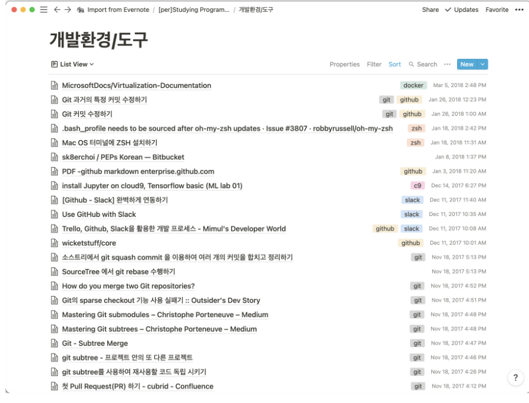

1-1. 에러 노트 작성 예시

  \* [실수 예방법](http://egloos.zum.com/agile/v/5774862)

[실수는 예방하는 것이 아니라 관리하는 것이다.

바람은 계산하는 것이 아니라 극복하는 것이다. --남이, <최종병기 활>에서 (해당 부분 영상)여러분들이 실수에 대해 갖는 느낌은 어떻습니까? 어떻게든 피해야 하고 알려지면 망신이다에 가깝습

egloos.zum.com](http://egloos.zum.com/agile/v/5774862)

* **슬랙 수업 채널에 질문할 때 세 가지 포함하기**

   1. 목적 - 내가 하려던 작업

   2. 에러 정보(에러 메시지, 에러가 발생한 화면)

   3. 내가 어떤 작업을 시도해봤는지, 참고한 자료가 있다면 무엇인지

   \* [질문 방법](https://blog.2dal.com/2020/04/01/%EB%B9%A0%EB%A5%B4%EA%B3%A0-%EC%A0%95%ED%99%95%ED%95%98%EA%B2%8C-%EB%8B%B5%EB%B3%80%EC%9D%84-%EB%B0%9B%EC%9D%84-%EC%88%98-%EC%9E%88%EB%8A%94-%EC%A7%88%EB%AC%B8%ED%95%98%EB%8A%94-%EB%B2%95/)

[빠르고 정확하게 답변을 받을 수 있는 질문하는 법 | asbubam's blog on 2dal.com

세상에 나쁜 질문은 없습니다. 물어보고 답변하는 과정에서 서로가 좀 더 성장할 수 있습니다. 이 문서에서는 에 대해서 제안합니다. 바보같은 질문은 없습니다. 궁금한 점은 언제든 질문합니다

blog.2dal.com](https://blog.2dal.com/2020/04/01/%EB%B9%A0%EB%A5%B4%EA%B3%A0-%EC%A0%95%ED%99%95%ED%95%98%EA%B2%8C-%EB%8B%B5%EB%B3%80%EC%9D%84-%EB%B0%9B%EC%9D%84-%EC%88%98-%EC%9E%88%EB%8A%94-%EC%A7%88%EB%AC%B8%ED%95%98%EB%8A%94-%EB%B2%95/)

**3) 1~3주차까지 배울 것**

* **1주차. 나를 위한 Git!**

   기초 Git 사용법을 배워서 내프로젝트를 위해 Git을 바로 쓸 수 있다.

   핵심 키워드 : 버전관리, commit, pull, push

* **2주차. 같이 하기 위한 Git!**

   협업하기 위한 기초 개념을 배웁니다.

   핵심 키워드 : issue, branch, merge

* **3주차. 모두의 Git**

    기초를 배웠다면 큰 물에서 놀아봐야죠! 1, 2주차에는 Git을 알기 위해서 배웠다면

    3주차에는 Github으로 만날 수 있는 새로운 세계를 경험한다.

---

**2. 필수 프로그램 설치**

**1) GitHub 가입**

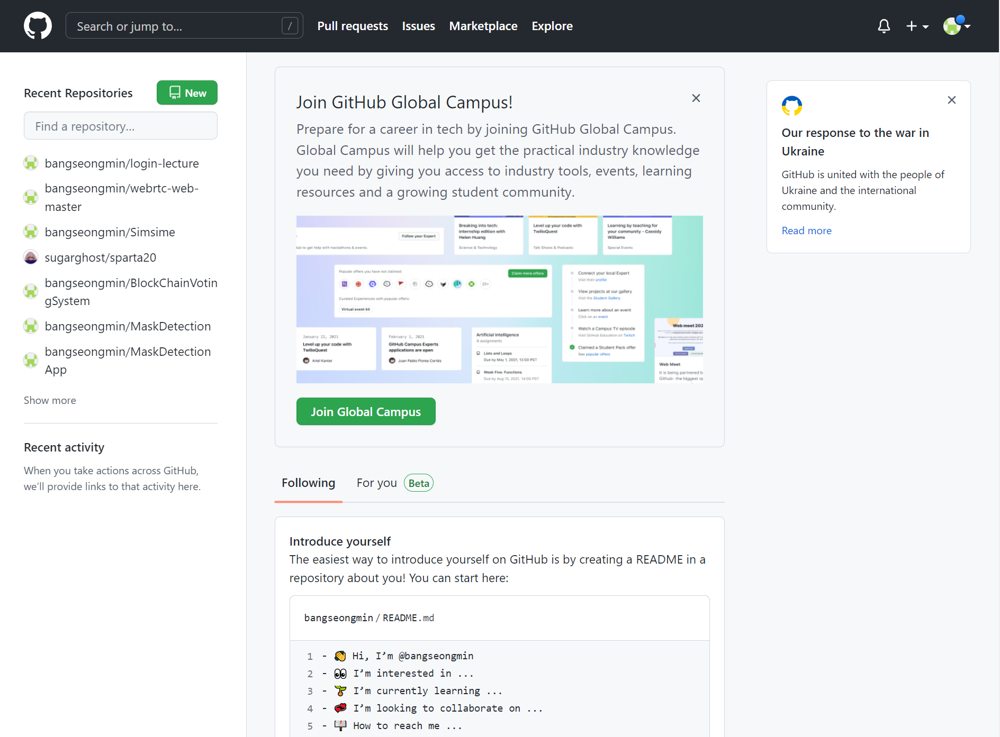

2.1 Github 가입

**2) Git**

**- 간단하게 Next Next만 하면 된다.**

**3) SourceTree 설치하기**

> SourceTree는 git을 사용하면서 형상관리를 하는 GUI 툴이다. (사실 사용은 처음이다..)  
> 형상관리 가능, 협업 가능, 브랜치, 원격 로컬 등 환경셋팅 테스트 유닛 만들기에 수월함의 강점을 보인다고 한다.

* [다운로드 링크](https://product-downloads.atlassian.com/software/sourcetree/windows/ga/SourceTreeSetup-3.4.3.exe)

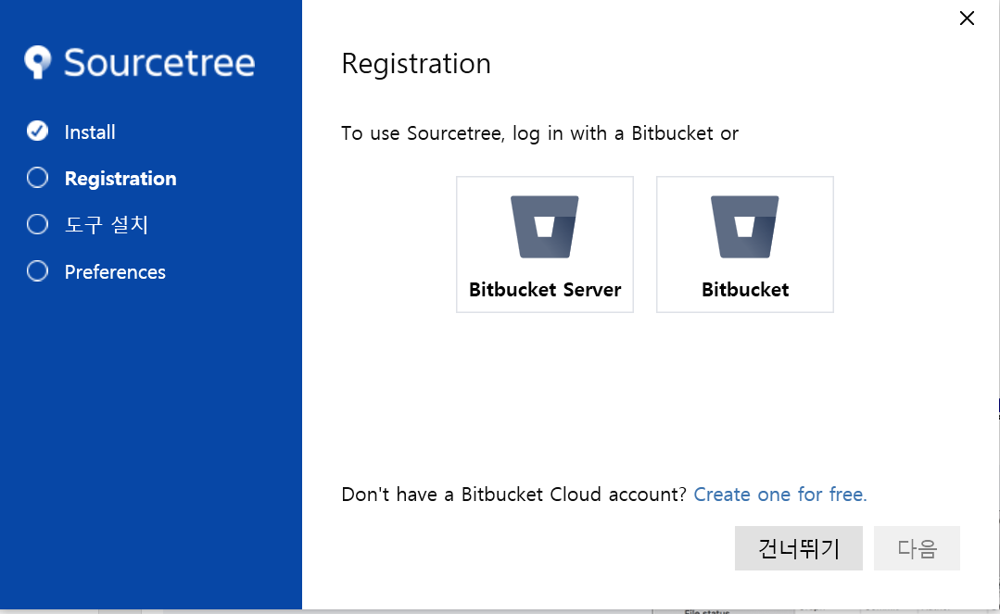

2-2. SourceTree 설치(1) - 건너뛰기

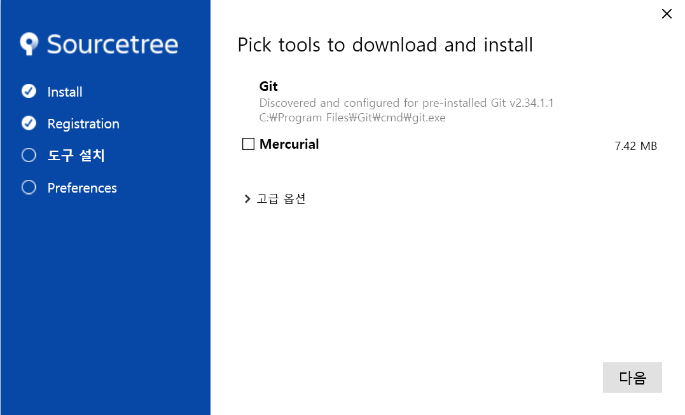

2-3. SourceTree 설치(2) - Mercurial 체크해제

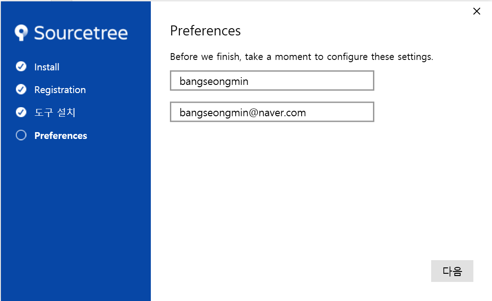

2-4. SourceTree 설치(3) - 사용자 이름과 깃허브 계정

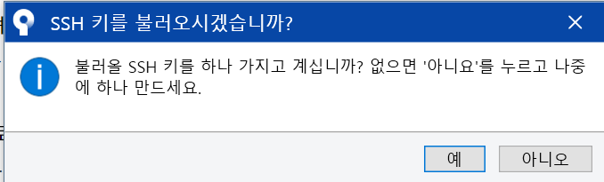

2-5. SourceTree 설치(4) - 아니오(선택)

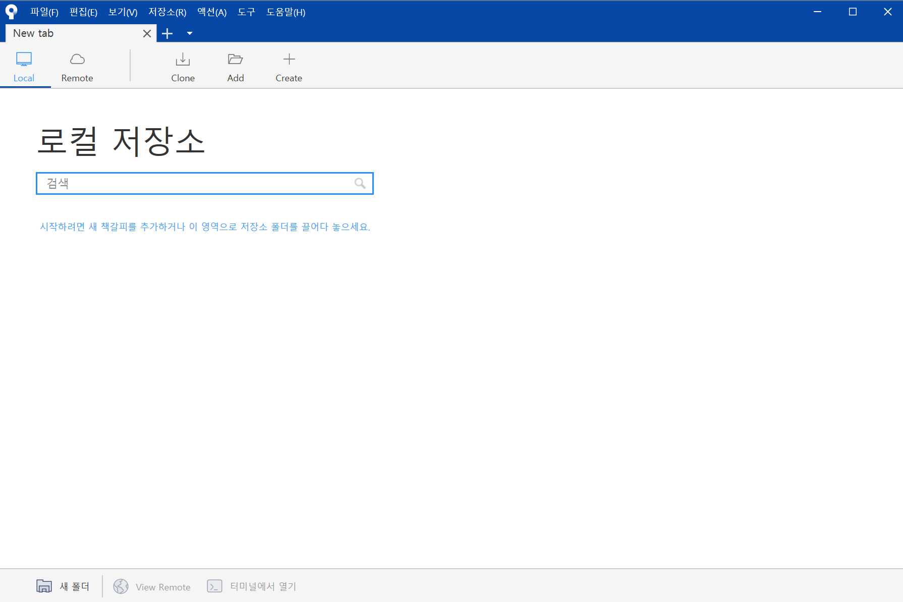

2-6. SourceTree(5) - 설치완료

**4) SourceTree 설정하기**

**(1) 토큰 생성**

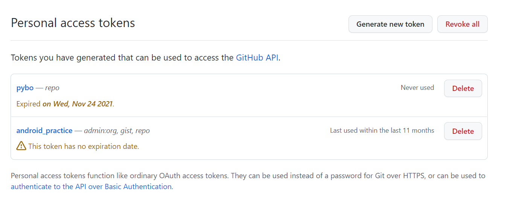

2-7. Generate new token 클릭

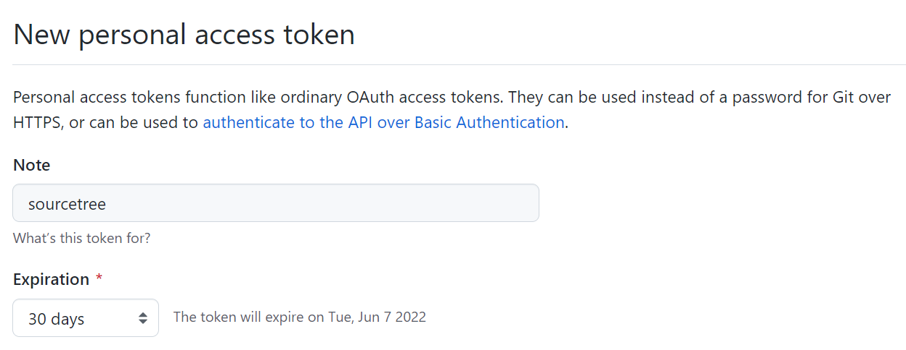

2-8. 토큰 설정

- repo, workflow, admin:org, admin:public\_key, gist, user, delete\_repo 체크박스 선택 후 생성

(2) 토큰 값 복사

(3) Sourcetree 실행 후 옵션 선택

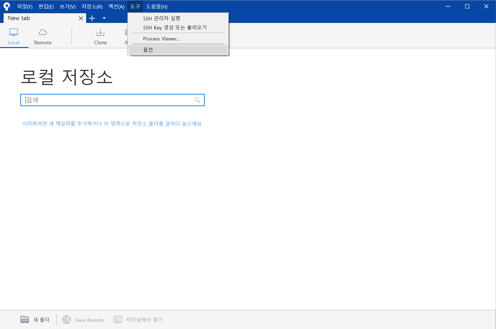

2-9. SourceTree에 도구 - 옵션 선택

(4) 한국어 설정

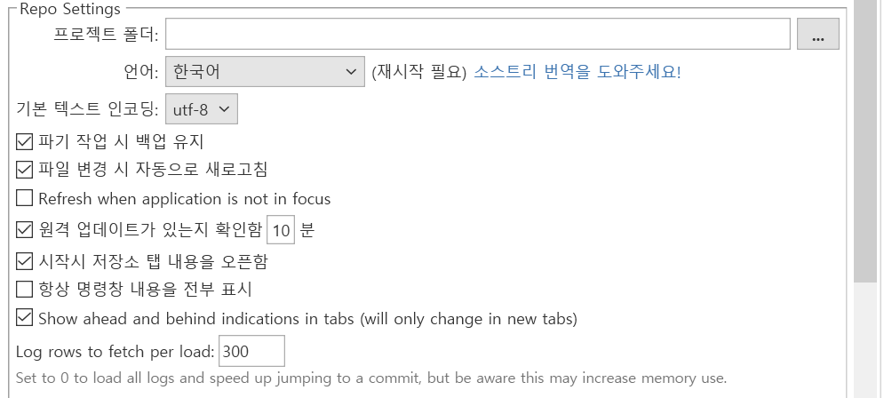

2-10. SourceTree 한국어 설정

(5) 계정 인증

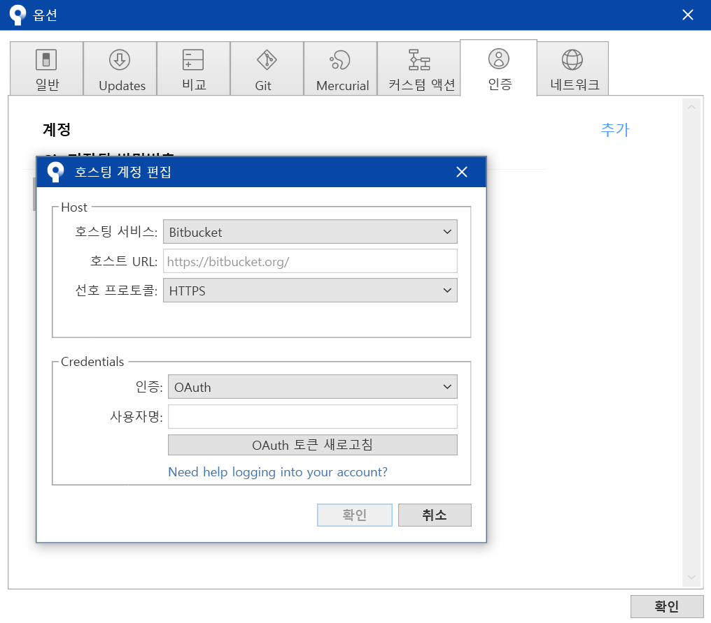

2-11. Token값을 통한 인증

사용자명 입력후, 암호에 토큰 값 입력!

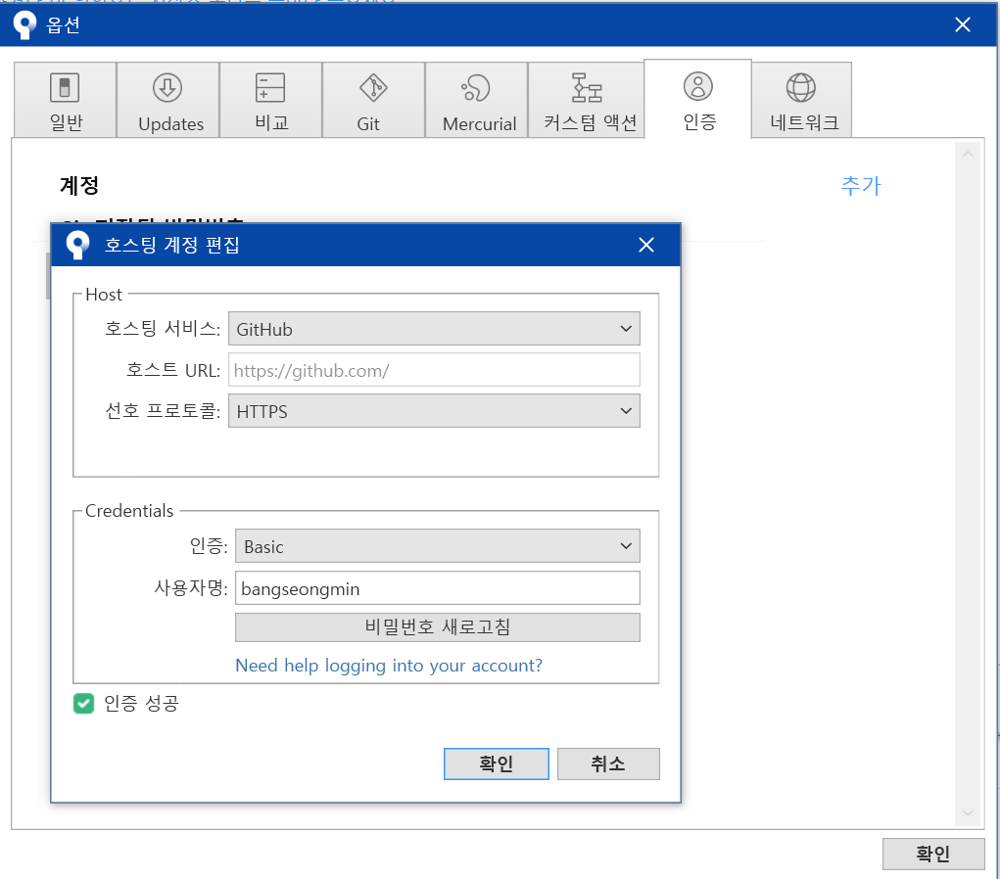

2-12. 인증 성공(왼쪽 하단에 초록색으로 뜬다)

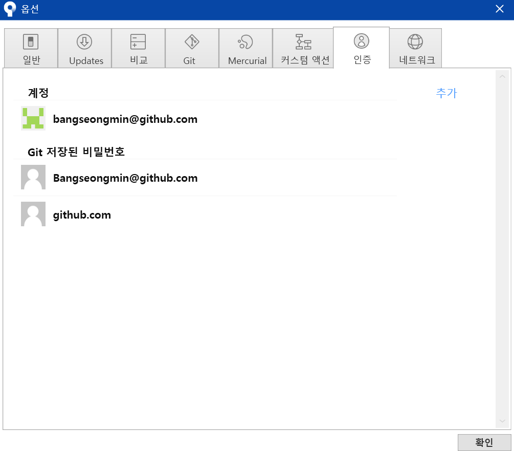

2-13. 계정 인증 후 상태

현재 윈도우는 위와 같이 간단하게 인증이 가능하다. 맥에 경우도 유사하므로 쉽게 할 수 있을 것이다.

---

**3. Git은 무엇이고, Github는 무엇인가?**

**1) Git 은 버전관리 도구**

**- Git을 사용하면 무슨 작업을 했는지도 히스트리도 한눈에 볼 수 있다.**

**- 작업 단위로 나눌 수 있다.**

**- 협업해서 하나의 프로젝트를 만드는데 유용하다**

**→ 프로젝트를 나누어서 작업하고 하나로 합치는 것이 편하다.**

**→ 누가, 언제, 어떤 부분을 수정했는지를 한 눈에 파악할 수 있다.**

> Git으로 모든 파일의 내용이 자동 비교가 되는가?  
> 기본 설정으로는 코드 text파일, markdown파일(text의 일종), CSV파일 등이 가능하다.  
> 이미지, Word, PDF파일, Excel 파일은 여러가지 설정을 해주어야 가능하고, 기본 설정으로는 이런 파일들을 파일의 크기가 변했구나... 정도만 알 수 있다.

**2) GitHub은 무엇인가?**

* Git과 GitHub는 다르다. GitHub는 Git 원격 저장소 + Git으로 할 수 있는 커뮤니티 기능 서비스이다.
* 즉, Github는 Git으로 된 프로젝트 저장 공간을 제공하고, Git을 편하게 사용하기 위한 여러가지 부가기능을 가지고 있다. Git이 협업할 때 필수 -> GitHub는 협업하기 위한 기능들을 가지고 있는 개발자들의 SNS이다.
* Github 외에도 Git 프로젝트 저장소 + 프로젝트 관리하는 기능을 제공하는 곳으로는 대표적으로 Gitlab, bitbucket 등의 서비스가 있다.

3) SourceTree는 무엇인가?

* Git을 쉽게 사용할 수 있는 도구이다. 워드 파일을 편지할때 MS Office를 사용하는 것처럼
* SourceTree를 배우는 이유는

1. 전 세계에서 가장 많이 사용되는 Git 도구 중에 하나이다.
2. 초심자부터 중급자까지 사용할 수 있도록 여러가지 기능을 제공
3. Git 사용패턴에 집중하기 위해서

4) GitHub 사용방법

- Commit에서 빨간색 부분은 삭제된 것, 초록색 부분은 수정된 것이다.

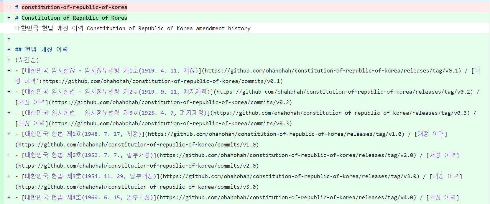

3-1. Commit 조회

- issue창에서는 다음과 같이 질문하며 토론을 할 수 있다.

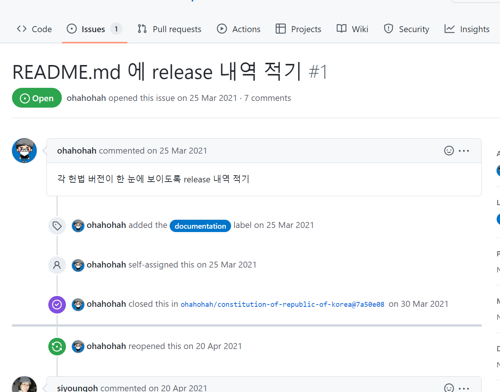

3-2. Github - issue

---

**4. 버전관리와 Commit**

1) 개념탑재

- git은 '누가, 언제, 현재 프로젝트의 상태가 어떤지' 세 가지 정보를 포함해 작업내역을 관리합니다.

  이렇게 현재 프로젝트 상태를 저장한 것을 **commit(커밋)**이라고 표현한다.

- Git 은 Commit을 통해 '현재 프로젝트의 상태'을 저장하고 조회합니다.

- commit : 현재 프로젝트의 상태를 저장한다. Git이 이전 commit를 알고 있으므로 자동으로 어떤 부분이 바뀌었는지 알려준다.

Q : 아래 대한민국 헌법 commit history 페이지에서 **대한민국 헌법 제10호**가 저장되어있는 commit 페이지로 들어가보세요.

A :  [대한민국 헌법 제 10호](https://github.com/ohahohah/constitution-of-republic-of-korea/commit/ed512280b49c566de2749f3abd28b9d11b22c158)

2) 실습

* 프로젝트 만들기

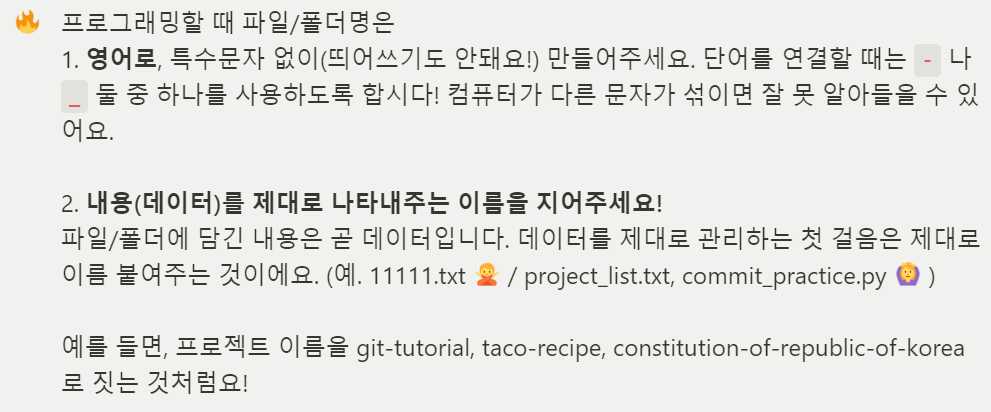

4-1. 프로젝트 규칙

* 프로젝트 생성 방법

   1. Create -> 폴더 찾기 -> 체크박스 해제 -> Create -> Yes 끝!

   2. 커밋 : 스테이지에 올라가지 않은 파일에 +버튼 클릭 -> "김치전 요리법 생성"입력후 커밋 클릭

   3. History 메뉴에서 커밋내용을 확인할 수 있다.

   4. 변경시 2-3번 반복

3) 정리하기

* 버전관리를 한다는 것은 어떤 의미일까?

> Me : 프로젝트 상태가 변경되는 정보를 관리하는 것이다.  
> 답 : 프로젝트 상태가 변경되는 정보를 알고 있다는 것입니다. Git 은 누가, 언제, 해당 시점의 프로젝트 상태를 기록해두기 때문에 버전 관리가 가능합니다. 

* 작업내역 단위인 commit에는 어떤 정보가 포함되어 있어야 잘 버전관리를 할 수 있을까?

> Me : "언제, 누가, 무엇을 수정했는가"에 대한 정보가 있어야 한다.  
> 답 : 누가, 언제, 무엇을 했는지가 필요하겠죠? 어떤 작업을 했는지 알려주는 작업 내역인 commit 메시지, 누가(author), commit 한 시간이 필요해요. 그리고 commit 을 편하게 관리하기 위한 commit 아이디! commit 아이디는 사용자 아이디처럼 commit 에 부여된 유일한 값!

* 지금까지 우리가 실습은 어떤 순서로 했었는지?

> Me : 프로젝트를 생성하고 commit하고 history 확인  
> 답 : (1) 기존의 프로젝트를 git 프로젝트로 만든다. - git 초기화(git initialize)  
>       (2) commit 할 파일들을 add(staging) 하고 commit 메시지 작성해서 commit!

---

**5. 원격 repo**

**1) 개념탑재**

**- repo : git으로 관리되는 프로젝트**

**- local repo : 내 컴퓨터에 저장되어 있는 리포지토리**

**- remote repo : Github처럼 다른 곳에서 접속할 수 있는 공간에 저장되어있는 것**

**- Tracking(branch Tracking) : 원격 repo와 로컬 repo를 연결시켜 내용을 반영시킬 위해** **repo를 연결하는 것**

**- 클라우드 서비스와 다르게 작업내역 즉, commit 을 자동으로 반영하지 않는다.** **내가 원하는 대로**

**어디 commit까지 반영할지를 수동으로 설정할 수 있게 해서 프로젝트를 더 잘 관리하기 위해서이다.**

**- push : 로컬 repo의 commit을 원격 repo에 반영하는 것**

**- pull : 원격 repo의 commit을 로컬 repo에 반영하는 것**

**- clone : 원격 repo를 내 컴퓨터에서도 사용할 수 있도록 가져올 수 있다. 즉, 초기 다운로드**

**2) 실습**

**- tracking : 설정 - 원격 - 자신의 원격 repo 주소를 복사붙여넣기**

**- 브랜치 변경 : 이름을 main으로 변경**

**- push : history 또는 branch에서 push 누르고 원하는 브랜치를 체크박스 선택하고 확인**

**- pull : **history 또는 branch에서 pull 누르고 충돌없으면 묶어서 바로 커밋 체크 박스 확인, Pull하면 원하는 대로 성공****

**- clone : 새 탭 생성 - clone 선택 remote repo url 받아서 복붙, 목적지 경로 설정후 클론 선택**

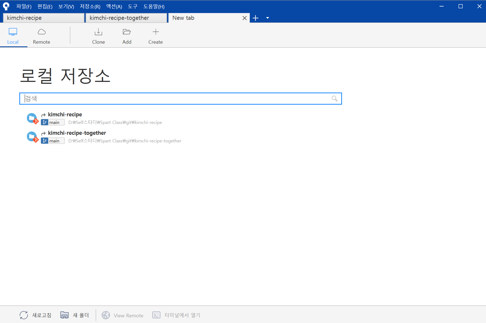

**3) 정리**

* 원격 repo와 로컬 repo를 연결해서 내용을 반영하고 싶을때 어떤 방법을 써야할까?

> Me : 혼자 개발할때는 pull - commit - push을 하면 충돌을 줄일 수 있다고 하셨다.  
>        push : 로컬 repo -> 원격 repo 에 반영  
>        pull : 원격 repo -> 로컬 repo 에 반영  
> 정답 : (1) 로컬 repo 가 없고 원격 repo 에 있는 내용을 가져오고 싶을 때는 clone 한다.   
>         (2) 원격 repo 와 로컬 repo 둘 다 있고 두 개를 연결하고 싶을 때는 로컬 repo 가   
>             원격 repo를 tracking 하도록 설정한다.

* 원격 repo와 로컬 repo는 왜 따로 있을까?

> Me : 정답은 효율적인 관리를 위해서이다. 로컬에서 개발하여 원격으로 통합하여 다양한 사람들이 개발에 참여할 수 있게 되기 때문이다.  
> 정답 : 협업할 때, 혹은 여러 컴퓨터를 사용한다면 하나의 원격 repo 에 여러 로컬 repo 를 연결시킬 수 있다. 하나의 프로젝트를 동시에 작업하는게 가능해진다.

* push와 pull의 개념을 원격 repo와 로컬 repo를 포함해 그림을 그려보세요.

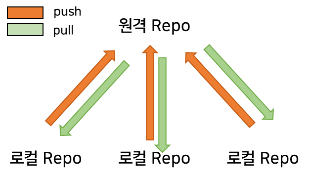

직접 그린 push와 pull 관계

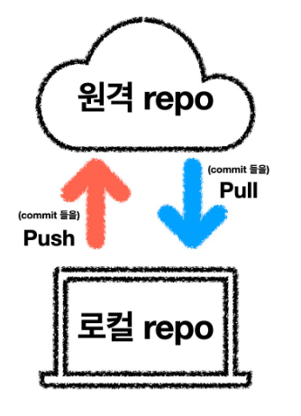

강의 자료 이미지

---

정리

마지막으로 오늘 TIL을 처음으로 올려보았다...

나도 Til을 열심히 작성해봐야지~~!!

Git에 대한 경험은 있었지만... 개념은 부족했던게 사실이고

sourcetree라는 간단한 git 도구를 사용하니까 편하긴 편한것 같다.

그치만 접근하고 뭐하고 폴더를 찾고 탐색하고 뭐하는게 귀찮긴하다..

git bash가 더편한거 같기도한데....ㅎ 일단 수업이라 사용하자!!

