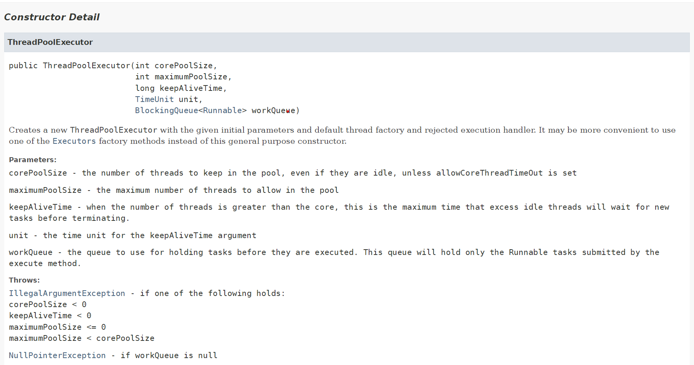

### **비동기 프로그래밍**

---

#### 비동기 프로그래밍이란?

- Async 한 통신

- 실시간성 응답을 필요로 하지 않는 상황에서 사용

- 예시) Notification, 이메일 전송, Push 알림

Main Thread가 Task를 처리하는 게 아니라 Sub Thread에게 Task를 위힘하는 행위라고 말할 수 있다.

**장점**

* **성능 및 응답성 향상**: 시간이 많이 걸리는 작업을 비동기적으로 처리하면 CPU가 놀지 않고 다른 작업을 수행할 수 있기 때문에 시스템의 성능과 응답성이 크게 향상됩니다. 예를 들어, UI가 있는 프로그램에서는 비동기 작업을 사용하여 사용자의 입력이 차단되지 않도록 할 수 있습니다.
* **동시성 개선**: 여러 작업을 동시에 처리할 수 있어, 특히 입출력 작업이나 네트워크 요청 같은 경우에 동시성을 통해 애플리케이션의 처리 속도를 높일 수 있습니다.
* **자원 효율성**: 작업이 끝날 때까지 스레드가 대기하지 않고 다른 작업을 처리할 수 있어, 멀티스레드 프로그램보다 자원을 덜 소모하면서도 유사한 이점을 얻을 수 있습니다.

**단점**

* **복잡성 증가**: 비동기 방식은 코드의 흐름이 콜백 또는 프라미스 체인으로 분리되기 때문에 코드가 직관적이지 않을 수 있습니다. 이를 콜백 지옥(Callback Hell)이라고 하며, 코드 가독성과 유지보수를 어렵게 만들 수 있습니다.
* **에러 처리**: 비동기 코드에서는 에러 처리가 복잡해질 수 있습니다. 동기 코드에서는 예외를 던지고 처리하면 되지만, 비동기 코드에서는 콜백 함수 내에서 예외 처리를 별도로 해야 합니다.

> 메인 스레드는 자동적으로 알아서 처리를 해주는데  
> 서브 스레드는 어떻게 생성을 하고 어떻게 관리를 해야할까?

---

#### **Spring에서 비동기 프로그래밍**

- Spring에서 비동기 프로그래밍을 하기 위해서는 Thread Pool을 정의할 필요가 있다.

**Thread Pool이란?**

Java에서 ThreadPool은 다수의 스레드를 미리 생성해 두고, 작업 요청을 스레드에 할당하여 처리하는 디자인 패턴입니다. ThreadPool은 작업을 실행할 때마다 새로운 스레드를 생성하는 대신, 이미 생성된 스레드를 재사용함으로써 시스템 자원을 절약하고 성능을 최적화하는데 도움이 됩니다. 이는 특히 스레드 생성 및 소멸이 빈번한 상황에서 유용합니다.

주요 개념

1. **Thread Creation Overhead 절감**: 스레드를 생성하고 소멸하는 작업은 비용이 많이 듭니다. ThreadPool을 사용하면 미리 생성된 스레드를 재사용하므로 이런 비용을 줄일 수 있습니다.
2. **동시성 관리**: 스레드 풀을 사용하면 애플리케이션의 동시성을 보다 효과적으로 관리할 수 있습니다. 풀의 크기를 제한할 수 있어서 시스템의 과부하를 방지할 수 있습니다.
3. **작업 큐**: 스레드 풀은 보통 작업을 담는 큐를 가지고 있습니다. 스레드가 바쁘면 새로운 작업은 큐에 저장되며, 스레드가 유휴 상태가 되면 큐에 있는 작업을 가져와 실행합니다.
4. **풀 크기**: 스레드 풀의 크기는 고정되거나 동적으로 변경될 수 있습니다. FixedThreadPool은 고정된 스레드 수를 사용하고, CachedThreadPool은 필요에 따라 스레드를 생성하고, 사용되지 않은 스레드를 일정 시간 후에 제거합니다.

ThreadPool의 장점

1. **자원 효율성**: 미리 생성된 스레드를 재사용하여 시스템 자원을 절약합니다.
2. **성능 향상**: 작업을 병렬로 처리하여 성능을 높일 수 있습니다.
3. **동시성 제어**: 스레드 수를 제한하여 과도한 동시 실행을 방지할 수 있습니다.

주의사항

* **Thread Leakage**: shutdown() 메서드를 호출하지 않으면 스레드 풀에 남아 있는 스레드가 종료되지 않아 메모리 누수가 발생할 수 있습니다.
* **적절한 풀 크기 설정**: 너무 적은 스레드는 성능 저하를, 너무 많은 스레드는 시스템 자원 고갈을 초래할 수 있습니다.

**Thread Pool 생성 필요한 이유**

java에서 **Thread Pool**을 생성하는 이유는 주로 성능 최적화와 자원 관리입니다. Thread Pool은 다중 스레드 환경에서 새로 스레드를 생성하고 제거하는 데 필요한 비용을 줄이고, 시스템의 자원 낭비를 방지하면서 동시에 애플리케이션의 응답성과 처리 속도를 높이는 데 도움을 줍니다.

* **스레드 생성/제거 비용 절감**: 스레드를 재사용함으로써 자원 낭비를 줄입니다.
* **자원 효율성**: 스레드 수를 제한해 CPU 및 메모리 자원을 최적으로 활용합니다.
* **응답 시간 단축**: 미리 생성된 스레드를 사용해 요청에 빠르게 응답할 수 있습니다.
* **안정성 확보**: 시스템 과부하를 방지하고, 적절한 스레드 수를 유지합니다.
* **병렬 처리**: 다중 작업을 동시에 처리해 성능을 높입니다.
* **비동기 작업 처리**: UI와 비동기 작업을 효율적으로 분리하여 처리할 수 있습니다.

더보기

**1. 스레드 생성 비용 감소**

스레드를 새로 생성하는 것은 비용이 많이 드는 작업입니다. 스레드를 생성할 때는 운영 체제의 자원을 할당받고, 메모리를 초기화하며, 각종 관리 비용이 발생합니다. 만약 애플리케이션이 매번 작업마다 새 스레드를 생성하고 끝난 후에 제거한다면, 이러한 비용이 누적되어 성능 저하를 초래할 수 있습니다.

**Thread Pool**을 사용하면 미리 스레드를 생성해 두고 필요할 때 재사용하기 때문에, 매번 스레드를 새로 생성하는 것보다 훨씬 효율적입니다.

2. **자원 관리 및 효율성**

무작정 많은 스레드를 생성하게 되면 CPU와 메모리를 비롯한 시스템 자원에 부담을 줄 수 있습니다. 특히 CPU는 많은 스레드 사이에서 문맥 전환(Context Switching) 비용이 증가하며, 메모리가 부족할 경우 애플리케이션이 비정상적으로 종료될 수 있습니다.

**Thread Pool**을 사용하면 풀의 크기를 제한할 수 있어서, 스레드 개수를 관리하고 시스템 자원의 사용을 최적화할 수 있습니다. 이렇게 하면 시스템 과부하를 방지할 수 있습니다.

3. **응답 시간 단축**

사용자가 요청을 보낼 때마다 스레드를 새로 생성한다면, 스레드 생성과 초기화에 소요되는 시간이 응답 시간에 영향을 미칩니다. 특히 고부하 상황에서는 새로운 스레드를 생성하는 시간이 상당히 길어질 수 있습니다.

반면, **Thread Pool**에서는 이미 생성된 스레드가 유휴 상태로 대기하고 있으므로 작업 요청이 오면 바로 스레드를 할당할 수 있어 응답 시간을 줄일 수 있습니다.

4. **스레드 수 제어를 통한 안정성**

다중 스레드 환경에서 스레드를 무제한으로 생성하면 시스템이 과부하에 걸릴 수 있습니다. 예를 들어, 네트워크 서버가 각 클라이언트 요청마다 새로운 스레드를 생성한다면, 특정 순간에 스레드가 너무 많이 생성되어 CPU와 메모리가 부족하게 됩니다.

**Thread Pool**을 사용하면 스레드 수를 제한하여 이런 상황을 방지할 수 있습니다. 작업이 많아지면 Thread Pool 내부 큐에 작업이 쌓이게 되고, 스레드가 처리 가능한 만큼 작업을 처리하게 됩니다. 이를 통해 시스템의 안정성을 확보할 수 있습니다.

5. **병렬 처리로 성능 향상**

스레드를 병렬로 실행하면 CPU 코어를 최대한 활용하여 성능을 향상시킬 수 있습니다. **Thread Pool**을 사용하면 여러 스레드가 동시에 병렬로 작업을 처리할 수 있기 때문에 대규모 작업을 보다 효율적으로 처리할 수 있습니다. 이때 스레드 풀의 크기를 적절히 설정함으로써 병렬 처리의 효율을 극대화할 수 있습니다.

6. **작업 큐를 통한 작업 관리**

**Thread Pool**은 일반적으로 작업 큐를 함께 사용합니다. 스레드가 바쁠 때는 새로운 작업이 큐에 저장되고, 스레드가 유휴 상태가 되면 큐에 있는 작업을 가져와 처리합니다. 이렇게 함으로써 작업이 실패하거나 유실되는 것을 방지하고, 보다 체계적으로 작업을 관리할 수 있습니다.

7. **비동기 작업 처리**

스레드 풀은 비동기 방식으로 작업을 처리하는 데 유리합니다. 예를 들어, 백그라운드에서 실행되는 작업이나 특정 이벤트를 처리하는 데 스레드 풀이 효과적입니다. 이는 사용자 인터페이스(UI)를 가진 애플리케이션에서 작업을 백그라운드에서 처리하여 UI가 멈추지 않도록 도와줍니다.

Thread Pool 생성 옵션

Thread Pool 생성 옵션 중 대표적인 5가지입니다.

1. **CorePoolSize** - 유휴 상태일 때에도 쓰레드 풀에 보관할 스레드 수 → 최소 스레드 수
   * Thread 수 < CorePoolSize → 쓰레드 생성
   * Thread 수 > CorePoolSize →  Queue에 요청 추가
2. **MaxPoolSize** - 풀에서 허용하는 최대 스레드 수 → 최대 스레드 수
   * Queue Full && Thread 수 < MaxPoolSize → 쓰레드 생성
   * Queue Full && Thead 수 > MaxPoolSize → 요청 거절
3. **keepAliveTime** - 스레드 수가 코어 수보다 많은 경우, 초과 유휴 스레드가 종료되기 전에 새 작업을 기다리는 최대 시간
4. **unitKeepAliveTime** -  시간 단위
5. **WorkQueue** - 작업이 실행되기 전에 보관하는 데 사용할 큐. 이 큐는 메서드 Runnable 에서 제출한 작업 만 보관

**Thread Pool 실행 순서**

1. CorePoolSize 만큼 Thread 생성
2. 요청 발생 시 WorkQueue 사이즈 만큼, 새로운 요청들을 계속해서 담는다.
3. WorkQueue의 요청 수가 지정한 사이즈 만큼 다 쌓이게 되면, MaxPoolSize만큼 쓰레드를 생성하게 된다.

**ThreadPool 생성 시 주의사항**

1. **CorePoolSize 값을 너무 크게 설정할 경우 Side Effect 고려해야함.**  
   CorePoolSize 같은 경우에는 그 수만큼은 무조건 자원을 점유하고 있다라는 말인데, 너무 크게 잡고 있게 되면 사실상 잘 사용되지 않고 사용되더라도 그만큼의 스레드가 필요 없음에도 불구하고 많은 스레드를 점유하고 있을 수 있기 때문에 적절하게 값을 조절하여 설정할 필요가 있다.
2. **Exception(IllegalArgumentException, NullPointerException)**
   1. IllegalArgumentException에 경우, 아래 조건 중 하나라도 일치할 경우 발생한다.
      * keepAliveTime < 0
      * maximumPoolSize <= 0
      * maximumPoolSize < corePoolSize
      * LbGP5Eb7W-4
   2. NullPointerException에 경우, workQueue가 존재하지 않은 경우 발생한다.

[참고] [Java Docs - ThreadPoolExecutor](https://docs.oracle.com/javase/8/docs/api/java/util/concurrent/ThreadPoolExecutor.html)

[ThreadPoolExecutor (Java Platform SE 8 )

An ExecutorService that executes each submitted task using one of possibly several pooled threads, normally configured using Executors factory methods. Thread pools address two different problems: they usually provide improved performance when executing la

docs.oracle.com](https://docs.oracle.com/javase/8/docs/api/java/util/concurrent/ThreadPoolExecutor.html)

---

#### 개발 시 주의사항

1. **Spring Framework에서 비동기 프로그래밍을 할 때, 순수한 빈을 사용하는 것이 아닌 프록시 객체를 받아온다. 그 사이에서 Spring Framework가 비동기로 동작할 수 있도록 지원을 해준다.**
2. **Spring 컨테이너에 있는 빈을 사용하지 않거나 내부 메소드로 접근하는 경우 Spring의 도움을 받을 수 없으므로 비동기로 처리되지 않는다.**
3. **비동기 기능 구현 시 테스트 코드 작성과 원하는 대로 서브 스레드에서 정의한 로직이 동작하고 있는지 확인이 필요하다.**

