## Feign Client

---

### Feign Client 란?

---

#### Feign Client란 무엇인가?

Feign Client는 **HTTP API 호출을 간소화**하기 위한 선언적 REST 클라이언트입니다.  
Spring Cloud에서 제공하며, REST API를 호출하는 코드를 인터페이스 기반으로 쉽게 구현할 수 있습니다.  
Java 인터페이스에 어노테이션을 추가하는 것만으로 HTTP 요청을 처리하고, 외부 서비스와의 통신을 간편하게 수행할 수 있습니다.

#### 왜 사용해야할까?

* **코드 간소화**: HTTP 요청을 보낼 때, 복잡한 코드를 작성할 필요 없이 인터페이스와 어노테이션으로 간단하게 구현할 수 있습니다.
* **유연한 구성**: Feign은 다양한 설정을 통해 로드 밸런싱, 리트라이 정책 등을 쉽게 적용할 수 있습니다.
* **확장성**: Ribbon, Hystrix와 같은 Spring Cloud 컴포넌트들과 쉽게 통합이 가능합니다.
* **가독성 향상**: 선언적 방식으로 HTTP API를 정의하므로, 비즈니스 로직에 집중할 수 있고 코드가 더 직관적입니다.

#### Feign Client vs WebClient vs RestTemplate

* **Feign Client**는 API 호출을 **간단하게 선언적**으로 작성하고, Spring Cloud와의 통합이 강력하여 로드 밸런싱, 장애 처리 등 마이크로서비스 간 통신에 적합합니다.
* **WebClient**는 **비동기** 및 **스트리밍** 처리가 가능한 고성능 네트워크 요청에 적합하며, 복잡한 비동기 작업이 필요할 때 주로 사용됩니다.
* **RestTemplate**은 **동기식**으로 작동하며, Spring 5 이상에서는 WebClient로 대체되는 경향이 있습니다.

| 특징 | Feign Client | Web Client | RestTemplate |
| --- | --- | --- | --- |
| 선언적 방식 | 인터페이스를 통해 선언적 사용 가능 | 함수형 스타일 | 객체 생성 후 호출 |
| 동기/비동기 처리 | 기본적으로 동기식, 비동기 확장 가능 | 비동기 및 동기 모두 지원 | 동기식 |
| 코드 복잡도 | 간단 | 상대적으로 복잡(체이닝 방식의 함수 호출) | 중간(객체 생성 후 사용) |
| 로드 밸런싱 | Spring Cloud LoadBanalancer와 통합 가능 | 별도 설정 필요 | 별도 설정 필요 |
| 에러 처리 | Hystrix, Resilience4j 등과 통합하여 처리 | Reactor의 onError 및 기타 핸들러 사용 | 예외 처리 코드 직접 작성 필요 |
| 용도 | 마이크로서비스 간 통신, 간단한 API 호출 | 비동기 처리 및 고성능 네트워크 요청 | 기본적인 REST API 호출 |
| Spring 지원 | Spring Cloud에서 강력하게 지원 | Spring WebFlux에서 지원 | Spring MVC 기반 (최근에는 WebClient로 대체됨) |


#### Feign 주요 기능

**Connection/Read Timeout - 외부 서버와 통신 시 타임아웃 설정**

외부 컴포넌트 간 통신에서, 각 컴포넌트마다 **개별적으로** 다른 타임아웃 시간이나 설정 값을 **명시적으로 구분**하여 선언할 수 있다.

````java
feign:
  url:
    prefix: http://localhost:8080/target_server # DemoFeignClient에서 사용할 url prefix 값
  client:
    config:
      default:
        connectTimeout: 1000
        readTimeout: 3000
        loggerLevel: NONE
      demo-client: # DemoFeignClient에서 사용할 Client 설정 값
        connectTimeout: 1000
        readTimeout: 10000
        loggerLevel: HEADERS # 여기서 설정한 값은 FeignCustomLogger -> Logger.Level logLevel 변수에 할당됨

#  [loggerLevel 옵션]
#      ref : feign.Logger.Level
#  ```
#  NONE, // No logging.
#  BASIC, // Log only the request method and URL and the response status code and execution time.
#  HEADERS, // Log the basic information along with request and response headers.
#  FULL // Log the headers, body, and metadata for both requests and responses.
# ```
````

**Feign Interceptor**

외부 요청 전 공통적으로 처리해야 할 작업(예: 로깅)은 **Interceptor**를 재정의하여 처리할 수 있습니다. 이렇게 하는 이유는, 단순히 "실패가 발생했다"라고 알리는 대신, 요청 시 어떤 값들로 인해 실패했는지 **상세한 정보**를 제공하고, 내부적으로 요청한 **값을 관리**하기 위해서입니다. 또한, 각 요청마다 헤더 같은 공통 값을 설정하는 대신, **Interceptor**를 사용해 **중앙에서 헤더를 관리**함으로써 **코드 유지보수**가 훨씬 편리해집니다.

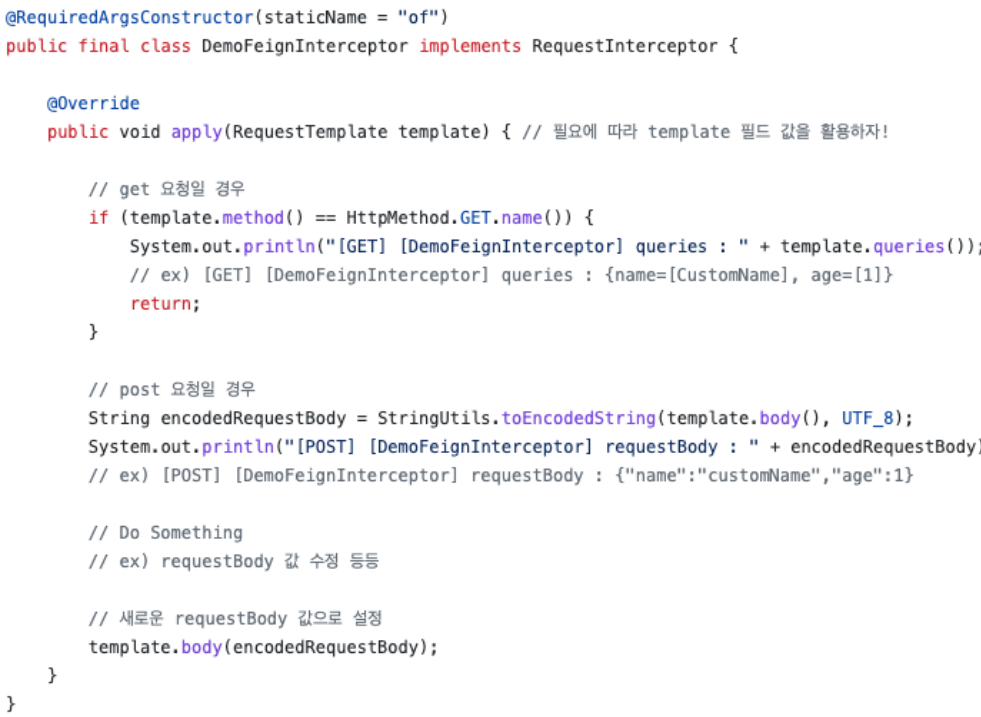

**Feign Logger**

운영을 위해서는 반드시 요청/응답에 대한 적절한 로그를 남겨야 합니다. 이를 통해, 요청 시 어떤 값들이 전송되었고, 어떤 응답이 왔는지, 요청 시간이 얼마나 걸렸는지를 모두 기록할 수 있습니다. Feign에서도 **Logger**와 **커스텀 로거** 설정을 통해, 필요한 로그를 남길 수 있는 기능을 제공하여 원하는 대로 로그를 관리할 수 있습니다.

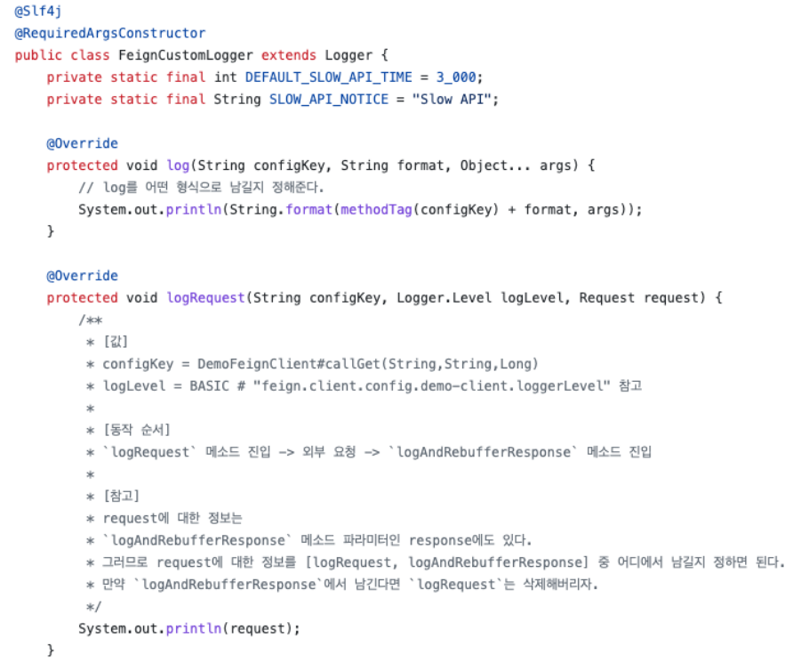

**Feign ErrorDecoder**

요청에 대해 정상 응답이 아닌 경우, Feign에서는 \*\*에러 디코더(ErrorDecoder)\*\*를 통해 적절하게 처리할 수 있습니다. 예를 들어, 400~500대의 HTTP 응답이 왔을 때, 이를 **커스텀 예외**로 한 번 더 래핑하여 처리하거나, 404 응답과 같은 특정 상황에서 이를 바로 클라이언트에 전달하지 않고, 정의된 에러 값으로 변환해 예외를 던질 수 있습니다. 이러한 방식으로 Feign은 비정상적인 응답에 대해 세밀하게 제어할 수 있는 기능을 제공합니다.

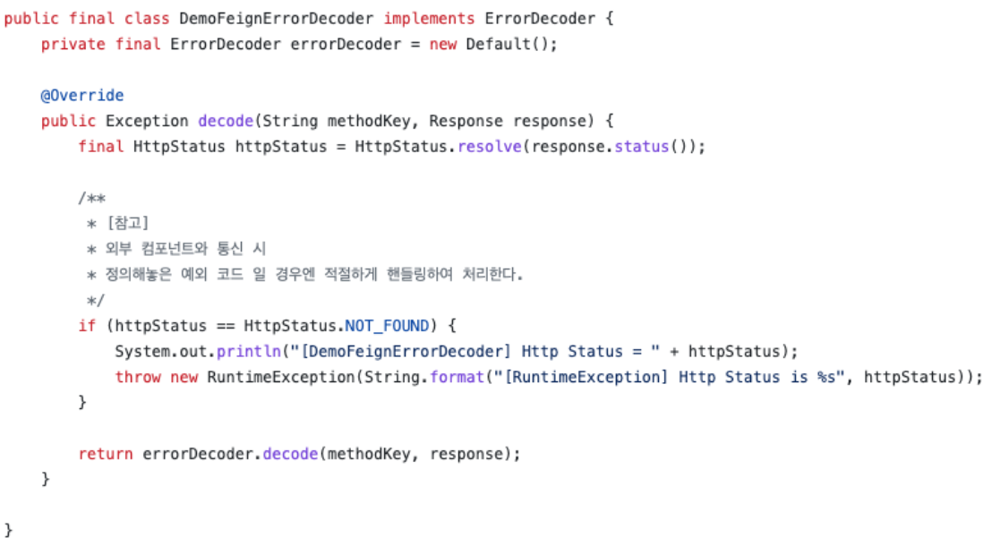

### Feign Client 실습

---

* 실습 환경
  + Spring Boot 3.3.3
  + Java 17(Amazon Corretto)
  + IntelliJ Ultimate
  + Windows 11

#### 기본 설정

**프로젝트 설정**

**1. 기본 의존성 설정**

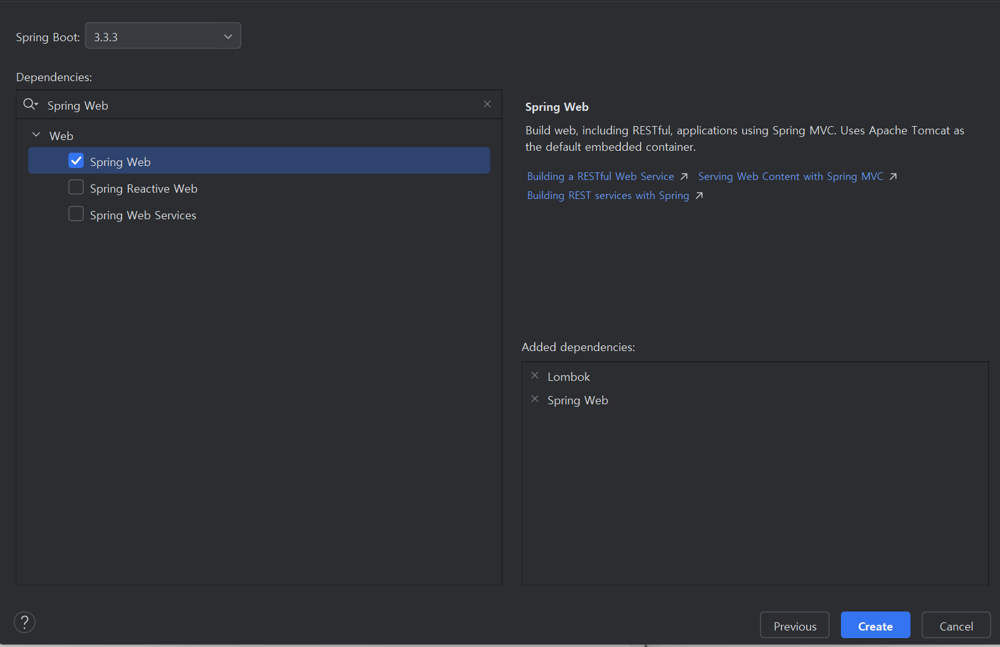

**2. Feign 의존성 추가**

Spring Cloud 버전에 맞는 Feign 클라이언트를 사용하려면 해당 버전을 임포트해야 합니다. **변수명 처리**는 동적으로 값을 바인딩할 때 사용되며, ext 블록에 Key-Value 값을 선언하면, 이 값이 바인딩됩니다. 이 값은 **Dependency Management**에서 관리되고, **dependencies**에서 실제로 사용됩니다.

또한, **Spring Boot 버전**에 따라 **Spring Cloud Feign** 버전의 호환성이 매우 중요합니다. Boot 버전에 맞는 릴리즈 버전을 확인해야 하며, 예를 들어 2023.0.x (Leyton)에서는 0.3 버전이 최신이므로 이를 사용할 예정입니다.

[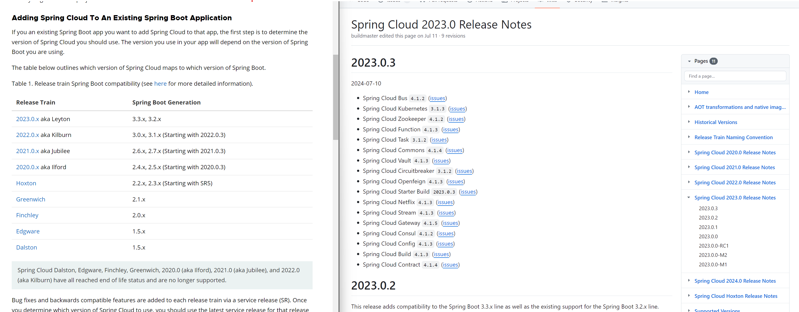](https://spring.io/projects/spring-cloud)

```java
ext {
    set('springCloudVersion', "2023.0.3")
}

dependencyManagement {

    imports {
        mavenBom "org.springframework.cloud:spring-cloud-dependencies:${springCloudVersion}"
    }

}

dependencies {
    implementation 'org.springframework.boot:spring-boot-starter-web'
    compileOnly 'org.projectlombok:lombok'
    annotationProcessor 'org.projectlombok:lombok'
    testImplementation 'org.springframework.boot:spring-boot-starter-test'
    testRuntimeOnly 'org.junit.platform:junit-platform-launcher'

    // Feign
    implementation 'org.springframework.cloud:spring-cloud-starter-openfeign'
}

tasks.named('test') {
    useJUnitPlatform()
}
```

**3. EnableFeignClients 설정**

Spring Cloud Feign Client를 사용하려면, 프로젝트에 **@EnableFeignClients** 어노테이션을 선언해야 합니다. 이 어노테이션은 프로젝트에 Feign 클라이언트를 사용할 것임을 알려주는 역할을 합니다. 즉, Feign 클라이언트의 자동 구성과 동작을 활성화하여, 정의된 Feign 클라이언트 인터페이스를 인식하고 사용할 수 있도록 합니다.

```java
@EnableFeignClients
@SpringBootApplication
public class FeignApplication {

    public static void main(String[] args) {
        SpringApplication.run(FeignApplication.class, args);
    }

}
```

**Config 파일 설정**

```java
@Configuration
public class FeignConfig {
}
```

[참고] 추가적인 서버 프로젝트를 만들어서 테스트할 수 있지만, 간단하게 테스트하기 위한 용도이기 때문에 컨트롤러를 추가로 생성하여 연결하였습니다.


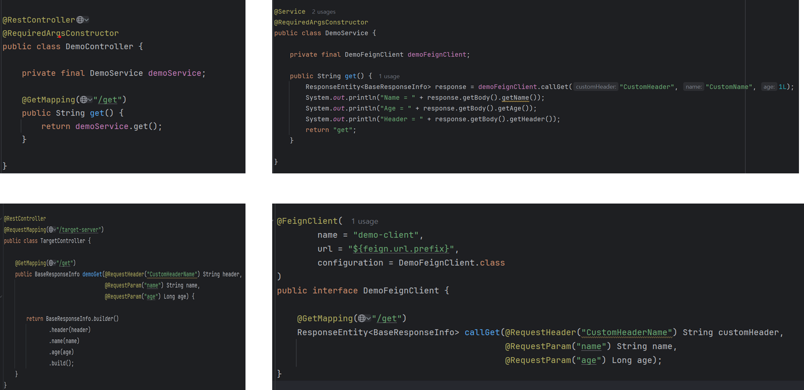

Controller에서 요청을 처리하면, Service를 호출하고, Service는 Feign Client의 `CallGet` 메소드를 호출합니다. 이때 요청 URL에 `get`이라는 서픽스를 붙여서 호출하며, `RequestHeader`에는 키-값 쌍을 설정하여 보냅니다.    

Feign Client가 요청을 보내면, `TargetController`는 수신한 데이터를 `BaseResponseInfo`로 변환하여 응답합니다. 최종적으로, Service는 이 응답 값을 출력하여 의도한 대로 반환됩니다.

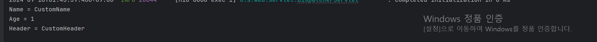

Feign Client를 사용해서 마치 외부 컴포넌트의 요청을 하였고, 그 요청한 결과에 성공 응답이 왔을 경우에는 의도한 대로 Response 값을 파싱해서 출력하는 것 까지 확인할 수 있다.

---

#### Interceptor 설정

Interceptor는 요청을 보낼 때 한 곳에서 그 요청에 필요한 공통적인 설정을 할 수 있는 부분입니다.

Interceptor에서는 HTTP 요청 메소드에 따른 분리된 로직을 추가

```java
@RequiredArgsConstructor(staticName = "of")
public class DemoFeignInterceptor implements RequestInterceptor {

    @Override
    public void apply(RequestTemplate template) {
        // GET 요청일 경우
        if(template.method().equals(Request.HttpMethod.GET.name())) {
            System.out.println("[GET] [DemoFeignInterceptor] queries :: " + template.queries());
            return;
        }

        // POST 요청일 경우
        String encodedRequestBody = StringUtils.toEncodedString(template.body(), StandardCharsets.UTF_8);
        System.out.println("[POST] [DemoFeignInterceptor] encodedRequestBody = " + encodedRequestBody);

        // 추가적으로 필요한 로직을 추가
        String covertedRequestBody = encodedRequestBody;
        template.body(covertedRequestBody);
    }
}
```

Interceptor를 Bean으로 등록

```java
@Configuration
public class DemoFeignConfig {

    @Bean
    public DemoFeignInterceptor feignInterceptor() {
        return DemoFeignInterceptor.of();
    }
}
```

GET 요청과 POST 요청 시 정상적으로 Interceptor가 동작함을 확인할 수 있다. 추가적으로 Interceptor가 외부에 요청하기 전에 먼저 호출되는 것을 확인할 수 있다.

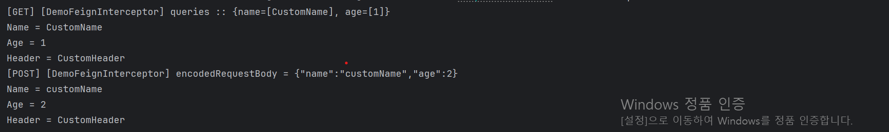

[참고] POST 관련 코드는 간단하여 설명을 생략하였고, 아래에 코드를 첨부하였습니다.

더보기

```java
@RestController
@RequiredArgsConstructor
public class DemoController {

    private final DemoService demoService;

    @GetMapping("/get")
    public String get() {
        return demoService.get();
    }

    @PostMapping("/post")
    public String post() {
        return demoService.post();
    }

}
```

```java
@Service
@RequiredArgsConstructor
public class DemoService {

    private final DemoFeignClient demoFeignClient;

    public String get() {
        ResponseEntity<BaseResponseInfo> response = demoFeignClient.callGet("CustomHeader", "CustomName", 1L);
        System.out.println("Name = " + response.getBody().getName());
        System.out.println("Age = " + response.getBody().getAge());
        System.out.println("Header = " + response.getBody().getHeader());
        return "get";
    }

    public String post() {
        BaseRequestInfo baseRequestInfo = BaseRequestInfo.builder()
                .name("customName")
                .age(2L)
                .build();
        ResponseEntity<BaseResponseInfo> response = demoFeignClient.callPost("CustomHeader", baseRequestInfo);
        System.out.println("Name = " + response.getBody().getName());
        System.out.println("Age = " + response.getBody().getAge());
        System.out.println("Header = " + response.getBody().getHeader());
        return "post";
    }
}
```

```java
@RestController
@RequestMapping("/target_server")
public class TargetController {

    @GetMapping("/get")
    public BaseResponseInfo demoGet(@RequestHeader("CustomHeaderName") String header,
                                    @RequestParam("name") String name,
                                    @RequestParam("age") Long age) {

        return BaseResponseInfo.builder()
                .header(header)
                .name(name)
                .age(age)
                .build();
    }

    @PostMapping("/post")
    public BaseResponseInfo demoPost(@RequestHeader("CustomHeaderName") String header,
                                     @RequestBody BaseRequestInfo body) {

        return BaseResponseInfo.builder()
                .header(header)
                .name(body.getName())
                .age(body.getAge())
                .build();
    }
}
```

---

#### Logger 설정

Logger는 상속 받을 때 Feign Logger 추상 클래스를 상속받아야 한다.

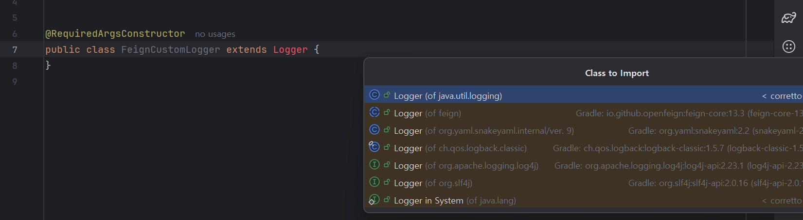

총 3가지 메서드를 사용해보려고 한다.

1. **log**
   * Feign.Logger 클래스에 정의된 기본 로그 메소드로, 주어진 수준의 로그를 출력합니다. 기본적으로 요청 및 응답과 관련된 메시지, 상태 코드, 헤더, 바디 등의 정보를 기록합니다.
   * 이 메소드는 특정한 형식의 문자열을 로그로 남기는데, Feign의 로깅 기능을 확장하거나 커스터마이징할 때 주로 사용됩니다.
2. **logRequest**
   * Feign 클라이언트가 서버에 요청을 보내기 전에 그 요청에 대한 정보를 로그로 기록하는 메소드입니다.
   * 이 메소드는 요청의 HTTP 메소드, URL, 헤더, 요청 본문 등을 기록합니다. 요청에 대한 디버깅이나 트러블슈팅 시 유용합니다.
3. **logAndRebufferResponse**
   * 서버로부터 응답을 받은 후, 그 응답을 로그로 기록하면서 응답 본문을 다시 버퍼링하는 역할을 합니다.
   * 이 메소드는 응답 본문을 읽고 다시 버퍼에 기록하여, 여러 번 응답 본문을 읽을 수 있도록 해줍니다. 보통 스트림 형태의 응답은 한 번 읽으면 다시 읽을 수 없기 때문에, 로그에 기록한 후에도 본문을 다시 사용할 수 있게 해주는 기능입니다.

**Bean 등록**

```java
@Configuration
public class FeignConfig {

    @Bean
    public Logger feignLogger() {
        return new FeignCustomLogger();
    }
}
```

**application.yaml 설정**

````java
feign:
  url:
    prefix: http://localhost:8080/target_server # DemoFeignClient에서 사용할 url prefix 값
  client:
    config:
      default:
        connectTimeout: 1000
        readTimeout: 3000
        loggerLevel: NONE
      demo-client: # DemoFeignClient에서 사용할 Client 설정 값
        connectTimeout: 1000
        readTimeout: 10000
        loggerLevel: HEADERS # 여기서 설정한 값은 FeignCustomLogger -> Logger.Level logLevel 변수에 할당됨

logging:
  level:
    feign: DEBUG
    org.dev.DemoFeignClient: DEBUG  # Feign 클라이언트에 대한 디버그 로깅 활성화
#  [loggerLevel 옵션]
#      ref : feign.Logger.Level
#  ```
#  NONE, // No logging.
#  BASIC, // Log only the request method and URL and the response status code and execution time.
#  HEADERS, // Log the basic information along with request and response headers.
#  FULL // Log the headers, body, and metadata for both requests and responses.
# ```
````

**Logger 설정**

```java
@RequiredArgsConstructor
public class FeignCustomLogger extends Logger {

    @Override
    protected void log(String configKey, String format, Object... args) {
        // log를 어떤 형식으로 남길지 정해준다.
        System.out.println(String.format(methodTag(configKey) + format, args));
    }

    @Override
    protected void logRequest(String configKey, Level logLevel, Request request) {
        System.out.println(request);
    }

    @Override
    protected Response logAndRebufferResponse(String configKey, Level logLevel, Response response, long elapsedTime) throws IOException {
        String protocolVersion = resolveProtocolVersion(response.protocolVersion());
        String reason = response.reason() != null && logLevel.compareTo(Logger.Level.NONE) > 0 ? " " + response.reason() : "";
        int status = response.status();
        this.log(configKey, "<--- %s %s%s (%sms)", protocolVersion, status, reason, elapsedTime);
        if (logLevel.ordinal() >= Logger.Level.HEADERS.ordinal()) {
            Iterator var9 = response.headers().keySet().iterator();

            while(true) {
                String field;
                do {
                    if (!var9.hasNext()) {
                        int bodyLength = 0;
                        if (response.body() != null && status != 204 && status != 205) {
                            if (logLevel.ordinal() >= Logger.Level.FULL.ordinal()) {
                                this.log(configKey, "");
                            }

                            byte[] bodyData = Util.toByteArray(response.body().asInputStream());
                            bodyLength = bodyData.length;
                            if (logLevel.ordinal() >= Logger.Level.FULL.ordinal() && bodyLength > 0) {
                                this.log(configKey, "%s", Util.decodeOrDefault(bodyData, Util.UTF_8, "Binary data"));
                            }

                            this.log(configKey, "<--- END HTTP (%s-byte body)", bodyLength);
                            return response.toBuilder().body(bodyData).build();
                        }

                        this.log(configKey, "<--- END HTTP (%s-byte body)", bodyLength);
                        return response;
                    }

                    field = (String)var9.next();
                } while(!this.shouldLogResponseHeader(field));

                Iterator var11 = Util.valuesOrEmpty(response.headers(), field).iterator();

                while(var11.hasNext()) {
                    String value = (String)var11.next();
                    this.log(configKey, "%s: %s", field, value);
                }
            }
        } else {
            return response;
        }
    }
}
```

아래와 같이 정상적으로 Log가 발생하는 것을 볼 수 있습니다.

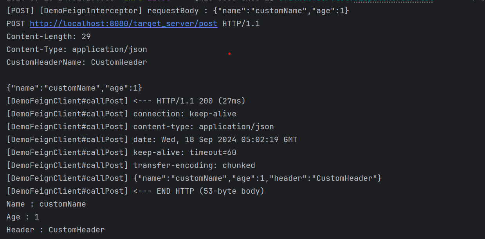

---

#### 에러 디코더 설정

**Controller 추가**

```java
@RestController
@RequiredArgsConstructor
public class DemoController {
    ...

    @GetMapping("/errorDecoder")
    public String errorDecoderController() {
        return demoService.errorDecoder();
    }


}
```

**Error Decorder 추가**

```java
public final class DemoFeignErrorDecoder implements ErrorDecoder {
    private final ErrorDecoder errorDecoder = new Default();

    @Override
    public Exception decode(String methodKey, Response response) {
        final HttpStatus httpStatus = HttpStatus.resolve(response.status());

        /**
         * [참고]
         * 외부 컴포넌트와 통신 시
         * 정의해놓은 예외 코드 일 경우엔 적절하게 핸들링하여 처리한다.
         */
        if (httpStatus == HttpStatus.NOT_FOUND) {
            System.out.println("[DemoFeignErrorDecoder] Http Status = " + httpStatus);
            throw new RuntimeException(String.format("[RuntimeException] Http Status is %s", httpStatus));
        }

        return errorDecoder.decode(methodKey, response);
    }

}
```

**빈 등록**

```java
@Configuration
public class DemoFeignConfig {

    @Bean
    public DemoFeignErrorDecoder DemoErrorDecoder() {
        return new DemoFeignErrorDecoder();
    }
}
```

아래와 같이 Custom하게 Error를 처리할 수 있다.

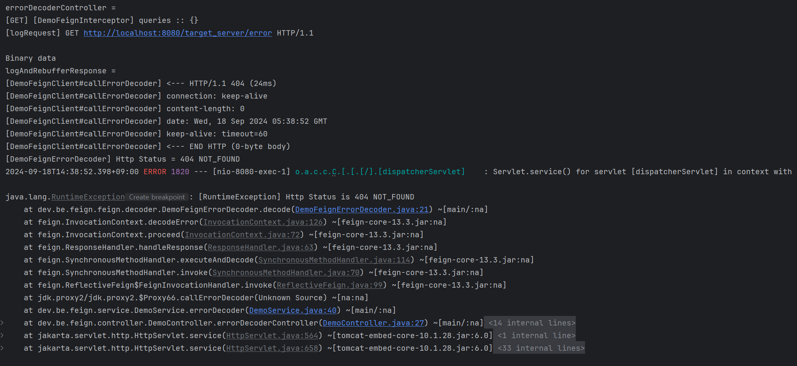
