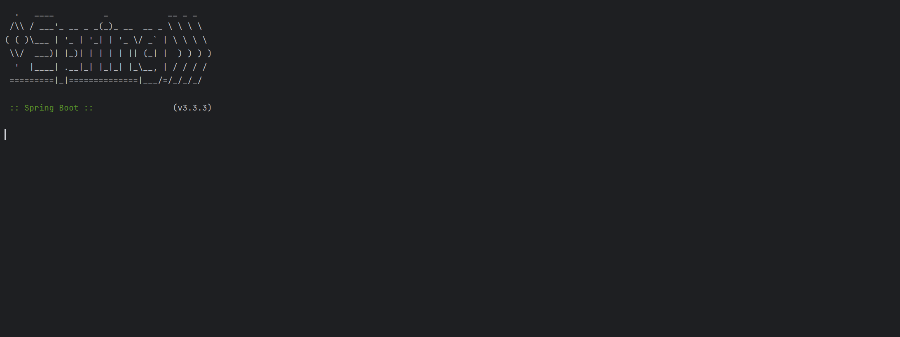
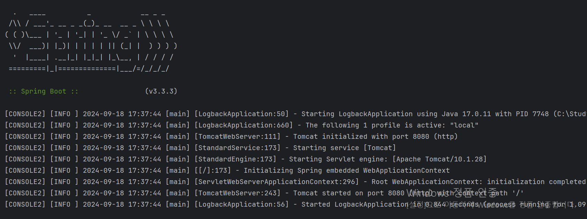
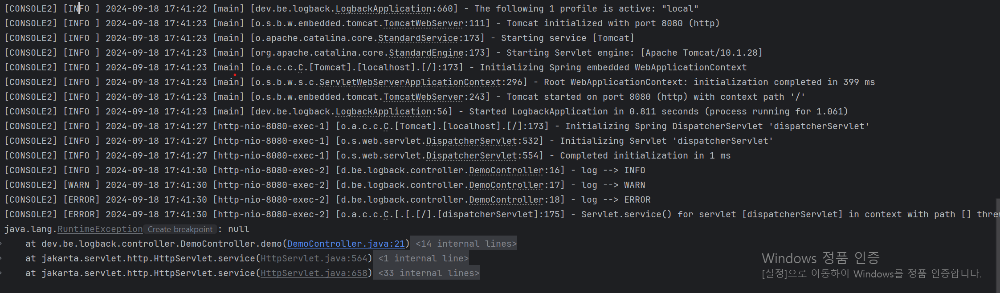
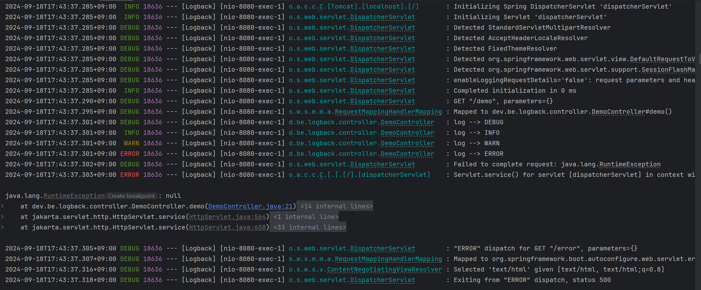
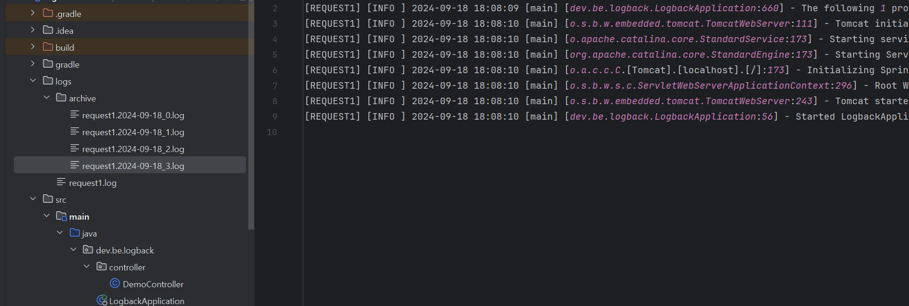

## Logback

---

### Logback이란?

**Logback**은 Spring Boot에서 기본적으로 사용하는 로깅 프레임워크입니다. 로깅은 애플리케이션 개발 및 운영 시 중요한 요소이며, 로그를 통해 애플리케이션의 동작 상태를 모니터링하거나 디버깅할 수 있습니다. Logback은 SLF4J(Simple Logging Facade for Java)와 잘 통합되어 있으며, 유연하고 성능이 뛰어난 로깅 솔루션으로 널리 사용됩니다.

**간단하게 설명하면, SLF4J라는 인터페이스를 구현하는 구현체인 로깅 프레임워크입니다.**

더보기

**Logback이란 무엇인가?**

Logback은 성능, 유연성, 구성 편리성을 고려해 설계된 고성능 로깅 프레임워크입니다. Logback은 SLF4J와 통합되어 있으며, 주로 다음과 같은 특징을 가지고 있습니다:

* **Logback Core**: 기본 로깅 시스템.
* **Logback Classic**: SLF4J와 연결되어 있는 모듈로, 주로 많이 사용됩니다.
* **Logback Access**: 웹 애플리케이션을 위한 HTTP 액세스 로그를 지원합니다.

Spring Boot에서는 기본적으로 Logback Classic을 사용하여 애플리케이션 로깅을 처리합니다.

**Logback과 비슷한 로깅 프레임워크**

* **Log4j2**: Apache에서 제공하는 로깅 프레임워크로, Logback과 유사한 기능을 제공합니다. 성능 향상과 다양한 기능 추가로 Log4j의 후속 버전입니다.
* **java.util.logging (JUL)**: JDK에 내장된 기본 로깅 API입니다. 비교적 간단하지만, 기능 면에서는 제한적입니다.
* **SLF4J**: 직접적인 로깅 프레임워크는 아니며, 다양한 로깅 프레임워크(Logback, Log4j2 등)와 연결되는 인터페이스 역할을 합니다.

**Logback의 장단점**

**장점**

1. **성능**: Logback은 성능 면에서 뛰어나며, 특히 대량의 로그를 처리할 때 적은 리소스를 사용합니다.
2. **SLF4J 통합**: SLF4J와의 통합 덕분에 다양한 로깅 프레임워크와 쉽게 교체할 수 있습니다. 개발자는 SLF4J API를 사용하고, 실제 로깅 백엔드(Logback, Log4j2 등)를 변경하기만 하면 됩니다.
3. **구성의 유연성**: XML 및 Groovy로 구성 파일을 작성할 수 있어 설정이 매우 유연하고, 조건에 따라 다른 로깅 레벨을 설정하는 등 다양한 기능을 지원합니다.
4. **다양한 출력 포맷 지원**: 로그를 콘솔, 파일, 데이터베이스, 원격 서버 등에 출력할 수 있습니다. 여러 가지 Appender를 지원합니다.
5. **이벤트 기반 필터링**: 특정 조건에 따라 로그 메시지를 필터링하거나 처리하는 기능을 제공합니다.
6. **자동 롤링 및 백업**: 로그 파일 크기나 시간에 따른 자동 롤링 및 백업 기능을 지원합니다.

**단점:**

1. **복잡성**: Logback은 강력한 기능을 제공하는 만큼, 복잡한 설정이 필요한 경우가 많아 초보자에게는 다소 어렵게 느껴질 수 있습니다.
2. **무거운 의존성**: Logback은 기능이 풍부한 만큼, 경량화된 애플리케이션에는 다소 무거울 수 있습니다. 간단한 애플리케이션에는 오버헤드가 될 수 있습니다.

**Logback과 다른 로깅 프레임워크 비교**

**Logback vs. Log4j2**

* **성능**: 두 프레임워크 모두 고성능을 자랑하지만, Log4j2는 비동기 로깅을 기본으로 제공하여 대규모 애플리케이션에서 조금 더 나은 성능을 보일 수 있습니다.
* **구성 유연성**: Logback은 Groovy를 이용한 유연한 설정 파일 구성이 가능하고, Log4j2는 JSON, YAML, XML 등 다양한 구성 방식을 제공합니다.
* **커뮤니티 및 업데이트**: Logback은 Log4j2에 비해 업데이트 빈도가 조금 적습니다. Log4j2는 활발하게 업데이트되고 있으며 새로운 기능이 자주 추가됩니다.

**Logback vs. JUL (java.util.logging)**

* **성능**: Logback이 JUL에 비해 훨씬 더 성능이 좋습니다.
* **유연성**: Logback은 다양한 로그 포맷과 출력 방식, 설정 파일을 지원하는 반면, JUL은 매우 제한적입니다.
* **기능**: Logback은 롤링, 필터링, 여러 Appender 등을 제공하지만 JUL은 상대적으로 간단한 기능만 지원합니다.

### Appender

Logback을 구현하기 위해서는 Appender라는 개념과 종류에 대해서 알 필요가 있다.

#### **Appender란?**

Appender는 로그 이벤트를 처리하는 최종 단계로, 로그 메시지를 기록할 위치(콘솔, 파일, 원격 서버 등)를 결정하는 역할을 합니다. Appender는 로그 출력 대상에 맞춰 다양한 설정을 할 수 있으며, Logback은 기본적으로 여러 종류의 Appender를 제공합니다.

#### **Appender의 종류**

**ConsoleAppender**

* 로그를 콘솔(표준 출력)에 출력하는 Appender입니다.
* 예시 : 애플리케이션이 실행되는 동안 개발 환경에서 로그를 즉시 확인할 때 사용

**FileAppender**

* 로그를 파일에 기록하는 Appender입니다.
* **예시**: 서버 로그, 애플리케이션 로그를 파일에 저장해 지속적으로 확인 및 분석할 때 사용합니다.

**RollingFileAppender**

* **설명**: 파일에 로그를 기록하지만, 일정 크기나 시간에 따라 로그 파일을 롤링(새로운 파일로 교체)하는 기능을 제공합니다.
* **사용 예시**: 로그 파일이 너무 커지지 않도록 주기적으로 새 파일로 교체하면서 로그를 유지 관리할 때 유용합니다.

**SMTPAppender**

* **설명**: 로그 메시지를 이메일로 전송하는 Appender입니다. 특정 조건에서 발생한 에러 로그 등을 이메일로 즉시 알릴 때 유용합니다.
* **사용 예시**: 중대한 예외나 오류가 발생할 때 개발자나 운영자에게 이메일 알림을 보낼 때 사용합니다.

**DBAppender**

* **설명**: 로그 메시지를 데이터베이스에 저장하는 Appender입니다. 로그를 중앙화된 데이터베이스에 저장함으로써, 나중에 로그 데이터를 검색하고 분석할 수 있습니다.
* **사용 예시**: 대규모 시스템에서 로그를 쌓아 중앙 로그 관리 시스템에서 검색하거나 분석할 때 유용합니다.

**AsyncAppender**

* **설명**: 비동기적으로 로그를 처리하는 Appender로, 성능을 높이기 위해 로그 이벤트를 별도의 스레드에서 처리합니다.
* **사용 예시**: 고성능 시스템에서 로그 기록에 따른 성능 저하를 줄이기 위해 비동기 로그 기록이 필요할 때 사용합니다.

**SocketAppender**

* **설명**: 로그를 TCP 소켓을 통해 원격 서버로 전송하는 Appender입니다.
* **사용 예시**: 로그 데이터를 중앙화된 로깅 서버에 실시간으로 전송하여 분석하거나 모니터링할 때 사용합니다.

**JMSAppender**

* **설명**: JMS(Java Message Service)를 사용하여 로그를 메시지 큐에 전송하는 Appender입니다.
* **사용 예시**: 로그 메시지를 메시지 큐로 전송하여 비동기적으로 처리하거나, 로그 데이터를 중앙화된 메시지 큐에 저장할 때 유용합니다.

이외에도 다양한 Appender가 존재하고, 많이 사용되는 것은 Console, File, RollingFile로 꼽을 수 있습니다.

---

#### Log가 필요한 이유

**1. 문제 진단 및 디버깅**

* **문제 발생 시 원인 분석**: 애플리케이션에서 오류가 발생하거나 비정상적인 동작이 있을 때, 로그를 통해 문제의 원인을 분석하고 디버깅할 수 있습니다. 로그는 오류 메시지, 스택 트레이스, 상태 정보를 포함하므로 문제 해결에 필수적입니다.

2. **시스템 모니터링**

* **실시간 모니터링**: 로그를 통해 시스템의 상태와 성능을 실시간으로 모니터링할 수 있습니다. CPU 사용률, 메모리 사용량, 응답 시간 등의 성능 지표를 확인하고, 이상 징후를 조기에 감지할 수 있습니다.

3. **보안 및 감사**

* **보안 이벤트 기록**: 사용자 로그인 시도, 권한 변경, 데이터 접근 등 보안 관련 이벤트를 기록하여 잠재적인 보안 위협을 감지하고 대응할 수 있습니다. 로그는 보안 감사 및 컴플라이언스 요구 사항을 충족하는 데 도움이 됩니다.

4. **문서화 및 감사 추적**

* **변경 사항 기록**: 시스템에서 수행된 주요 작업이나 설정 변경 내역을 기록하여, 나중에 변경 사항을 추적하고 감사할 수 있습니다. 이는 시스템 관리와 유지보수에 유용합니다.

5. **성능 분석 및 최적화**

* **성능 분석**: 로그를 통해 애플리케이션의 성능을 분석하고, 느린 요청이나 병목 현상을 식별할 수 있습니다. 성능 문제를 해결하고 최적화하는 데 필요한 정보를 제공합니다.

6. **문제 재현**

* **문제 재현**: 문제가 발생한 시점의 로그를 분석하여 문제가 발생한 상황을 재현할 수 있습니다. 이는 문제를 해결하고 수정 사항을 테스트하는 데 유용합니다.

7. **사용자 행동 추적**

* **사용자 행동 분석**: 사용자 행동을 추적하여 사용 패턴을 분석하고, 사용자 경험을 개선하기 위한 인사이트를 얻을 수 있습니다. 로그는 어떤 기능이 자주 사용되는지, 사용자가 어떻게 상호작용하는지 등을 보여줍니다.

8. **비즈니스 인사이트**

* **비즈니스 데이터 기록**: 비즈니스 관련 데이터를 기록하여 비즈니스 인사이트를 얻고, 운영 전략을 개선하는 데 활용할 수 있습니다. 예를 들어, 구매 패턴, 트랜잭션 데이터 등을 기록하여 분석할 수 있습니다.

9. **경고 및 알림**

* **자동 경고**: 로그를 기반으로 경고 시스템을 설정하여 시스템에 이상이 발생했을 때 자동으로 알림을 받을 수 있습니다. 이를 통해 신속하게 대응할 수 있습니다.

### Logback 설정

---

#### **Loback 기본 설정**

**logback-spring.xml 파일 생성**

spring에서 사용한 로그 백을 관리하겠다라고 파일을 만들었기 때문에 기본적으로 내장되어 있던 로그 백 설정들이 다 무시가 됩니다. 

```java
<?xml version="1.0" encoding="UTF-8" ?>

<configuration>

</configuration>
```



**기본 설정과 프로파일별 분리**

```java
<configuration>

    <!-- Spring에서 제공해주는 기본 logback    -->
    <include resource="org/springframework/boot/logging/logback/defaults.xml" />
    <!-- profile별 logback 분리 -->
    <include resource="logback-spring-${spring.profiles.active}.xml" />

</configuration>
```

* **<include resource="org/springframework/boot/logging/logback/defaults.xml" />**  
  Spring Boot가 제공하는 기본 Logback 설정을 포함합니다. 이 설정 파일에는 기본적인 로깅 설정이 포함되어 있어, Spring Boot 애플리케이션에서 공통적으로 사용하는 기본 로그 설정을 적용합니다.
* **<include resource="logback-spring-${spring.profiles.active}.xml" />**   
   현재 활성화된 Spring 프로파일에 따라 별도의 Logback 설정 파일을 포함합니다. ${spring.profiles.active}는 Spring 애플리케이션의 현재 활성 프로파일을 참조합니다. 이 설정 파일을 통해 환경별로 다른 로그 구성을 적용할 수 있습니다.

```java
<included>
    <!-- ConsoleAppender   -->
    <include resource="org/springframework/boot/logging/logback/console-appender.xml"/>
    <!--  
    <included>
        <appender name="CONSOLE" class="ch.qos.logback.core.ConsoleAppender">
            <filter class="ch.qos.logback.classic.filter.ThresholdFilter">
                <level>${CONSOLE_LOG_THRESHOLD}</level>
            </filter>
            <encoder>
                <pattern>${CONSOLE_LOG_PATTERN}</pattern>
                <charset>${CONSOLE_LOG_CHARSET}</charset>
            </encoder>
        </appender>
    </included> 
    -->

    <root level="DEBUG">
        <appender-ref ref="CONSOLE"/>
    </root>
</included>
```

* **<include resource="org/springframework/boot/logging/logback/console-appender.xml"/>**  
  Spring Boot가 제공하는 콘솔에 로그를 출력하는 설정 파일을 포함합니다. 이 파일은 콘솔 출력을 위한 기본 설정을 포함하고 있습니다.
* **<root level="DEBUG">**
  + **DEBUG 레벨로 루트 로거를 설정합니다. 이는 모든 로그 메시지가 DEBUG 레벨 이상에서 기록되도록 설정합니다.**
  + **<appender-ref ref="CONSOLE" />: CONSOLE이라는 이름의 Appender를 참조하여, 콘솔에 로그를 출력합니다.**

**Custom Appender**

* Root Level은 DEBUG으로 설정하더라도 Appender마다 고유한 Level 설정을 해줄 수 있다.

```java
<included>
    <!-- ConsoleAppender   -->
    <include resource="org/springframework/boot/logging/logback/console-appender.xml"/>
    <!--
    <included>
        <appender name="CONSOLE" class="ch.qos.logback.core.ConsoleAppender">
            <filter class="ch.qos.logback.classic.filter.ThresholdFilter">
                <level>${CONSOLE_LOG_THRESHOLD}</level>
            </filter>
            <encoder>
                <pattern>${CONSOLE_LOG_PATTERN}</pattern>
                <charset>${CONSOLE_LOG_CHARSET}</charset>
            </encoder>
        </appender>
    </included>
    -->

    <appender name="CONSOLE2" class="ch.qos.logback.core.ConsoleAppender">
        <filter class="ch.qos.logback.classic.filter.ThresholdFilter">
            <level>INFO</level>
        </filter>
        <layout>
            <pattern>
                [CONSOLE2] [%-5level] %d{yyyy-MM-dd HH:mm:ss} [%thread] [%logger{0}:%line] - %msg%n
            </pattern>
        </layout>
    </appender>

    <!-- LEVEL : DEBUG < ... < INFO < WARN < ERROR -->
    <root level="DEBUG">
<!--        <appender-ref ref="CONSOLE"/>-->
        <appender-ref ref="CONSOLE2"/>
    </root>
</included>
```



테스트를 위해 컨트롤러를 생성하여 로그백이 어떻게 돌아가는지 확인해보겠습니다.

```java
@Slf4j
@RestController
public class DemoController {

    @GetMapping("/demo")
    public String demo() {

        log.trace("log --> TRACE");
        log.debug("log --> DEBUG");
        log.info("log --> INFO");
        log.warn("log --> WARN");
        log.error("log --> ERROR");

        if (true) {
            throw new RuntimeException();
        }

        return "Hello";
    }
}
```

현재 INFO 레벨로 설정했기 때문에, INFO, WARN, ERROR 레벨까지만 표시되는 것을 확인할 수 있습니다.



기본 ConsoleAppender로 실행시키게 되면 아래와 같이 DEBUG, INFO, WARN, ERROR가 표시되는 것을 확인할 수 있습니다.

[참고] TRACE는 DEBUG보다 한 단계 낮은 수준이므로 출력되지 않음.



---

#### 운영 환경 Loback 설정

운영 환경에서는 로컬 환경과 다르게 Console이 아닌 파일로 관리하여야 하기 때문에 RollingFileAppender를 사용하였고, 파일의 크기는 지속적으로 커지므로 파일 정책을 설정하였다.

```
<included>

    <appender name="REQUEST1" class="ch.qos.logback.core.rolling.RollingFileAppender">
        <!-- 파일명 지정 -->
        <file>logs/request1.log</file>
        <!-- 파일 정책 -->
        <rollingPolicy class="ch.qos.logback.core.rolling.SizeAndTimeBasedRollingPolicy">
            <fileNamePattern>logs/archive/request1.%d{yyyy-MM-dd}_%i.log</fileNamePattern>
            <!--      <maxFileSize>10MB</maxFileSize>-->
            <maxFileSize>1KB</maxFileSize> <!-- 로그파일의 최대 크기 -->
            <maxHistory>30</maxHistory> <!-- 로그파일 최대 보관주기(단위 : 일) / 보관주기가 넘어가면 파일은 자동으로 삭제 -->
        </rollingPolicy>

        <!-- 인코딩 설정 -->
        <encoder class="ch.qos.logback.classic.encoder.PatternLayoutEncoder">
            <pattern>[REQUEST1] [%-5level] %d{yyyy-MM-dd HH:mm:ss} [%thread] [%logger{40}:%line] - %msg%n</pattern>
        </encoder>
    </appender>

    <!-- LEVEL : DEBUG < ... < INFO < WARN < ERROR -->
    <root level="INFO">
        <appender-ref ref="REQUEST1"/>
    </root>
</included>
```

컨트롤러를 통해 테스트하게 되면, 아래와 같이 콘솔에는 아무것도 뜨지 않고, 로그 파일이 생성된 것을 확인할 수 있다. 용량을 1KB로 설정하였기 때문에 요청을 반복해서 보내게 될 경우, 파일이 분리되어 저장되는 것을 확인할 수 있다.



**공통 코드 제거 방법**

logback-variables.properties라는 파일을 통해 공통된 값을 한 번에 관리할 수 있습니다.

```
LOG_DIR=logs
LOG_PATTERN=[%-5level] %d{yyyy-MM-dd HH:mm:ss} [%thread] [%logger{0}:%line] - %msg%n
```

해당 프로퍼티를 사용한다는 것을 명시해주어야 합니다.

```java
<included>

    <property resource="logback-variables.properties" />

    <appender name="REQUEST1" class="ch.qos.logback.core.rolling.RollingFileAppender">
        <!-- 파일명 지정 -->
        <file>${LOG_DIR}/request1.log</file>
        <!-- 파일 정책 -->
        <rollingPolicy class="ch.qos.logback.core.rolling.SizeAndTimeBasedRollingPolicy">
            <fileNamePattern>${LOG_DIR}/archive/request1.%d{yyyy-MM-dd}_%i.log</fileNamePattern>
            <!--      <maxFileSize>10MB</maxFileSize>-->
            <maxFileSize>1KB</maxFileSize> <!-- 로그파일의 최대 크기 -->
            <maxHistory>30</maxHistory> <!-- 로그파일 최대 보관주기(단위 : 일) / 보관주기가 넘어가면 파일은 자동으로 삭제 -->
        </rollingPolicy>

        <!-- 인코딩 설정 -->
        <encoder class="ch.qos.logback.classic.encoder.PatternLayoutEncoder">
            <pattern>[REQUEST1] ${LOG_PATTERN}</pattern>
        </encoder>
        <outputPatternAsHeader>true</outputPatternAsHeader>
    </appender>

    <!-- LEVEL : DEBUG < ... < INFO < WARN < ERROR -->
    <root level="INFO">
        <appender-ref ref="REQUEST1"/>
    </root>
</included>
```

#### **MDC**

MDC(Mapped Diagnostic Context)는 **멀티 스레드 환경에서 로그 메시지에 추가적인 컨텍스트 정보를 제공**하는 기능입니다. 주로 **동시성 처리**가 있는 애플리케이션에서, 각 스레드의 특정한 컨텍스트 정보를 로깅에 포함시키는 데 사용됩니다.

MDC의 주요 특징

1. **스레드-로컬(Thread-local) 저장**: MDC는 **ThreadLocal**을 이용하여 스레드별로 독립적인 컨텍스트를 관리합니다. 이 말은, 하나의 스레드에서 설정한 MDC 값이 **다른 스레드에 영향을 주지 않는다는 것**입니다. 즉, 각 스레드는 자신만의 MDC 값을 유지하고 로그를 남길 때 이를 사용합니다.
2. **로그에 추가적인 컨텍스트 정보 제공**: MDC는 로그에 추가적인 컨텍스트 정보를 첨부할 수 있는 기능을 제공합니다. 예를 들어, 사용자 ID, 세션 ID, 트랜잭션 ID 등을 로그 메시지에 포함시켜 로그를 더 구체적이고 분석하기 쉽게 만들어 줍니다.
3. **멀티 스레드 환경에서 유용**: 멀티 스레드 환경에서는 각 스레드가 독립적으로 작동하기 때문에, 스레드별로 로깅에 포함될 정보를 구분할 필요가 있습니다. 이때 MDC는 특정 스레드의 작업 맥락을 로그에 자동으로 추가할 수 있게 도와줍니다.

기본 사용 방법

* **MDC 값 설정**: MDC.put(String key, String value) 메소드를 사용하여 특정 스레드에 대해 MDC 값을 설정합니다.
* **로그 패턴 설정**: logback.xml과 같은 설정 파일에서 MDC 값을 로그 출력 패턴에 포함시킬 수 있습니다.
* **MDC 값 제거**: MDC.remove(String key) 또는 MDC.clear()로 MDC 값을 삭제하여 메모리 누수를 방지할 수 있습니다.

```java
public class MDCExample {
    private static final Logger logger = LoggerFactory.getLogger(MDCExample.class);

    public static void main(String[] args) {
        // 첫 번째 스레드
        new Thread(() -> {
            MDC.put("userId", "user1");
            MDC.put("transactionId", "txn123");
            logger.info("Processing request in Thread 1");
            MDC.clear(); // 값 제거
        }).start();

        // 두 번째 스레드
        new Thread(() -> {
            MDC.put("userId", "user2");
            MDC.put("transactionId", "txn456");
            logger.info("Processing request in Thread 2");
            MDC.clear(); // 값 제거
        }).start();
    }
}
```

사용 시 주의점

* **메모리 누수**: MDC는 스레드-로컬 변수를 사용하므로, 스레드가 종료되거나 작업이 끝난 후에 MDC 값을 명시적으로 제거(MDC.clear() 또는 MDC.remove(key))해야 합니다.
* **비동기 환경**: 비동기 로깅이나 스레드 풀을 사용하는 경우 MDC 값이 다음 스레드에 제대로 전달되지 않을 수 있습니다. 이럴 때는 MDC 컨텍스트를 유지하도록 추가 설정이나 코드를 작성해야 합니다

---

#### **에러 로그 필터**

에러 로그는 필터를 통해 수집 레벨을 설정하고 에러 레벨만을 가져오도록 설정하면 된다.

```java
<included>

    <property resource="logback-variables.properties" />

    <appender name="REQUEST1" class="ch.qos.logback.core.rolling.RollingFileAppender">
        <!-- 파일명 지정 -->
        <file>${LOG_DIR}/request1.log</file>
        <!-- 파일 정책 -->
        <rollingPolicy class="ch.qos.logback.core.rolling.SizeAndTimeBasedRollingPolicy">
            <fileNamePattern>${LOG_DIR}/archive/request1.%d{yyyy-MM-dd}_%i.log</fileNamePattern>
            <!--      <maxFileSize>10MB</maxFileSize>-->
            <maxFileSize>1KB</maxFileSize> <!-- 로그파일의 최대 크기 -->
            <maxHistory>30</maxHistory> <!-- 로그파일 최대 보관주기(단위 : 일) / 보관주기가 넘어가면 파일은 자동으로 삭제 -->
        </rollingPolicy>

        <!-- 인코딩 설정 -->
        <encoder class="ch.qos.logback.classic.encoder.PatternLayoutEncoder">
            <pattern>[REQUEST1] ${LOG_PATTERN}</pattern>
        </encoder>
        <outputPatternAsHeader>true</outputPatternAsHeader>
    </appender>

    <appender name="MDC" class="ch.qos.logback.core.rolling.RollingFileAppender">
        <!-- 파일명 지정 -->
        <file>${LOG_DIR}/mdc.log</file>
        <!-- 파일 정책 -->
        <rollingPolicy class="ch.qos.logback.core.rolling.SizeAndTimeBasedRollingPolicy">
            <fileNamePattern>${LOG_DIR}/archive/mdc.%d{yyyy-MM-dd}_%i.log</fileNamePattern>
            <!--      <maxFileSize>10MB</maxFileSize>-->
            <maxFileSize>10KB</maxFileSize> <!-- 로그파일의 최대 크기 -->
            <maxHistory>30</maxHistory> <!-- 로그파일 최대 보관주기(단위 : 일) / 보관주기가 넘어가면 파일은 자동으로 삭제 -->
        </rollingPolicy>

        <!-- 인코딩 설정 -->
        <encoder class="ch.qos.logback.classic.encoder.PatternLayoutEncoder">
            <!-- %X를 통해 MDC 안에 Key 조회 가능 -->
            <pattern>[MDC] %X{job}%n</pattern>
        </encoder>
        <outputPatternAsHeader>true</outputPatternAsHeader>
    </appender>

    <appender name="ERROR" class="ch.qos.logback.core.rolling.RollingFileAppender">
        <!-- 파일명 지정 -->
        <file>${LOG_DIR}/error.log</file>
        <filter class="ch.qos.logback.classic.filter.LevelFilter">
            <level>ERROR</level>
            <onMatch>ACCEPT</onMatch>
            <onMismatch>DENY</onMismatch>
        </filter>
        <!-- 파일 정책 -->
        <rollingPolicy class="ch.qos.logback.core.rolling.SizeAndTimeBasedRollingPolicy">
            <fileNamePattern>${LOG_DIR}/archive/error.%d{yyyy-MM-dd}_%i.log</fileNamePattern>
            <!--      <maxFileSize>10MB</maxFileSize>-->
            <maxFileSize>10KB</maxFileSize> <!-- 로그파일의 최대 크기 -->
            <maxHistory>30</maxHistory> <!-- 로그파일 최대 보관주기(단위 : 일) / 보관주기가 넘어가면 파일은 자동으로 삭제 -->
        </rollingPolicy>

        <!-- 인코딩 설정 -->
        <encoder class="ch.qos.logback.classic.encoder.PatternLayoutEncoder">
            <!-- %X를 통해 MDC 안에 Key 조회 가능 -->
            <pattern>[ERROR] ${LOG_PATTERN}</pattern>
        </encoder>
        <outputPatternAsHeader>true</outputPatternAsHeader>
    </appender>

    <appender name="WARN" class="ch.qos.logback.core.rolling.RollingFileAppender">
        <!-- 파일명 지정 -->
        <file>${LOG_DIR}/warn.log</file>
        <filter class="ch.qos.logback.classic.filter.LevelFilter">
            <level>WARN</level>
            <onMatch>ACCEPT</onMatch>
            <onMismatch>DENY</onMismatch>
        </filter>
        <!-- 파일 정책 -->
        <rollingPolicy class="ch.qos.logback.core.rolling.SizeAndTimeBasedRollingPolicy">
            <fileNamePattern>${LOG_DIR}/archive/warn.%d{yyyy-MM-dd}_%i.log</fileNamePattern>
            <!--      <maxFileSize>10MB</maxFileSize>-->
            <maxFileSize>10KB</maxFileSize> <!-- 로그파일의 최대 크기 -->
            <maxHistory>30</maxHistory> <!-- 로그파일 최대 보관주기(단위 : 일) / 보관주기가 넘어가면 파일은 자동으로 삭제 -->
        </rollingPolicy>

        <!-- 인코딩 설정 -->
        <encoder class="ch.qos.logback.classic.encoder.PatternLayoutEncoder">
            <!-- %X를 통해 MDC 안에 Key 조회 가능 -->
            <pattern>[WARN] ${LOG_PATTERN}</pattern>
        </encoder>
        <outputPatternAsHeader>true</outputPatternAsHeader>
    </appender>


    <!-- LEVEL : DEBUG < ... < INFO < WARN < ERROR -->
    <root level="INFO">
<!--        <appender-ref ref="REQUEST1"/>-->
<!--        <appender-ref ref="REQUEST2"/>-->
<!--        <appender-ref ref="MDC"/>-->
        <appender-ref ref="ERROR"/>
        <appender-ref ref="WARN"/>
    </root>
</included>
```

---

#### Custom Log 사용법

logger를 다음과 같이 생성할 수 있습니다.

```java
<included>

    <property resource="logback-variables.properties" />

    <appender name="QUERY" class="ch.qos.logback.core.rolling.RollingFileAppender">
        <!-- 파일명 지정 -->
        <file>${LOG_DIR}/query.log</file>
        <!-- 파일 정책 -->
        <rollingPolicy class="ch.qos.logback.core.rolling.SizeAndTimeBasedRollingPolicy">
            <fileNamePattern>${LOG_DIR}/archive/query.%d{yyyy-MM-dd}_%i.log</fileNamePattern>
            <!--      <maxFileSize>10MB</maxFileSize>-->
            <maxFileSize>10KB</maxFileSize> <!-- 로그파일의 최대 크기 -->
            <maxHistory>30</maxHistory> <!-- 로그파일 최대 보관주기(단위 : 일) / 보관주기가 넘어가면 파일은 자동으로 삭제 -->
        </rollingPolicy>

        <!-- 인코딩 설정 -->
        <encoder class="ch.qos.logback.classic.encoder.PatternLayoutEncoder">
            <pattern>[QUERY] ${LOG_PATTERN}</pattern>
        </encoder>
        <outputPatternAsHeader>true</outputPatternAsHeader>
    </appender>

    <!-- additivity: 상위 로그의 속성 상속여부  -->
    <logger name="SQL_LOG1" level="INFO" additivity="false">
        <appender-ref ref="QUERY"/>
    </logger>

    <logger name="SQL_LOG2" level="INFO" additivity="false">
        <appender-ref ref="QUERY"/>
    </logger>

</included>
```

생성한 logger는 다음과 같이 topic을 지정하는 방법과 LoggerFactory를 통해 직접 지정하는 방법이 있습니다.

```java
@Slf4j(topic = "SQL_LOG1")
@RestController
public class TestController1 {

    @GetMapping("/test1")
    public String test1() {
        log.trace("log --> TRACE");
        log.debug("log --> DEBUG");
        log.info("log --> INFO");
        log.warn("log --> WARN");
        log.error("log --> ERROR");
        return "test1";
    }

}

@RestController
public class TestController2 {

    public static final Logger log = LoggerFactory.getLogger("SQL_LOG2");

    @GetMapping("/test2")
    public String test2() {
        log.trace("log --> TRACE");
        log.debug("log --> DEBUG");
        log.info("log --> INFO");
        log.warn("log --> WARN");
        log.error("log --> ERROR");
        return "test2";
    }

}
```
