오늘은 드디어 나의 첫 항해 시작이다..

나는 D반 5조에 당첨!! 

새로운 분들과 만나게 되었다.

1주차는 주특기와 관계없이 랜덤으로 선택된 분들이다.

누군가에게 피해를 주지 않기 위해!

나의 미래를 위해!! 열심히 달리자 화이팅!!

오늘 9시간 21분 공부했지만 여기서 끝이 아니야!!

나의 열정은 계속 이어진다!

시작~!!!!!!!!!!

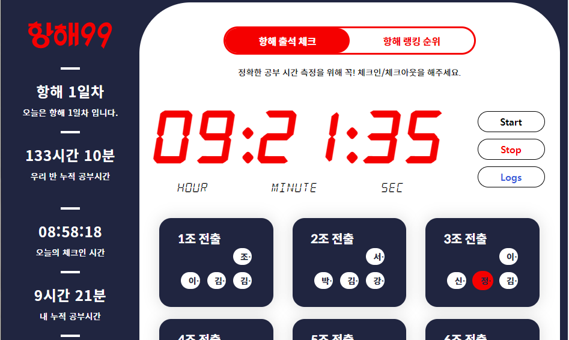

항해99 - 출석 타이머

---

#### **[ 웹개발 플러스 - 1주차 ]**

**[ 수업 목표 ]**

**1) 웹서비스 만들기 전 과정을 복습**

**2) 파일 올리기 기능을 구현**

**3) AWS에 배포 과정을 복습**

**[ 목차 ]**

**1. 복습**

**2. 나홀로 메모장**

**3. 나홀로 일기장**

**4. 정리**

---

**1. 복습**

1) 웹서비스의 동작 원리와 키워드

 → 클라이언트(브라우저 = 요청을 하는 쪽)

 → 서버(요청을 받는 쪽) → 서버는 특수한 컴퓨터다 ? NO!! 컴퓨터의 역할이다.

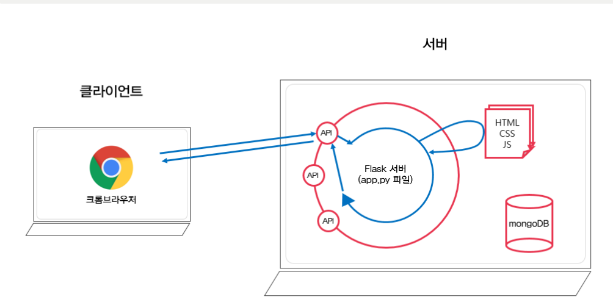

1-1. 웹서비스의 동작원리

(1) 서버는 요청을 받으면 HTML, CSS, Javascript 파일을 주기도 하고, JSON 형식으로 데이터를 주기도 한다

(2) API는 서버가 요청을 받기 위해 뚫어놓은 '창구'와 같다.

    요청에는 POST, GET, PUT, DELETE 등 여러가지 타입이 있다.

(3) HTML(뼈대), CSS(꾸미기), JavaScript(움직이게 하는것)

(4) JQuery는 Javascript의 라이브러리로, HTML 조작을 쉽게 할 수 있도록 도와주는 친구이다.

(5) AJax는 서버 통신을 위해 쓰이는 친구

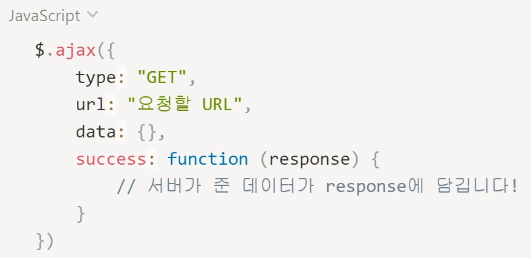

1-2. Ajax 기본 뼈대

(6) Flask는 파이썬으로 서버를 만드는데 도움을 주는 프레임워크

---

**2. 나홀로메모장 프로젝트**

**1) [나홀로 메모장(예시)](http://spartacodingclub.shop/)**

[스파르타코딩클럽 | 나홀로 메모장

spartacodingclub.shop](http://spartacodingclub.shop/)

**2) 기능 생각하기**

1. 포스팅 박스 열기를 누른다.
2. 원하는 아티클 URL과 간단한 코멘트를 작성한다.
3. 기사저장 버튼을 누르면 아래에 기사들이 순서대로 저장된다.

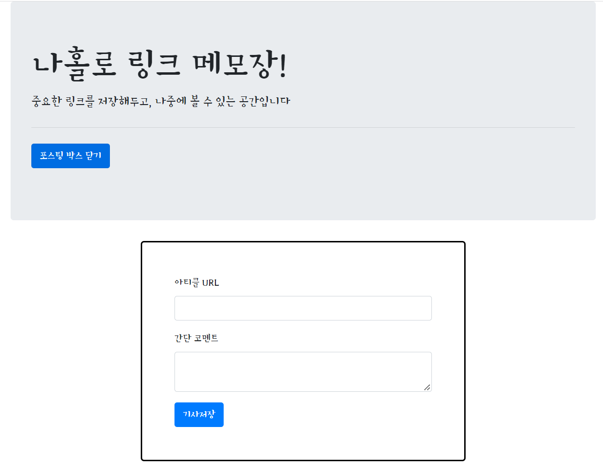

2-1. 나홀로 메모장 - 미리보기

**3) 폴더 구조화**

1. static - js, css 파일 등을 저장
2. templates - html 파일 저장
3. app.js - flask 실행 파일

**4) 파일 실행**

- 강의와 동일하게 테스트를 하였는데, 다음과 같은 에러가 발생했습니다.

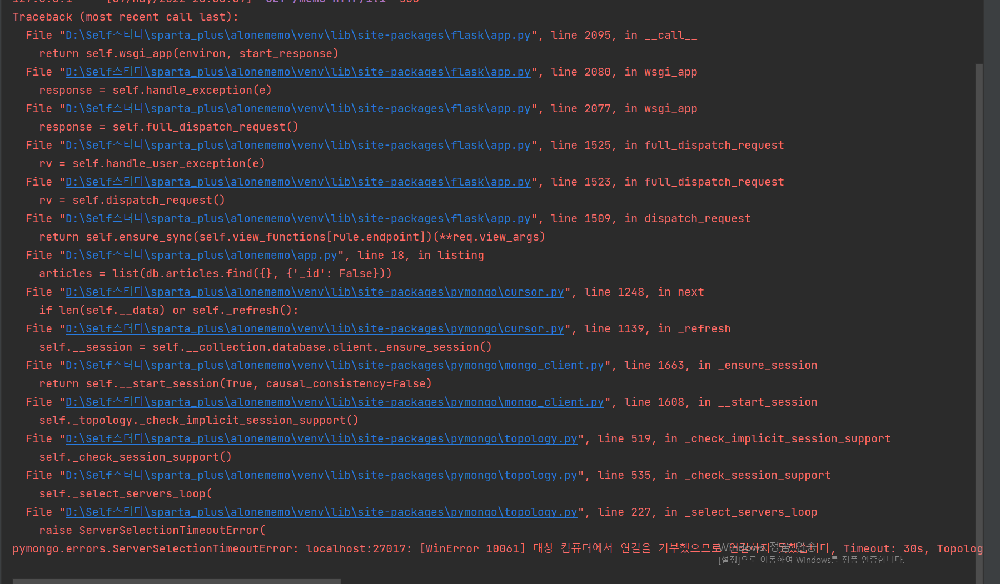

2-2. pymongo 에러

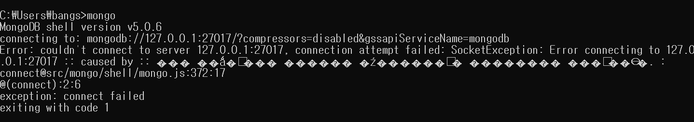

2-3. mongoDB 접속에러

> [해결책 1] MongoDB를 재설치하면 해결될 것이다.

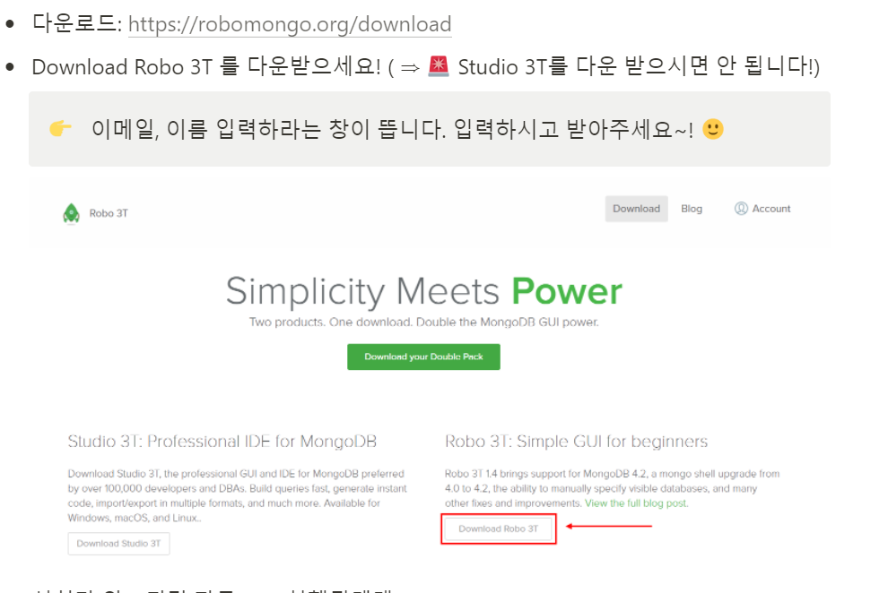

2-4. 강의 중 중단 사유

> [해결책] 찾는 중.. Studio 3T가 아닌 Robo3T를 설치해야하는데 존재하지 않는다..  
>            현재는 studio3T가 Robo3T를 대체한 것으로 보인다.. 강의에서는 Studio3T쓰지 말라고 했는데..

5) 이해 및 파악

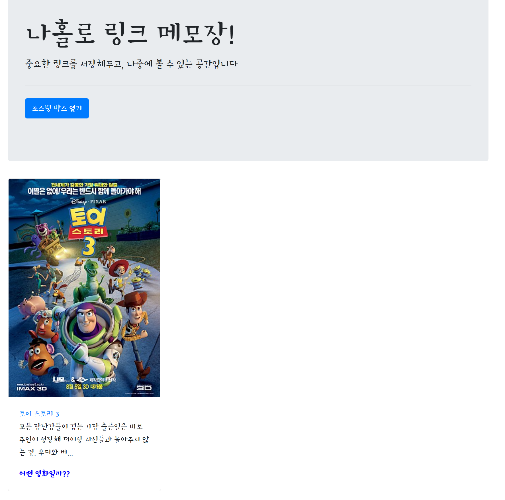

2-5. 나홀링 메모장

---

**3. 나홀로일기장**

**1) 설치 패키지****: flask, pymongo**

**2) 만들어갈 순서**

1. 생김새를 먼저 만들기 - HTML, CSS
2. 만들어야 할 기능 파악하기(포스팅 API, 리스팅 API 두개)
3. 서버-클라이언트 연결
4. 포스팅 API 만들기 (꿀팁! 보통저장하는 것을 먼저 만들때가 편함)
5. 리스팅 API 만들기

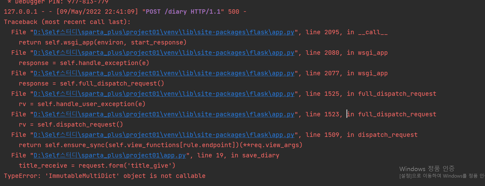

3-1. ImmutableMultiDict 에러 발생

> [해결책] request.form[''] 을 소괄호로 작성하였기 때문이다.

**3) 사진 업로드**

* 부트스트랩 라이브러리 코드

> 

* 부트스트랩 뼈대 코드

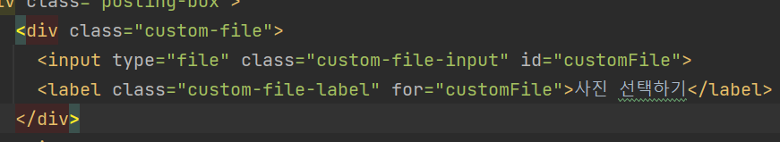

3-2. 사진 업로드를 위한 뼈대 코드

* 부트스트랩 사진 업로드를 위한 자바스크립트 코드

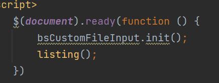

3-3. 사진 업로드를 위한 자바스크립트 코드

(Tip)

> 파이썬에서 문자열을 쉽게 조합해서 쓰기 위해서는 fString을 사용한다.

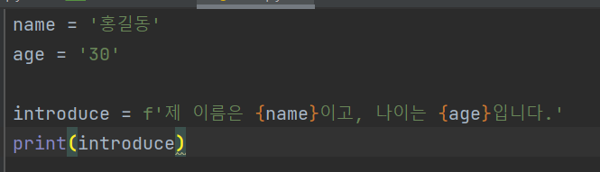

3-4. f-string 사용 예시

> 현재 시간을 출력하는 datetime 함수에 대해 알아보자

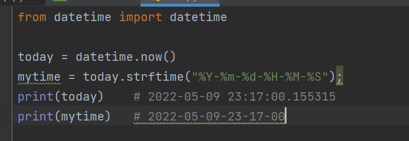

3-5. datetime 함수 사용 예시

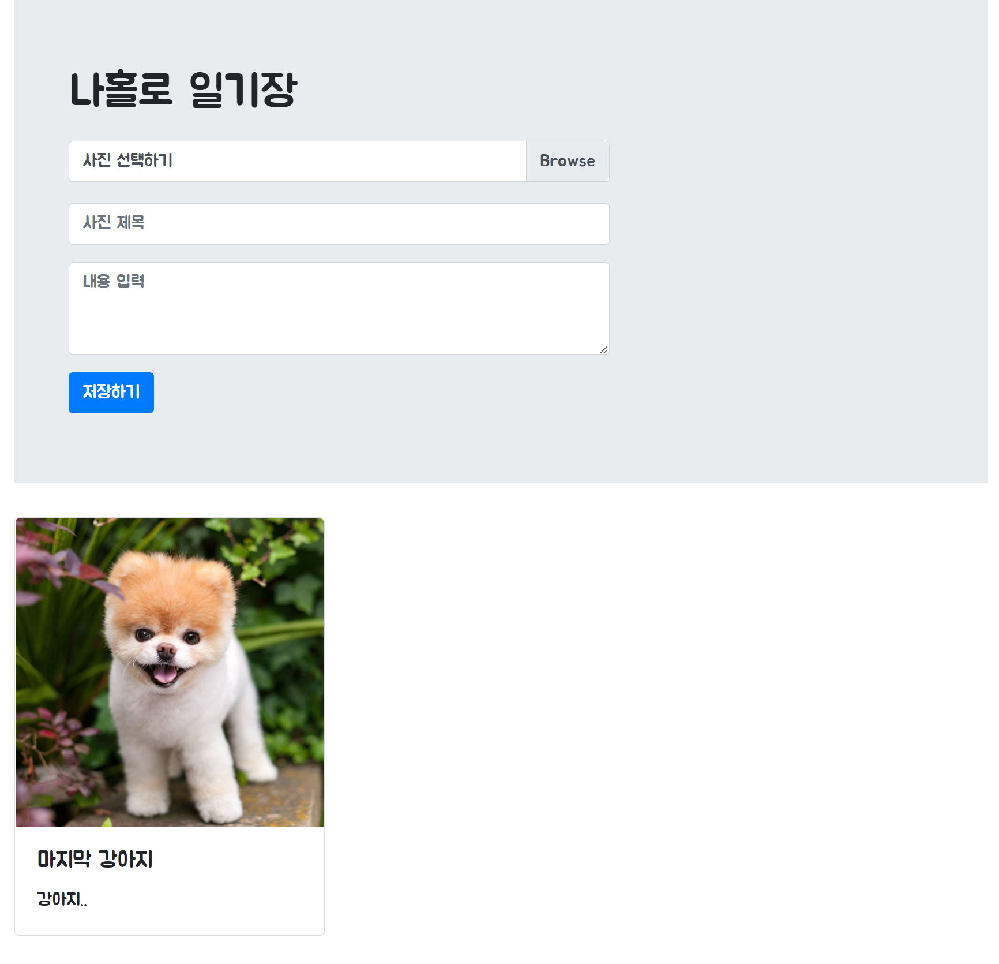

3-6. 강아지 사진 올리기.. (몇번을 작업한건지.. ㅠㅠ)

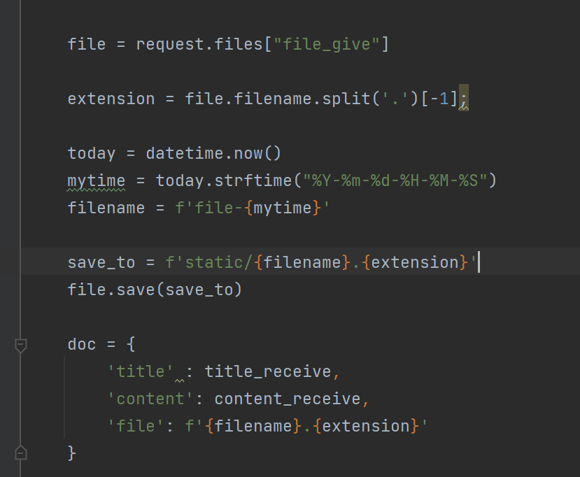

3-7. 서버 파일 올리기

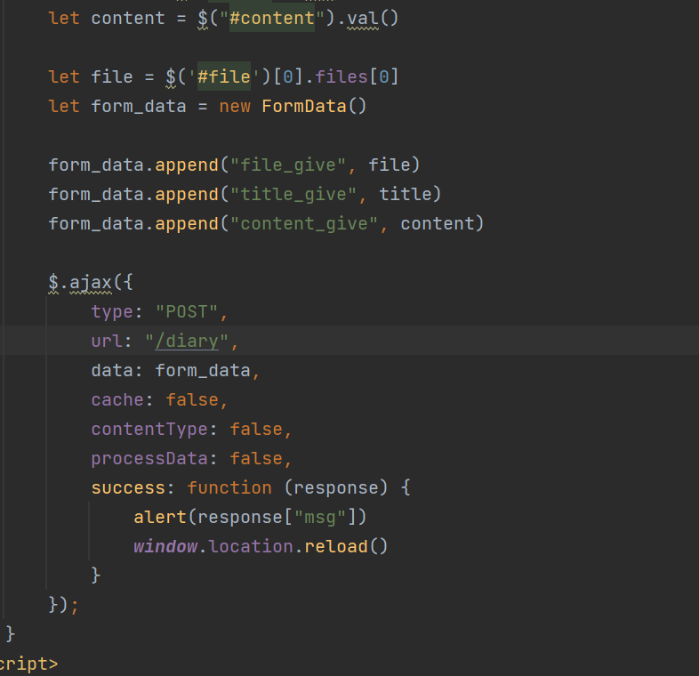

3-8. 클라이언트 파일 보내기

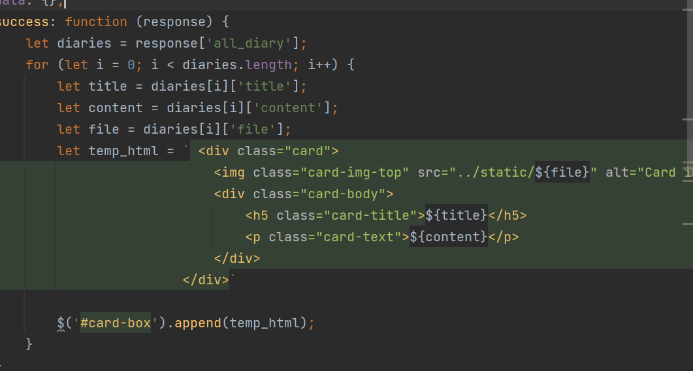

3-9. 클라이언트 파일 받기

---

#### 정리

오늘 나의 강의는 드디어 끝났다!!!!

근데.. 지금 시간은 12:03분... 할게 너무 많아 ㅠㅠㅠ

개인 프로젝트도 해야하는뎅 해야할것은 1억개인데

나는 왜 하나지?? 빨리 하러 가야하므로 여기서 이만... 굿바이!
