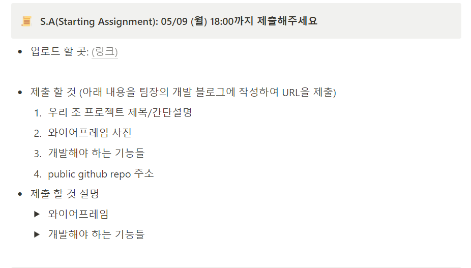
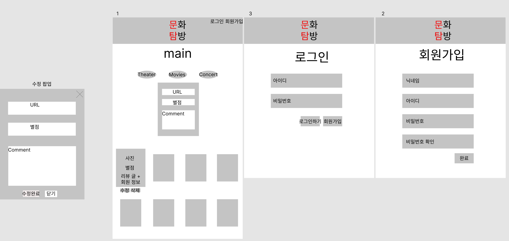
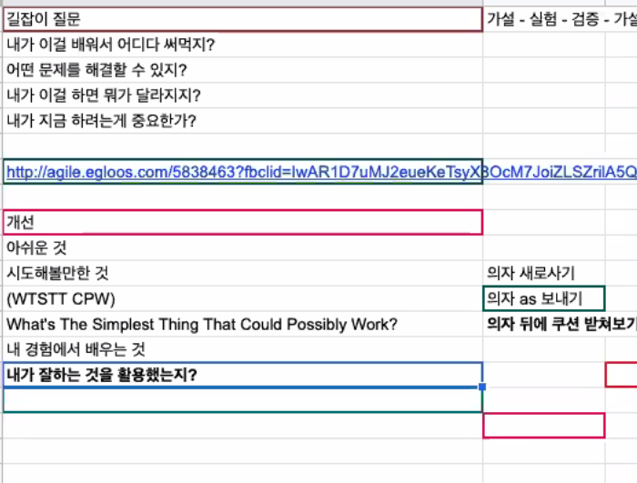

**오늘은 5월 9일 항해99 첫 항해일이다.**

**나는 D반 5조로 선발되었다.**

**새로운 분들과 함께 프로젝트를 하게 되었다.**

**첫 날부터 항해는 과제가 시작된다.**

1일차 과제

**우리 프로젝트 주제는 "문화탐방"로** **영화, 연극, 뮤지컬 등을 리뷰할 수 있는 서비스이다.**

**선정 이유 : 우리가 배운 것을 최대한 활용하여 최소 기능을 구현하고**

**달성 후 추가기능을 계속 추가하려고 한 목표이다.**

**와이어프레임은 Figma를 사용하여 만들었다.**

**이전에는 파워포인트를 많이 활용하였지만.. 처음으로 사용한 것 같다**

**일단 페이지는 로그인, 회원가입, 메인페이지, 팝업창으로 구성된다.**

와이어프레임

**개발 기능은 역할분담하였다.**

**1. 로그인(1명) - 로그인 성공/실패, 페이지 연결**

**2. 회원가입(1명) - 아이디 중복확인, 비밀번호 일치 확인**

**3. 메인페이지(2명) - 분류, 수정 및 삭제, 세션 확인**

**나는 메인페이지에 선택되었다(네이버 사다리가 결정해준건 비밀..)**

**나는 메인 페이지에서 수정 및 삭제 작업을 맡았다.**

**메인페이지 하단에 카드를 클릭하면 포커스되어**

**수정 및 삭제 버튼이 보이게 되고, 수정을 및 삭제를 할 수 있다.**

**기존의 수업 코드를 활용하려 했지만, 사용할 경우 문제가 발생한다.****수업에서는 현재 저장된 개수 + 1로 저장하였는데,****이렇게 할 경우 삭제하면 값이 변동되어 num 값이 중복되는 현상이 발생한다.**

**이를 위해 내가 선택한 방법은 카드가 0개 일경우는 위와 동일하고,****아닐 경우 리스트를 불러오고 마지막 카드의 num + 1을 하였다.**

**이를 통해 중복되는 문제를 해결 할 수 있게 되었다.****하지만 이 방법에도 삭제된 인덱스는 계속 비어있게 된다는 문제가 있다.**

**아직 통합하지 않았기 때문에 깃허브에는 제대로 된 코드가 아직 올라가지 않았다.****이유를 말하자면, 오늘 구현을 달성한 사람은 나 혼자였고****나머지 분들은 인강을 추가적으로 들어야하기 때문이다.**

[**팀장님 GitHub**](https://github.com/wea9677/Exploration-of-Culture-EC-)

---

**오늘 추가적으로 TIL에 대한 특가을 듣게 되었다.****특강을 통해 다양한 것을 배웠는데 이 것이 오늘의 TIL이다.**

특강 자료

---

**내일 할일**

**1. DB 설계도**

**2. **API 설계도****

****3. 알고리즘 학습 4문제****

**3. 웹개발 플러스 2주차, Git 1주차**

**4.개인프로젝트 이어서하기**

**오늘은 여기까지!**

