**오늘은 2일차**

**Git에 이어 웹개발 플러스 2일차까지 Let's go!!**

**나의 2일차는 단단하고 더 강해진다**

**나의 노력은 2배가 아닌 몇천배로 강해진다!**

---

#### **[웹개발 플러스 - 2주차]**

**1. 수업 목표**

1. **Flask의 더 많은 기능을 배운다.**
2. **API에 보안 키를 전달할 수 있다.**
3. **멀티페이지 사이트를 만들 수 있다.**

**2. 목차**

1. **멀티페이지 사이트 만들기**
2. **사전 API 사용**
3. **나만의 단어장**
4. **정리**

---

#### **S#.0 예고편**

1. 동적 웹페이지와 템플릿 언어

* 정적 웹페이지 vs 동적 웹페이지

   - 정적 웹페이지는 서버에 저장되어있는 HTML,CSS파일 그대로 보여주는 것

   - 동적 웹페이지는 상황에 따라 서베에 저장되어있는 HTML에 데이터 추가/가공을 해서 보여주는 방법

   - 정적 웹페이지는 추가적인 통신&계산이 필요 없기 때문에 속도가 빠르고 서버에 부담이 적은 반면, 추가/수정/삭제 등

     내용 변경이 필요할 때 HTML 자체를 수정해야 하기 때문에 번거롭다는 단점이 있습니다.

   - 동적 웹페이지는 한 페이지에서 상황/시간/사용자요청에 따라 다른 모습을 보여줄 수 있다는 장점이 있지만 상대적으로 보안에

     취약하고 모습이 계속 변하기 때문에 (많은 경우 주소도 같이 변하죠!) 검색 엔진 최적화(search engine optimazation)가 어렵습니다.

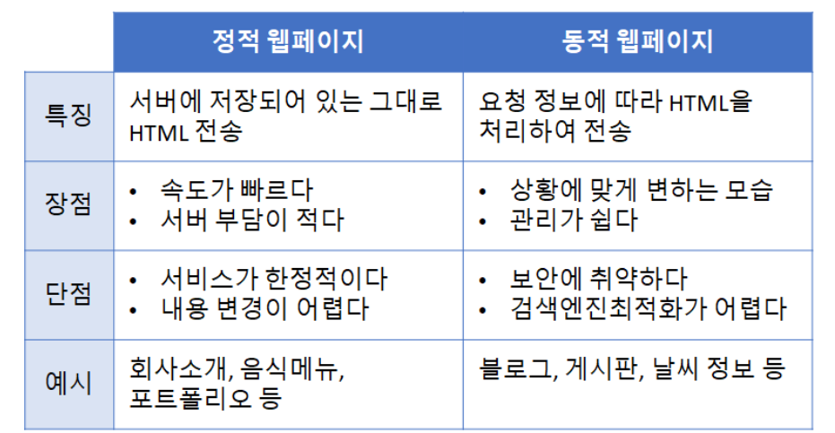

정적 웹페이지와 동적 웹페이지 비교

* 동적 웹페이지 종류

1. **Client-side rendering (CSR) - 자바스크립트에 데이터를 포함해서 보낸 후, 클라이언트 쪽에서 HTML을 완성하는 방법**
2. **Server-side rendering(SSR) - 서버 쪽에서 템플릿 HTML에 데이터를 끼워넣어 완성된 형태의 HTML을 보내주는 방법**
3. **복합적인 방법 - 클라이언트 쪽에서 Ajax 요청을 보내서 서버에서 데이터를 받아와 HTML을 완성하는 방법**

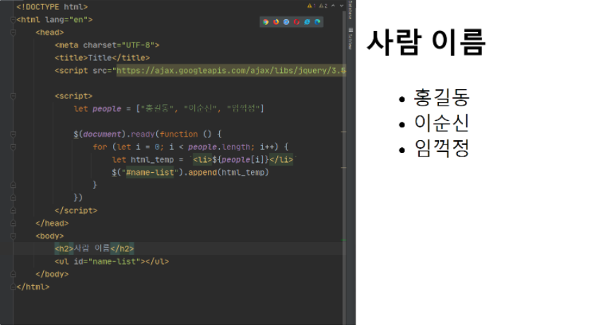

CSR 예시

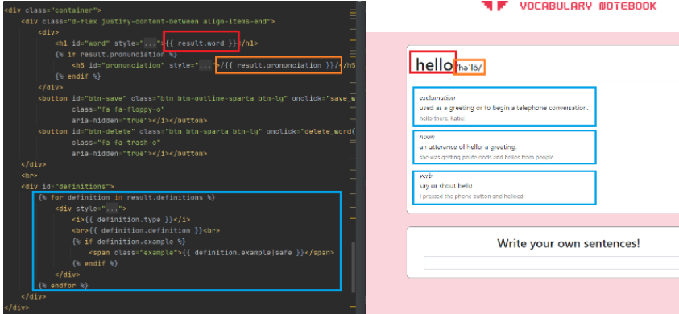

SSR 예시

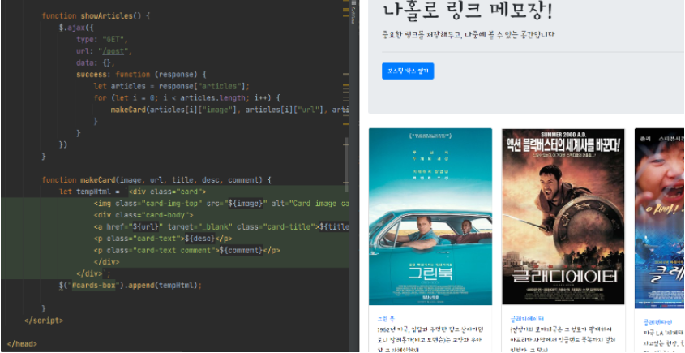

복합적인 방법 예시

* Jinja2 템플릿 언어

> Flask 프레임워크에서 사용하는 템플릿 언어 '템플릿'이 되는 HTML 문서에 데이터가 들어갈 곳을 표시해놓는 역할을 합니다.

2. API 키

* Open API라도 너무 많은 요청을 보내는 등의 악용을 방지하기 위해, API 키를 배부 받아 요청 시에 같이 보내줘야하는 경우가 있다.
* 이 API 키를 1) 플라스크 서버에서 API로 요청을 보낼 때, 2) 클라이언트에서 API로 요청을 보낼 때 어떻게 같이 보내줘야하는지에 알수 있게 될 것이다.

---

#### **S#. 1 멀티페이지 사이트 만들기**

1. 설치 패키지

**- flask, pymongo, requests**

2. Jinja2 예제

> 서버 - 서버에서 render\_template()에 첫번째 인자로 목적지(html)파일을, 두 번째 인자로 (key,value)로 값을 주게 되면 해당 html 페이지에서 해당 key값을 사용할 수 있다.

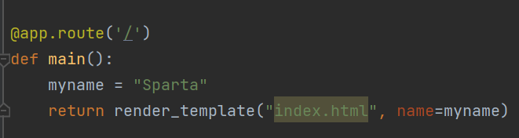

1-1. flask 서버 코드

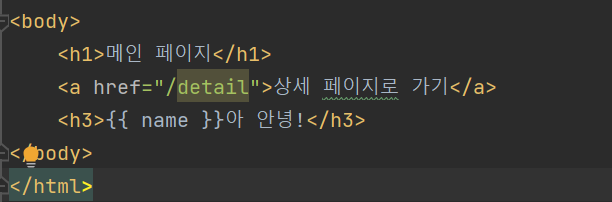

1-2. 클라이언트 코드

(1) 복합적 사용과 Jinja2 비교

- 복합적 사용 방법은 JSON 데이터를 받아 그대로 필터링하여 백틱 태그를 이용하여 출력한다.

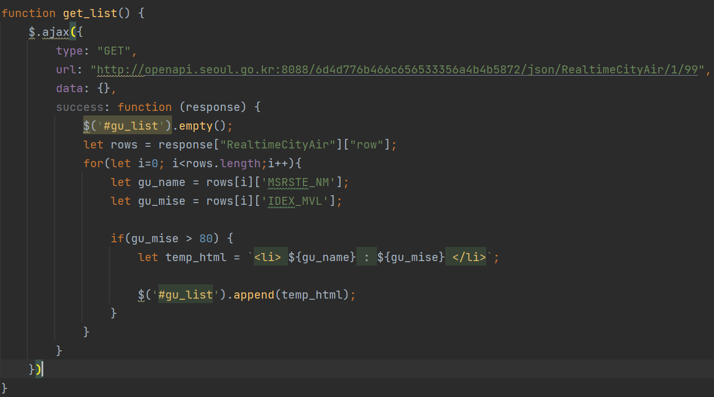

1-3. 복합적인 방법(기존 사용방법)

- 파이참에서는 Jinja2를 쉽게 이용할 수 있도록 도와준다.

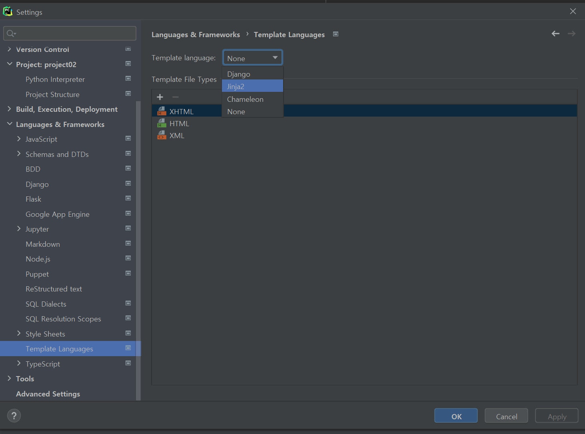

1-4. Pycharm에서 Jinja2 이용하는 방법

- Jinja는 다음과 같이 서버에서 데이터를 전달, 클라이언트에서 해당 키값으로 사용

> 변수 : 변수는 으로 설정  
> 조건문 : if문이 어디서 끝나는지 알 수 없으므로  사용해주어야 한다.  
> for문 : for문이 어디서 끝나는지 알 수 없으므로  사용해주어야 한다.  
>   
> 이외에도 title, script, 다른 html 문서를 만들어 끼어 넣는 것 등 다양한 방법으로 사용가능하다.

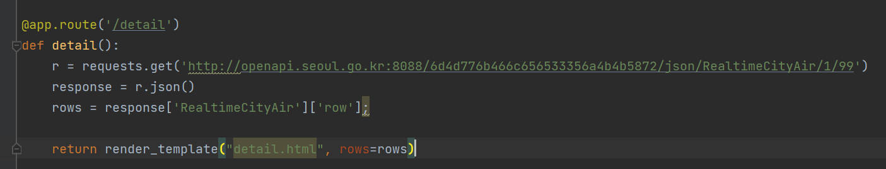

1-5. Flask 서버에서 요청하여 데이터 전달

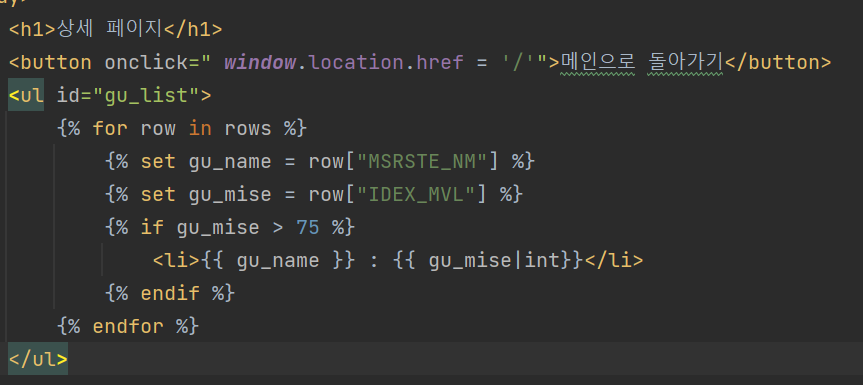

1-6. 클라이언트 Jinja2 코드

(2) URL로 데이터를 받아 Jinja2 사용하기

* URL GET 파라미터 사용하기(/detail?word\_give=test)

   - 다음과 같이 **request.args.get()**을 통해 ?뒤 키값을 접근할 수 있다.

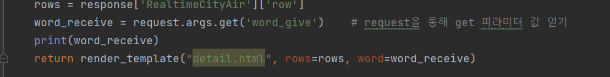

1-7. 파리미터 값 받기

* URL일부를 변수로 받기(/detail/<keyword>)

   - keyword라는 변수명으로 데이터를 받아 사용할 수 있다.

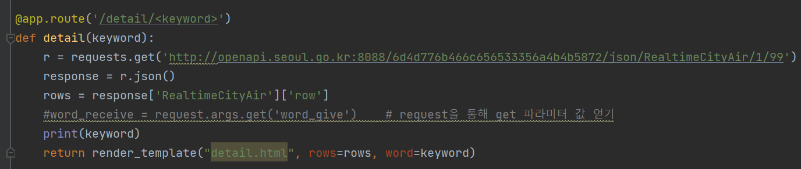

1-8. URL 일부를 변수로 만드는 방법

---

#### **S#. 2 사전 API 이용하기**

**1) Jinja2를 이용한 방법**

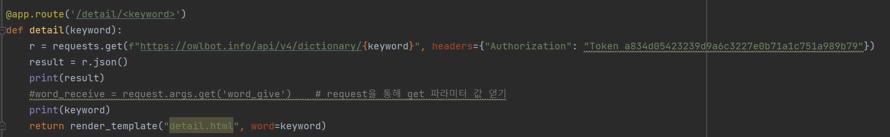

**2) 복합적 방법**

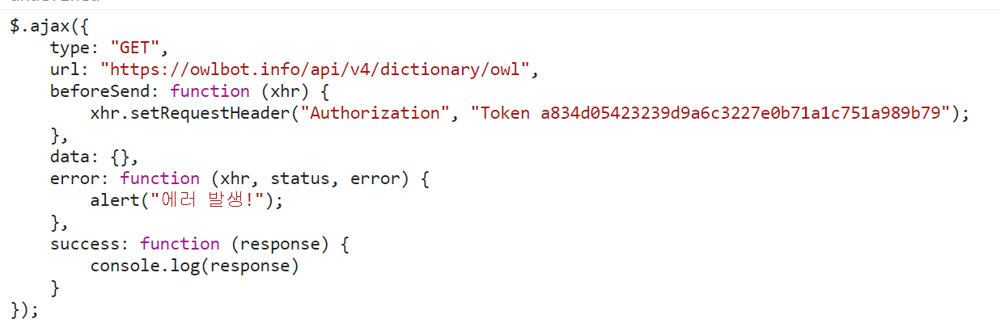

> 어떤 부분에서는 Jinja2가 간단해지는 것을 볼 수 있고, 다른 부분에서는 복합적 부분이 간단할 때가 있었다.  
> 두 가지를 제대로 사용한다면 코드를  효율적으로 작성할 수 있을 것 같다.

---

#### **S#. 3 나만의 단어장**

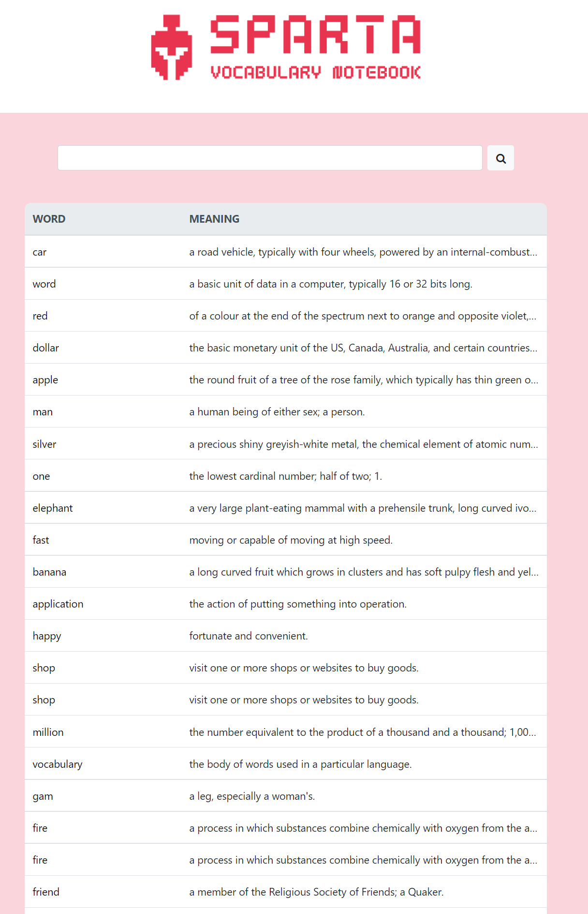

3-1. 미리보기

**1) 기능 파악하기**

1. 단어를 검색하면 해당 단어에 하이라이트되고, 스크롤이 이동된다.
2. 해당 단어를 클릭하면 상세한 뜻과 자신이 적은 예문을 적을 수 있다.
3. 해당 단어를 삭제할 수 있다. 삭제된 단어는 메인 페이지에서 사라진다.
4. 내 단어장에 없는 단어는 사전에서 찾아서 보여주고, 저장할 수 있고 예문을 적을 수 있다.
5. 알 수 없는 단어를 검색 할 경우, 메인페이지에 alert로 경고메시지가 나타난다.

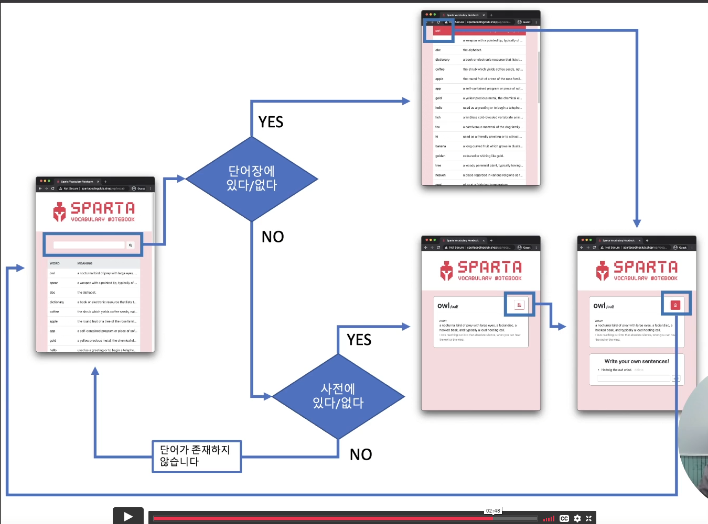

3-1. 나만의 단어장 Flow chart

**2) 상세 페이지 구현하기**

**(1) Ajax를 이용한 방법**

**- 생각보다 예외처리 해줄 것들이 많다.**

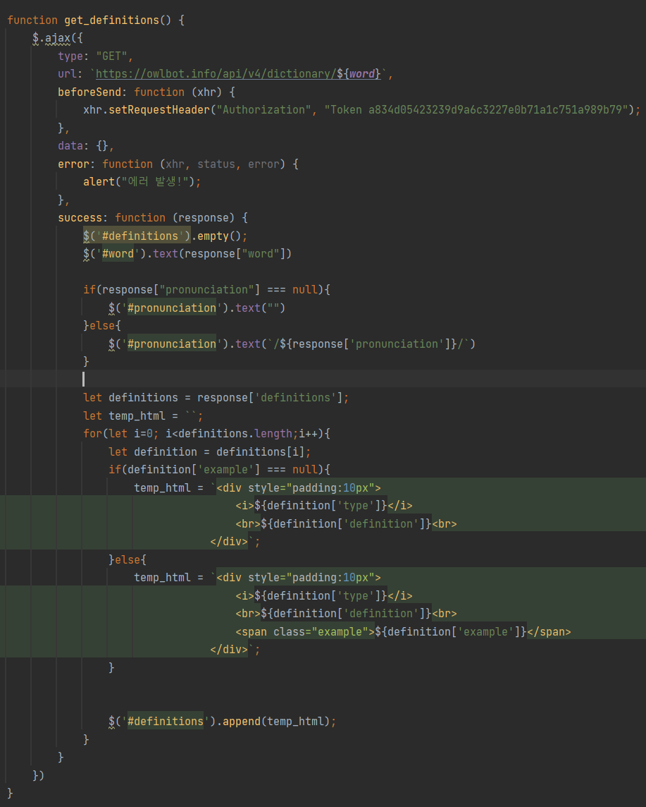

**(2) Jinja2 를 이용한 방법**

>  해당 페이지처럼 한번 띄어주고 바뀔일 없는 부분에서는 Jinja2와 같은 템플릿언어를 이용해서 html을 완성해서 보내주는 서버사이드 렌더링을 해주는 것이 훨씬 좋다.

문제 : 다음과 같이 Jinja2를 이용해서 데이터를 받으면 태그는 무시된다.

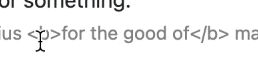

태그 무시된 경우

해결법 : 태그가 들어오면 우리가 태그 그대로 사용해달라고 명령을 따로 주어야한다.( |safe를 붙여주면 된다.)

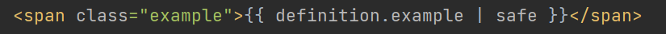

문제 : 다음과 같이 문자가 깨지는 경우가 발생한다.

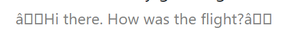

해결법 : 태그에 문자열을 아스키코드로 인코딩을 해주고, 바꿀수 없는애들은 무시하고 다시 그 애들을 utf-8타입에 문자열로 바꿔주면 된다.

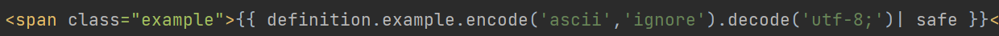

**3) 상세 페이지 - 새단어/기존 단어 구분**

- url?status\_give=new이면 새단어, old이면 기존 단어로 판단할 것이다.

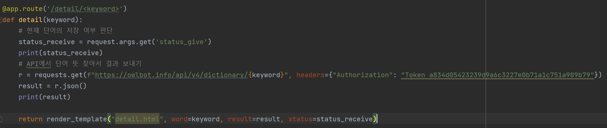

상세페이지 - 새단어/기존단어 서버코드

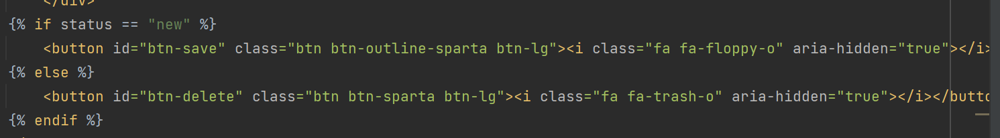

상세페이지 - 새단어/기존단어 클라이언트 코드

> CSS가 바로 적용되지 않을 때가 있다. 이유는 브라우저가 CSS 등 static 파일들을 효율적으로 사용하기 위해 캐시메모리에 저장하고 있기 때문이다. 이를 해결하는 방법은 **ctrl+shift+R(윈도우)** 명령을 사용하면 된다.

문제 : "&#39"는 따옴표에 해당하는 html 코드이다. 우리가 원하는 것은 진짜 따옴표처럼 행동하는 것이다.

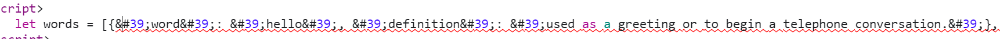

해결법 : 이 부분이 html이 아니고 진짜 데이터였으면 좋겠다고 알려주는 방법은 "**|tojson**"을 붙이면 된다.

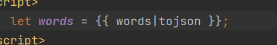

---

**2주차 미션**

* 우선 예문이 들어갈 칸을 만들어주세요. 새 단어일 때는 보이지 않고 기존 단어일 때만 나타나야합니다 🙂
* 변화가 있을 때 페이지 전체를 로딩하지 않고 예문 칸만 새로 채워넣는 방법이 효율적이기 때문에 jinja보다는 ajax를 쓰는 것이 좋습니다.
* input 칸에 예문을 넣고 저장 버튼을 누르면 1) 예문이 해당 단어를 포함하는지 확인하고 2) POST 요청을 보내 DB에 저장해주세요. examples라는 컬렉션을 따로 만들면 좋겠죠?
* DB에 저장된 예문들 중 해당 단어에 관한 것만 찾아와서 보여주는 함수를 만듭니다. 페이지가 로딩되었을 때, 새 예문을 저장했을 때, 기존 예문을 삭제했을 때 함수를 실행해서 다시 예문을 보여줍니다.
* 예문을 삭제할 때 여러 예문 중 어떤 것인지 구분을 해야하기 때문에 각 줄에 id를 부여하는 것이 좋습니다.
* 이제 예문들이 생겼으니, 단어를 삭제할 때 이 단어에 해당하는 예문들도 같이 지워주어야합니다. 컬렉션에서 조건을 만족하는 여러 도큐먼트를 지울 때는 delete\_many()를 사용할 수 있어요.

최종 미션 : <http://artist-bang.shop/>

[English Vocabulary Notebook

mini project for Web Plus

artist-bang.shop](http://artist-bang.shop/)

---

2주차 강의와 과제는 평소보다 오래 걸린것 같다..

내가 많이 부족한 것을 배울 수 있어 행복하다!! 열정 Up!!

오늘은 여기까지!

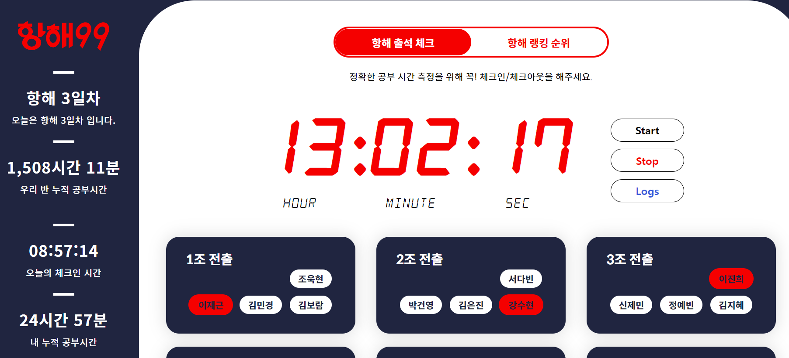
