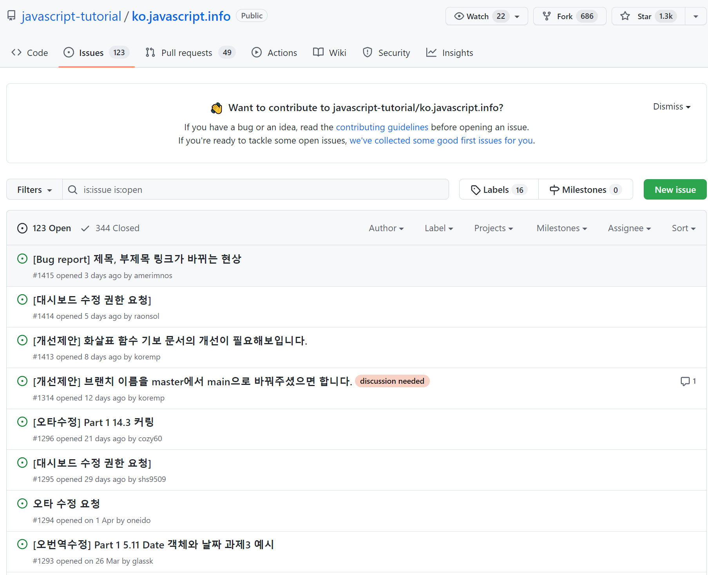
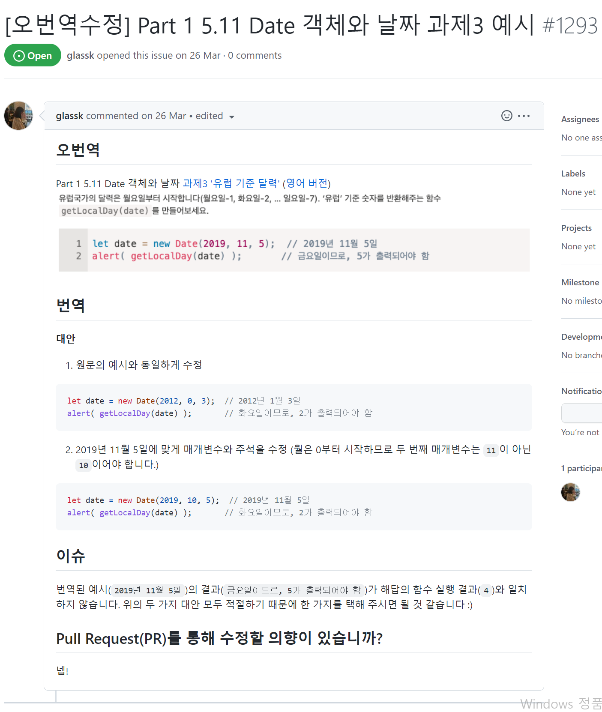
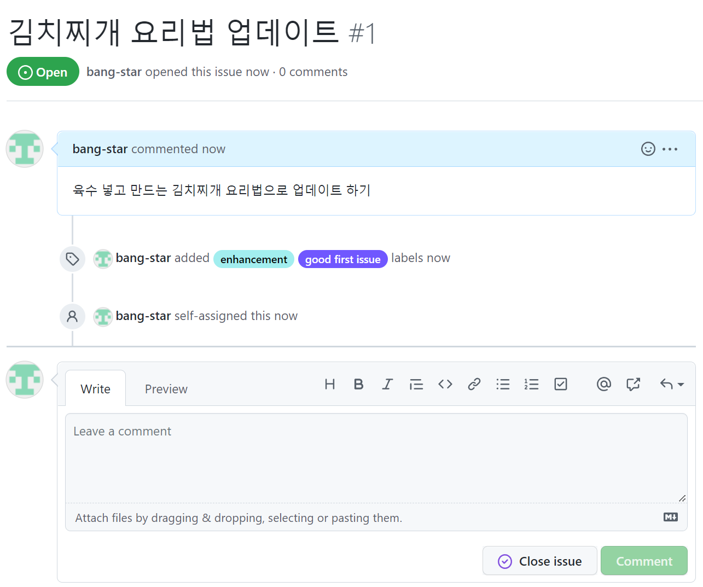

오늘은 항해 3일차

나의 위대한 모험은 시작되었다!

어제보다 오늘더 성장한 나!

나의 일기는 계속된다!

---

### **2주차**

**[수업 목표]**

1. 협업하기 위한 Git 기본 개념을 익힌다 - issue, branch, merge
2. 두 명 이상과 협업하는 Git 프로젝트를 만들 수 있다.
3. 기능별로 나누어 작업내역을 남길 수 있다.

**[목차]**

1. 협업위한 Git 배우기
2. 작업 할당 - issue 할당
3. 각자 공간에서 작업하기 - Branch
4. 작업 내용 합치기 - Merge(병합)
5. 충돌 해결 - Merge conflict
6. 원격 repo와 Branch

---

## 1. 협업 위한 Git 배우기

#### 1) 복습

* 버전관리- 버전이 다르다는 것은 프로젝트 상태가 변경되었다는 것! Git 은 가장 널리 쓰이는 버전관리 도구 중에 하나로 commit 을 사용해서 버전이 달라지는 것을 관리합니다.
* repo- 'Git으로 관리되는 프로젝트' 를 Git 에서는 repo(리포, repository 리포지토리의 약자) 라고 부릅니다. 내 컴퓨터에 저장되어있는 리포지토리를 로컬 repo(local repository) 라고 합니다. Github 처럼 다른 곳에서 접속할 수 있는 공간에 저장되어있는 것을 원격 repo(remote repository) 라고 합니다.
* 작업내역을 반영하기위한 단계- add(staging) -> commit;
* - git 초기화(initialize)는 처음에 단 한번만 해 주면 됩니다.
* commit- 현재 프로젝트의 상태를 찰칵 📸 저장하는 것을 이라고 합니다.
* - 누가(author), 언제(시간), commit 시점의 파일 상태, commit 메시지 정보를 포함.
* add(혹은 staging)- commit 에 반영할지 안할지는 파일 단위로 선택할 수 있습니다. commit 에 반영할 파일을 선택하는 것
* Tracking- 로컬 repo 와 원격 repo 를 연결한다!

---

### 2) 오늘 배울 것

* 충돌 해결법1. 누가 이 작업을 할 것인지 정한다.3. 각자 작업을 프로젝트에 합칠 수 있게 공유한다.
* 4. 작업한 내용을 리뷰하고 최종적으로 프로젝트에 반영한다.
* 2. 각자 맡은 것을 작업한다.

---

## 2. 작업 할당 - issue 할당

#### 1) issue의 의미

> 위에서 정한 작업방식 중 1단계를 issue를 사용해 작업할 수 있습니다.   
> 👉 1단계. 누가 이 작업 할 것인지 정한다. - Issue  
> 2단계. 각자 맡은 것을 작업한다. - Branch   
> 3단계. 각자 작업을 프로젝트에 합친다. - merge   
> (경우에 따라) 작업한 내용을 리뷰하고 최종적으로 프로젝트에 반영한다. - PR 후 merge

* 프로젝트에서 issue(이슈)는 프로젝트에서 해결해야하는 문제이다.
  + 버그(프로그램이 원하는 대로 동작하지 않는 것)를 신고 (Bug report, 버그 리포트)
  + 기능 추가 등의 프로젝트 개선 제안 (enhancement)
  + 위 문제들을 해결하기 위한 작업단위
* 개발자들은 이렇게 이슈라는 말을 사용하죠!
  + "회원가입 기능에서 버그있네요. 이슈 등록해둘게요."
  + 여기 버튼을 더 눈에 잘 보이게 고치면 좋겠는데요? 이슈 등록해둘게요.
  + "6번 이슈 제가 처리할게요. 제 앞으로 할당해두겠습니다!"

> 👉Github 외에도 많이 쓰이는 이슈 관리를 할 수 있는 도구는 Jira, Trello, YouTrack 등이 있어요.  
> 이런 도구를 이슈를 추적(tracking)하면서 관리할 수 있다고 해서 이슈 트래커(issue tracker) 또는 이슈 추적도구(Issue Tracking Tool, 이슈 트래킹 툴) 라고 부릅니다.

(예시) [이슈 관리](https://github.com/javascript-tutorial/ko.javascript.info/issues)

2-2. 이슈 자세한 내용

#### 2) issue 만들어보기

1. 이슈 사용법
   1. GitHub에서 원하는 repo 선택
   2. repo에서 issues 선택
   3. New issue 선택
   4. title과 comment를 남들이 알기 쉽게 작성하기
   5. Assignees 할당
   6. Label 선택(issue의 종류) - 다중선택 가능
   7. Submit new issue 클릭!

이슈 발생

### 3) issue와 연관된 commit 만들기

* commit 메시지를 작성할 때 관련된 issue가 무엇인지 issue 번호를 포함해 알려줄 수 있다.
  1. SourceTree 실행
  2. commit메시지 + #이슈넘버를 붙여서 commit한다
  3. commit 후에 push
  4. 해당 issue에 접근하면 이슈에 대한 commit이된 것을 확인 할 수 있다.
  5. Assignees 할당
  6. Label 선택(issue의 종류) - 다중선택 가능
  7. Submit new issue 클릭!

[Github 공식 이슈 관리 소개](https://guides.github.com/features/issues/) [GitHub를 활용한 이슈 관리](https://terry-some.tistory.com/93)

---

## 3.각자 공간에서 작업하기 - Branch

#### 1) Branch가 무엇인가?

> 위에서 정한 작업방식 중 1단계를 issue를 사용해 작업할 수 있습니다.   
> 1단계. 누가 이 작업 할 것인지 정한다. - Issue  
> 👉 2단계. 각자 맡은 것을 작업한다. - Branch   
> 3단계. 각자 작업을 프로젝트에 합친다. - merge   
> (경우에 따라) 작업한 내용을 리뷰하고 최종적으로 프로젝트에 반영한다. - PR 후 merge

* 브랜치(Branch)를 사용하게 되면 나뭇가지가 뻗어나오듯 기능에 맞게 나누어 작업할 수 있습니다. 이게 어떤 의미인지 예시로 보죠!👉 잠깐!  
  우리는 그동안 commit 을 main 이라는 이름을 가진 브랜치에 해주었습니다. 프로젝트마다 기본 브랜치가 설정되어있답니다. 우리 프로젝트의 경우 main 브랜치가 기본 브랜치였기 때문에 따로 설정을 해주지 않아도 자동으로 main 브랜치에 commit 이 된 거에요.
* 작업 목적에 따라 branch를 만들어서 관련된 작업만 하고, 나중에 합칠 수 있다.

#### 2) issue와 브랜치 만들기

* issue와 branch 만드는 방법
  1. issue 생성
  2. sourcetree에 History에 접근
  3. 맨 위 commit 자료를 클릭하고 오른쪽 마우스를 눌러 브랜치 선택
  4. 약속된 대로 브랜치명 설정(feautre/2\_jjigae)
     + feature : 기능을 의미
     + 2 : 해당 issue 번호
     + jjigae : 해당 작업 이름
  5. 명시된 커밋과 새브랜치 체크아웃 체크 후 브랜치 생성
  6. 브랜치를 이동하면 왼쪽 branch에 동그란 모양이 생기고, 이동하는것을 체크아웃이라고 한다.
  7. commit 할때는 현재 어떤 브랜치에 체크아웃 되어있는지 꼭 확인해야한다.

#### 3) 브랜치 삭제하기

* 브랜치 삭제하기
  1. 브랜치를 삭제한다는 것은 그동안 브랜치에 했던 작업 내역 즉, commit이 모두 사라진다는 의미이다.
  2. 브랜치를 삭제하면 기본 브랜치인 main브랜치로 체크아웃 즉, 작업 브랜치가 변경됩니다. 작업 브랜치가 변경되면 파일의 상태도 당연히 해당 브랜치의 마지막 commit으로 상태로 변경됩니다.
     1. 브랜치 만들기
     2. 헤당 브랜치에서 테스트용으로 commit하기
     3. 다른 브랜치로 이동하기
     4. 해당 브랜치 삭제하기(강제 삭제 체크박스 선택)
     5. 삭제 후 이전 파일로 되돌아갔는지 확인하기
  3. 명시된 커밋과 새브랜치 체크아웃 체크 후 브랜치 생성
  4. 브랜치를 이동하면 왼쪽 branch에 동그란 모양이 생기고, 이동하는것을 체크아웃이라고 한다.
  5. commit 할때는 현재 어떤 브랜치에 체크아웃 되어있는지 꼭 확인해야한다.

---

## 4.작업 내용 합치기 - Merge(병합)

1. Merge(병합) - 개념탑재

> 위에서 정한 작업방식 중 1단계를 issue를 사용해 작업할 수 있습니다.   
> 1단계. 누가 이 작업 할 것인지 정한다. - Issue  
> 2단계. 각자 맡은 것을 작업한다. - Branch   
> 👉 3단계. 각자 작업을 프로젝트에 합친다. - merge   
> (경우에 따라) 작업한 내용을 리뷰하고 최종적으로 프로젝트에 반영한다. - PR 후 merge

* Merge(병합) 는 브랜치를 다른 브랜치에 합치는 것입니다. 즉, 특정 브랜치의 commit 들을 다른 브랜치의 commit 내역에 모두 반영하는 것입니다. 기본적인 설정은 해당 브랜치의 모든 commit 을 모두 다 반영한다고 생각하면 됩니다.
* 브랜치 만들기 예시의 바로 빨간 네모 부분입니다! 작업내역을 합치기!

> 프로젝트마다 Branch 관리하는 방법이 조금씩 다릅니다. commit하고 작업하는 방법을 통틀어 flow(흐름) 라고 합니다. 대표적으로 github-flow, gitlab-flow, git-flow 가 있습니다.  
> 웹 프로젝트 개발의 경우 github-flow 를 많이 사용합니다. 우리가 실습하는 방식은 github-flow 와 유사합니다. 각 flow 에 대한 소개는 위 코드스니펫 git 사용 flow 를 참고해보세요.

* [github-flow](https://guides.github.com/introduction/flow/)
* [chrome 웹페이지 번역](https://support.google.com/chrome/answer/173424?co=GENIE.Platform%3DDesktop&hl=ko)
* [git-사용 flow](https://ujuc.github.io/2015/12/16/git-flow-github-flow-gitlab-flow/)

1. Merge(병합) - 실습

   1. 작업한 feature/2\_jjigae를 main 브랜치로 merge 할 것이다.
   1. sourcetree에서 commit을 반영시킬 브랜치인 main으로 checkout(합쳐질 목적지로 이동)
   2. sourcetree에서 병합 선택
   3. 합치고 싶은 브랜치의 commit을 선택
   4. 옵션 선택(즉시 커밋 병합(충돌없을시), 병합 커밋에 있는 메시지들을 첨부, fast-forward가 가능해도 새 커밋으로 생성)
   5. merge 후 합병된 브랜치는 삭제  
   1. 여러 브랜치에 commit하고 Merge(병합)하기
   1. sourcetree에서 2개 브랜치 생성
   2. 해당 branch마다 파일 수정후 commit(충돌나지 않게 각각 다른 파일 시도)
   3. merge를 위해 main branch checkout
   4. 병합 클릭 후 옵션 선택(즉시 커밋 병합(충돌없을시), 병합 커밋에 있는 메시지들을 첨부, fast-forward가 가능해도 새 커밋으로 생성)
   5. 옵션 선택 후 확인
   6. 나머지 branch도 동일하게 병합
   7. 병합 후 병합된 branch 삭제
2. Merge(병합) - 정리와 꿀팁   
   1. 중간 정리
      * 브랜치의 작업 내역 commit 들을 다른 branch 로 반영(합치기)는 것을 Merge(머지, 병합) 이라고 부릅니다. 기본적으로 branch 단위로 merge 하게 됩니다.
      * 개발할 때는 기준이 되는 기본 브랜치를 정해놓고 다른 브랜치들을 기본 브랜치에 merge합니다. 우리는 main 브랜치를 기본으로 두고 두 작업 브랜치를 merge 했습니다.
   2. 꿀팁
      * 프로그래밍은 문제 해결! 문제해결하기 위해 어떻게 정보를 활용하고 연결시키느냐 중요합니다!
      * 궁금한 것들을 검색해보면 됩니다. 기술(도구 이름) + 단어 조합으로 하면 훨씬 더 좋은 검색 결과를 얻을 수 있다 예.sourcetree branch
      * 검색어 팁
        + 기술을 처음 배우고 싶을 때 : '기술이름'+'tutorial' (예.git tutorial)
        + 기능을 찾을 때 : '기술이름' + 'how to' + '찾을 내용' (예.git how to merge)
        + 어떻게 사용하는지 예제를 보고 싶을 때 : '기술이름' + '내용' + 'example' (예.github flow example)
        + 원하는 사이트명 포함해 검색할 수도 있습니다. (예: stackoverflow git merge - stackoverflow 라는 사이트에서 검색)

---

## 5. 충돌 해결 - Merge conflict

1. Merge conflick - 개념과 준비
   1. 개념에러를 안 내는 게 중요한게 아니라 버그(컴퓨터가 의도한 대로 동작하지 않는 것)를 고칠 수 있느냐 없느냐가 중요합니다!
      * 충돌을 안 내면 편하겠지만, 실제 상황에서는 여러 번의 충돌을 마주하게 됩니다! 에러 안 내려고 시도하지 않는 거보다 해결하는 것을 배우는 게 중요합니다.
      * 하나의 파일을 여러 브랜치에서 수정하고 하나의 branch에 merge 하려고 할 때 merge conflict(병합 충돌) 가 발생합니다. 양 쪽에서 내용이 수정되었는데 어떤 내용을 반영해야할지
      * 이럴 때 git 은 친절하게! 이 충돌나는 내용 중에 어떤 내용을 반영하면 좋겠니? 하고 확인하는 메시지를 줍니다. 자동으로 파일을 합친 다음에 충돌이 나는 부분을 보여줍니다.
   2. Merge Conflict 일부러 내보고 고치기 - 실습 설명위에서 정한 작업방식 중 3단계 각자 작업한 것을 프로젝트를 합치는 Merge 과정을 학습하고 있습니다. Merge할 때 conflict 가 발생할 경우 수정하는 방법을 배웁니다!  

      1단계. 누가 이 작업 할 것인지 정한다. - Issue  
      2단계. 각자 맡은 것을 작업한다. - Branch  
      👉 3단계. 각자 작업을 프로젝트에 합친다. - merge  
      (경우에 따라). 작업한 내용을 리뷰하고 최종적으로 프로젝트에 반영한다. - PR 후 merge
   3. 각 브랜치 작업하기
      1. branch 생성( feature/stock, feature/jjigae\_rtan)
      2. feature/stock merge(옵션 선택(즉시 커밋 병합(충돌없을시), 병합 커밋에 있는 메시지들을 첨부, fast-forward가 가능해도 새 커밋으로 생성))
      3. feature/jjigae\_rtanmerge(옵션 동일)
      4. 충돌 에러메시지 발생 → 커밋하지 않은 변경사항이 존재한다.
      5. 파일 상태에 접근하여 해당 파일 더블클릭하여 열기
      6. '======='표시를 기준으로 나눠진다.(현재 merge에서 발생한 충돌 데이터가 현재 합쳐져 있는 상태)
      7. '======='을 기준으로 파일을 직접 수정하여 다시 커밋해야한다.
         #이유는1. 새로운 내용은 수정 후 추가해야한다 이유는 작업내용에서 추적이 안될 수 있기 때문에 새로운 내용을 새로운 커밋으로 하는 게 좋다.
         2. 프로젝트 관리할 때에도 작업 내역을 나눠서 제대로 커밋하는 습관 기르기 위해서
2. Merge conflick - 정리
   1. 각 작업 브랜치에서 작업할 때는 다른 브랜치의 영향을 받지 않고 독립적으로 작업할 수 있습니다.
   2. Merge 하는 과정에서 같은 파일이 동일한 부분이 수정된 게 발견되면 Merge conflict(병합 충돌) 이 발생합니다.
   3. Git 이 똑똑하게 충돌을 파악할 수 있도록 파일 내용을 고쳐서 충돌 내역을 보여줍니다.
   4. conflict 를 수정하려면 최종적으로 반영할 내역으로 고친 후에 merge commit 하면 됩니다.

---

## 5.원격 repo와 Branch

1. 개념과 실습
   1. 원격 repo의 Branch 개념탑재
      * 앞에서 원격 repo 는 로컬 repo 가 연결되어있다고 이야기했습니다. 사실 이 연결은 로컬 repo 의 브랜치와 원격 repo 의 브랜치가 연결된 것과 같습니다.
      * 따로 설정을 해주지 않으면 기본적으로 로컬 repo의 브랜치명와 같게 원격 repo의 브랜치명이 생성되어 tracking됩니다.
        + commit history 에 보여지는 origin/main 이름표는 원격 repo 의 main 브랜치 라는 뜻입니다. 원격 repo 를 연결할 때 origin 이라고 적어주었기 때문에 앞에 origin 이 붙습니다.
      * pull 과 push 는 결국 특정 branch(tracking branch) 에 있는 commit 을 여기와 연결되어있는 branch에 가져오는 것입니다.
   2. 원격 repo 브랜치와 로컬 repo 브랜치 연결 확인 - 실습
      * 원격 repo 브랜치와 로컬 repo 브랜치가 연결이 되어있다는 것을 먼저 실습으로 확인해보겠습니다.
      * 아래 히스토리를 보면 파란색 main 이름표 붙어있는 commit 과 origin/main 이라고 이름표 붙어있는 commit 이 다르다는 것을 보여줍니다.
      * 원격 repo 의 main 브랜치의 최신 commit 은 '김치찌개 요리법 업데이트' 이고, 로컬 repo의 main 브랜치의 최신 commit 은 'Merge branch 'feature/jjigae\_rtan into main' 입니다.
      * 원격 repo 의 main 브랜치에 로컬 branch main 브랜치의 commit 을 반영하기 위해 상단 push 를 눌러 보겠습니다.
   3. 로컬 repo 브랜치 만들어 원격 repo 브랜치에 push - 실습
      1. 브랜치 생성 후 새로운 파일을 생성하여 commit
      2. 새로운 브랜치에서 해당 파일을 push하게 되면 자동으로 원격repo에 동일한 브랜치가 생성된다.
      3. push할 경우 원격 repo에 생성되며 파일이 원격repo에 저장된다.
      4. 원할 경우, 원격repo의 위치를 변경 가능하다.  
      위에서 정한 작업방식 중 3단계 각자 작업한 것을 프로젝트를 합치는 Merge 과정을 학습하고 있습니다. Merge할 때 conflict 가 발생할 경우 수정하는 방법을 배웁니다!  

      1단계. 누가 이 작업 할 것인지 정한다. - Issue  
      2단계. 각자 맡은 것을 작업한다. - Branch  
      3단계. 각자 작업을 프로젝트에 합친다. - merge  
      👉 (경우에 따라). 작업한 내용을 리뷰하고 최종적으로 프로젝트에 반영한다. - PR 후 merge
2. 정리
   1. 중간 정리하기
      * tracking 한다는 것은 로컬 repo와 원격 repo의 특정 브랜치를 연결해주는 것입니다.
      * push와 pull 은 기본적으로 tracking(추적)되고 있는 브랜치를 기준으로 commit 내역을 반영합니다.
   2. 로컬 repo 브랜치 작업내역 원격 repo에 push
      * 로컬 repo 브랜치를 만들고 commit 을 해보세요
      * 원격 repo 에 해당 브랜치를 push 해보세요.
      * 다 작업하고 난 후에는 로컬 repo 브랜치를 지워주세요!

---

## 총 정리

1. 협업할 때는 아래의 단계를 따릅니다.
   * 1단계. 누가 이 작업 할 것인지 정한다. - Issue
   * 2단계. 각자 맡은 것을 작업한다. - Branch
   * 3단계. 각자 작업을 프로젝트에 합친다. - merge
   * (경우에 따라). 작업한 내용을 리뷰하고 최종적으로 프로젝트에 반영한다. - PR 후 merge
2. issue 는 내가 할 작업, 기능 추가, 버그 리포트 등 여러 방식으로 사용할 수 있습니다.
3. 협업을 하기 위해 issue 를 만들어 누가 작업할지 정하고, 브랜치를 만들어 작업할 공간을 나눕니다.
4. 브랜치(branch)는 특정 commit 에서 갈라져나와 작업할 수 있습니다. 우리는 기능별로 이름을 만들어주어 브랜치에 작업해줍니다.
5. 작업할 브랜치로 바꾸는 것을 체크아웃(checkout)이라고 합니다. 체크아웃된 브랜치에만 commit 이 반영됩니다.
6. 브랜치의 작업 내역 commit 들을 다른 branch 로 반영(합치기)는 것을 Merge(머지, 병합) 이라고 부릅니다. 개발할 때는 기준이 되는 기본 브랜치를 정해놓고 해당 브랜치에 내용을 merge합니다. 우리는 main 브랜치에 작업 브랜치의 내용을 merge 했습니다.
7. 브랜치명은 규칙을 가지고 잘 이름 지으면 프로젝트 관리가 쉬워집니다. 작업이 완료되면 작업한 브랜치는 보통 삭제해줍니다. 나중에 브랜치 설정이 꼬이는 것을 방지할 수 있습니다.
8. 각 작업 브랜치에서 작업할 때는 다른 브랜치의 영향을 받지 않고 독립적으로 작업할 수 있습니다. jjigae.txt 파일을 각각 브랜치에서 자유롭게 수정한 것처럼요!
9. Merge 하는 과정에서 같은 파일이 동일한 부분이 수정된 게 발견되면 Merge conflict(병합 충돌) 이 발생합니다.
10. conflict 를 수정하려면 최종적으로 반영할 내역으로 고친 후에 merge commit 하면 됩니다.
11. tracking 한다는 것은 로컬 repo와 원격 repo의 특정 브랜치를 연결해주는 것입니다.
12. push와 pull 은 기본적으로 tracking(추적)되고 있는 브랜치를 기준으로 commit 내역을 반영합니다.

---

## - 후기 -

> 오늘은 처음으로 HTML형식으로 작성해보았다.. 너무 힘들다 이거 하느라 죽는줄 알았다..  
> 시간도 5배 이상소요되는것으로 판단된다... ㅠㅠㅠ 이거 너무 어려워요!!  
> 그래도 오늘도 열심히하는 나에게 아주~ 칭찬해!!
