오늘은 항해 3일차!! 위대한 항로로~!!!

Git 2주차 수업 Finished!

웹개발 플러스 3주차까지 가즈아!!

---

#### **[웹개발 플러스 - 3주차]**

**1. 수업 목표**

1. Selenium을 이용해 브라우저를 제어하고 웹스크래핑을 할 수 있다.
2. 내 웹사이트에 네이버 지도를 넣을 수 있다.
3. 네이버 지도 API의 다양한 기능을 활용할 수 있다.

**2. 목차**

1. **셀레니움 스크래핑**
2. **네이버 지도 API**
3. **맛집지도 프로젝트**

---

#### **S#.0 예고편**

**1. 브라우저 제어**

* 내가 필요한 정보를 얻기 위해 로그인, 스크롤 내리기 등 브라우저를 동작시켜야 할 때, selenium 같은 브라우저 제어 프로그램을 이용할 수 있습니다.
* 웹스크래핑 뿐만 아니라 브라우저 제어 기능을 응용하면 정해진 시간에 게시판에 글을 작성하는 등 다양한 업무를 자동화하는 데 쓰일 수 있습니다.

2. 맛집 지도

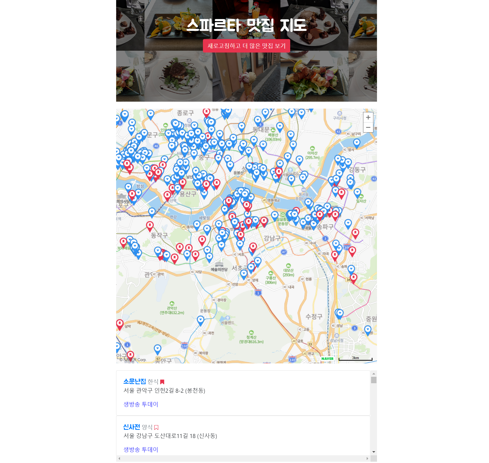

맛집 지도 - 미리보기

---

#### 

#### **S#.1 Selenium 스크래핑**

**1) 멜론**

 - 목적 : 멜론 차트를 스크래핑

> \* 웹 스크래핑(web scraping)  
> 은 웹 페이지에서 우리가 원하는 부분의 데이터를 수집해오는 것을 뜻합니다.

* 한국에서는 같은 작업을 크롤링 crawling 이라는 용어로 혼용해서 쓰는 경우가 많습니다. 원래는 크롤링은 자동화하여 주기적으로 웹 상에서 페이지들을 돌아다니며 분류/색인하고 업데이트된 부분을 찾는 등의 일을 하는 것을 뜻해요.
* 구글 검색을 할 때는 **web scraping** 으로 검색해야 우리가 배우는 페이지 추출에 대한 결과가 나올 거예요!

> **[ 문제 ]**  
> **현재 멜론 차트를 스크랩핑하였는데 좋아요 값이 0으로 출력되고 있다.**  
>   
> **[해결방법]**  
> **1단계 (상황 파악)**  
> **- HTML 파일이 로드될 때는 초기 값이 0으로 설정되어 있다. 서버에 HTML을 로드하고 나서 서버에 다시 좋아요 개수를 요청하고 실시간 좋아요 개수를 가져와서 숫자를 입력한다.**  
>   
> **- request가 가져오는 것은 처음에 0으로 좋아요 개수 데이터를 요청하기 전의 초기 HTML 파일의 값이므로 0 값을 가져온 것이다.**  
>   
> **2단계 (대처 방법)**  
> **- 멜론 차트처럼 동적인 웹페이지를 스크래핑할 때는 브라우저에 띄운 후 소스코드를 가져오는 방법을 써야합니다.  
> 즉, 진짜 브라우저를 띄워서 서버에 좋아요 개수를 요청한 상태에 HTML 파일에 값을 가져오는 것이다.**  
>   
> **3단계(결론)**  
> **- requests는 HTML의 초기값을 가져오므로 Selenium으로만 할 수 있다.**  
>   
> **\*용어**  
> **동적인 웹페이지 : HTML이 로드되고 나서 다시 Ajax를 이용하여 정보를 가져와서 페이지를 이렇게 바꾸는 것**

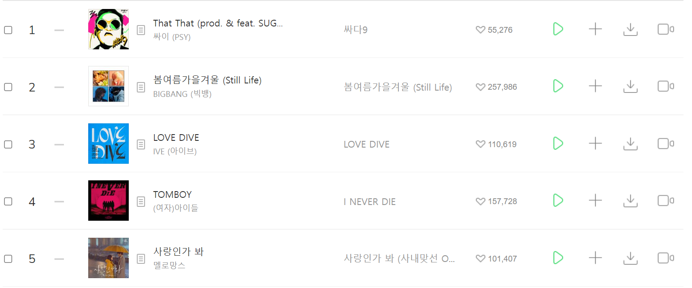

1-1. 멜론 실시간 차트

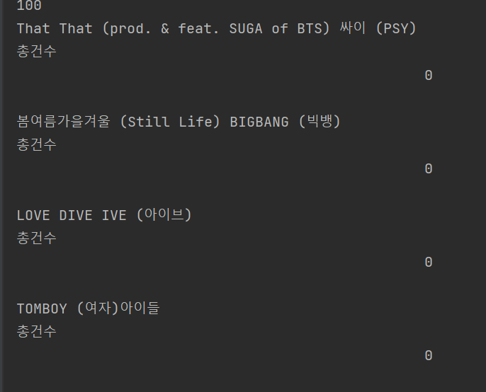

1-2. 멜론 차트 스크래핑 결과

**2) 구글 드라이버**

> 1단계는 크롬 브라우저 버전차이로 에러 발생할 가능성이 크므로 무조건적으로 해야하는 작업이다.

**1단계 - 크롬 브라우저 버전 확인 : chrome://settings/help**

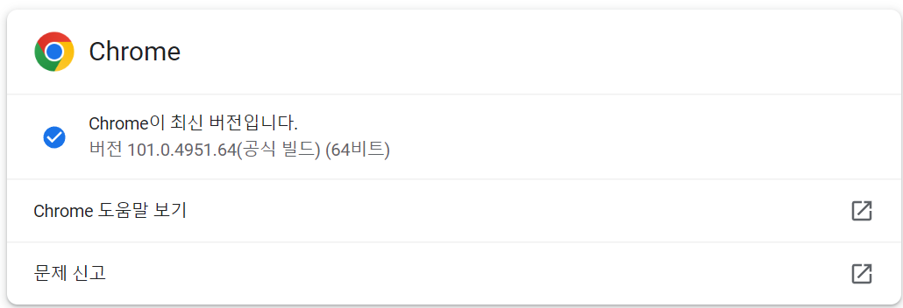

1-3. 크롬 브라우저 버전 확인

**2단계 - [크롬 드라이버 다운로드](https://chromedriver.storage.googleapis.com/index.html)**

> 해당 OS에 맞는 파일을 다운받아서 현재 프로젝트에 복사하여 사용한다.  
> [조건] : prac\_scraping.py(현재 스크랩핑 파이썬 파일)과 동일한 위치에 있어야한다.

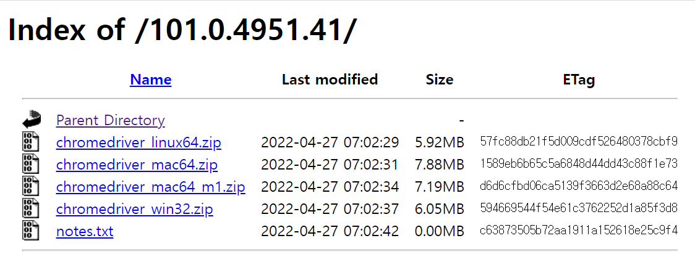

1-4. 크롬 드라이버

> [ NEW ]   
> 1. decompose 메소드 : span 태그를 없애준다.  
> 2. strip 메소드 : 텍스트에 앞뒤 빈간을 지워준다.  
> 3. 셀레니움의 기능   
>   1) 스크롤  
>   2) 버튼 클릭

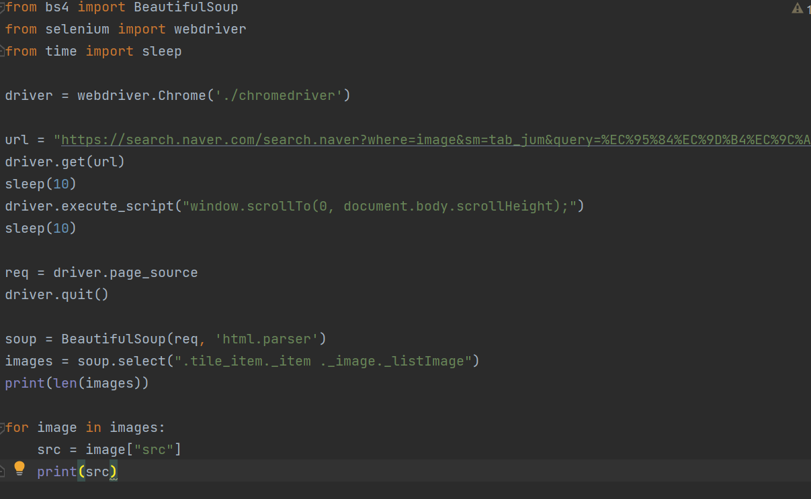

1-5. 셀리니움을 이용한 스크롤 이동

---

#### **S#.2 네이버 지도**

**1) [네이버 지도 API 링크 이용](https://www.ncloud.com/product/applicationService/maps)**

 - 가입과 결제 수단을 등록하여야 한다.

 - 네이버 지도에 Web Dynamic Map, Geocoding을 체크한다.

 - URL은 http://localhost:5000을 추가해준다.

 - 콘솔에서 인증정보를 클릭하면 인증번호를 받을 수 있다.

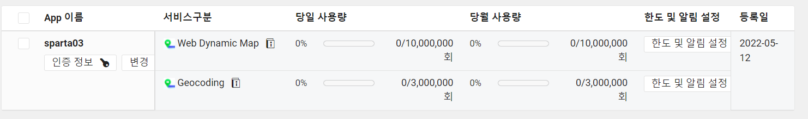

2-1. 네이버 클라우드 플랫폼 애플리케이션

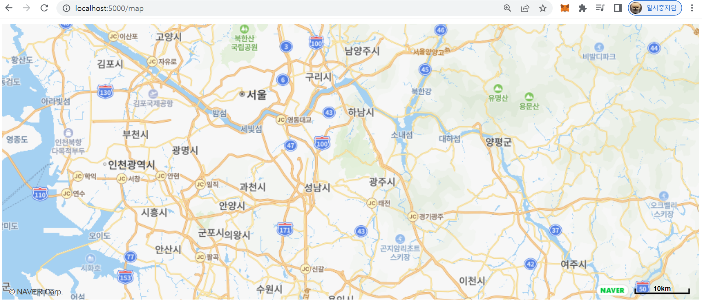

2-2. 네이버 지도 API 테스트

2) 용어

- 아이콘 : 마커

- 메시지창 : info window

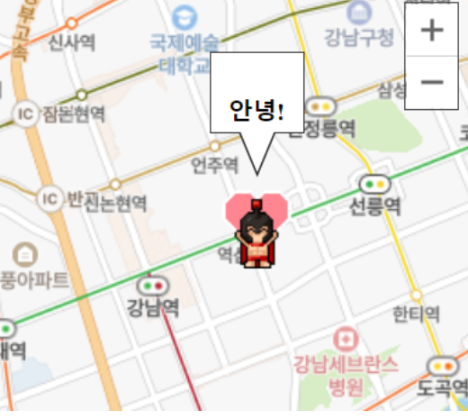

2-3. 예시

3) 확대, 축소 버튼 추가

- 맵에 옵션을 통해 추가 가능하다.

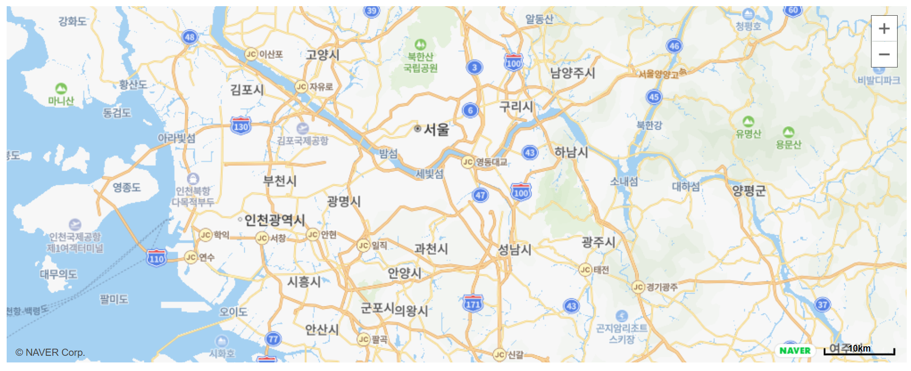

2-4. 확대, 축소 버튼 추가

4) 마커 띄우기

- 맵에 마커를 띄우고 이미지를 변경할 수 있다.

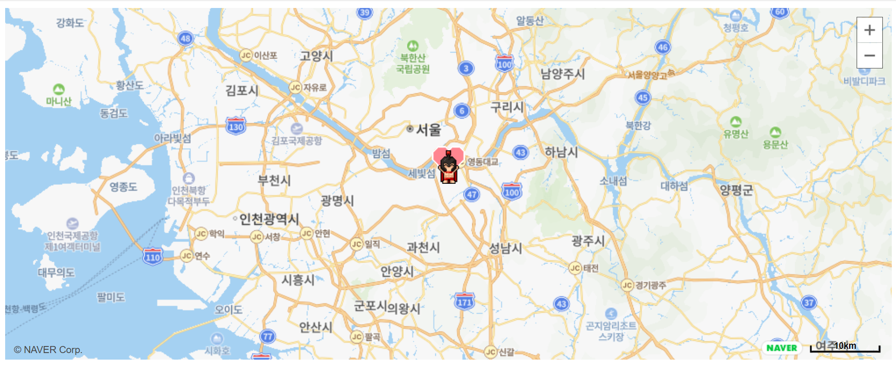

2-5. 마커 이미지 등록

5) 마커 띄우기

- 맵에 마커를 띄우고 이미지를 변경할 수 있다.

---

#### **S#.3 맛집 지도**

**1) API 설계하기**

> 필요한 기능들을 생각해보기!

* 맛집 정보 스크랩핑
* 지도 보여주기
* 각 맛집 별 마커, 정보창, 카드 만들고 서로 연결하기

**2) 구현 순서**

1. app.py에 서버 코드 구현
2. index.html에 네이버 지도와 하단에 맛집 정보 리스트를 출력할 수 있는 카드를 출력
3. 스크랩핑 할 사이트 선정 : [SBS TV 맛집](http://matstar.sbs.co.kr/location.html)
4. scraping.py에 selenium을 통해 sbs tv 맛집 사이트를 스크랩핑
5. 스크랩핑을 통해 얻은 주소를 통해 위도와 경도로 전환해주는 작업이 필요하다(네이버 지도의 geocoding API 사용)
6. 여러 페이지를 스크랩핑하기 위해서 버튼에 대한 정보를 가져와야한다.(페이지 소스를 로드하기 전)
7. 페이지에서 불러온 데이터를 DB에 저장하면 된다.
8. 데이터베이스에서 데이터를 불러와서 출력한다.
9. 맛집 리스트를 불러와서 맛집 카드 -> 마커 -> info window 차례로 만들어주면 된다.

**3) 고급기능**

(1) 카드 선택시 스크롤 움직이기

(2) 역으로 지도가 아닌 카드를 클릭했을 때 정보창 띄우기

> [ 꿀팁 ]  
> a 태그를 클릭했을 때 새창이 뜨는게 아니라 javascript 함수를 실행하고 싶다면?  
> → <a href="javascript:실행함수명()"> ...

(3) og태그, favicon 넣기

---

**정리**

**오늘도 어김없이 3주차까지밖에 못한다.. 시간이 너무 늦엇다... ㅠㅠ**

**내일은 무조건 내 프로젝트를 진행해야한다...**

**제발 무조건 해야해 ㅠㅠ**

