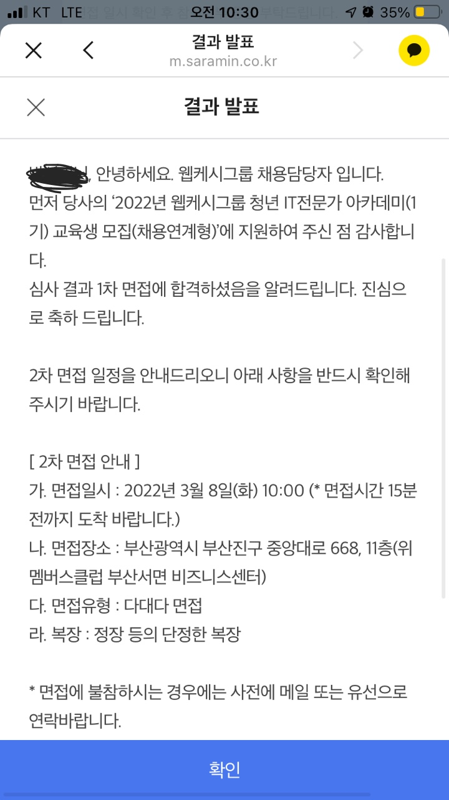
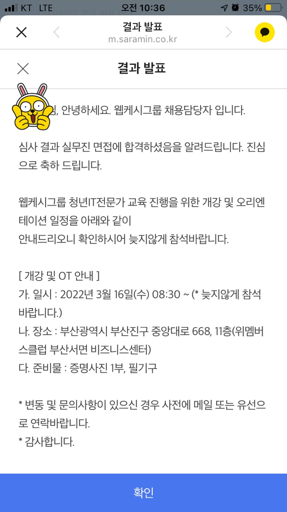

## **1차 면접**

저는 웹 캐시 그룹면접을 보기 위해 부산으로 다녀왔었습니다. 처음에 길을 찾지 못해서 서성이다가 결국 찾았습니다...

처음에는 두근 두근 두근 되는 심장에 무엇을 할 수 있을지 예상이 가지 않았습니다...

1차 면접에서는 간단하게 자바 문법 관련 문제를 보게 되었습니다. 문제 난이도는 下라고 생각됩니다.

다른 곳에서 봤던 코딩테스트와는 약간 다른 방식에 코딩 테스트라서 머리를 많이 회전시킬 필요는 없으십니다... (장점)

50분이었나.. 1시간정도에 시간동안 10문제를 풀고 난 뒤 면접이 진행되었습니다.

1차 면접은 비트교육센터 회장님과 1대 다 면접이었습니다.

면접 지원서 순서대로 회장님께서 한 가지 질문을 하셨습니다.

> 무엇을 개발해보셨습니까?

저는 면접 전에 10개 정도에 질문에 대해서 생각했었는데.. 그 중 하나만 나왔습니다... (아쉽..)

아주 자세하게 무엇을 개발 해보았고 무엇을 담당했고 거기서 어떤 구현을 하였는지를 설명하라고 하셨었습니다.

저는 거의 마지막에서 2번째로 하게 되었는데.. 너무 긴장되어서 말을 너무 더듬었습니다.

그래도 자신감있게 다시 하겠다고 말씀드리고 떨면서 개발 경험을 말하였습니다.

제가 너무 많이 떨어서 저는 떨어질 것이라는 생각을 하게 되었습니다... 이정도면 병인데 맛있는 점심을 먹고 부산을 돌아다니면서 내가 이곳을 올 수 있을까 하며 몇일을 기다렸습니다.

그런데 그때 띵!! 하는 메시지가 울립니다..

1차 면접 결과

한번 더 경험을 주시겠다고... 하셔서 감동을 하게 되었습니다!!

이번에는 더 열심히 준비하게 되었습니다.

2차 면접을 위해서 더 열심히 암기하고 외웠습니다.

내가 과연.. 연봉 4000에 자리에 앉을 준비가 되었는가 라는 생각을 하면서 열심히 준비하고 또 준비했습니다..

또 부산을 향해 아침 5시 30분에 기상해서 새벽에 기차를 타고 달려갔습니다. SRT 참 빠르더라고요...

2차 면접은 다대다 면접으로 웹캐시 그룹내 개발 팀장님 3분과 인사과 부장님 1분으로 구성되어 계셨고 면접자는 6명정도 였습니다. 저는 첫 면접에 첫 타자로 시작되었습니다...

매를 먼저 맞는게 맞다고는 하는데.. 저는 그쪽 타입은 아닙니다...

모든 질문에 처음이 저로 시작되서 다른분들이 준비할 수 있는 시간에 저는 어버버버버버버버버버버.... 해버렸습니다.

제가 생각하기엔 저는 정말로 면접 때는 바보가 되는 것 같습니다.

면접에서 질문은

* 간단하게 자기소개
* 자신있는 프로그래밍 언어는 무엇이고 이유는 무엇인가

밖에 기억이 나지 않습니다. 공통 질문과 저한테 개인 질문도 많이 하셔서 제 머리는 하얗게 물이 들어버렸습니다..

면접 후에 저는 밥을 코로 먹었는지 점심 먹은 것도 기억이 안날정도였습니다....

저는 당연히 저는 떨어졌을 것이라는 생각으로 공부를 하고 있었는데..

그런데 갑자기 아시죠? 띵! 하고 울리는 명쾌한 알림

2차 면접 결과

저는 이와 같은 결과를 받게 되었습니다.... 하하하하하하하

## 결론

저는 웹캐시를 선택하지 않았습니다. 이유는 여러가지가 있겠지만... 개인적인 이유도 있으면서 저의 꿈과는 거리가 있다는 것을 느끼게 되어 선택하지 않았습니다.. 후회라면 1-2번 정도는 했지만 저는 가지 않고 열심히 공부중입니다.. 하하하

