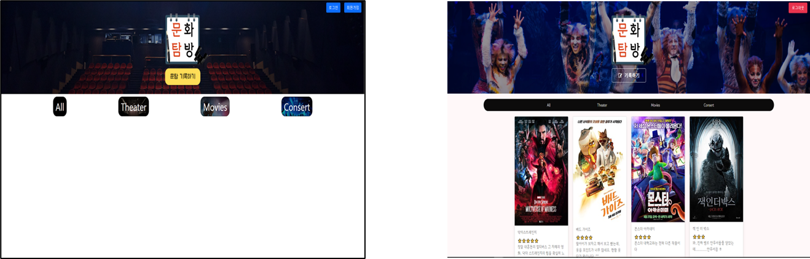
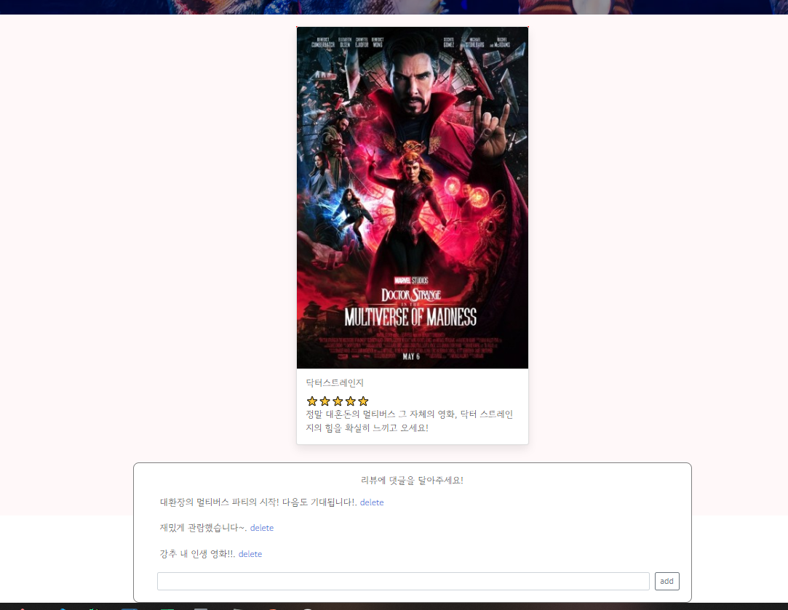
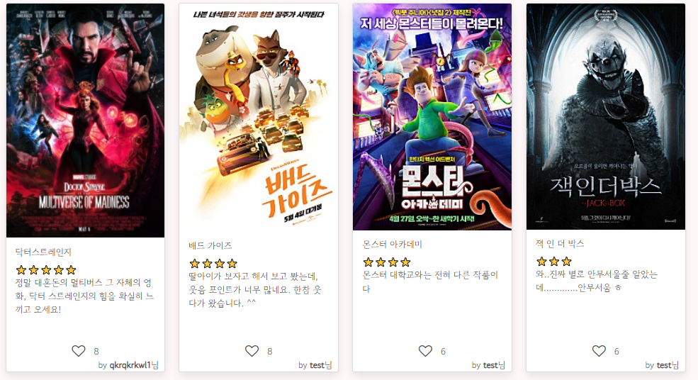

오늘은 첫 번째 미니 프로젝트 마감일이다..

첫 미니프로젝트인 만큼 더 열심히 하고 싶었다!

기술 매니저님이 하신 말씀이...

다른 조에서는 안자고 개발한 분들도 계시다고...

우리 조에서는 내가 제일 늦게 자던데 ㅠㅠ...

내가 그런 사람이 되야겠다...

---

(상황 요약)

5월 10일

- 팀원 별 발생하는 문제를 해결하였다.

1) 메인 ↔ 로그인, 회원가입 페이지 연결

2) 보안 강화 → 세션을 통해 로그인 정보 유지

5월 11일

- 프로토타입 서비스 통합을 하였다.

- 기술매니저님과 멘토링 후 추가 기능 설정

1) 본인 - 디자인 통일 및 에러 처리

2) 문화 카드 자세히 보기 페이지 구현

3) 좋아요 버튼 기능 구현

4) 목차 정렬 버튼

---

1. 디자인 수정

- 평소 디자인은 내 담당이 아니라 부족하지만, 현재 팀에서 CSS는 그나마 제일 나아서 내가 선택되었다..

- 기존 디자인은 팀장님께서 대부분 수업 코드를 기반으로 준비하셨었다. 

(변경 사항)

1. 목차 버튼 → 카테고리

- 목차 버튼이 글자 크기별로 모양과 크기였는데, 현재는 심플한 카테고리로 변경되었다.

- 카테고리 별 배경 이미지가 변경된다.

- 로그인, 회원가입, 메인 페이지 별로 버튼의 디자인과 소스들이 다르므로 통일시켰다.

(서로 다른 라이브러리로 고생함... )

2. 아이콘 및 기록하기 내부 수정

- 버튼 디자인을 변경하면서 아이콘을 첨부해서 쉽게 접근할 수 있도록 수정

(좌) 수정 전, (우) 수정 후

---

디자인 수정 완료 후.. 에러 처리부터 시작하였다.

**1. 에러 처리**

첫 번째, 메인페이지 접근 시 에러

문제 : 강의에서는 시작 페이지가 로그인 페이지였고, session 값이 있을 때만 메인페이지에 접근할 수 있는 코드였다.

해결방법 : 해결 방법은 시작시 session 값이 없어도 메인페이지에 접근할 수 있도록 변경하였고, 대신에 내부 기능에 접근할 때마다 session값을 조회하도록 하였다.

두 번째, 회원정보와 관계없이 작성한 문화카드를 수정할 수 있다.

문제 : 자신이 작성한 것이 아님에도 불구하고 업데이트가 가능한 상태이다.

해결방법

- 카드 저장시 사용자 아이디를 작성할 수 있도록 하였다.

- 세션에 저장된 아이디와 카드를 작성한 아이디 값을 비교하였다.

**2. 기능 구현**

**첫 번째. 팀장님께서 강의는 수강하셨지만 상세페이지 구현을 하지 못하셨다.**

**1) 상세페이지 구현을 위해 서버 코드를 강의 코드와 비교하여 설명해드렸다.**

**2) 강의는 저장된 순서로 값을 주었지만, 현재 우리 코드는 DB에 num값을 주었다.**

**이유는 인덱스로 접근하게 되면 해당 인덱스 값에 접근하는 것이 어렵기 때문이다(이전 수정 작업을 위해 해둔 것)**

**3) num값을 주었기 때문에 강의 코드보다 간결하게 상세 페이지를 구현할 수 있었다.**

**( 어느 날.. 갑자기..)가 아니라 언제나 개발하면 에러가 발생한다.**

**(문제 : 상세페이지 이동하는 메소드가 카드 전체로 잡혀있어 업데이트, 삭제 등을 눌러도 상세페이지로 이동되므로 onclick 메소드를 이미지 태그 부분으로 한정하였다. 안그러면 좋아요 버튼을 눌러도 넘어가요... ㅠㅠ)**

상세 페이지 구현

**두 번째. 팀원A분께서 좋아요 기능을 구현하지 못하셨다... 자리에 안계시고 어디가 안되는지 않알려 주셔서 직접 구현하였다.**

**1) 해당 카드마다 하트 아이콘과 값을 주었다.**

**2) 해당 카드 별 num값에 따라 좋아요 클릭 수가 저장되게 되었다.**

**3) 계정 당 1회 토글로 누를 수 있도록 하였다.**

**4) 누르면 빨간 하트로 숫자값이 올라가고, 다시 누르면 내려가게 설정하였다.**

**문제 : 새로고침 하면 해당 카드에 좋아요를 또 누를 수 있다....**

**해결 방법 : 마감시간이 얼마 남지 않아서 시도하지 못했지만, 방법은 간단하다. 좋아요를 저장하는 데이터베이스에 해당 아이디와 확인을 위한 bool타입 값을 저장하면 된다. 누르게 되면 true로 저장, 안눌렀으면 false로 저장하면 된다. 이를 통해 사용자 페이지에 하트 모양이 다르게 출력할 수 있다.**

---

아쉬웠다.. 시간이 없어서 팀원 B님의 기능은 구현하지 못하였다..

하지만 그 기능도 간단하게 해결될 것이라 생각된다. 현재 카드 별 제목이 한글로 통일하였므로 한글을 나열하면 될 것이라 생각된다.

기술 매니저님 피드백으로는

첫 번째, API 설계

- 이 부분에 대한 내용은 TIL에도 기록하였는데, 이야기는 하였지만 개발에 경험이 없는 분들에게 API 설계서 만들어야한다고 말씀을 드렸는데 이것이 잘못된 것 같다. 수업을 들었지만, 경험이 없는 분들이기 때문에 먼저 어떻게 하고 어떻게 하는 것이 좋은지 경험을 바탕으로 했어야 했는데 부족했던 것 같다.

-> 다음부터는 먼저 선을 보여주는 것이 좋을 것 같다... 이 때문에 합칠때마다 서로 다다르게 API를 구성한 경우도 있었다.. 메소드도 ㅠㅠ

두 번째, 암호화

현재 데이터베이스 주소, 암호화 키값 등이 함께 코드에 명시되어 있는데 이것은 node js기준에서는 .env 파일을 통해 해당 키값들을 저장하고 관리할 수 있었다. 아마도 flask에도 있을 것 같다. 다음에는 해봐야지... 정신없어서 죄송합니다 ㅠㅠ

---

오늘은 여기까지... 늦게 올렸는데 얼른 또 가야해요... ㅠㅠ

제 github에 코드가 올려져 잇으니 확인 가능하십니다!! 구경하셔도 좋아요!!

<https://github.com/wea9677/Exploration-of-Culture-EC->
