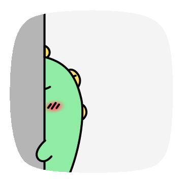
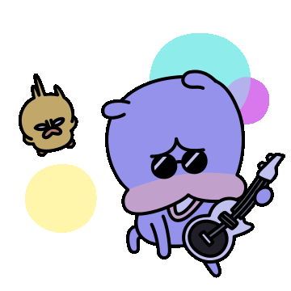

오늘은 2주차의 시작이다!!

2주차는 새로운 멤버들과 함께 하게 되었다.

이번에는 내가 팀장이 되었는데.. 개인적인 이유로 오전에는 참석하지 못했다...

팀장이 되었는데.. 죄송하고 죄송합니다 ㅠㅠ

---

이번주차 목표는 빠밤!!

**목표 - 주특기 언어와 친숙해지기 & 알고리즘 문제 찍먹하기**

* 스스로 막힘없이 풀어내는 것 보다, 구현력을 키우는 것이 알고리즘 기간의 목표입니다.
* 프로그래머스에서 총 28+a개의 문제를 풀어봅니다. 적당한 난이도의 문제들로 구성되어 있습니다.
* 알고리즘 문제와 더불어, 나의 주특기와 친해지기 위한 기본 과제를 해결해봅니다.

> **드디어 나에게 과제가 다가왔다!!!**

# [과제1](https://teamsparta.notion.site/Spring-5bc43b8d7df441c9a4b4250e4b47a537)  ( 5/19(목) 까지 40문제 + 주특기별 과제 해결 )

# 과제2 (5/13(금) 17:00 까지) 

- 과제2는 알고리즘 스터디 가이드라인 대로 1-4번 문제를 풀어보고 우리팀의 속도를 파악 후 주간 학습 계획서를 작성하는 것이다.

항해의 알고리즘 스터디 가이드 라인은 아래와 같다.

문제를 풀고 3-4시간 뒤에 모여서, 각자의 학습 내용을 발표하는 것이다.

**[알고리즘 스터디 가이드라인]**

1. 오늘은 몇번까지 풀 지 정하고, 문제별 담당자를 선정해주세요.
2. 문제의 담당자는 그 문제를 꼭 풀고, 팀원들한테 설명할 수 있는 준비를 해주세요.
3. 3~4시간 뒤에 모여서, 각자가 푼 문제에 대한 스터디를 진행합니다.

이것은 이전에도 했던 경험이 있어서 많이 도움되었엇다.

이번에도 할수 있어 벌써부터 행복하네!!

---

> 두근 두근 기대하시라... 항해가 주는 선물!!  
>   
> 
>
> 알고리즘 테스트 2회 진행 예정.... 좋아요!!!  
>   
> 5/17(화) : 15:00 ~ 17:00 (알고리즘 모의고사)  
> 5/19(목) : 15:00 ~ 17:00 (알고리즘 테스트)  
>   
>   
> 추가로 제1회 항해톡 발표자를 모집한다고 합니다... 이거 꼭해야지 ㅎㅎㅎ  
> 항해톡은 매주 수요일 총 4회 진행되는데 특정 주제를 스스로 공부하여 크루들 앞에서 발표해보는 시간입니다.  
>   
>   
> 주제 예시 : REST API, DB Index, 동기 & 비동기 등의 주요 키워드  
>   
>   
> 주간 스케쥴도 정리해주셧다 
>
> ---
>
> **05/13 (금) 17:00까지: 프로그래밍 기초주차 S.A. 제출  
> 05/13 (금) 18:00~19:00 : Mingle Friday   
> 05/16 (월) 10:00: CS 스터디 발제  
> 05/17 (화) 16:00~18:00: 알고리즘 모의고사  
> 05/18 (수) 오후: 제1회 항해톡  
> 05/19 (목) 16:00~19:00: 알고리즘 테스트****05/20 (금) 09:00: 주특기 기초주차 발제**
>
> ---

---

2주차에 대한 정리는 이렇게 된것 같다 ㅎㅎ

벌써부터 새로운 분들과의 시작이 두근두근 거리네요!!
