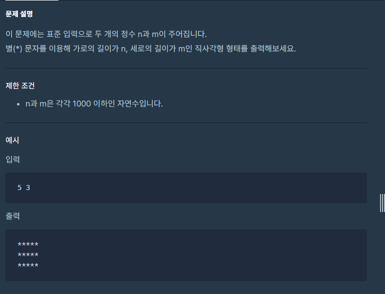
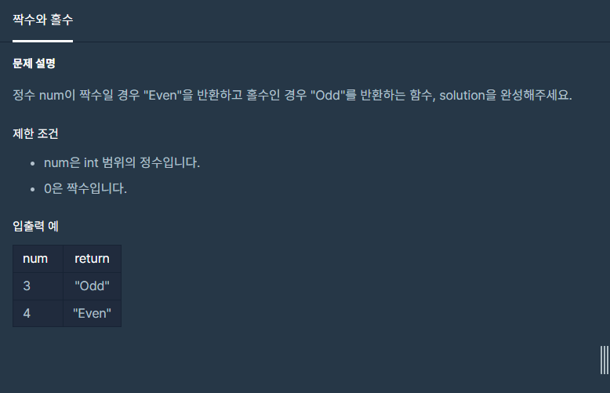
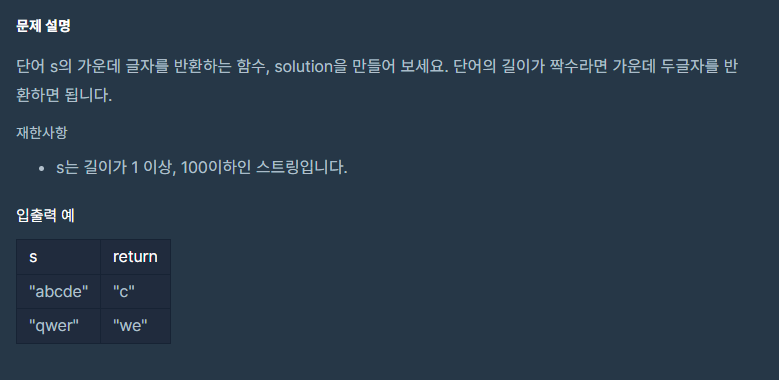
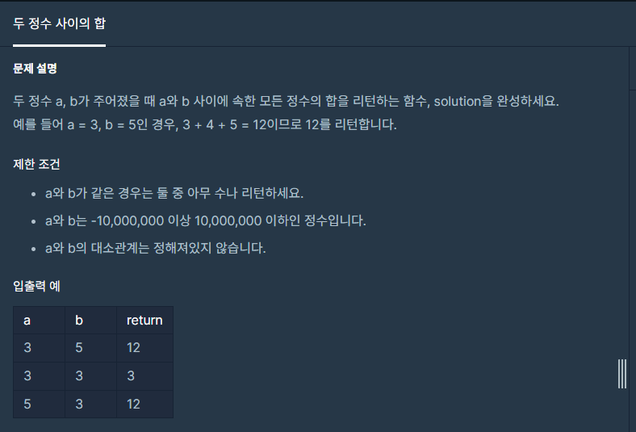
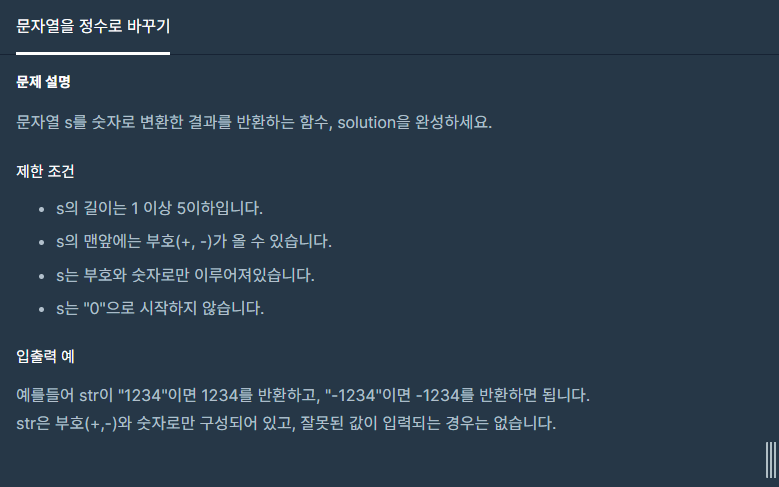
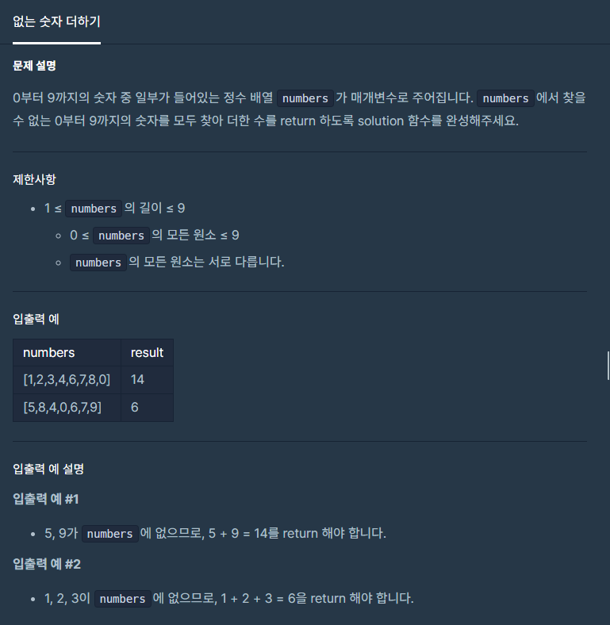

오늘은 새로운 팀원분들과

주특기 주차가 시작되었다!!

오늘은 알고리즘을 학습하는 시간을 갖는다!!

우리의 범위는 1-6번 문제이다.

Lets go! 

---

**#P. 01 : 직사각형 별찍기**

* 이 문제는 반복문, 조건문, 입출력을 사용할 수 있는지 질문하는 문제이다.



프로그래머스 - 연습문제(직사각형 별찍기)

* 풀이 방법  
  1. 정수 2개를 한줄로 입력 받아 저장한다.  
  2. 입력받은 값에서 첫번째 정수는 가로 개수, 두번째 정수는 세로줄의 개수이다.  
  3. 외부 for문에서 두 번째 정수를, 내부 for문에서 첫 번째 정수값을 반복횟수로 설정한다.  
  4. 내부 반복문에서 바로 출력하는 방법도 있지만, 시간 단축을 위해 StringBuilder에 입력해 주었다.  
  5. 내부 반복문이 끝나면 외부 반복문으로 가기전에 StringBuilder에 이스케이스 시퀀스에 줄바꿈해준다.

```
/*
 *  문제 : 직사각형 별찍기
 *  URL : https://programmers.co.kr/learn/courses/30/lessons/12969
 *  Date : 2022-05-13
 * */

import java.io.BufferedReader;
import java.io.IOException;
import java.io.InputStreamReader;
import java.util.StringTokenizer;

public class Exam01 {
    public static void main(String[] args) throws IOException {
        BufferedReader br = new BufferedReader(new InputStreamReader(System.in));
        StringBuilder sb = new StringBuilder();

        StringTokenizer st = new StringTokenizer(br.readLine(), " ");
        int N = Integer.parseInt(st.nextToken());
        int M = Integer.parseInt(st.nextToken());

        for(int i=0; i<M;i++){
            for(int j=0; j<N;j++){
                sb.append('*');
            }
            sb.append('\n');
        }

        System.out.println(sb);
    }
}
```

---

**#P. 02 : 짝수와 홀수 판별  (****Keyword : 조건문 **)****

* 이 문제는 조건문 사용할 수 있는지 질문하는 문제이다.



프로그래머스 - 짝수와 홀수

* 풀이 방법  
  1. 함수의 파라미터 값으로 입력값이 전달된다.  
  2. num 값이 2로 나눴을 때 나머지가 0일 경우 짝수, 아닌 경우 홀수로 판별할 수 있다.

```
/*
 *  문제 : 짝수와 홀수
 *  URL : https://programmers.co.kr/learn/courses/30/lessons/12937
 *  Date : 2022-05-13
 * */

public class Exam02 {
    public static void main(String[] args) {
        System.out.println(solution(3));
    }

    private static String solution(int num) {
        return((num % 2 == 0) ? "Even":"Odd");
    }
}
```

---

**#P. 03 : 가운데 글자 가져오기  (****Keyword : String 내장 함수 **)****

* 문자열을 자유롭게 자르고 붙이고 할 수 있는지를 점검하는 문제이다.



* 풀이 방법  
  1. 함수의 파라미터 값으로 입력값이 전달된다.  
  2. 문자열 길이가 홀수일경우 인덱스 중간값을, 짝수일 경우는 중간 2개를 반환한다.

```
/*
 *  문제 : 가운데 글자 가져오기
 *  URL : https://programmers.co.kr/learn/courses/30/lessons/12903
 *  Date : 2022-05-13
 * */

public class Exam03 {
    public static void main(String[] args) {
        System.out.println(solution("abcde"));
        System.out.println(solution("qwer"));
    }

    private static String solution(String s) {
        int length = s.length();

        if(length % 2 != 0){
            return s.substring(length/2, length/2+1);
        }else{
            return s.substring(length/2-1,length/2+1);
        }
    }
}
```

---

**#P. 04 : 두 정수 사이의 합  (** **Keyword :조건문, 반복문, String 내장함수 **)****

* 문자열을 자유롭게 자르고 붙이고 할 수 있는지를 점검하는 문제이다.



프로그래머스 - 두 정수 사이의 합

* 풀이 방법  
  1. 입력된 두 수 a, b의 값 사이에 합을 구해야하므로 큰 값과 작은 값으로 나눠주어야 한다.  
  2. 작은 값을 시작으로 큰 값까지 반복문을 사용하면 합을 구해주면 된다.  
  3. 반복문을 사용하는 방법도 있지만, 등차수열의 합 공식을 사용하며 풀이하였다.

```
/*
 *  문제 : 두 정수 사이의 합
 *  URL : https://programmers.co.kr/learn/courses/30/lessons/12912
 *  Date : 2022-05-13
 * */

public class Exam04 {
    public static void main(String[] args) {
        System.out.println(solution(3, 5));
        System.out.println(solution(3, 3));
    }

    private static long solution(int a, int b) {
        return sum(Math.min(a, b), Math.max(b, a)) ;
    }

    private static long sum(long a, long b) {
        return (b - a + 1) * (a + b) / 2;
    }
}
```

---

**#P. 05 : 문자열 정수로 바꾸기 (****Keyword : 형변환 **)****

* 문자열을 정수타입으로 형변환 할 수 있는지를 알아보는 문제이다.



프로그래머스 - 문자열 정수로 바꾸기

* 풀이 방법  
  1. 입력된 문자열의 첫번째 인덱스 값을 가지고 '+', '-'인지 판단해야한다.  
  2. 판단 후 첫번째 인덱스 값이 '0'보다 크거나 같고, '9'보다 작거나 같을때는 바로 형변환  
  3. 아닐경우 첫번째 인덱스 값과 문자열의 첫번째 인덱스를 제외한 나머지를 substring으로 잘라준다.  
  4. 부호와 substring된 문자열을 합치고 형변환시켜주면된다.  
  즉, 바로 형변환 해주면 해결된다.

```
/*
 *  문제 : 문자열을 정수로 바꾸기
 *  URL : https://programmers.co.kr/learn/courses/30/lessons/12925
 *  Date : 2022-05-13
 * */

public class Exam05 {
    public static void main(String[] args) {
        System.out.println(solution("1234"));
        System.out.println(solution("+1234"));
        System.out.println(solution("-1234"));
    }

    private static int solution(String s) {
        return Integer.parseInt(s);
    }
}
```

---

**#P. 06 : 없는 숫자 더하기(****Keyword : 배열, Arrays 사용방법,반복문**)****

* 배열, 반복문 등에 대한 이해가 필요하다.



프로그래머스 - 없는 숫자 더하기

* 풀이 방법  
  - 위 문제는 문제 풀이 방법이 정말 다양하다.  
  1) 0 부터 10까지 반복문을 순회하면서 배열에서 해당 값을 삭제하고 남아 있는 배열의 값을 합하는 방법  
  2) 0 부터 10까지 합에서 배열의 합을 빼는 방법 **(만약 배열에 중복 값이 있을 경우 사용하지 못한다.)**  
  3) 0 부터 10까지 반복문을 순회하는 반복문 값이 배열에 존재하지 않을 경우 해당 값을 바로 합하는 방법

```
/*
 *  문제 : 없는 숫자 더하기
 *  URL : https://programmers.co.kr/learn/courses/30/lessons/86051
 * Date : 2022-05-13
 * */

import java.util.Arrays;

public class Exam06 {
    public static void main(String[] args) {
        int arr1[] = {1,2,3,4,6,7,8,0};
        int arr2[] = {5,8,4,0,6,7,9};
        System.out.println(solution(arr1));
        System.out.println(solution(arr2));
    }

    private static int solution(int[] numbers) {
        // 1. 배열을 정렬 시킨다.
        // 2. 반복문을 통해 값이 존재하는지 확인한다.
        // 3. 있으면 pass 없으면 합

        Arrays.sort(numbers);
        int sum = 0;
        for(int i=0; i<10;i++){
            int finalI = i;
            sum += Arrays.stream(numbers).anyMatch(value -> value == finalI) ? 0 : i;
        }

        return sum;
    }
}
```

---

#### **정리**

현재 새로운 분들과 새로운 조가 편성되었는데생각했던 것과 다르게 비전공자분들이셨다.현재 프리트랙과정에 주특기를 듣지 않으신 분들이 계셔서개인마다 문제풀이 속도가 크게 차이나고 있다.그래서 속도를 낼 수 없는 상황이라 첫날은 6문제로 마감하였다.

#### **해야할 일**

기존에 알고리즘 학습할 때는 문법을 알고 있는 상태에서시작했기 때문에 지금의 문제를 경험해보지 못했다.그래서 창의적인 생각을 통해 현재의 문제를 해결할 필요가 있다.


