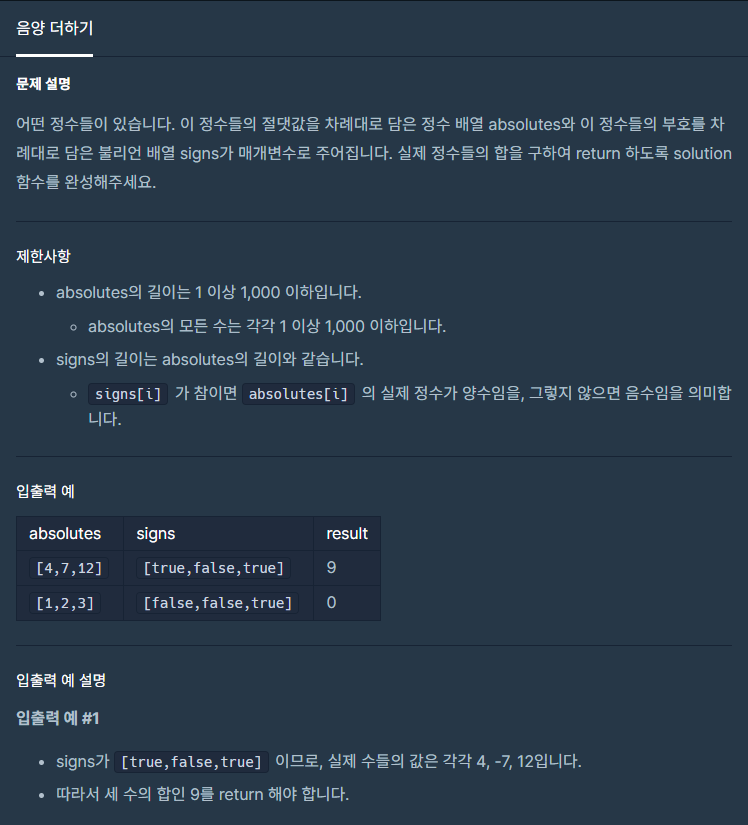
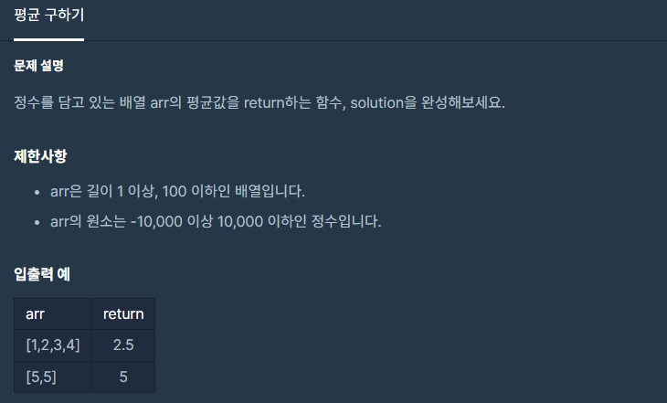
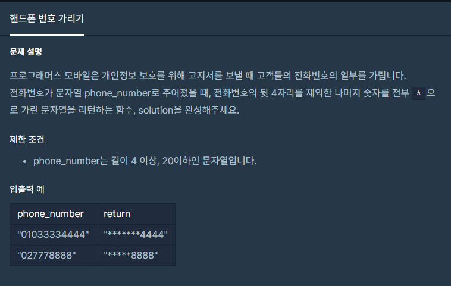
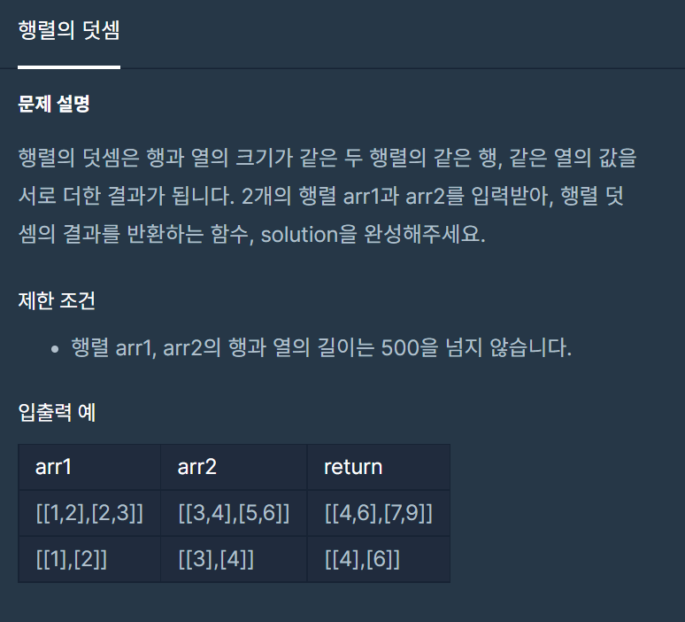
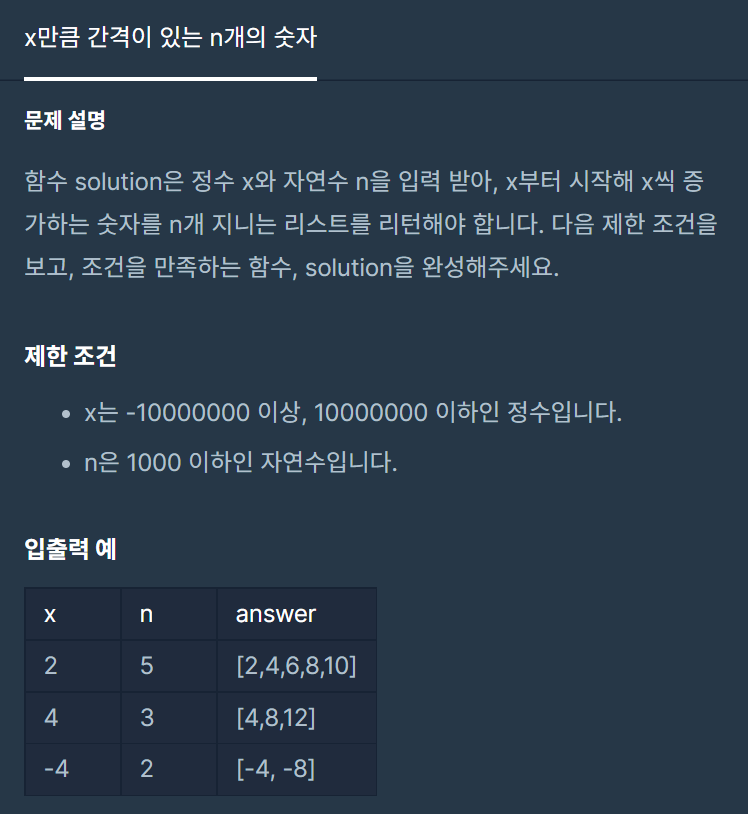

오늘은 알고리즘 2일차!!

주특기 주차가 시작되었지만..

알고리즘 수업은 아직 듣지는 못했다... 


---

**#P. 07 : 음양 더하기(난이도 : 하)**

* 이 문제는 배열, 조건문에 대한 이해가 있는지 점검하는 문제이다.



프로그래머스 - 연습문제(음양 더하기)

* 풀이 방법  
  1. 배열음 참조하여 signs의 값이 참일 때 합, 거짓일때 차를 하면 된다.

```
package day2;

/*
 *  문제 : 음양 더하기
 *  URL : https://programmers.co.kr/learn/courses/30/lessons/76501
 *  Date : 2022-05-14
 * */

public class Exam07 {
    public static void main(String[] args) {
        int arr1[] = {4,7,12};
        boolean arr2[] = {true,false,true};
        System.out.println(solution(arr1, arr2));
    }

    public static int solution(int[] absolutes, boolean[] signs) {
        int sum = 0;
        for(int i=0; i<absolutes.length; i++)
            sum += absolutes[i] * (signs[i] ? 1: -1);

        return sum;
    }
}
```

---

**#P. 08 : 평균 구하기(난이도 : 하)**

* 이 문제는 배열의 값에 접근할 수 있는지 점검하는 문제이다.



* 풀이 방법  
  + Intstream을 이용해서 풀이하는 방법을 선택하였다.
  + 배열을 Intstream에 넣어서 sum함수를 호출하여 계산한 뒤 배열의 길이만큼 나눈다.
  + return 전에 타입을 double형으로 변환해준다.

```
package day2;

/*
 *  문제 : 평균 구하기
 *  URL : https://programmers.co.kr/learn/courses/30/lessons/12944
 *  Date : 2022-05-14
 * */

import java.util.stream.IntStream;

public class Exam08 {
    public static void main(String[] args) {
        int arr1[] = {4,7,12};
        System.out.println(solution(arr1));
    }

    public static double solution(int[] arr) {

        return (double)IntStream.of(arr).sum() / arr.length;
    }
}
```

---

**#P. 09 : 핸드폰 번호 가리기(난이도 : 하)**

* 이 문제는 문자열의 내장함수를 사용하는 방법을 확인하는 문제이다.



* 풀이 방법  
  1. substring을 사용하여 앞과 뒤로 자른다.  
  2. front에 들어간 숫자는 \*으로 변경하고 Stringbuilder에 저장시킨다.  
  3. front와 back을 Stringbuilder에 삽입하고 return 하여 준다.

```
package day2;

/*
 *  문제 : 핸드폰 번호 가리기
 *  URL : https://programmers.co.kr/learn/courses/30/lessons/12948
 *  Date : 2022-05-14
 * */

public class Exam09 {
    public static void main(String[] args) {
        System.out.println(solution("027778888"));
    }

    public static String solution(String phone_number) {
        StringBuilder sb = new StringBuilder();

        String front = phone_number.substring(0, phone_number.length()-4);
        String back = phone_number.substring(phone_number.length()-4);

        for(int i=0; i<phone_number.length()-4; i++){
            front = front.replace(phone_number.charAt(i), '*');
        }

        sb.append(front);
        sb.append(back);

        return sb.toString();
    }
}
```

---

**#P. 10 : 핸드폰 번호 가리기(난이도 : 하)**

* 이 문제는 2차원 배열의 사용 방법을 알고 있는지에 대한 문제이다.



* 풀이 방법  
  1. 이중 for문을 통해 값에 접근한다.  
  2. 새로운 배열을 선언하는 방법 대신 입력값으로 들어온 arr1 배열에 arr2를 더하는 방법을 사용하였다.

```
package day2;

/*
 *  문제 : 행렬의 덧셈
 *  URL : https://programmers.co.kr/learn/courses/30/lessons/12950
 *  Date : 2022-05-14
 * */

public class Exam10 {
    public static void main(String[] args) {
        int[][] arr1 = new int[][] {{1,2},{2,3}};
        int[][] arr2 = new int[][] {{3,4},{5,6}};
        System.out.println(solution(arr1, arr2));
    }

    public static int[][] solution(int[][] arr1, int[][] arr2) {
        for(int i=0; i<arr1.length;i++){
            for(int j=0; j<arr1[i].length;j++){
                arr1[i][j] += arr2[i][j];
            }
        }
        return arr1;
    }
}
```

---

**#P. 11 : x만큼 간격이 있는 n개의 숫자(난이도 : 하)**

* 이 문제는 2차원 배열의 사용 방법을 알고 있는지에 대한 문제이다.



* 풀이 방법  
  1. 입력 받은 n값의 크기로 배열을 초기화 시킨다.  
  2. long 타입으로 num 이라는 변수를 선언하고 x값으로 초기화 시킨다.  
  3. x값을 입력하고 num에 x값을 반복해서 더해주는 방법을 선택하였다.

```
package day2;

/*
 *  문제 : x만큼 간격이 있는 n개의 숫자
 *  URL : https://programmers.co.kr/learn/courses/30/lessons/12954
 *  Date : 2022-05-14
 * */


public class Exam11 {
    public static void main(String[] args) {
        System.out.println(solution(-4, 5));
        System.out.println(solution(-5, 10));
    }

    public static long[] solution(int x, int n) {
        long[] answer = new long[n];

        long num = x;
        for (int i = 0; i<n;i++){
            answer[i] = num;
            num += x;
        }
        return answer;
    }
}
```
