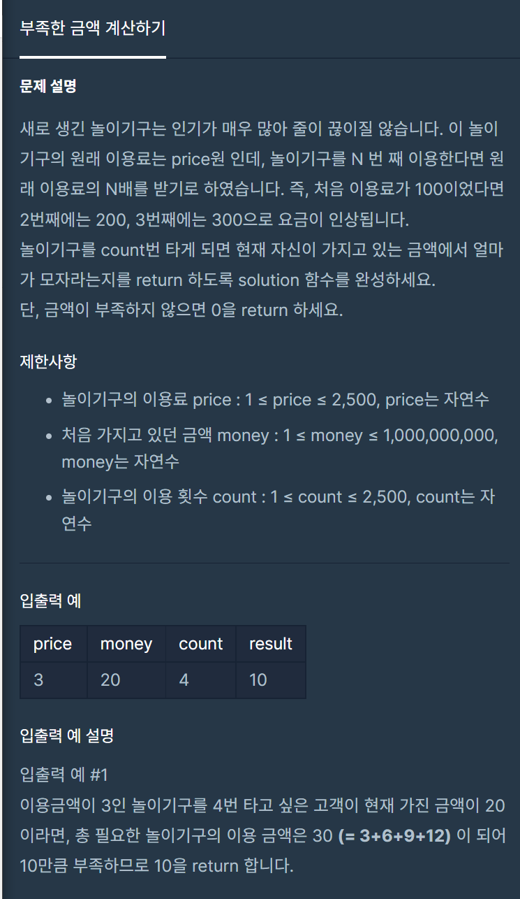

**#P. 12 : 부족한 금액 계산하기(난이도 : 중하)**

* 이 문제는 규칙을 찾아야하는 문제이다.



프로그래머스 -&nbsp;부족한 금액 계산하기

* 풀이 방법  
  1. count 만큼 가격을 계속해서 합한다.  
  2. 현재 갖고 있는 금액 money보다 많은지 확인한다.  
  3. 현재 갖고 있는 금액이 더 많은 경우 0을, 계산해야할 금액이 더많을 경우 부족한 값을 반환한다.  
  4. 다른 풀이법으로는 등차수열의 합을 이용하는 방법이 있다.  
  5. return 시에는 삼항연산자를 사용하여 간단하게 풀이가능하다.

```
package day2;

/*
 *  문제 : 부족한 금액 계산하기
 *  URL : https://programmers.co.kr/learn/courses/30/lessons/82612
 *  Date : 2022-05-14
 * */

public class Exam12 {

    // 원래 이용료는 price원
    // 놀이기구를 N 번 째 이용한다면 원래 이용료의 N배를 받기
    // 100원, 200, 300

    public static void main(String[] args) {
        System.out.println(solution1(3, 20, 4));
    }

    /* 반복문 풀이 방법 */
    public static long solution(int price, int money, int count) {
        long sum = 0;
        for(int i = 0; i<count; i++){
            sum = sum + (price *(i+1));
        }

        return money > sum? 0 : sum - money;
    }

    /* 등차수열의 합 */
    public static long solution1(int price, int money, int count) {
        long sum = (count*(2*price + (count-1)*price))/2;

        return money > sum? 0 : sum - money;
    }
}
```
