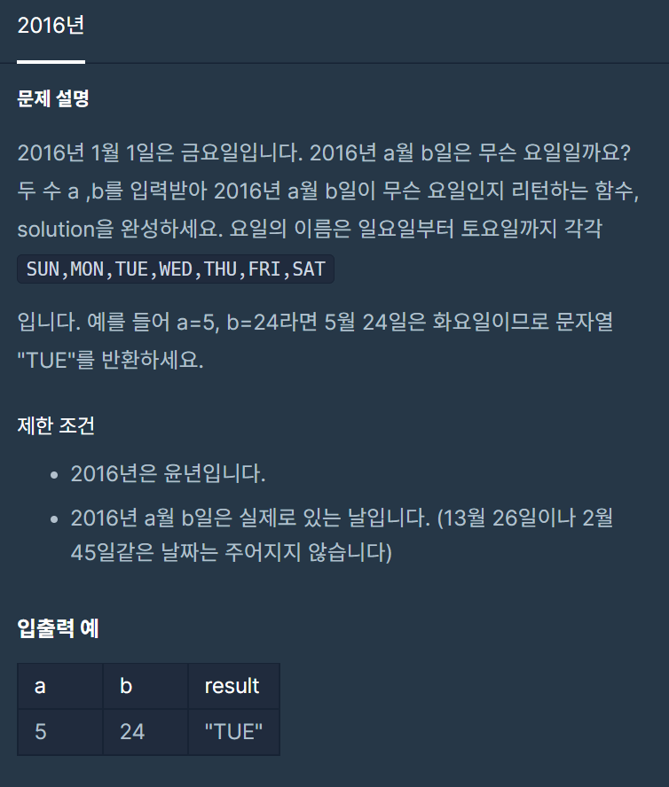

**#P. 13 : 2016년 (난이도 : 중하)**

* 이 문제는 1월 1일 금요일을 기준으로 입력되는 날짜의 요일을 짧게 대문자로 출력하는 문제이다.
* 문제 풀이를 위해서는 윤년에 대한 이해가 필요한 문제이다.



프로그래머스 - 연습문자(2016년)

* 풀이 방법  
  + 1. 캘릭더 클래스를 이용한 방법
  + 2. 직접 배열에 요일과 월별 일수를 입력하여 풀이하는 방법

   - 성능 상으로는 2번 방법이 훨씬 우수하였다.

```
package day2;

/*
 *  문제 : 2016년
 *  URL : https://programmers.co.kr/learn/courses/30/lessons/12901
 *  Date : 2022-05-14
 * */

import java.util.Calendar;
import java.util.Locale;

public class Exam13 {
    public static void main(String[] args) {
        System.out.println(solution(5, 24));
    }

    public static String solution0(int month, int day) {
        // 1. 캘린더 클래스를 이용하자.
        // 요일을 입력하여 캘린더에 있는 요일의 값을 출력하자.
        Calendar cal = new Calendar.Builder().setCalendarType("iso8601").setDate(2016, month - 1, day).build();         // 날짜를 생성
        return cal.getDisplayName(Calendar.DAY_OF_WEEK, Calendar.SHORT, new Locale("ko-KR")).toUpperCase(Locale.ROOT);     // 짧게 요일을 대문자로 달라! 기준은 한국이다.
    }

    public static String solution(int a, int b) {
        String answer = "";
        String[] day = {"FRI", "SAT", "SUN", "MON", "TUE", "WED", "THU"};  // 요일
        int[] date = {31, 29, 31, 30, 31, 30, 31, 31, 30, 31, 30, 31};     // 월의 일수
        int allDate = 0;                                                     // 총 일수

        for (int i = 0; i < a - 1; i++) {                                    // 4월 까지의 일수 의 합
            allDate += date[i];
        }

        allDate += (b - 1);                                                  // 5월의 일 수 추가
        answer = day[allDate % 7];                                           // 요일 계산
        return answer;
    }
}
```
