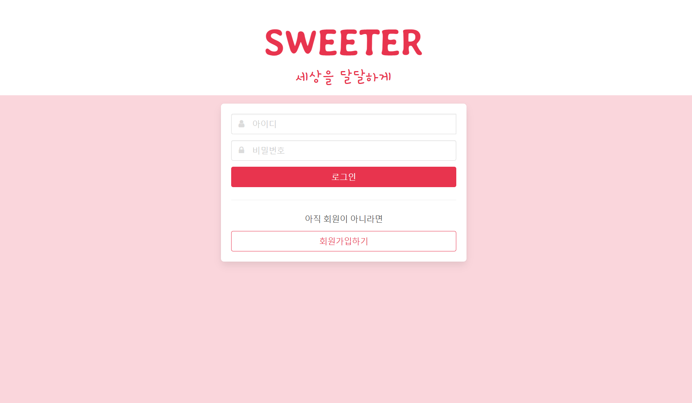
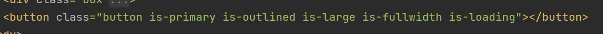
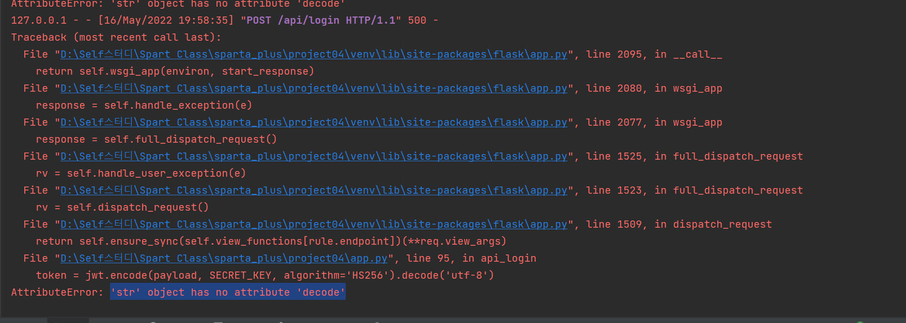
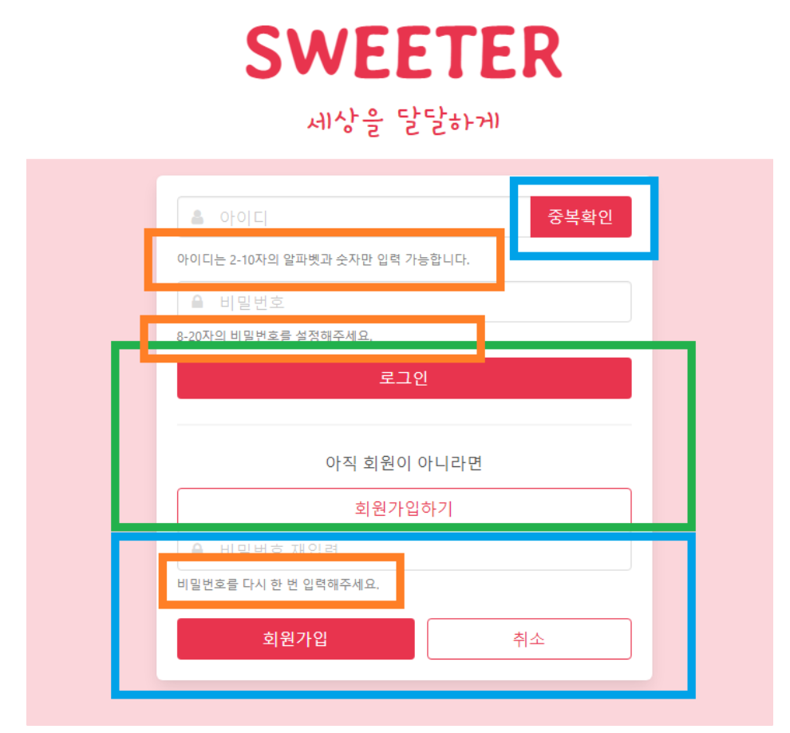
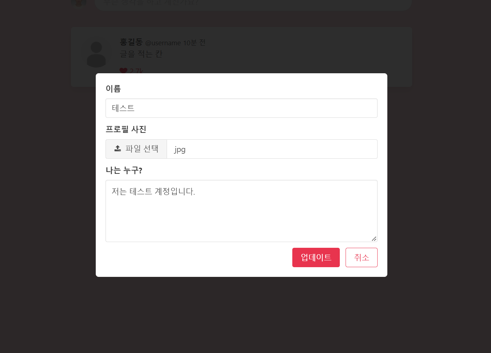
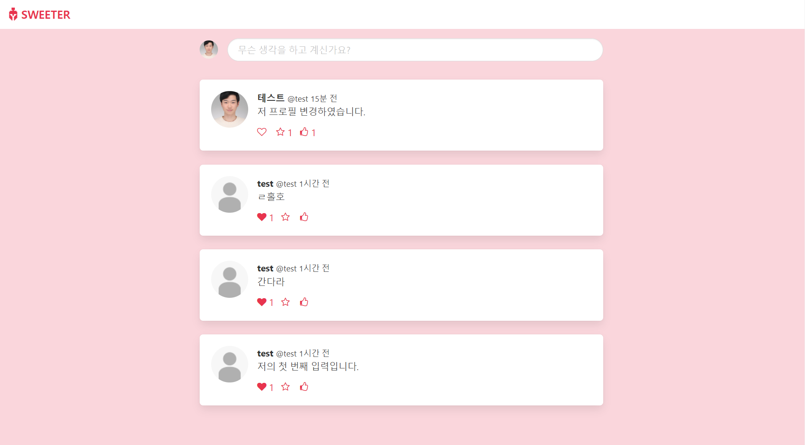
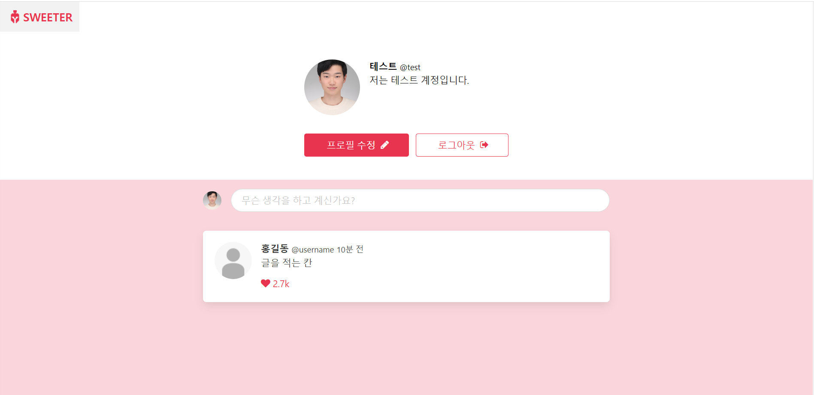

오늘은 미니프로젝트 기간에 보고 해야했던 수업을 들으려고 한다..

늦었지만.. 얼른봐야지 봐야할게 산더미고 해야할 것은 백두산 보다 높은 것 같아...

---

[웹개발 플러스 - 4주차]

[수업 목표]

1. Bulma로 예쁜 웹사이트 만들기

2. 로그인 기능을 구현

[목차]

0. 이번 주에 배울 것

1. Bulma로 웹사이트 꾸미기

2. 회원가입

3. 로그인

4. Sweeter

5. 회원가입 페이지

6. 로그인 페이지

6. 메인 페이지

7. 프로필 페이지

8. 4주차 끝 & 숙제

---

**#S.0 이번 주에 배울 것**

- 로그인 기능을 구현하여 전체에게 공개된 내용과 개인이 볼 수 있는 내용이 다르게 만들 것이다.

Sweeter 프로젝트 미리보기

---

**#S.1 Bulma로 웹사이트 꾸미기**

**1. Bulma란?**

> 우리가 써봤던 Bootstrap과 비슷하게, 미리 정해진 모습의 클래스를 가져다쓸 수 있는 무료 CSS 프레임워크입니다.

* Bootstrap과 비교
  + Bootstrap은 jQuery을 써서 웹사이트에서의 상호작용을 쉽게 구현할 수 있는 반면, Bulma는 순수한 CSS 프레임워크이기 때문에 기능을 직접 구현해야하지만 대신 더 자유롭게 커스터마이징이 가능해요.
  + Bootstrap은 커뮤니티가 커서 테마나 플러그인 등이 개발이 많이 되어있고 질문에 대한 답이나 예시 등을 찾기 쉽고, Bulma는 문법이 직관적이고 Flexbox 등 최신기술을 많이 써요!

2. 프로젝트 세팅

패키지 설치 : flask, pymongo, pyjwt, dnspython

3. 예제를 통한 비교

- 아래와 같이 어떤 역할을 할 것인지 알 수 있다. 이것이 Bulma의 장점이다.

---

**#S.2 회원가입**

- 회원가입 기능을 이해하기 위해서는 해시 함수라는 개념을 알면 훨씬 더 명쾌하게 이해할 수 있다.

1) 해시 함수란?

> 💡 해시함수란, 알고리즘의 한 종류로서 임의의 데이터를 입력 받아 항상 고정된 길이의 임의의 값으로 변환해주는 함수를 말합니다.

* 우리가 회원가입에 사용할 해시함수 SHA256은 어떤 길이의 입력값을 넣어도 항상 256바이트의 결과값이 나옵니다!
* 추가적으로 동일한 입력값은 항상 같은 결과값이 나오고, 입력값은 조금이라도 달라지면 완전히 다른 값이 나오게 됩니다. 그리고 결과값을 통해 입력값을 알아내는 것이 불가능하다는 세 가지 특징이 있습니다!33

2) 강의 중 에러 발생

decode 속성 에러

(해결법) : 에러 그대로 decode attribute가 없다고 하여 지워주었더니 해결되었다. 이유가 무엇인지 알아야할 것 같다.

(이유) : 버전 문제라고 한다. 

> pyjwt 기존 버전에서는 jwt.encode()함수의 리턴값이 '바이트 문자열'이라는 자료형이었기 때문에 뒤에 .decode('utf-8')를 붙여 일반 문자열로 바꾸어 주었음. 2.0.0 버전부터는 이 함수의 리턴값이 일반 문자열이기 때문에 여기에 또 .decode('utf-8')를 붙여주게 되면 문자열에는 이런 메소드가 없으므로 에러가 난다.  
> (101100100110 같은 바이트 자료를 문자열로 바꾸는 것이 decode)

<참고> 항해 5일차 미니프로젝트 동기의 자료

<https://velog.io/@lipton/%ED%95%AD%ED%95%B499-1%EC%A3%BC%EC%B0%A8-%ED%9A%8C%EA%B3%A0>

[항해99 5일차 미니과제 회고

app.py 로그인 기능이 에러 (AttributeError: ‘str’ object has no attribute ‘decode’)pyjwt 기존 버전에서는 jwt.encode()함수의 리턴값이 '바이트 문자열'이라는 자료형이었기 때문에 뒤에 .decode('utf-

velog.io](https://velog.io/@lipton/%ED%95%AD%ED%95%B499-1%EC%A3%BC%EC%B0%A8-%ED%9A%8C%EA%B3%A0)

---

**#S.3 로그인**

**1) JWT**

> JSON Web Token의 줄임말로, JSON 객체를 사용해 정보를 안정성 있게 전달하는 웹표준이에요!

* 예를 들어, 로그인 기능을 생각해보면 사용자가 로그인하면 서버에서 회원임을 인증하는 토큰을 넘겨줌으로써 이후 회원만 접근할 수 있는 서비스 영역에서 신분을 확인하는 데 쓰일 수 있습니다.
* 즉, JSON을 통한 정보 전달 방식인데 이 정보가 Token으로 왔다가 갔다 한다.

- JWT는 아래 자료를 통해 더 자세히 알 수 있다.

<참조> JWT : <https://github.com/bang-star/TIL/blob/main/web/jwt.md>

[GitHub - bang-star/TIL: My Daily

My Daily. Contribute to bang-star/TIL development by creating an account on GitHub.

github.com](https://github.com/bang-star/TIL/blob/main/web/jwt.md)

2) 쿠키

> 브라우저의 자체 데이터베이스라고 이해하시면 된다. 페이지와 관계없이 브라우저가 계속 Key:Value 형태로 특정한 정보를 계속 저장하고 있는 것입니다.

3) 로그인 기능 정리

* 로그인 시, 비밀번호를 같은 방법으로 암호화한 후, DB에서 해당 아이디와 비밀번호를 갖는 회원이 있는지 찾습니다. 회원 정보가 없는 경우 실패 메시지를 보내고, 찾은 경우 아이디와 토큰 만료 시간을 저장하는 토큰을 만들어 넘겨줍니다.
* 로그인 성공 메시지를 받으면 건네받은 토큰을 쿠키로 저장하여 만료되기 전까지 갖고 있으면서, API 요청을 보낼 때마다 회원임을 확인받습니다.
* 로그아웃 시 해당 토큰을 삭제합니다.

---

**#S.3 Sweeter**

**1) 기능 파악**

**2) API 설계하기**

1. 로그인 & 회원가입  
   1. 기본 화면으로 로그인 화면 보이기
   2. '회원가입하기' 버튼을 클릭하면 회원가입 화면으로 바뀌기
   3. '취소' 버튼을 클릭하면 로그인 화면으로 돌아오기
   4. 회원가입
      1. 아이디 & 비밀번호 형식 확인
      2. 아이디 중복 확인
      3. DB에 아이디와 비밀번호 저장하여 회원가입 & 로그인 화면으로 전환
   5. 로그인
      1. 아이디 & 비밀번호 입력 확인
      2. 서버로 POST 요청을 보내 가입 정보가 존재하는지 확인
      3. 회원일 경우 토큰 부여
2. 메인 페이지  
   1. 모든 사람의 포스트를 시간 역순으로 보여주기
   2. 각 포스트에 좋아요/좋아요 취소 가능
      1. 좋아요 누른 포스트는 찬 하트로 보여주기
   3. 포스팅 칸에 내 프로필 사진 보여주기
      1. 프로필 사진 누르면 프로필 페이지로 이동
   4. 포스팅 칸 클릭하면 포스팅 모달 띄우기
      1. 포스팅하기 버튼 클릭하면 포스트 DB에 저장
      2. 새로고침하여 포스트 목록 다시 띄우기
3. 프로필 페이지 
   1. 해당 사용자의 포스트만 시간 역순으로 보여주기
   2. 내 프로필이라면 프로필 수정 & 로그아웃 버튼 보여주기
   3. 내 프로필일 때만 포스팅 칸 보여주기
   4. 프로필 수정 버튼 클릭하면 프로필 수정 모달 보여주기
      * 기존의 저장되어 있는 값 보여주기
      * 수정 시 DB에 업데이트하고 새로고침해서 변경사항 적용
   5. 로그아웃 버튼 클릭하면 토큰 삭제하고 로그인 페이지로 이동

참고 : 항해 1주차 - 나의 미니프로젝트에서는 강의를 보지는 않았지만, 여기서 많은 것을 구현했던 것 같다.

(포스팅되어 있으니 참고해보세요~!! 코드는 다릅니다)

**3) 로그인**

- 하단 이미지와 같이 눌렀을때 사라지고, 눌렀을때 보여야하는 것이 함께 있다. 이것을 JQuery에서 쉽게 할 수 있도록 해준 것이 있다. 

- class 명에 is-hidden을 추가하고, toggleClass를 사용하면 된다.

> function toggle\_sign\_up() { $("#sign-up-box").toggleClass("is-hidden") }

**4) 회원가입**

**(1) 규칙**

* 회원가입할 때는 입력 받은 값들이 형식에 맞는지 우선 확인해야겠죠?
  + 아이디: 영문과 숫자, 일부 특수문자(.\_-)만 사용 가능, 2-10자 길이. 영문 무조건 포함
  + 비밀번호: 영문, 숫자는 1개 씩 무조건 포함, 일부 특수문자 사용 가능, 8-20자 길이
  + 비밀번호 확인: 비밀번호와 일치

> **1. 아이디, 비밀번호 정규표현식**  
>   
> function is\_nickname(asValue)   
> { var regExp = /^(?=.\*[a-zA-Z])[-a-zA-Z0-9\_.]{2,10}$/; return regExp.test(asValue); }   
>   
> function is\_password(asValue) { var regExp = /^(?=.\*\d)(?=.\*[a-zA-Z])[0-9a-zA-Z!@#$%^&\*]{8,20}$/; return regExp.test(asValue); }

(2) 포스팅 모달

* 실제로 글을 적을 수 있는 포스팅 모달은 우선 모습을 만들고 숨겨놓았다가 포스팅 칸을 클릭하면 나타납니다. 바깥 배경 영역이나 X표, 취소 버튼을 클릭하면 사라집니다. 나타나고 사라지는 것은 is-active 클래스를 이용해 제어가 가능합니다.

---

**#S.3 Sweeter(과제까지 포함)**

---

> 미니프로젝트 이후에 몇일이 지나고 보고 나서 느꼈다...  
>   
> 나는 힘들게 보지 않고 만들었다는 것을...  
>   
> 더 쉽고 디자인이 이쁘게 만들 수 있었는데 .. 아쉽다는 생각밖에 안든다...  
>   
> 다음 프로젝트에서는 여기서 배운 것을 활용할 계획이다.!!
