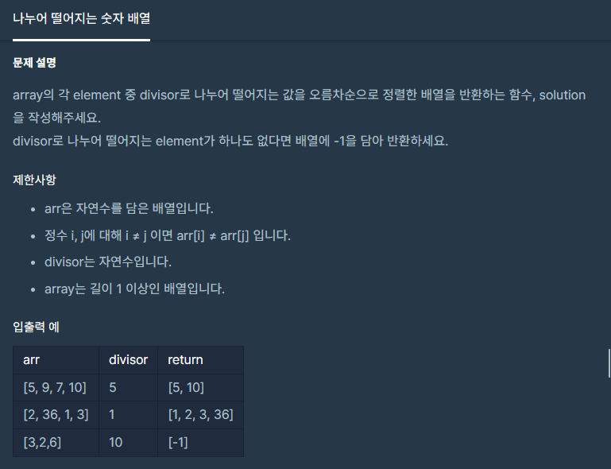

**#P. 14 : 나누어 떨어지는 숫자 배열 (난이도 : 중하)**

* 이 문제는 조건문과 오름차순 정렬에 대한 문제이다.



프로그래머스 - 나누어 떨어지는 숫자 배열

* 풀이 방법  
  + 1. List + Collections.sort
  + 2. 배열 + Arrays.sort
  + 3. 배열과 반복문

- 코드는 2번이 제일 간결하다.

```
public static int[] solution(int[] arr, int divisor) {
    List<Integer> list = new ArrayList<Integer>();

    for(int i=0; i<arr.length; i++){
        if(arr[i]%divisor ==0){
            list.add(arr[i]);
        }
    }

    if(list.isEmpty())
        list.add(-1);

    Collections.sort(list);

    return list.stream().mapToInt(i -> i).toArray();
}
```

```
public static int[] solution1(int[] arr, int divisor){
    int[] answer = Arrays.stream(arr).filter(x -> x % divisor ==0).toArray();
    Arrays.sort(answer);
    return answer.length == 0 ? new int[]{-1}: answer;
}
```

```
public static int[] solution2(int[] arr, int divisor){
    int count = 0;
    for(int a : arr){
        if(a%divisor==0)
            count++;
    }

    if(count == 0) return new int[]{-1};
    int[] answer = new int[count];
    for(int i=0; i<answer.length;i++){
        if(arr[i]%divisor==0)
            answer[i] = arr[i];
    }

    return answer;
}
```
