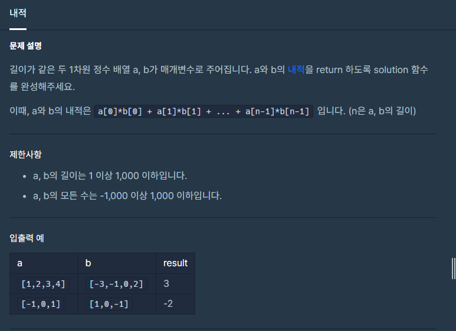

**#P. 15 : 내적  (난이도 : 중하)**

* 이 문제는 정수형 배열의 곱의 합을 계산하는 문제이다.
* 다른 문제들에 비해 간단한 문제이다.



프로그래머스 - 연습문제 : 내적

```
public static int solution(int[] a, int[] b) {
    int sum = 0;
    for(int i=0; i<a.length;i++){
        sum += a[i] * b[i];
    }
    return sum;
}
```
