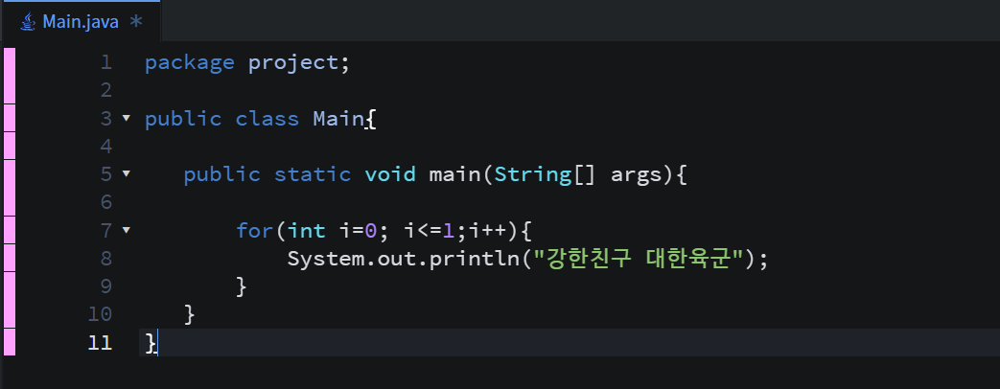
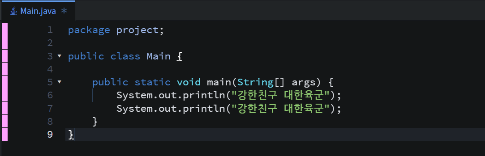
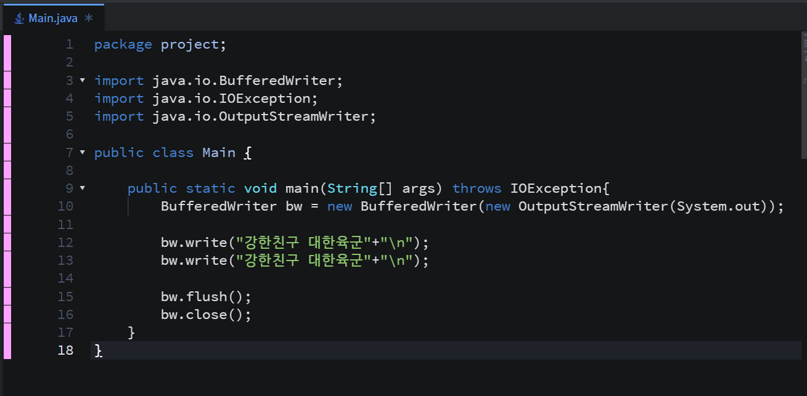

### 서론

**- 출력을 할 줄 아는가하는 문제인데 풀이 방법은 다양한 방법이 있겠지만, 간결하고 간단하게 작성하는 것이 최선이라 생각하고 풀이하였습니다.**

* **문제**

10718번 - We love Krill

* **풀이****풀이 방법은 총 3가지 입니다.**

**- 방법 1(System.out.println + 반복문)**

방법1

- 방법 2(System.out.println)

방법2

- 방법3(BufferWriter)

방법3

* 실행결과

실행결과

실행결과에서 1, 2가 있는데 1번은 반복문으로 풀이한 결과이고, 2번은 두줄로 작성한 것입니다.

실행결과 3에서는 BufferWriter를 사용하여 비교하기 위해 추가하였습니다(2022-04-06 기준). 그런데 속도 차이가 없는 것을 볼수 있습니다... 제 컴퓨터 사양이 좋지 않아서 그런건지 저는 속도가 많이 느리게 나오더라고요 ㅠㅠ

**<참고>**

**다른 분들은 코드를 어디서 작성하시는지 모르겠지만.. 저는 구름 IDE를 활용하고 있습니다.**

**이유는 간단하고 어디서든 사용가능하기 때문입니다. 매번 프로젝트나 소스를 만들지 않고 테스트하기도 좋습니다.**
