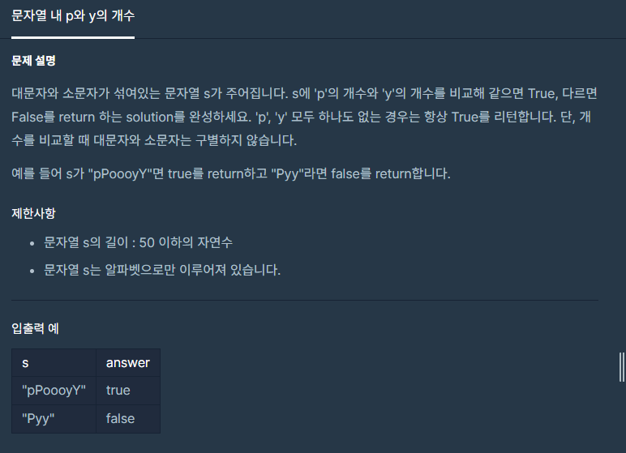

**#P. 16 : 문자열 내 p와 y의 개수 (난이도 : 중하)**

* 이 문제는 문자열을 대문자와 소문자로 변경하는 방법을 질문하는 문제이다.



* 풀이 방법  
  + 1. 문자열을 대문자나 소문자로 통일
  + 2. p,y의 개수를 확인할 수 있는 정수형 타입 변수 1개 선언
  + 3. P를 찾으면 ++, Y를 찾으면 --
  + 4. 변수에 값이 0이면 true, 아니면 false

```
static boolean solution(String s) {
    // 1. 문자열을 대문자 또는 소문자로 일치시킨다.
    // 2. p,y의 개수를 확인할 수 있는 변수 1개를 설정한다.
    // 3. p를 찾으면 ++, y를 찾으면 --
    int count = 0;
    for(char ch : s.toLowerCase().toCharArray()){
        switch (ch){
            case 'p': count++; break;
            case 'y': count--; break;
            default: break;
        }
    }
    return count==0 ? true: false;
}
```
