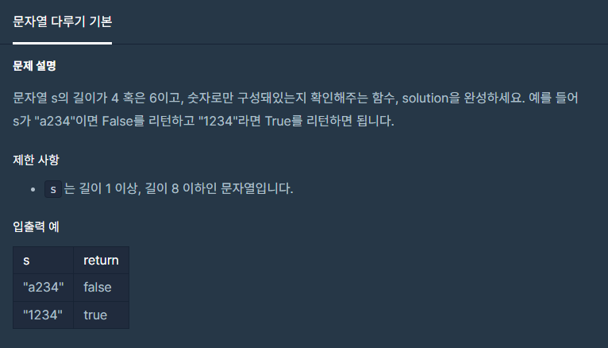

**#P. 17 : 나누어 떨어지는 숫자 배열 (난이도 : 중하)**

* 이 문제는 11점을 받았다..!!!
* 기억에 남을만한 점수이다.....
* 문자열을 확인하여 문자열의 길이와 문자열의 상태를 확인하는 문제이다.



풀이 방법

* 1. 정규식 표현

```
static boolean solution(String s) {
    // 1. 문자열 길이 체크.
    // 2. 영문자 확인(정규식 표현)
    int length = s.length();
    if(length == 4 || length ==6){
        if(s.matches(".*[a-zA-Z].*")){
            return false;
        }else{
            return true;
        }
    }else{
        return false;
    }
}
```
