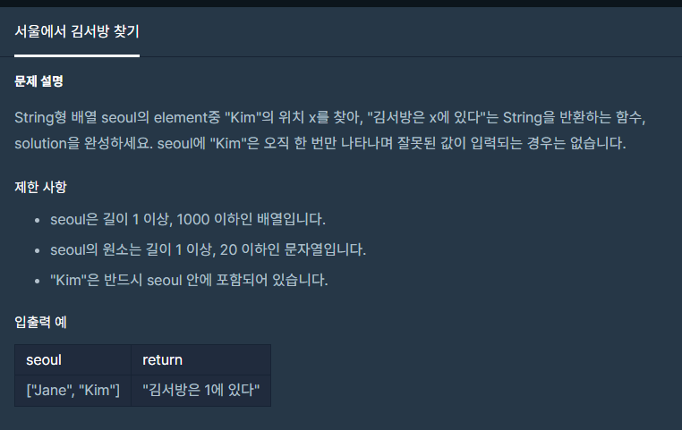

**#P. 18 : 서울에서 김서방 찾기 (난이도 : 중하)**

* 이 문제는 문자열 비교에 대한 문제이다.



프로그래머스 연습문제 : 서울에서 김서방 찾기

* 풀이 방법  
  + 1. Equals를 사용하여 값 비교

```
public static String solution(String[] seoul) {
    StringBuilder sb = new StringBuilder();
    sb.append("김서방은 ");

    for(int i=0; i<seoul.length; i++){
        if(seoul[i].equals("Kim")){
            sb.append(i);
            break;
        }
    }

    sb.append("에 있다");
    return sb.toString();
}
```

---

> **기억해야할 것  
>   
> 1. IDE에서는 == 를 통해 값비교가 되지만, 값 비교시 Equals를 사용해야한다.  
> 2. Match를 통해서도 가능하다. (Match - 정규식에 자주 사용됨)  
> 3. 문제를 제대로 확인해야한다.**
