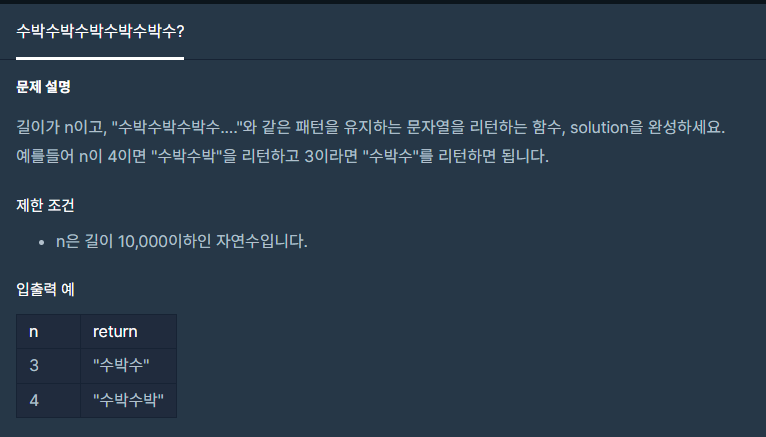

**#P. 14 : 수박수박수박수박수박수 (난이도 : 중하)**

* 이 문제는 문자열의 길이에서 규칙을 찾는 문제이다.



프로그래머스 - 연습 문제 : 수박수박수박수박수박수

* 풀이 방법

```
// N : 1 - 수
// N : 2 - 수박
// N : 3 - 수박수
// N : 4 - 수박수박
// 짝수이면 짝수 만큼 반복
// 홀수이면 짝수 만큼 반복 + "수"
```

```
public static String solution(int n) {

    StringBuilder sb = new StringBuilder();
    for(int i=0; i<n/2;i++){
        sb.append("수박");
    }
    if(n%2==1)
        sb.append("수");

    return sb.toString();
}
```
