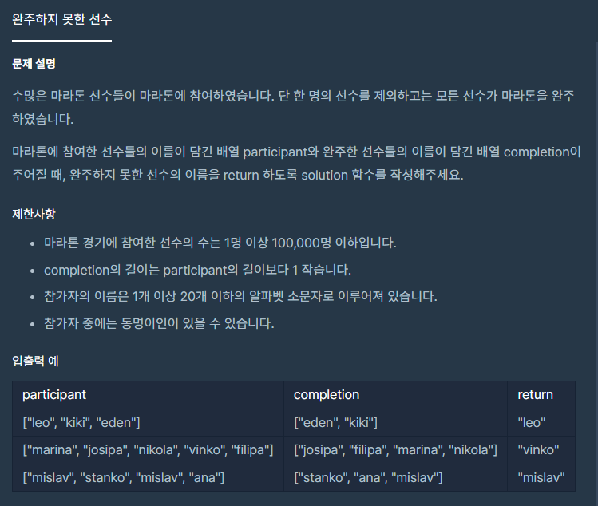

**#P. 20 : 완주하지 못한 선수**(난이도 : 중하)****

* 이 문제는 두 문자열의 배열을 비교하여 존재하지 않는 문자열을 찾는 것이다.



프로그래머스 - 완주하지 못한 선수

* 풀이 방법  
  + 1. StringBuilder + HashMap(삽입, 수정) + Iterator
  + 2. StringBuilder + HashMap(삽입, 삭제)
  + 3. Arrays

```
public static String solution(String[] participants, String[] completion) {
    StringBuilder sb = new StringBuilder();

    HashMap<String, Integer> map = new HashMap<>();
    for(String participant : participants){
        map.put(participant, map.getOrDefault(participant, 0)+1);
    }
    for(String participant : completion){
        map.put(participant, map.get(participant) - 1);
    }

    Iterator<Map.Entry<String, Integer>> iterator = map.entrySet().iterator();

    while(iterator.hasNext()){
        Map.Entry<String, Integer> entry = iterator.next();
        if(entry.getValue() != 0){
            sb.append(entry.getKey());
            break;
        }
    }

    return sb.toString();
}
```

```
public static String solution2(String[] participants, String[] completion) {
    StringBuilder sb = new StringBuilder();

    HashMap<String, Integer> map = new HashMap<>();
    for(String participant : participants){
        map.put(participant, map.getOrDefault(participant, 0)+1);
    }
    for(String participant : completion){
        map.remove(participant);
    }

    Iterator<Map.Entry<String, Integer>> iterator = map.entrySet().iterator();      // 반복문을 사용하지 map을 출력하는 방법

    if(iterator.hasNext()){
        Map.Entry<String, Integer> entry = iterator.next();
        sb.append(entry.getKey());
    }
    return sb.toString();
}
```

```
public static String solution1(String[] participants, String[] completion){
    for(int i=0; i< participants.length;i++){
        int finalI = i;
        if(!Arrays.stream(completion).anyMatch(x -> x == participants[finalI])){
            return participants[i];
        }
    }
    return participants[0];
}
```
