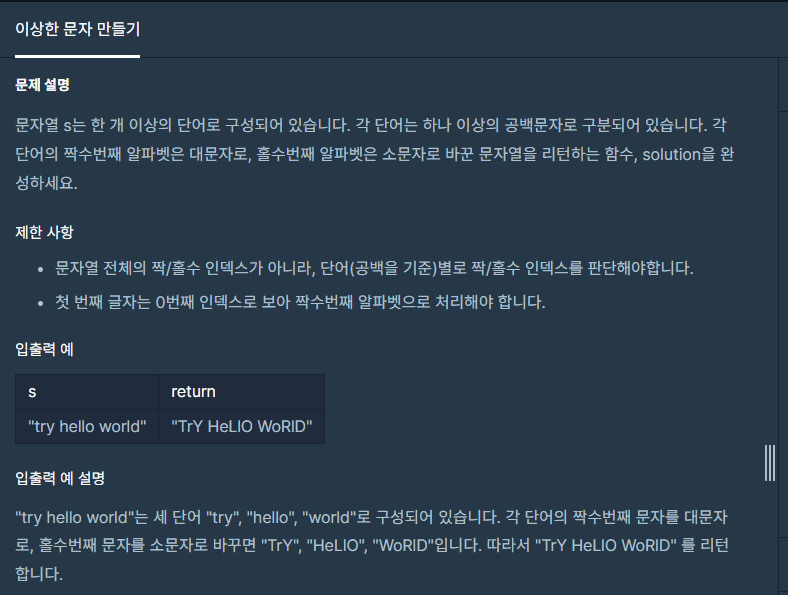

**#P. 21 : 이상한 문자 만들기 (난이도 : 중하)**

* 이 문제도 11점이다!!
* 어떻게 풀었는지 알려드리겠슴다!!



프로그래머스 - 이상한 문자 만들기

* 풀이 방법  
  + 1. 배열을 문자단위로 자른다.
  + 2. 문자열 배열에 빈값이 있을 경우 count 0, 아닐 경우 1을 준다.
  + 3. count가 짝수면 소문자, 홀수이면 대문자로 출력한다.

```
public static String solution(String s) {
    StringBuilder sb = new StringBuilder();

    int count = 0;
    String[] array = s.split("");
    for (String str : array){
        count = str.equals(" ") ? 0:count+1;
        sb.append(count%2 == 0 ? str.toLowerCase() : str.toUpperCase());
    }
    return sb.toString();
}
```
