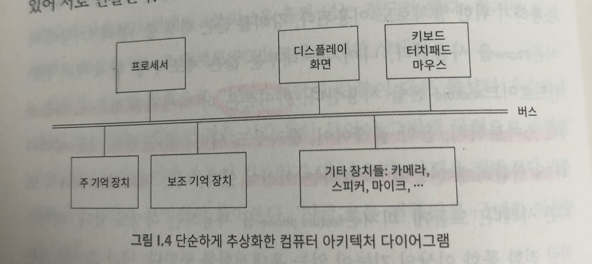
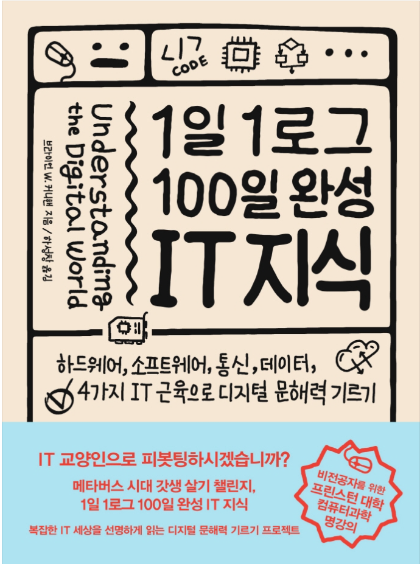

## **CS(1일차)** **- 항해 2주차에서는 CS 스터디를 팀으로 시작한다.**

---

**1부 - 하드웨어**   

**\* 하드웨어는 직접 보고 조작할 수 있는 기기나 장비를 말한다.**   
**\* 컴퓨터 장치는 초기에는 주로 천문 현상이나 행성 또는 별의 위치를 예측하는데 특화된 형태였다.**   
**\* 기원전 100년경에 만들어진 안티키티라 기계도 정교한 천문 계산용 컴퓨터다.**   
**\* 계산자는 존네이피어가 로그의 원리를 설명하고 얼마 지나지 않은 1600년 초에 발명되었다.**   

**\* 오늘날의 컴퓨터와 가장 근접한 모습을 보인 장치는 1800년 경 프랑스에서 조제프 마리 자카르가 발명했다고 한다.**   
**작카르 직기는 여러 줄의 구멍이 있는 직사각형 모양의 카드를 이용해 직조 패턴을 지정했다.**   
**즉, 천공 카드에 입력된 명령에 따라 다양한 패턴을 짜도록 '프로그래밍'된 것이다.**   
**\* 직물 생산에 필요한 노동력을 대체하는 기계가 등장하자, 방직공들이 일자리를 잃게되면서 사회적 혼란이 발생했다고 한다. 대표적으로는 1811년 ~ 1816년 까지 영국에서 일어난 러다이트 운동은 기계화에 반대하는 폭력 시위였다고 한다.**   

**\* 오늘날과 같은 의미의 컴퓨팅은 영국의 찰스 배비지라는 사람에게서 처음 이루어졌는데, 배비지는 항해술과 천문학에 관심이 많은 과학자였고, 두분야 모두 위치를 계산하는 데 숫자값으로 이루어진 표가 필요하여 그런 표를 만들고 인쇄까지 하려면 직접 산술 연산을 했는데, 지겹기도 하고 실수하기도 쉬었다. 배비지는 수작업을 멈추기 위해 기계적으로 처리하는 장치를 개발하는 데 일생의 많은 시간을 투자했다고 한다. 재정적 후원이 끊기는 등 여러 가지 이유로 그의 포부는 결국 실현되지 못했지만, 설계 방식은 타당했다고 한다.**   
**\* 배비지가 살던 시대의 도구와 재료를 사용하여 그가 만들던 기계 중 하나인 차분 기관의 일부를 현대적으로 구현하기도 했다.**   

**\* 오거스타 에이다 바이런은 세계 최초의 프로그래머로 내가 존경하는 하는 사람 중 한명이다. 배비지는 그녀가 수학을 본격적으로 배우고자신의 계산 장치를 연구할 수 있도록 돕고 격려해주었다. 그녀는 배지지의 해석을 과학적 계산에사용하는 방법을 상세하게 기록했으며, 이 기계가 작곡 같은 비수치적 계산도 할수 있을 것이라고 추측하기도 했다.**

---

#### **컴퓨터의 논리와 구조** **\* "완성된 장치가 범용 컴퓨터 기계가 되려면 산술 연산, 기억-저장,제어 운영자와의 연결을 담당하는 특정 주요 기관을 포함해야 한다"  (1946. 폰노이만, 아서벅스, 허먼 골드스타인)** **\* 컴퓨터는 논리적 구조(기능), 물리적 구조로으로 살펴보고 있다.** **\* 이 책에서 컴퓨터의 다양한 OS를 자동차와 비교하고 있는데 인상적이었다. 자동차는 모습이 비슷하고 기본 기능이 동일하지만, 서로 다른 회사들이 비슷하지만 다르게 기능을 만들어서 사용자의 니즈를 충족시키기 위해 만든다는 점을 자동차와 비슷하다고 설명하고 있다.** **\* 네트워크 효과를 PC에 OS에서 볼수있다는 점도 설명하였다.** **\* 네트워크 효과는 사람들이 A를 더 많이 쓸수록 당신에게도 A의 효용이 더 커지며, 그 효과는 사용자의 수에 대략 비례한다.**

---

#### **프로세스 속도와 심작 박동수**

---

#### **Comment** **1. 이 책을 읽으면서 1-2학년 때 전공을 맨 처음 배울때가 생각났었다. 그때는 이해보다 암기가 우선이였다. 매일 과제와 시험을  위해 외워야만 했기 때문에 주요 단어와 그에 대한 내용을 암기만 하였다. 지금은 그 내용을 이야기를 통해 읽고 있어 재미있게 느껴졌다.** **전공책에서는 많은 부분들이 딱딱한 부분이 많았는데, 이 책에서는 깊이 있게 말하고 있지는 않지만 예시를 통해 설명하려고 하는 것 같았다.** **2. 1세대 ~ 5세대 컴퓨터를 표로 외웠던 것이 생각나는데 기원전 100년전에도 컴퓨터가 있었다는 것은 처음 알게되었다.(내가 잊고 있던 것일 수 도 있다)** **3. 이 책을 보면서 두가지의 질문을 생각하였다.** **\* 첫번 째는 현재의 스마트폰은 미래의 어떤 모습일까? 이전의 기술처럼 사라지고 지기한 유물이될 것인가라는 생각** **\* 두번 째는 기술의 발전으로 인한 빅 브라더가 심화되어 사람들의 모든 것을 침해받고 유출되고 있는 현재와 교도소와 다른 것일까? 라는 생각**

#### **<참고서> [1일 1로그 100일 완성 IT 지식](https://book.naver.com/bookdb/book_detail.nhn?bid=21380986)**

