드디어 수강하는 알고리즘 항해 1주차 

늦었지만 얼른 시작해보겠습니다~!

---

#### 

#### **[알고리즘 항해 - 1주차]**

**[수업 목표]**

1. 개발자들에게 알고리즘 공부가 필요한 이유를 이해한다.
2. 알고리즘을 학습하기 위한 기본 코드 구현력을 높인다.
3. 시간 복잡도, 공간 복잡도에 대해 배운다.

**[목차]**

0. 오늘 배울 것(요약)

1. 알고리즘과 친해지기

2. 시간복잡도 판단

3. 공간복잡도 판단

4. 점근 표기법

5. 알고리즘 더 풀오보기

---

**#S.0 오늘 배울 것(요약)**

> 📘 어떤 문제의 해결을 위하여, 입력된 자료를 토대로 하여 원하는 출력을 유도하여 내는 규칙의 집합. 여러 단계의 유한 집합으로 구성되는데, 각 단계는 하나 또는 그 이상의 연산을 필요로 한다. [표준국어대사전]

* 어떤 문제가 있을때, 그것을 해결하기 위한 여러 동작들의 모임입니다.
* 그런데, 하나의 문제를 풀기 위해서는 다양한 방법이 있을 수 있습니다.   
  예를 들어 엄마가 계란과 돼지고기를 사오라고 하셨다면 여러 방법이 떠오를 수 있습니다.
  1. 집앞 롯데슈퍼에서 계란과 돼지고기를 사온다.
  2. 시장 골목에 있는 노점상의 계란과 정육점의 돼지고기를 사오고 남은 돈으로 아이스크림을 사먹는다.
  3. 시골에 계시는 할머니집에 내려가 농사 일을 하루동안 도와주고 일삯으로 계란과 고기를 받는다
* 알고리즘을 공부해야하는 이유
  1. 좋은 개발자가 되고 싶다.
     1. 개발자는 프로그램을 만드는 직업입니다. 즉, 좋은 개발자가 되려면? **좋은 프로그램**을 **구현할** 줄 알아야 합니다.
     2. 좋은 프로그램이란? **적은 공간**을 이용해서 **빠른 속도**로 수행되는 프로그램입니다!
     3. 그런 프로그램을 만들기 위해서는 경우에 따라 **특정 자료구조나 접근방법**을 사용해야 합니다. 즉, 프로그램을 잘하기 위해서는 여러 자료구조와 방법들을 배우고 익혀야 좋은 프로그램을 만들 수 있습니다.
     4. 막연히 개발만 하다보면 좋은 코드를 만들지 못합니다! 자료구조와 알고리즘에 대해서 배워 더 좋은 프로그램을 만들어 보자구요!
  2. 좋은 회사에 취직하고 싶다.
     1. 수많은 회사들이 코딩테스트를 통해 개발자를 구인하고 있습니다. 카카오, 삼성, 구글 등 국내외 유망 IT 기업들 외에도 많은 스타트업까지 코딩테스트를 개발자의 **필수 관문**으로 만들고 있습니다.
     2. **그러나**, 엄청나게 어려운 수준의 문제를 출제하진 않습니다.
     3. 기초적인 지식과 해결책으로 적절한 사고를 할 수 있는지에 대해 검증하기 위함이다.
     4. (그렇다고 이런 문제를 항상 풀어야 하는 것은 아닙니다. 취업하고부터는 이미 잘 만들어진거 쓰시면 됩니다 🙂)

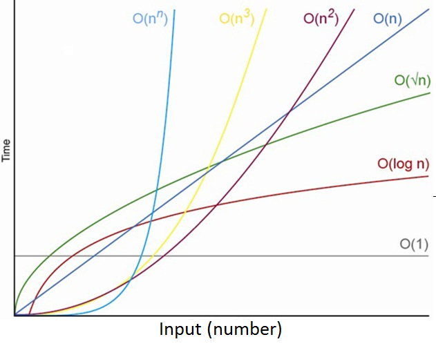

시간 복잡도(빅오 표기법)

> 이번 주차에는 시간/공간 복잡도, 알고리즘 구현력 기르기를 목표로 한다.

---

#### **#S.1 알고리즘과 친해지기**

**1) 최대값 찾기**

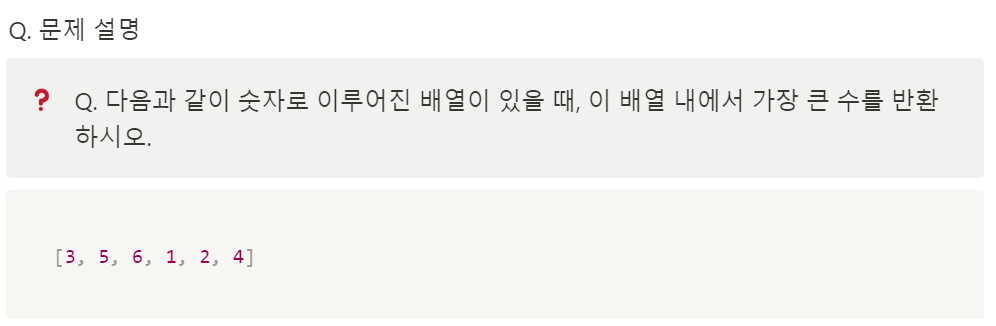

최대값 찾기

**(나의 답안)**

**1. 배열을 정렬한다.**

**2. 내장함수를 통해 정렬할 경우, 오름차순으로 정렬된다.**

**3. 배열을 pop()할 경우, 마지막 인덱스 값이 삭제와 동시에 빠져나가진다.**

```
def find_max_num(array):
    array.sort();

    return array.pop()
```

**(강의 코드 - 1)**

**1. 이중 반복문을 통해 해결한다.**

**2. 외곽 반복문은 탐색할 대상을, 내부 반복문은 비교대상을 위한 반복문이다.**

**3. 탐색대상을 비교대상과 비교하여 가장 큰 경우, 리턴을 해주는 것이다.**

```
def find_max_num(array):
    for num in array:               # 배열에서 순차적으로 검색할 값을 부른다.
        for compare_num in array:   # 비교할 대상을 위해 반복문을 하나더 호출
            if num < compare_num:
                break
            else:
                return num
```

**(강의 코드 - 2)**

**1. 배열의 첫번째 인덱스 값을 맥스값으로 임의로 지정한다.**

**2. 순차적으로 배열을 탐색하여 맥스 변수보다 클경우, 맥수 변수에 저장한다.**

```
def find_max_num(array):
    max_num = array[0]
    for num in array:
        if num > max_num:
            max_num = num

    return max_num
```

> PEP는 것이 파이썬의 기본적인 포맷팅 규칙입니다.  
> 즉, 파이썬을 이쁘게 쓰기 위한 규칙이다.   
> Reformat file을 누르면 자동으로 처리해준다.

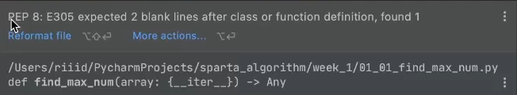

파이썬 PEP8 Warining

---

**2) 최빈값 찾기**

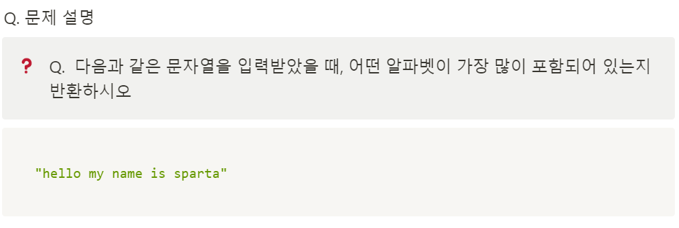

최빈값 찾기

> **(TIP)** **문자인지 확인하는 방법  
> - 파이썬의 내장 함수 str.isalpha() 를 이용하면 해당 문자열이 알파벳인지 확인할 수 있습니다!  
>   
> print("a".isalpha())    # True   
> print("1".isalpha())    # False   
>   
> s = "abcdefg"   
> print(s[0].isalpha())   # True  
>   
> **(TIP)** 알파벳 별로 빈도수를 리스트에 저장하기  
> - 컴퓨터는 0과 1 숫자 밖에 모르기 때문에 문자도 숫자로 기억합니다. 이때, 어떤 숫자와 어떤 문자를 대응시키는가에 따라 여러 가지 인코딩 방식이 있는데 통상 아스키 코드 방식을 많이 사용합니다.**

[ 최빈 값 찾기 전, 알파벳 빈도 파악 방법 ]

```
def find_alphabet_occurrence_array(string):
    alphabet_occurrence_array = [0] * 26

    # 이 부분을 채워보세요!
    for char in string:
        if not char.isalpha():
            continue
        else:
            index = ord(char) - ord("a")
            alphabet_occurrence_array[index] += 1

    return alphabet_occurrence_array
```

**(강의 코드 - 1)**

**1. 알파벳을 배열에 저장한다.**

**2. 최대값과 최빈값에 알파벳을 찾기 위한 변수를 생성한다.**

**3. 알파벳 배열을 반복문을 통해 차례대로 순회한다.**

**4. 순회하면서 빈도수를 확인하기 위한 변수를 설정한다.**

**5. 내부 반복문에서 입력받은 문자열에서 일치하는 문자열이 있는지 확인한다.**

**6. 내부 반복문에서 일치할 경우 현재 빈도수 값을 1증가시킨다.**

**7. 내부 반복문이 종료되면 최대 빈도값과 비교하여 최빈 값과 알파벳을 저장한다.**

```
def find_max_occurrence_array(string):
    alphabet_array = ["a", "b", "c", "d", "e", "f", "g", "h", "i", "j", "k", "l", "m", "n", "o", "p", "q", "r", "s",
                      "t", "u", "v", "w", "x", "y", "z"]

    max_occurence = 0
    max_alphabet = alphabet_array[0]

    for alphabet in alphabet_array:
        occurence = 0
        for char in string:
            if char == alphabet:
                occurence += 1

        if occurence > max_occurence:
            max_occurence = occurence
            max_alphabet = alphabet

    return max_alphabet
```

**(강의 코드 - 2)**

**1. 알파벳 빈도수를 저장하기 위한 정수열 배열을 저장한다.**

**2. 문자열을 순회하면서 문자인지 확인한다.**

**3. **문자를 아스키 코드값과 비교하여 해당 순서의 문자를 배열에 저장한다.****

**4. 반복문을 통해 배열의 길이를**

**5. 내부 반복문에서 입력받은 문자열에서 일치하는 문자열이 있는지 확인한다.**

**6. 내부 반복문에서 일치할 경우 현재 빈도수 값을 1증가시킨다.**

**7. 내부 반복문이 종료되면 최대 빈도값과 비교하여 최빈 값과 알파벳을 저장한다.**

```
# (꿀팁 활용)알파벳 occurency array를 사용하는 방법
def find_max_occurrence_array(string):
    alphabet_occurrence_array = [0] * 26

    # 알파벳 빈도수 저장
    for char in string:
        if not char.isalpha():
            continue
        else:
            index = ord(char) - ord("a")
            alphabet_occurrence_array[index] += 1

        max_occurence = 0
        max_alphabet_index = 0
        for index in range(len(alphabet_occurrence_array)):
            alphabet_occurrence = alphabet_occurrence_array[index]
            if alphabet_occurrence > max_occurence:
                max_alphabet_index = index
                max_occurence = alphabet_occurrence

    print(chr(max_alphabet_index+ord("a")))
```

---

#### **#S.2 시간 복잡도**

> 입력값과 문제를 해결하는 데 걸리는 시간과의 상관관계를 말합니다! 입력값이 2배로 늘어났을 때 문제를 해결하는 데 걸리는 시간은 몇 배로 늘어나는지를 보는 것이죠. 우리는 시간이 적게 걸리는 알고리즘을 좋아하니 입력값이 늘어나도 걸리는 시간이 덜 늘어나는 알고리즘이 좋은 알고리즘이겠죠?

#### **1. 분석 예제 1(최대값 찾기 알고리즘 활용)**

```
input = [3, 5, 6, 1, 2, 4]


def find_max_num(array):
    for num in array:
        for compare_num in array:
            if num < compare_num:
                break
        else:
            return num


result = find_max_num(input)
print("정답 = 6 / 현재 풀이 값 = ", find_max_num([3, 5, 6, 1, 2, 4]))
print("정답 = 6 / 현재 풀이 값 = ", find_max_num([6, 6, 6]))
print("정답 = 1888 / 현재 풀이 값 = ", find_max_num([6, 9, 2, 7, 1888]))
```

* 이 해결 방법은 각 숫자마다 모든 다른 숫자와 비교해서 최대값인지 확인합니다. 만약 다른 모든 값보다 크다면 반복문을 중단합니다.
* 이 함수가 시간이 얼마나 걸리는지 어떻게 분석할 수 있을까요?
* 바로, **각 줄이 실행되는 걸 1번의 연산이 된다**고 생각하고 계산하시면 됩니다. 아래와 같이 계산할 수 있습니다.

```
for num in array:  # array 의 길이만큼 아래 연산이 실행
    for compare_num in array:  # array 의 길이만큼 아래 연산이 실행
        if num < compare_num:  # 비교 연산 1번 실행
            break
    else:
        return num
```

* 위에서 연산된 것들을 더해보면,
  1. **array의 길이 X array의 길이 X 비교 연산 1번**만큼의 시간이 필요합니다. 여기서 array(입력값)의 길이는 보통 N이라고 표현합니다. 그러면 위의 시간을 다음과 같이 표현할 수 있습니다.그러면 우리는 이제 이 함수는 **N^2**만큼의 **시간이 걸렸겠구나**! 라고 말할 수 있습니다.

#### **2. 분석 예제 2(최대값 찾기 알고리즘 활용)**

```
def find_max_num(array):
    max_num = array[0]        
    for num in array:      
        if num > max_num:  
            max_num = num
    return max_num

result = find_max_num(input)
print("정답 = 6 / 현재 풀이 값 = ", find_max_num([3, 5, 6, 1, 2, 4]))
print("정답 = 6 / 현재 풀이 값 = ", find_max_num([6, 6, 6]))
print("정답 = 1888 / 현재 풀이 값 = ", find_max_num([6, 9, 2, 7, 1888]))
```

대입 연산 1번 실행 -> 배열 길이만큼 N번 -> 비교연산 1회 -> 대입 연산 1회

= 1 \* N \* 1 \* 1 = N번!

#### **3. 비교**

* 코드만 봐도 두 번째 방법이 좋을 것 같다고 어렴풋이 생각은 했겠지만, 이렇게 수치화시키니 얼마나 효율적인지 정량적으로 분석할 수 있습니다
* 그러면, 이를 수학적으로 표현해보면 첫 번째 방법은 $N^2$, 두 번째 방법은 $2N+1$ 이라는 식이 나온다는 걸 알 수 있습니다. 그러면 N 의 길이가 길어질수록, 다음과 같이 연산량이 변화합니다.

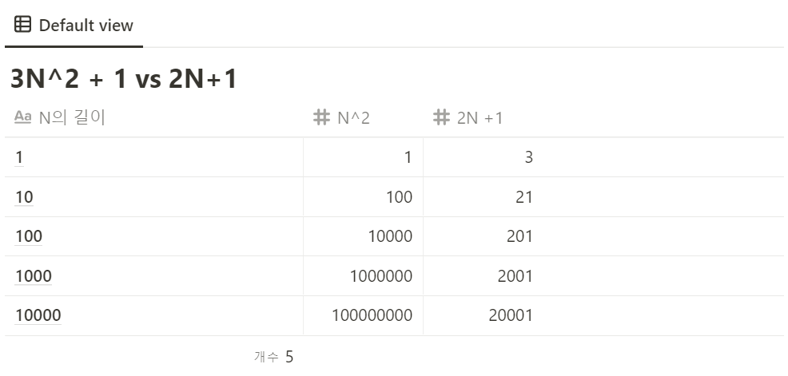

* 이 표를 보면, 두 가지를 깨달을 수 있습니다.
  1. $N$ 과 $N^2$ 은 N 이 커질수록 더 큰 차이가 나는구나!
  2. $N$의 지수를 먼저 비교하면 되겠구나.
* 그러나, 저희가 매번 코드를 매 실행 단위로 이렇게 몇 번의 연산이 발생하는지 확인하는 건 불가능합니다. 따라서 **상수는 신경쓰지말고**, 입력값에 비례해서 어느 정도로 증가하는지만 파악하면 됩니다.

> 즉, 2N+1 의 연산량이 나온 첫번째 풀이 방법은 N 만큼의 연산량이 필요하다   
> N^2 의 연산량이 나온 두번째 풀이 방법은 N^2 만큼의 연산량이 필요하다.   
>   
> 참고로, 만약 상수의 연산량이 필요하다면, 1만큼의 연산량이 필요하다고 말하면 됩니다.

#### 

---

#### **#S.3 공간 복잡도**

> 입력값과 문제를 해결하는 데 걸리는 공간과의 상관관계를 말합니다! 입력값이 2배로 늘어났을 때 문제를 해결하는 데 걸리는 공간은 몇 배로 늘어나는지를 보는 것이죠. 우리는 공간이 적게 걸리는 알고리즘을 좋아하니 입력값이 늘어나도 걸리는 공간이 덜 늘어나는 알고리즘이 좋은 알고리즘이겠죠?

#### **1. 분석 예제 1(최대값 찾기 알고리즘 활용)**

```
def find_max_occurred_alphabet(string):
    alphabet_array = ["a", "b", "c", "d", "e", "f", "g", "h", "i", "j", "k", "l", "m", "n", "o", "p", "q", "r", "s", "t", "u", "v", "x", "y", "z"]
    max_occurrence = 0
    max_alphabet = alphabet_array[0]

    for alphabet in alphabet_array:
        occurrence = 0
        for char in string:
            if char == alphabet:
                occurrence += 1

        if occurrence > max_occurrence:
            max_alphabet = alphabet
            max_occurrence = occurrence

    return max_alphabet

result = find_max_occurred_alphabet
print("정답 = a 현재 풀이 값 =", result("Hello my name is sparta"))
print("정답 = a 현재 풀이 값 =", result("Sparta coding club"))
print("정답 = s 현재 풀이 값 =", result("best of best sparta"))
```

* 이 해결 방법은 각 알파벳마다 문자열을 돌면서 몇 글자 나왔는지 확인합니다. 만약 그 숫자가 저장한 알파벳 빈도 수보다 크다면, 그 값을 저장하고 제일 큰 알파벳으로 저장합니다. 이 함수가 공간을 얼마나 사용하는지 어떻게 분석할 수 있을까요?
* 바로 **저장하는 데이터의 양이 1개의 공간**을 사용한다고 계산하시면 됩니다. 아래와 같이 계산할 수 있습니다.

```
    alphabet_array = ["a", "b", "c", "d", "e", "f", "g", "h", "i", "j", "k", "l", "m", "n", "o", "p", "q", "r", "s", "t", "u", "v", "x", "y", "z"]
# -> 26 개의 공간을 사용합니다
    max_occurrence = 0 # 1개의 공간을 사용합니다
    max_alphabet = alphabet_array[0]   # 1개의 공간을 사용합니다.

    for alphabet in alphabet_array:
        occurrence = 0  # 1개의 공간을 사용합니다
```

* 위에서 사용된 공간들을 더해보면,
  1. alphabet\_array 의 길이 = 26
  2. max\_occurrence, max\_alphabet, occurrence 변수 = 3그러면 우리는 이제 이 함수는 **29** 만큼의 **공간이 사용되었구나**! 라고 말할 수 있습니다.

#### **2. 분석 예제 2(최대값 찾기 알고리즘 활용)**

```
def find_max_occurred_alphabet(string):
    alphabet_occurrence_list = [0] * 26

    for char in string:
        if not char.isalpha():
            continue
        arr_index = ord(char) - ord('a')
        alphabet_occurrence_list[arr_index] += 1

    max_occurrence = 0
    max_alphabet_index = 0
    for index in range(len(alphabet_occurrence_list)):
        alphabet_occurrence = alphabet_occurrence_list[index]
        if alphabet_occurrence > max_occurrence:
            max_occurrence = alphabet_occurrence
            max_alphabet_index = index

    return chr(max_alphabet_index + ord('a'))


result = find_max_occurred_alphabet
print("정답 = a 현재 풀이 값 =", result("Hello my name is sparta"))
print("정답 = a 현재 풀이 값 =", result("Sparta coding club"))
print("정답 = s 현재 풀이 값 =", result("best of best sparta"))
```

* 이 해결 방법은 각 알파벳의 빈도수를 저장한 다음에, 빈도 수 중 가장 많은 알파벳의 인덱스 값을 반환합니다. 다시 한 번 공간복잡도를 분석해볼까요?

```
alphabet_occurrence_list = [0] * 26 # -> 26 개의 공간을 사용합니다

  for char in string:
      if not char.isalpha():
          continue
      arr_index = ord(char) - ord('a')  # 1개의 공간을 사용합니다
      alphabet_occurrence_list[arr_index] += 1

  max_occurrence = 0                   # 1개의 공간을 사용합니다
  max_alphabet_index = 0               # 1개의 공간을 사용합니다
  for index in range(26):
      alphabet_occurrence = alphabet_occurrence_list[index] # 1개의 공간을 사용합니다
      if alphabet_occurrence > max_occurrence:
          max_occurrence = alphabet_occurrence
          max_alphabet_index = index
```

* 위에서 사용된 공간들을 더해보면,
  1. alphabet\_array 의 길이 = 26
  2. arr\_index, max\_occurrence, max\_alphabet\_index, alphabet\_occurrence 변수 = 4그러면 우리는 이제 이 함수는 **30**만큼의 **공간이 사용되었구나**! 만큼의 공간이 필요합니다.

> **그러면, 공간을 더 적게 쓴 첫 번째 방법이 더 효율적인걸까요?**  
>   
> **그렇지 않습니다. 29와 30 모두 상수라 큰 상관이 없습니다.**   
> **그러면 뭘로 비교하는 게 좋을까요? 바로 시간 복잡도로 비교하시면 됩니다.**   
> **이처럼, 대부분의 문제에서는 알고리즘의 성능이 공간에 의해서 결정되지 않습니다.**   
> **따라서 공간 복잡도보다는 시간 복잡도를 더 신경 써야 합니다.**

#### **3. 분석 예제 1(최대값 찾기 알고리즘 활용)**

```
for alphabet in alphabet_array:    # alphabet_array 의 길이(26)만큼 아래 연산이 실행
     occurrence = 0                  # 대입 연산 1번 실행
     for char in string:             # string 의 길이만큼 아래 연산이 실행
         if char == alphabet:        # 비교 연산 1번 실행
             occurrence += 1         # 대입 연산 1번 실행 

     if occurrence > max_occurrence: # 비교 연산 1번 실행
         max_alphabet = alphabet     # 대입 연산 1번 실행
         max_occurrence = number     # 대입 연산 1번 실행
```

* 위에서 연산된 것들을 더해보면,
  1. alphabet\_array 의 길이 X 대입 연산 1번
  2. alphabet\_array 의 길이 X string의 길이 X (비교 연산 1번 + 대입 연산 1번)
  3. alphabet\_array 의 길이 X (비교 연산 1번 + 대입 연산 2번)만큼의 시간이 필요합니다. 여기서 string 의 길이는 보통 N이라고 표현합니다.

> **26\*(1 + 2\*N + 3) = 52N + 104**

그러면 우리는 이제 이 함수는 **52N+104** 만큼의 **시간이 걸렸겠구나**! 라고 말할 수 있습니다.

#### **4. 분석 예제 1(최대값 찾기 알고리즘 활용)**

```
for char in string:  # string 의 길이만큼 아래 연산이 실행
    if not char.isalpha():  # 비교 연산 1번 실행
        continue
    arr_index = ord(char) - ord('a')  # 대입 연산 1번 실행 
    alphabet_occurrence_list[arr_index] += 1  # 대입 연산 1번 실행 

max_occurrence = 0  # 대입 연산 1번 실행 
max_alphabet_index = 0  # 대입 연산 1번 실행 
for index in range(len(alphabet_occurrence_list)):  # alphabet_array 의 길이(26)만큼 아래 연산이 실행
    alphabet_occurrence = alphabet_occurrence_list[index]  # 대입 연산 1번 실행 
    if alphabet_occurrence > max_occurrence:  # 비교 연산 1번 실행 
        max_occurrence = alphabet_occurrence  # 대입 연산 1번 실행 
        max_alphabet_index = index  # 대입 연산 1번 실행 
```

* 위에서 연산된 것들을 더해보면,
  1. string의 길이 X (비교 연산 1번 + 대입 연산 2번)
  2. 대입 연산 2번
  3. alphabet\_array 의 길이 X (비교 연산 1번 + 대입 연산 3번)만큼의 시간이 필요합니다. 여기서 string 의 길이는 보통 N이라고 표현합니다. 그러면 위의 시간을 다음과 같이 표현할 수 있습니다.

> N \* (1 + 2) + 2 + 26 \* (1 + 3) = 3N + 106

그러면 우리는 이제 이 함수는 **3N+106** 만큼의 **시간이 걸렸겠구나**! 라고 말할 수 있습니다.

#### **5. 비교**

* 그러면, 이를 수학적으로 표현해보면 첫 번째 방법은 52N+104, 두 번째 방법은 3N + 106 이라는 식이 나온다는 걸 알 수 있습니다. 그러면 N 의 길이가 길어질수록, 다음과 같이 연산량이 변화합니다. 비교를 위해서 N^2 도 넣어봤습니다!

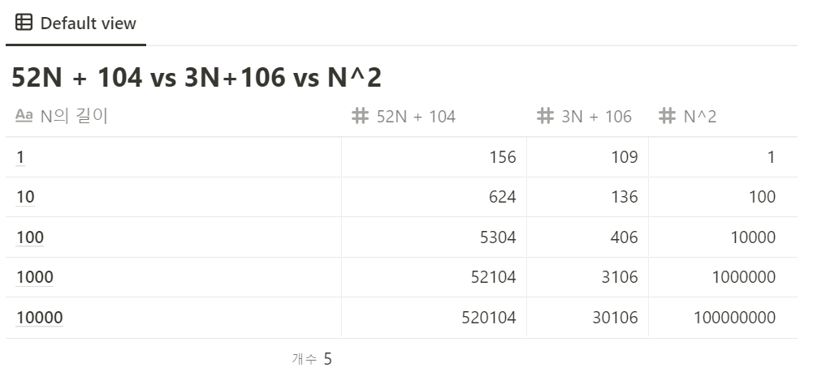

* 이 표를 보면, 두 가지를 깨달을 수 있습니다.
  1. **52N + 104$ 든 3N+106 이든 N^2 에 비해서 아무것도 아니구나.**
  2. **공간 복잡도보다는 시간 복잡도를 더 신경 써야 한다!**

---

#### **#S.4 점근 표기법**

> 알고리즘의 성능을 수학적으로 표기하는 방법입니다. 알고리즘의 “효율성”을 평가하는 방법입니다. 점근 표기법(asymptotic notation)은 어떤 함수의 증가 양상을 다른 함수와의 비교로 표현하는 수론과 해석학의 방법이다. 저희가 지금까지 이 함수는 N 정도의 시간과 공간이 걸리겠구나 하면서 분석했던 게 점근 표기법의 일종이라고 말할 수 있습니다.

> 점근 표기법의 종류에는 빅오(Big-O)표기법, 빅 오메가(Big-Ω) 표기법이 있습니다.   
> 빅오 표기법은 최악의 성능이 나올 때 어느 정도의 연산량이 걸릴것인지, 빅오메가 표기법은 최선의 성능이 나올 때 어느 정도의 연산량이 걸릴것인지에 대해 표기합니다.   
>   
> 예를 들어 빅오 표기법으로 표시하면 O(N) , 빅 오메가 표기법으로 표시하면 Ω(1)의 시간복잡도를 가진 알고리즘이다! 라고 표현할 수 있습니다. 한 번 문제를 풀면서 알아보도록 하겠습니다!

#### **1. 분석 예제 - 배열에서 특정 요소 찾기**

> ❓ Q. 다음과 같은 숫자로 이루어진 배열이 있을 때, 이 배열 내에 특정 숫자가 존재한다면 True, 존재하지 않다면 False 를 반환하시오.

```
[3, 5, 6, 1, 2, 4]
```

**(나의 코드)**

**1. 배열을 반복문을 통해 순차적으로 탐색하면서 해당하는 값이 있을 경우 True, 아니면 False를 반환한다.**

```
def is_number_exist(number, array):
    for num in array:
        if num == number:
            return True
        else:
            return False
```

* 시간 복잡도는 배열의 길이 N만큼 \* 비교연산 1회  => N\*1 = N만큼  
  최악의 경우 N, 최선의 경우 1가 될 것이다.

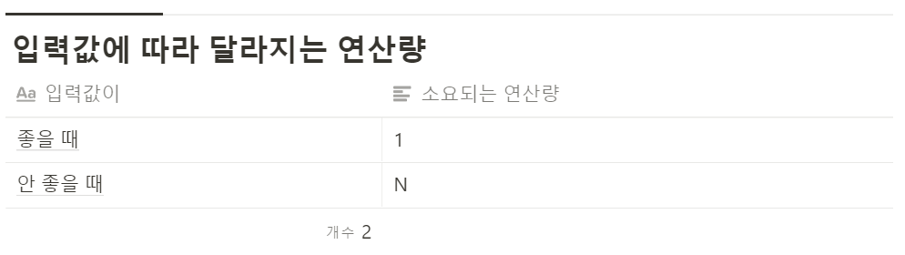

> 즉 위의 경우에는 빅오 표기법으로 표시하면 O(N), 빅 오메가 표기법으로 표시하면 Ω(1)의 시간복잡도를 가진   
> 알고리즘이다! 라고 말할 수 있습니다.

> ✅ 알고리즘에서는 거의 모든 알고리즘을 빅오 표기법으로 분석합니다.  
>   
> 왜냐면 대부분의 입력값이 최선의 경우일 가능성은 굉장히 적을 뿐더러, 우리는 최악의 경우를 대비해야 하기 때문입니다.

---

#### **#S.5 알고리즘 더 풀어보기**

**(1) 곱하기 더하기**

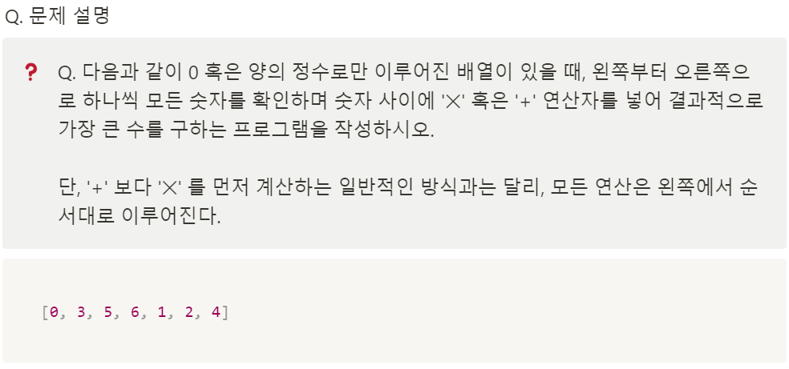

[풀이 과정]

1. 합을 위한 변수 초기값 0 설정

2. 배열을 순회 할 때 배열의 값이 0 일경우 곱보다 합이 크다.

3. 배열을 순회 할 때 현재 합이 0일 경우 곱보다 합이 크다.

4. 이외에 경우는 합보다 곱이 크다.

```
def find_max_plus_or_multiply(array):
    multiply_sum = 0

    for num in array:
        if num <= 1 or multiply_sum <= 1:
            multiply_sum += num
        else:
            multiply_sum *= num

    return multiply_sum
```

**=> 시간 복잡도는 배열 N \* 조건문 \*2  => O(N)이다.**

**(2) 반복되지 않은 문자**

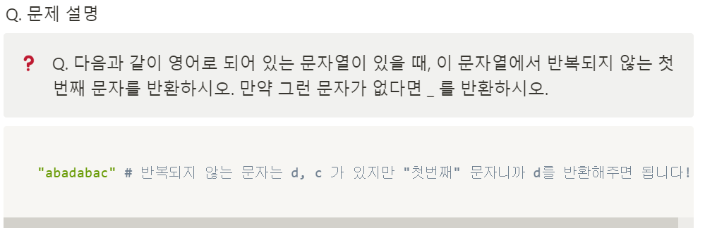

* 이 문제를 풀기 위해서는 어떻게 해야 할까요? 아래 코드를 복사 붙여넣기 하고 함수를 작성해보세요! 2분 정도 고민해 본 다음, 아래 방법들을 펼쳐 봅시다!

```
def find_not_repeating_first_character(string):
    alphabet_occurrence_array = [0] * 26

    # 알파벳 빈도수 저장
    for char in string:
        if not char.isalpha():
            continue
        else:
            index = ord(char) - ord("a")
            alphabet_occurrence_array[index] += 1

    not_repeating_character_array = []
    for index in range(len(alphabet_occurrence_array)):
        alpabet_occurrence = alphabet_occurrence_array[index]
        if alpabet_occurrence == 1:
            not_repeating_character_array.append(chr(index + ord("a")))

    print(not_repeating_character_array)        # 기존 문자열의 순서를 보장해주지 않는다.

    for char in string:
        if char in not_repeating_character_array:
            return char

    return "_"
```

---

#### 

#### **#S.6 숙제**

**1) 소수 나열하기**

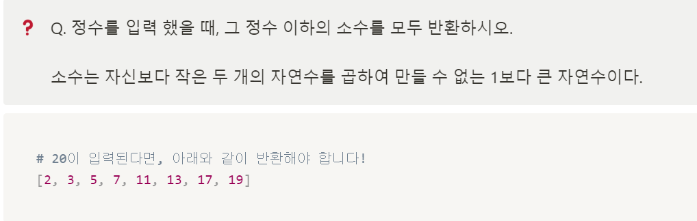

[풀이 과정]

1. 에라토스테네스의 체를 사용한 방법이다.

2. 입력 값보다 작 은 모든 수를 순차적으로 판단한다.

3. 이 때 한 개의 소수를 찾아 해당 소수의 배수는 소수가 아니므로 제외시키는 방식이다.

```
def find_prime_list_under_number(number):
    check = [False,False] + [True]*(number-1)
    prime = []

    for i in range(2, number + 1):
        if check[i]:
            prime.append(i)
            for j in range(2*i, number+1, i):
                check[j] = False

    return prime
```

**2) 문자열 뒤집기**

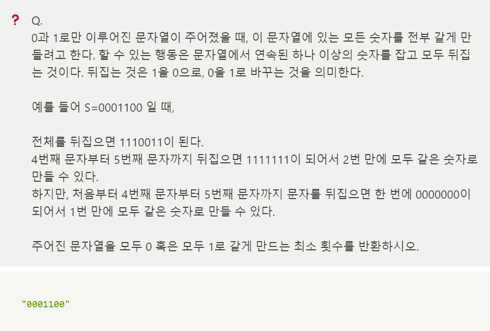

[풀이 과정]

1. 0, 1인지에 따라 횟수를 다르게 해야하므로 변수를 설정

2. 앞자리가 0일경우 1로 바꿔야할 것이 1증가, 반대로 0일 경우 바꿔야할 0이 1증가

3. 반복문을 통해 값을 증가시키는데 이 때 연속된 값이면 그대로 아닐 경우 위 작업을 동일하게 진행한다.

```
def find_count_to_turn_out_to_all_zero_or_all_one(string):
    count_to_all_zero = 0
    count_to_all_one = 0

    if string[0] == '0':
        count_to_all_one += 1
    elif string[0] == '1':
        count_to_all_zero += 1

    for i in range(len(string) - 1):
        if string[i] != string[i + 1]:
            if string[i + 1] == '0':
                count_to_all_one += 1
            if string[i + 1] == '1':
                count_to_all_zero += 1

    return min(count_to_all_one, count_to_all_zero)
```

---

> 정리해보면 오늘은 시간 복잡도, 공간 복잡도를 메인으로 배운 것 같다.  
> 알고리즘 문제의 경우, 난이도는 "하"로 문법을 사용하는데 익숙해질 수 있는 문제이다.  
>   
> 학부시절 자료구조 시간을 통해 빅오 표기법 등 시간복잡도 분석 방법을 배우고  
> 문제도 풀고 프로젝트의 적용하여 사용한 경험이 있었지만,  
> 최근에는 잘 사용하지 않았던 것 같다...   
>   
> 다시 적용할 수 있도록 도전하자!! 화이팅!!
