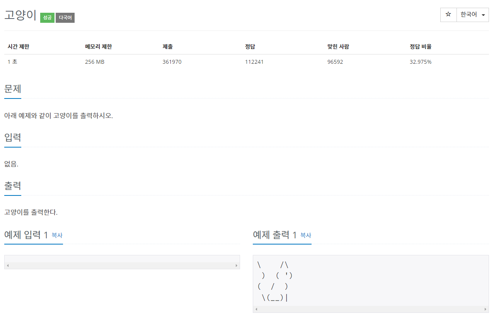
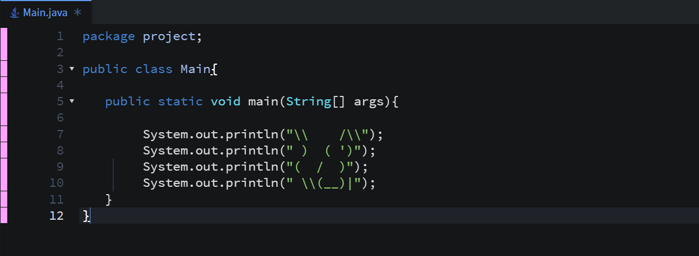
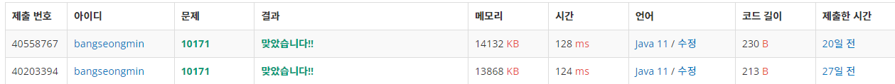

## **1. 문제**

---

### **2. 간략 설명**

**1) 1가지 풀이 방법을 이용한다.**

**- System 클래스를 이용합니다.**

**2) Escape Sequance**

**- 이스케이프 시퀀스에 대해서 알아야 합니다.**

### **3. 풀이**

**- 방법 1**

**- 실행결과**

### **4. 정리**

**핵심이라면 이스케이프 문자일 것 같습니다.****이스케이프 문자를 학습은 많이 봤지만.. 할때마다 까먹는 것은... 현실입니다... ㅠㅠ****저도 구름 IDE에서 여러번 테스트한 후에 코드를 완성하게 되었습니다.**
