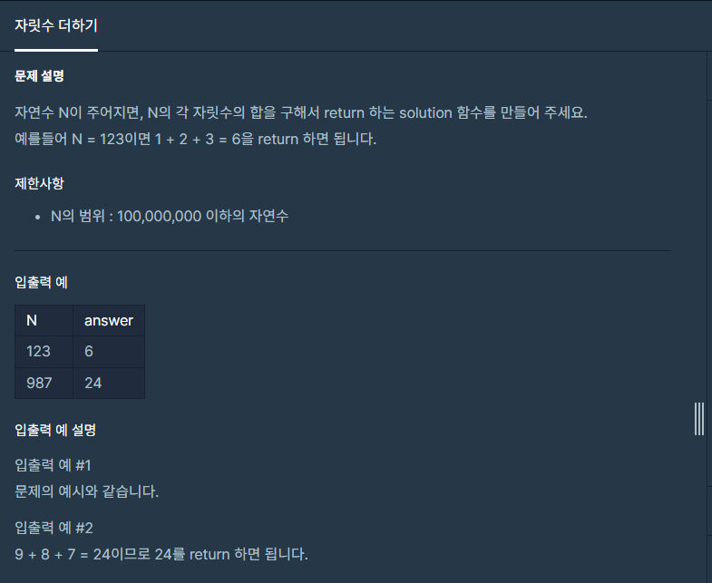

#### **#P. 21 : 이상한 문자 만들기 (난이도 : 중하)**



* 풀이 방법  
  + 1.입력 값을 10으로 나누어 나머지 값은 더하고, 입력값을 10으로 반복해서 입력값이 0보다 클때동안 반복한다.

```
public class Exam22 {
    public static void main(String[] args) {
        long start = System.nanoTime();
        System.out.println(solution(99999999));
        long end = System.nanoTime();
        System.out.println("수행시간: " + (end - start) + " ns");
    }

    // 554100
    public static int solution(int n) {
        int sum = 0;
        while (n> 0){
            sum += n %10;
            n = n /10;
        }
        return sum;
    }
}
```
