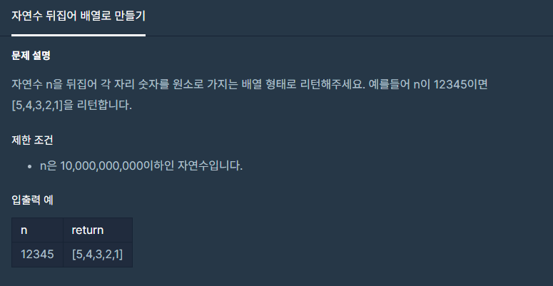

#### **#P. 23 : 자연수 뒤집어 배열로 만들기 (난이도 : 중하)**



* 풀이 방법  
  + 1. 입력받은 값을 String 타입으로 받아서 크기만큼 정수형 배열 만든다.
  + 2. 반복문을 통해 나눗셈 연산자를 이용하여 풀이한다.

```
public class Exam23 {
    public static void main(String[] args) {
        long start = System.nanoTime();
        System.out.println(solution(12345));
        long end = System.nanoTime();
        System.out.println("수행시간: " + (end - start) + " ns");
    }

    // 554100
    public static int[] solution(int n) {
        int[] answer = new int[String.valueOf(n).length()];
        int idx = 0;
        while (n > 0){
            answer[idx] = (int)(n % 10);
            n /= 10;
            idx++;
        }
        return answer;
    }
}
```

---

* 유사 문제  
  1. [자릿수 더하기](tistory-81.html)
