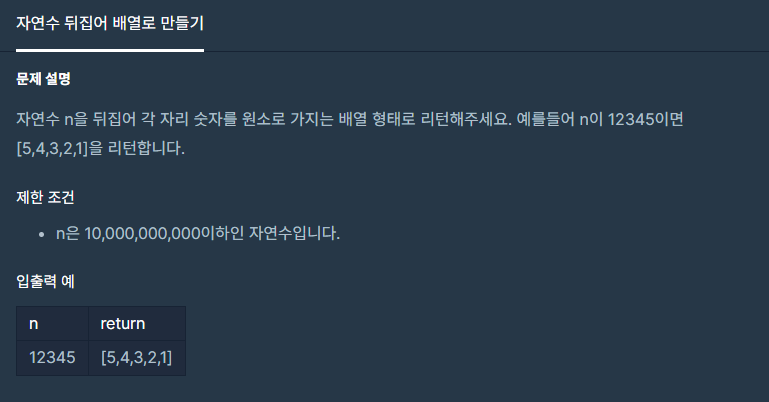

#### **#P. 24 : 이상한 문자 만들기 (난이도 : 중하)**



* 풀이 방법  
  + 1. StringBuilder를 이용하여 카운팅 정렬 방식에서 정렬을 제거한 상태
  + 2. Arrays.sort를 이용한 방법

```
public static long solution(long n) {
    StringBuilder sb = new StringBuilder();
    String num = String.valueOf(n);
    long[] arr = new long[10];
    // 카운팅 정렬
    for(int i=0; i<num.length();i++){
        arr[(int)(n %10)]++;
        n = n /10;
    }

    for(int i=9; i>=0;i--){
        if(arr[i] > 0){
            for(int j=0; j<arr[i]; j++){
                sb.append(i);
            }
        }
    }

    return Long.parseLong(sb.toString());
}

// 4217200
public static long test2(long n){
    String[] arr= Long.toString(n).split("");
    Arrays.sort(arr, Comparator.reverseOrder());
    StringBuilder sb = new StringBuilder();
    for(String str : arr){
        sb.append(str);
    }
    return Long.parseLong(sb.toString());
}
```

---

* 유사 문제  
  + [자릿수 더하기](tistory-81.html)
  + [자연수 뒤집어 배열로 만들기](tistory-82.html)
