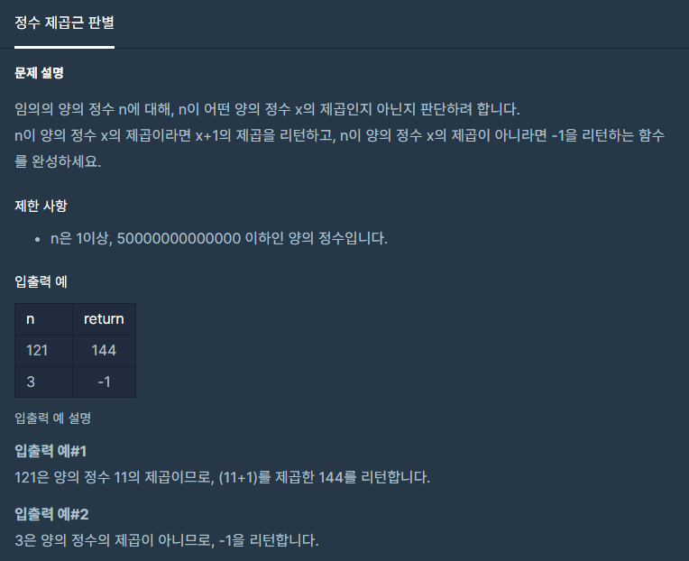

#### **#P. 25 : 정수 제곱근 판별 (난이도 : 중하)**



* 풀이 방법  
  + 1. Math.sqrt와 Math.pow 활용

```
public static long solution(long n) {
    Double d = Math.sqrt(n);
    return d.intValue() == d ? (long) Math.pow(d + 1, 2):-1;
}
```
