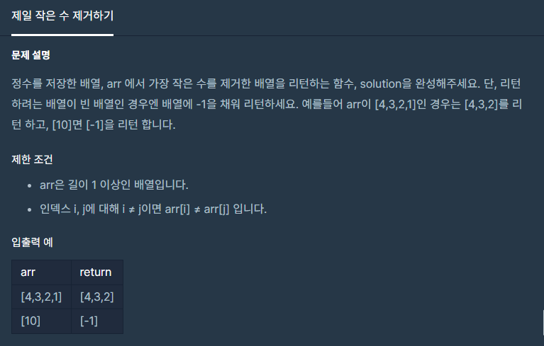

#### **#P. 26 : 제일 작은 수 제거하기 (난이도 : 중하)**

#### 



#### 

* 풀이 방법  
  + 1. Arrays클래스 이용
  + 2. 반복문을 이용한 풀이법

```
public static int[] solution(int[] arr) {
    if (arr.length <= 1) return new int[]{-1};
    int min = Arrays.stream(arr).min().getAsInt();
    return Arrays.stream(arr).filter(i -> i != min).toArray();
}

public static int[] solution1(int[] arr) {
    int min = arr[0];
    int[] answer = new int[arr.length - 1];

    if (arr.length <= 1) {
        int[] answer2 = { -1 };
        return answer2;
    }


    for (int i = 0; i < arr.length; i++) {

        if (min > arr[i]) {
            min = arr[i];
        }

    }
    int index = 0;
    for (int j = 0; j < arr.length; j++) {
        if (min == arr[j]) {
            continue;
        } else {
            answer[index++] = arr[j];
        }

    }


    return answer;
}
```

####
