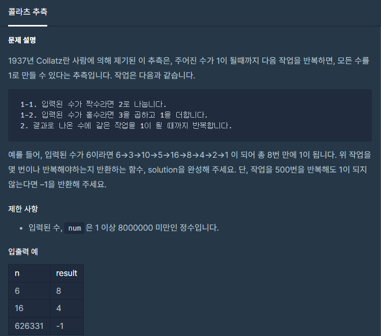

#### **#P. 27 : 이상한 문자 만들기 (난이도 : 중하)**



* 풀이 방법  
  + 1. 반복문을 이용한 풀이
  + 2. 재귀함수를 통한 풀이

```
public static int solution(int num) {
    int answer = 0;
    long n = Long.valueOf(num);
    while(n!=1) {
        if(n%2==0) {
            n /= 2;                       // int 범위 를 넘어가서
        } else {
            n = 3*n + 1;
        }

        answer++;
        if(answer==500) {
            answer=-1; break;
        }
    }
    return answer;
}

static int count = 0;
public static int test(int n){
    if(count >= 450)
        return -1;
    if (n == 1)
        return count;
    else{
        count++;
        if(n%2==0){
            return test(n/2);
        }else{
            return test(n*3+1);
        }
    }
}
```
