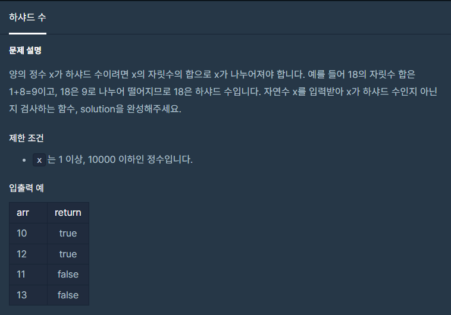

#### **#P. 28 : 제일 작은 수 제거하기 (난이도 : 중하)**



* 풀이 방법  
  + 1. String 배열을 이용한 풀이
  + 2. 반복문을 이용한 풀이법

```
public static boolean solution(int n) {
    String[] str = String.valueOf(n).split("");
    int div = 0;
    for(String s : str){
        div += Integer.parseInt(s);
    }
    return n % div ==0 ? true:false;
}

// 401901
public static boolean solution2(int n) {
    int div = 0, x = n;
    while (n > 0){
        div += n%10;
        n/=10;
    }
    System.out.println(div);
    return x % div ==0 ? true:false;
}
```
