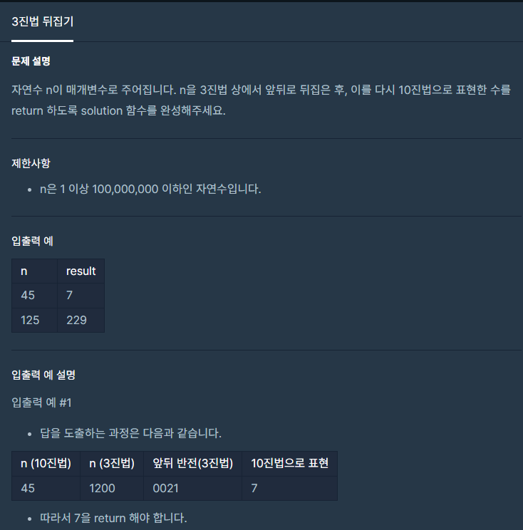

#### **#P. 29 : 제일 작은 수 제거하기 (난이도 : 중)**



* 풀이 방법  
  + 1. StringBuilder 활용  
    - 입력 값을 3진법으로 저장하여 StringBuilder에 삽입  
    - 삽입된 값을 reverse하여 전환하고 그 값을 다시 10진법으로 돌려준다.

```
public static int solution(int n) {
    StringBuffer sb = new StringBuffer();
    sb.append(Integer.toString(n , 3));             // 3진법으로 변형 -> Sb 넣고
    sb.reverse();                                         // reverse 해서
    return Integer.parseInt(String.valueOf(sb), 3); // 10진법으로
}
```
